# CI 글꼴 독립 수식 계약과 실제 출력 대조

Issue: #7642 / PR: #8064

CI의 사설 글꼴 미설치로 수식 글자를 usvg가 누락한 검사 결함을 보정한다. 제품 엔진·문서·기준 PDF·기준 좌표는 바꾸지 않았다. 양방향 장식은 저장소의 공개 Latin Modern Math를 명시해 실제 AB 윤곽을 검사한다. 한컴 PUA 아래첨자는 다른 글리프로 치환하지 않고 최종 SVG 원문의 문자 보존·단일 방출과 실제 조상 변환 후 분모보다 낮은 기준선을 검사한다. 이 검사는 사설 글리프의 픽셀 모양을 검사한다고 주장하지 않는다. 실제 모양은 별도의 Native/fresh WASM·독립 Print 대조로 확인했다.

## 현재 엔진의 새 전쪽 대조

엔진 source `d7d4d2ea6ed427f2f3bc8b59a936a5f99aca852b`와 현재 후보의 제품 소스 동일성을 확인한 뒤 같은 Native/fresh WASM producer로 새로 출력했다. Native SHA-256 `fb3c6d537ad5ae92f57b66d8f77a86f14e53619b91136d3d0a4e932153cf143a`, WASM SHA-256 `24ff17cf6906c3779a268fd9b9bd43a8658fd493c5c3148242947d7488aa747c`. Print/96 DPI, PDFium153, 판정은 색상 경계 보정 전2px raw다.

| 입력 | 독립 PDF | 쪽수 | Native 최저·TSV | fresh WASM 최저·TSV |
| --- | --- | ---: | --- | --- |
| `samples/issue7593/repro-equation-issue7593.hwpx` | `pdf/issue7593/repro-equation-issue7593-hwpx-2020.pdf` | 1/1 | [99.77969%](native-dyad.tsv) | [99.88334%](wasm-dyad.tsv) |
| `pdf/issue7642-extended-base-script-diagnostic/extended-base-script-2024.hwp` | `pdf/issue7642-extended-base-script-diagnostic/extended-base-script-2024.pdf` | 1/1 | [100.00000%](native-fraction.tsv) | [100.00000%](wasm-fraction.tsv) |
| `pdf/issue7642-extended-base-script-diagnostic/extended-base-script-v4-2024.hwp` | `pdf/issue7642-extended-base-script-diagnostic/extended-base-script-v4-2024.pdf` | 4/4 | [99.91615%](native-root-index.tsv) | [99.93071%](wasm-root-index.tsv) |

- `dyad` 원본 SHA-256 `88a3683c34e92f8887e54b9b379f8c399a8ec844e46e127793c6486cba8d31ec` / Print SHA-256 `206b9fc127a8f40e63fc49ba86ebd455f7d4e651e1f32dbf68d3915052d9f8db`.
- `fraction` 원본 SHA-256 `b56f792854da2126022f19a9b82b1054621568647024295c05e112e55c3e82fc` / Print SHA-256 `bf86189aec6cf835f5546ef556c2bc5900c9708e8193f244dc5b133e1a6c7e18`.
- `root-index` 원본 SHA-256 `0a1bc853a2527acc1c2f5fd4aa7cb0823ac1119eedf7ff8788da77ebd7e6b519` / Print SHA-256 `e5f3d54d44f78cbec08c572d5075fba836f9f0111c0200955ac668fe6a25dfb0`.

전체 6쪽을 양쪽에서 비교했고 90% 미만·누락·쪽수 불일치는 0이다. dyad 1쪽·분수 1쪽·근 지수 4쪽의 review/overlay를 같은 배율로 판독했다. 아래첨자·분모·제곱·근 지수와 AB/화살표·뒤 본문 간격을 확인했다. 글리프 굵기·안티앨리어싱·가장자리 잔차가 있으며 raw 100%를 동일 이미지로 해석하지 않는다.

실행 명령·입력/Print 해시·원문 TSV는 로컬 `stage4183-ci-failure-analysis/{sweep.py,sweep-receipt.json}`에 있고, 원래 조판 결함의 수정 전 FAIL/수정 후 PASS는 기존 stage171·165 기록과 연결한다. 이번 글꼴 공급 보정은 조판 엔진의 추가 개선으로 보고하지 않는다.

## 대표 PNG

### native dyad 1쪽

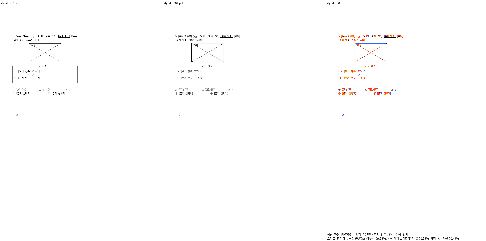

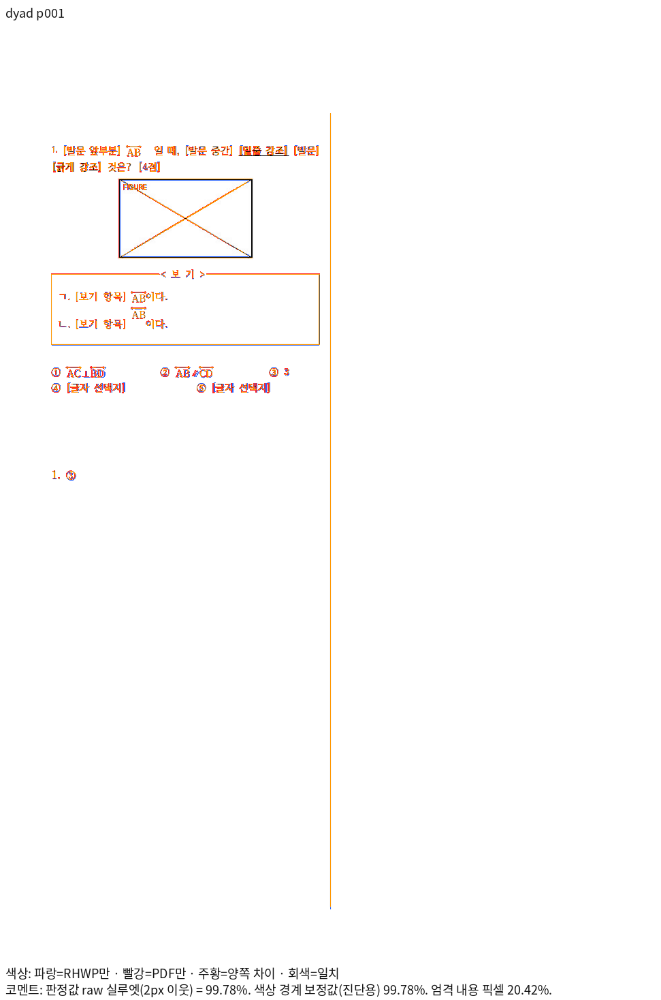

### native fraction 1쪽

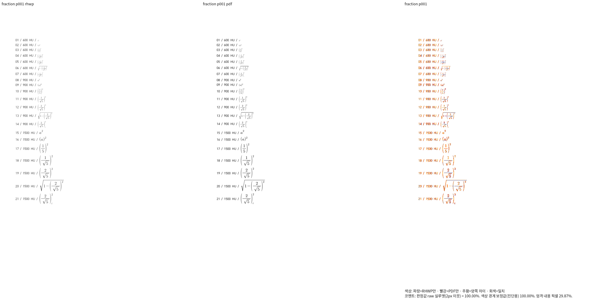

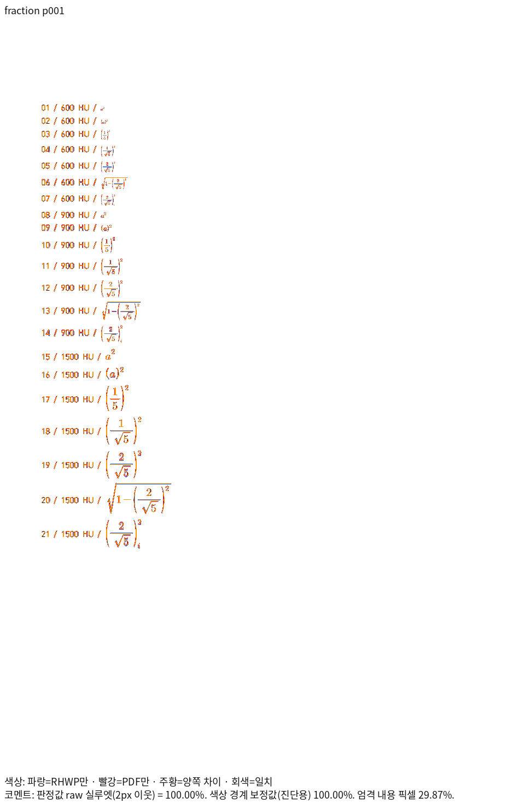

### native root-index 4쪽

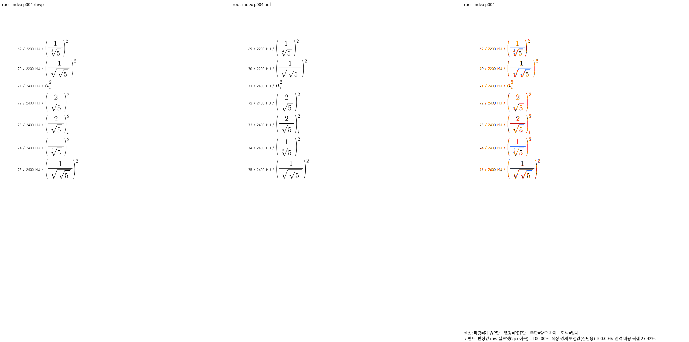

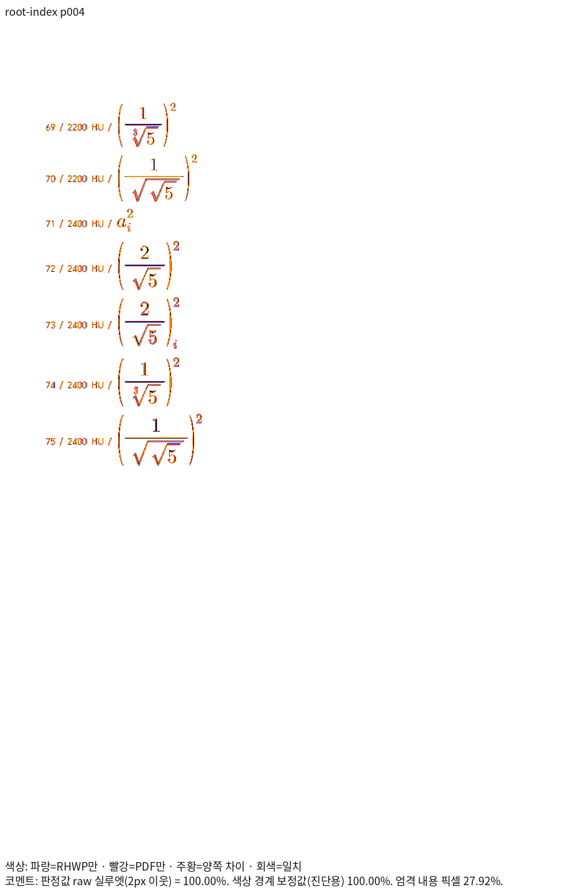

### wasm dyad 1쪽

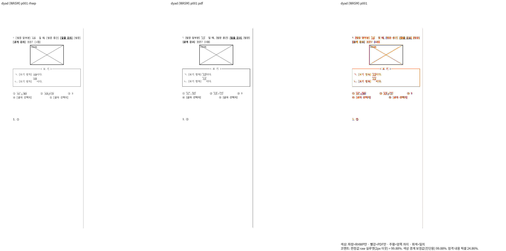

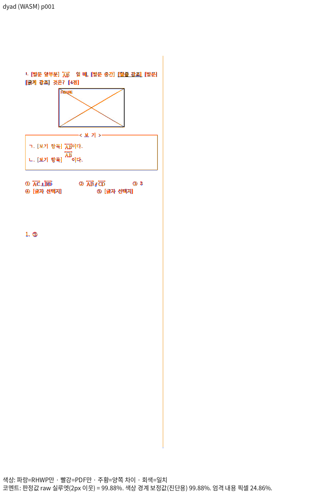

### wasm fraction 1쪽

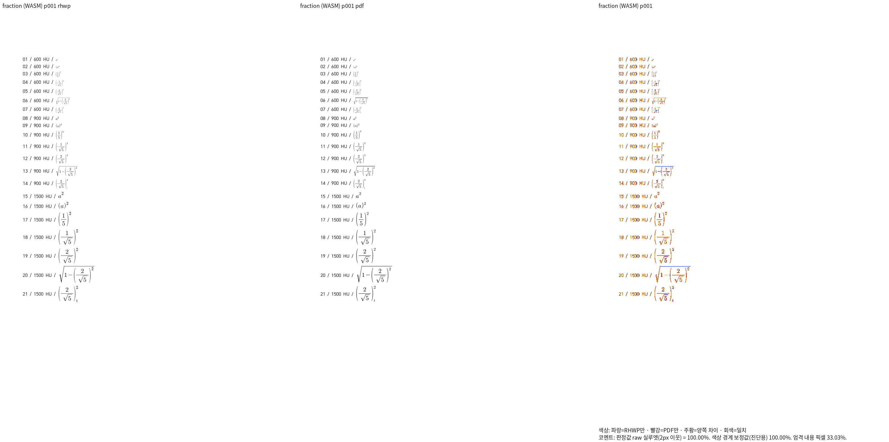

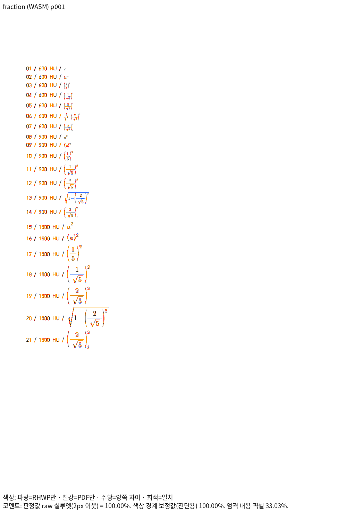

### wasm root-index 4쪽

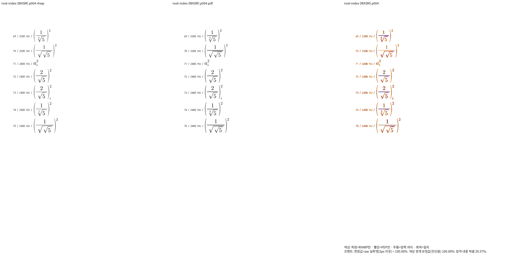

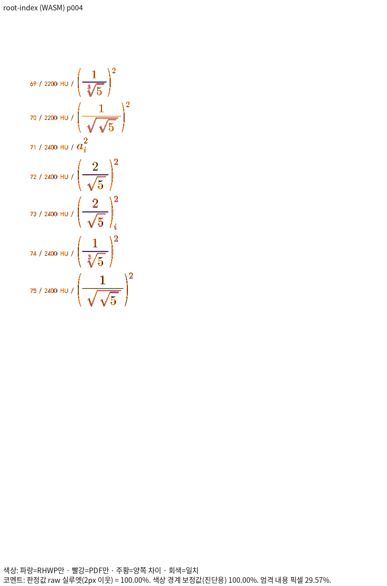

## 고정 devel과 추가 전쪽 대조

코드 PR의 기준은 `224a326063a5aeab5a1ca8dcaa92918f55843ffc`, 실제 base producer는 런타임 동등성을 확인한 `6ed1682c3267ea786734eb2e75252916a861d1fd`다. 같은 원본·Print·96 DPI·시스템 글꼴·backend로 Native/fresh WASM 각각 6쪽을 비교했다. 모든 12개 페이지 쌍이 개선됐으며 쪽수 불일치·누락·측정 불가는 없다. base의 90% 미달로 발생한 exit 1은 측정 실패가 아니다. 후보는 전쪽 90% 이상이다.

| backend | 입력 | 쪽 | base raw | 후보 raw |
| --- | --- | ---: | ---: | ---: |
| native | dyad | 1 | 82.88512% | 99.77969% |
| native | fraction | 1 | 92.73837% | 100.00000% |
| native | root-index | 1 | 98.37327% | 100.00000% |
| native | root-index | 2 | 92.78212% | 99.98097% |
| native | root-index | 3 | 84.36851% | 99.91615% |
| native | root-index | 4 | 75.20913% | 100.00000% |
| wasm | dyad | 1 | 82.22342% | 99.88334% |
| wasm | fraction | 1 | 92.93997% | 100.00000% |
| wasm | root-index | 1 | 98.39156% | 100.00000% |
| wasm | root-index | 2 | 93.87706% | 99.98588% |
| wasm | root-index | 3 | 87.82830% | 99.93071% |
| wasm | root-index | 4 | 80.64814% | 100.00000% |

| 입력 | base Native 원문 | base fresh WASM 원문 |
| --- | --- | --- |
| dyad | [TSV](base-native-dyad.tsv) | [TSV](base-wasm-dyad.tsv) |
| fraction | [TSV](base-native-fraction.tsv) | [TSV](base-wasm-fraction.tsv) |
| root-index | [TSV](base-native-root-index.tsv) | [TSV](base-wasm-root-index.tsv) |
