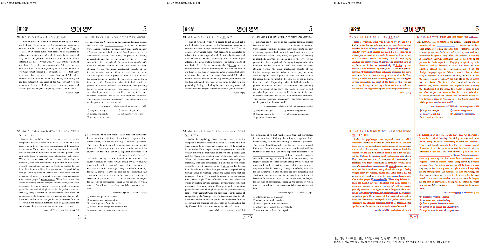
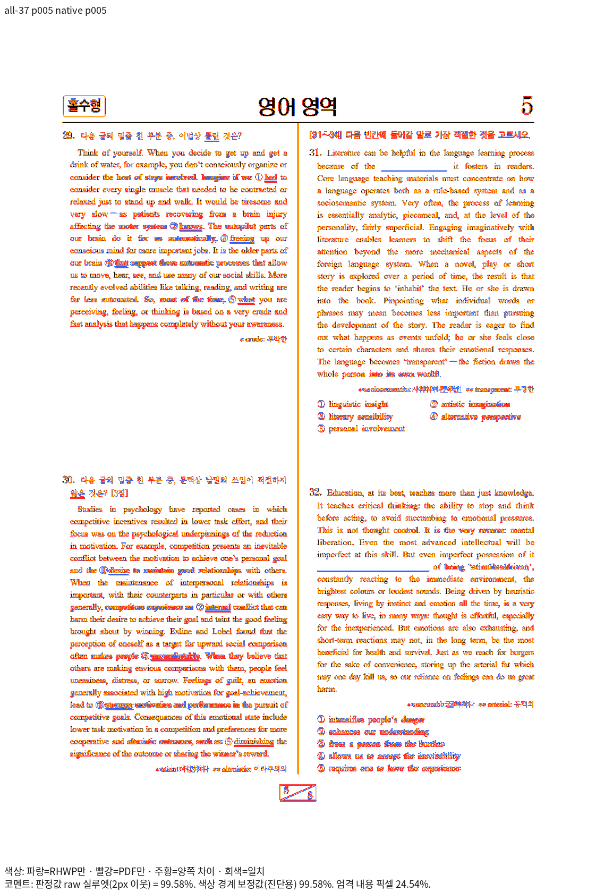
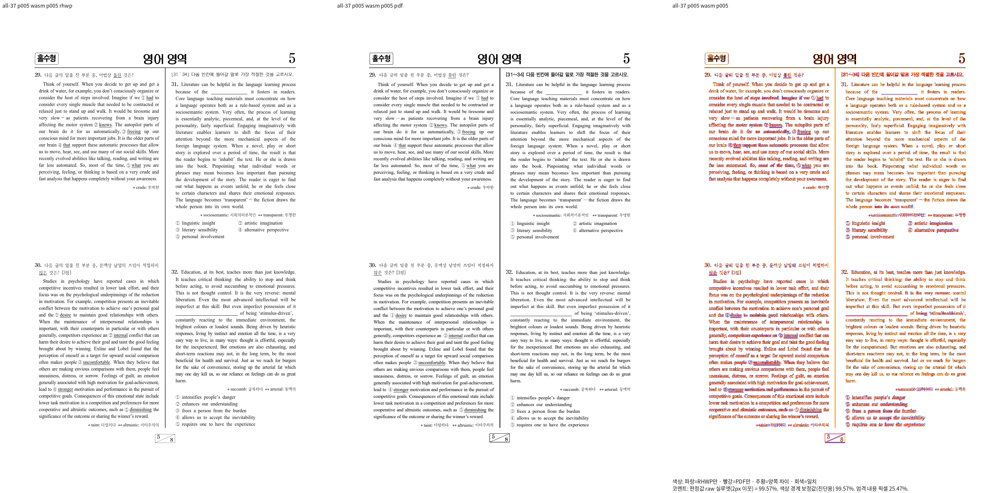
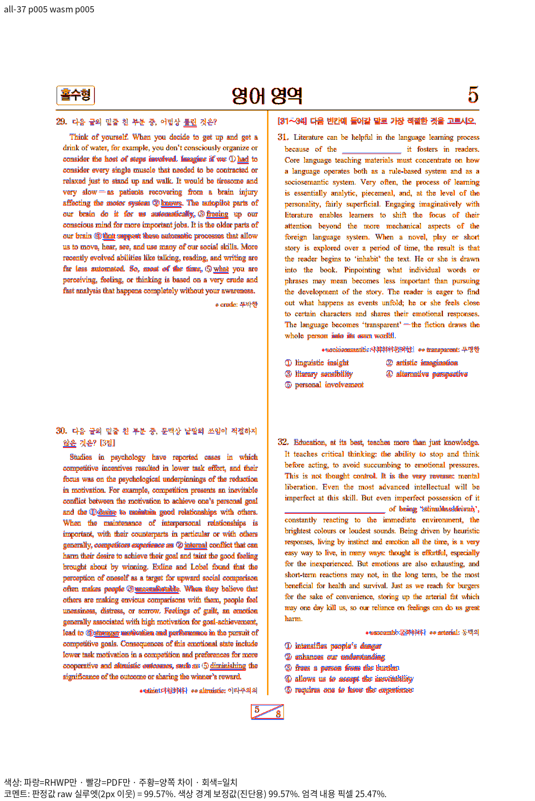

# 영어 중립 공백: 독립 Print 대조와 새 회귀

- 입력: `samples/exam_eng.hwp`, SHA-256 `7a5755a2f773fce4d295cbfeb1c5d722edb02c7f920bb067fa56940e8cd6a05b`.
- 기준: `pdf/issue7642-exam-print/exam-02-exam_eng-hwp-print-2020.pdf`, 원본 그대로 한컴 2020 Print, SHA-256 `08b34c32089b73b5535bd59c38171e698e0b11932c66c4172c54b01a796b2102`.
- 최신 출력 source: `d7d4d2ea6ed427f2f3bc8b59a936a5f99aca852b`. Native binary SHA-256 `fb3c6d537ad5ae92f57b66d8f77a86f14e53619b91136d3d0a4e932153cf143a`.
- fresh WASM SHA-256 `24ff17cf6906c3779a268fd9b9bd43a8658fd493c5c3148242947d7488aa747c`, root/Studio 네 파일 동일.
- Print 프로필, 실제 CLI `--compat 2022`(비2024 기본 조판 경로), 기준 PDF는 한컴 2020 Print, 96 DPI, 좌상단 원점 CSS px, 전체 8쪽. 기본 시스템 글꼴과 `assets/fonts`를 공급했다.
- 전쪽 원본 TSV: [Native](native-silhouette.tsv), [fresh WASM](wasm-silhouette.tsv). 최저 raw는 각각 **97.10866% / 96.88952%**이며 쪽수 8/8이다.
- base `224a326063a5aeab5a1ca8dcaa92918f55843ffc`와 같은 원본/PDF/폰트/도구 비교에서 0.1%p 이상 하락한 쪽은 0이다. base producer `6ed1682c3267ea786734eb2e75252916a861d1fd`와 해당 base의 엔진 경로가 동일함을 Git diff로 확인했다.

## 직접 판독과 페이지 선택

5쪽의 양쪽 raw는 **Native 99.58462% / WASM 99.56831%**다. 같은 공백 전진을 검증할 수 있는 1쪽(양쪽 최솟값 98.90717%)보다 99%대인 5쪽을 좌표 회귀 대상으로 우선했다. 양쪽 review·overlay를 직접 열어 문29/30의 한글 지시문·공백, 영문 줄바꿈·밑줄·보기 번호, 오른쪽 문31/32와 빈칸, 쪽번호·단 경계를 대조했다. 내용의 누락·중복이나 잘못된 단 소속은 없으며, 글꼴 가장자리·일부 강조 획의 작은 잔차는 남는다. 완전한 픽셀 동일로 보고하지 않는다.

## 독립 기대값과 실제 검사

`tests/cases/verified_english_neutral_space_ownership.rs`를 새 이름으로 추가한다. 첫 검사는 첫 문항 첫 선택지를 원문 내용으로 선택하고, 원본의 서로 다른 영문/한글 상대 크기·장평을 확인한 뒤 공백 전진/상속 em 비율 0.49–0.51, 내용 순서·공백 수·소유를 검사한다. `stage4083`의 같은 술어는 수정 전 실제 캐시 라이브러리에서 **0.55652로 FAIL**, `stage4085`의 후보에서 PASS했다. 캐시의 정확한 source SHA를 추정하지 않고 그 실행의 라이브러리 바이트 해시를 영수증에 남겼다.

별도 5쪽 검사는 문29 지시문을 원문으로 선택하여 다른 쪽의 중복 부재·전체 내용 보존·전진 순서를 유지한다. 독립 PDF의 glyph origin(pt)을 96/72로 환산한 `다=(151.199992,227.039998)`, `어=(336.480001,227.039998)`, `것=(419.679972,227.039998)`을 각각 ±2px로 검사한다. 후보의 RenderTree 좌표를 기대값으로 복사하지 않았다. 이 좌표 검사의 수정 전 실행 여부는 첫 비율 검사의 수정 전 실패 증거와 구분한다.

추가 독립 MCP 공백 대조군 24조건에서도 한글/기호 em의 반각이 관찰됐다(`stage4096`). 같은·다른 영문 face, 다른 장평·상대 크기, 글자 위치 -12/0/+12를 포함하며, 합성 대조군은 이 실물 원본의 전쪽 검증을 대신하지 않는다.

실행 명령·producer·입력/출력 해시·확대 판독은 작업 기록 `mydocs/working/task_m100_7642_stage3905.md`의 stage4082–4103을 따른다. 정식 suite의 최종 실행 결과는 해당 검증 완료 뒤 작업 기록에 별도로 연결한다.

## 최종 후보 재출력

`stage4144`에서 같은 원본·PDF의 전8쪽을 양쪽 재출력했다. 전체 최저와 완료5쪽 점수가 위 값으로 유지됐고, 이 폴더의 TSV·대표 PNG를 실제 최신 출력으로 갱신했다. 런타임 공백 보정 source는9636에서 도입됐으며, 그 당시 before/after 증거와 최신 재출력을 구분한다.
