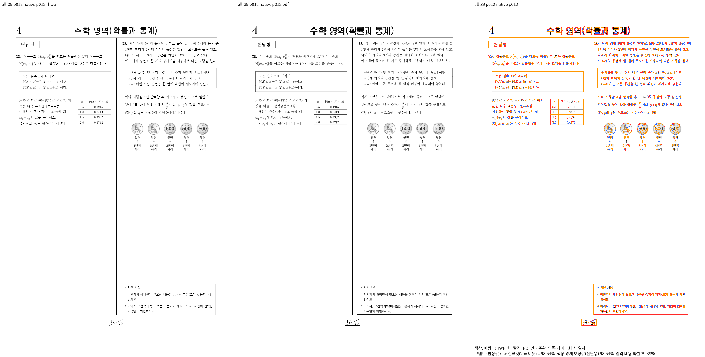
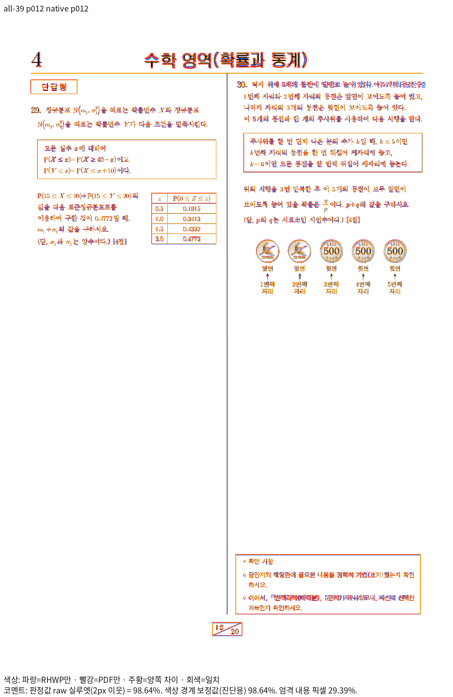
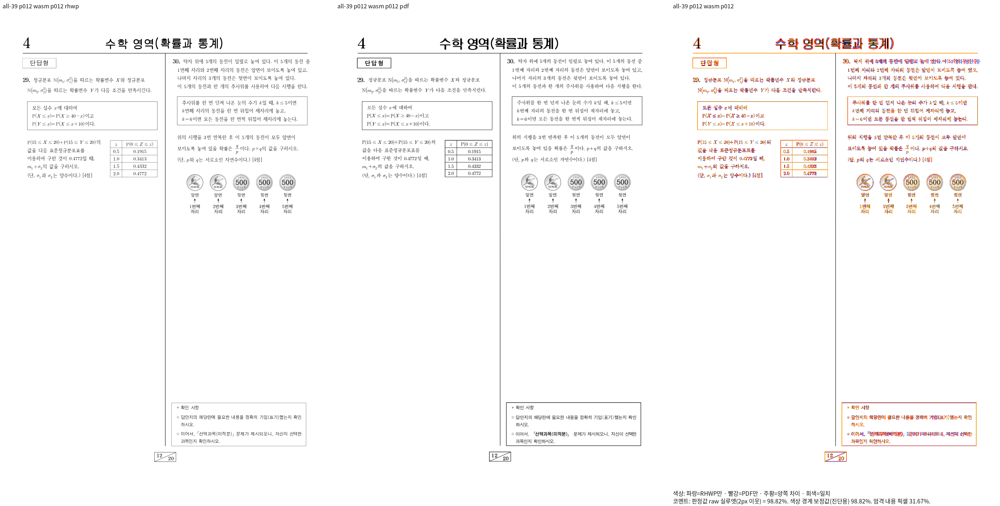
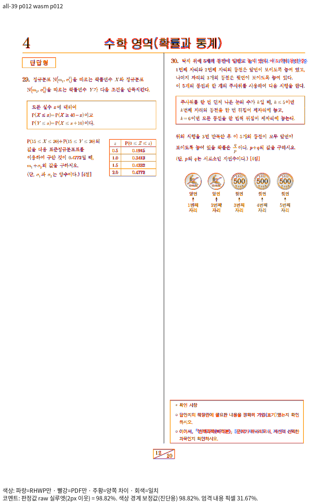

# 시험지 52개 원본의 내용·소유·쪽 소속 회귀

엔진 source는 `d7d4d2ea6ed427f2f3bc8b59a936a5f99aca852b`다. 원본 파일별 새 이름의 검사 52개를 `tests/cases/verified_exam_source_content_and_pages.rs`에 추가했다. 다른 PR에서 제거한 옛 시험지 검사와 이름·수집 경로가 겹치지 않는다.

## 독립 근거와 검사 범위

- [전쪽 Native/fresh WASM 원본 TSV 색인](../final_sweep_20261019/README.md)의 같은 원본·독립 한컴 Print PDF를 사용했다. 52개 모두 전쪽 raw 90% 이상이며 쪽수가 같다. 글꼴 예외를 사용하지 않았다.
- [불변 입력·독립 PDF·선택 페이지·벡터 좌표](../../../../../tests/fixtures/verified_exam_source_pages.tsv)에 SHA-256을 기록했다. DPI는 96, 좌상단 원점이며 PDF point에 96/72를 곱했다. `compat=2022`는 기존 엔진의 2024 이전 호환 프로필 이름이다. 한컴 Print 출력 제품을 2022로 새로 선택했다는 뜻이 아니다.
- 원본 IR의 비어 있지 않은 수식 script 다중집합과 전쪽 실제 수식 다중집합을 대조해 누락·중복을 검사한다. 각 수식의 원본 문단과 본문/각주/미주 소유, 수식을 가진 각주·미주의 원래 읽기 순서를 함께 확인한다.
- 고유 본문을 내용으로 찾고 독립 Print의 물리 쪽 소속, 원본 문단 소유, 글자 전진 순서를 검사한다. 원본 셀 문단은 `cell_context.parent_para_index`로 최외곽 소유에 연결한다. 미주 표 안 수식의 배치용 인덱스는 공개 pagination 원본 연결로 해석한다. 이를 원본 본문 인덱스로 직접 사용하지 않는다.
- 완료 페이지는 Native/WASM raw의 작은 값을 기준으로 100% → 99%대 → 98%대 순서로 선택했다. 의미 있는 독립 본문이 있는 쪽 중 최고 점수 쪽을 사용했다. 50개 문서에는 독립 PDF에서 선택한 중앙의 긴 단 구분선 또는 첫 긴 본문 상단 경계의 시작점 x/y를 ±2px로 보호한다. 선 끝점·모든 글자 좌표·전체 SVG를 고정했다는 뜻은 아니다.
- `eq-002.hwp`/`eq-002.hwpx`는 양쪽 98% 이상인 페이지가 없어 px 검사를 추가하지 않고 수식 보존·원본 소유·본문 쪽 소속 관계만 검사한다.
- PDF의 글자 origin과 렌더러의 run pen 원점을 일률적으로 같다고 가정했던 초안은 사용하지 않는다. 확대 대조에서 글자 굵기·전진의 잔차는 남아 있다. 새 px 계약은 글꼴 pen 비교가 아니라 실제 구조 경계 시작점에 한정한다. PDF 선을 Rectangle로 그리는 문단 테두리도 네 변의 실제 좌표로 찾는다.
- 아래 `review_01`~`07`은 Native / Print / fresh WASM, `overlay_01`~`07`은 Native / Print와 WASM / Print의 동일 배율 확대다. 이 진단 crop의 점수를 전쪽 gate로 사용하지 않는다. 위치·본문 내용·구조 경계와 남은 글자 굵기 차이를 직접 판독했다.
- `math-p012-*`는 사용자가 지적한 원본 수학 시험지 12쪽의 최신 전체 review/standalone overlay다. Native 98.64024%, fresh WASM 98.82481%이며, 이전 머리글 4의 가로 어긋남과 문항 29/30, 정규분포 표·동전·꼬리말 대응을 직접 대조했다.
- `lowest-wasm-p011-*`는 전체 검증 최저인 온새미로 HWP 11쪽(90.10782%)의 기능 보존 대조다. 글자 형태·선 굵기·작은 간격 잔차를 보존 기록과 구분하며 이번 시험지 수정의 완료나 새 개선으로 주장하지 않는다.

## 문서별 전쪽 최저와 완료 페이지

| 조건 | 원본 | 전체 쪽수 | 전쪽 최저 Native / WASM | 선택 쪽 | 선택 쪽 Native / WASM | px 경계 시작점 |
| --- | --- | ---: | --- | ---: | --- | --- |
| all-01 | `samples/21_언어_기출_편집가능본.hwp` | 15 | 95.19794% / 95.24383% | 4 | 99.98215% / 99.98957% | ±2px |
| all-02 | `samples/3-09월_교육_통합_2022.hwp` | 23 | 95.05435% / 95.37371% | 17 | 99.64942% / 99.63511% | ±2px |
| all-03 | `samples/3-09월_교육_통합_2022.hwpx` | 23 | 95.08296% / 95.40193% | 17 | 99.68679% / 99.67105% | ±2px |
| all-04 | `samples/3-09월_교육_통합_2023.hwp` | 20 | 97.67861% / 97.55892% | 3 | 99.43661% / 99.41564% | ±2px |
| all-05 | `samples/3-09월_교육_통합_2023.hwpx` | 20 | 97.72531% / 97.60553% | 3 | 99.48024% / 99.45816% | ±2px |
| all-06 | `samples/3-09월_교육_통합_2024-격자기준종이.hwp` | 23 | 95.08296% / 95.40193% | 17 | 99.68679% / 99.67105% | ±2px |
| all-07 | `samples/3-09월_교육_통합_2024-격자기준쪽.hwp` | 23 | 95.08296% / 95.40193% | 17 | 99.68679% / 99.67105% | ±2px |
| all-08 | `samples/3-09월_교육_통합_2024-구분선아래20.hwp` | 23 | 95.08296% / 95.40193% | 17 | 99.68679% / 99.67105% | ±2px |
| all-09 | `samples/3-09월_교육_통합_2024-구분선아래20구분선위20.hwp` | 23 | 95.08823% / 95.40721% | 17 | 99.68679% / 99.67105% | ±2px |
| all-10 | `samples/3-09월_교육_통합_2024-구분선아래20구분선위20.hwpx` | 23 | 95.08823% / 95.40721% | 17 | 99.68679% / 99.67105% | ±2px |
| all-11 | `samples/3-09월_교육_통합_2024-미주사이20.hwp` | 24 | 96.48033% / 96.74455% | 6 | 99.58597% / 99.55530% | ±2px |
| all-12 | `samples/3-10월_교육_통합_2022.hwp` | 18 | 98.07832% / 98.11724% | 3 | 99.54567% / 99.54981% | ±2px |
| all-13 | `samples/3-10월_교육_통합_2022.hwpx` | 18 | 98.11499% / 98.15247% | 3 | 99.58470% / 99.58768% | ±2px |
| all-14 | `samples/3-11월_실전_통합_2022.hwp` | 21 | 97.56166% / 97.61215% | 9 | 99.83240% / 99.83548% | ±2px |
| all-15 | `samples/3-11월_실전_통합_2022.hwpx` | 21 | 97.61256% / 97.66388% | 9 | 99.89051% / 99.89165% | ±2px |
| all-16 | `samples/3-11월_실전_통합_2024-구분선없음구분선위20미주사이20구분선아래20.hwp` | 22 | 97.61256% / 97.66388% | 9 | 99.89057% / 99.89201% | ±2px |
| all-17 | `samples/3-11월_실전_통합_2024-구분선없음구분선위20미주사이20구분선아래20.hwpx` | 22 | 97.61256% / 97.66388% | 9 | 99.89051% / 99.89165% | ±2px |
| all-18 | `samples/3-11월_실전_통합_2024-구분선위0미주사이0구분선아래0.hwp` | 21 | 96.49787% / 96.57753% | 9 | 99.89057% / 99.89201% | ±2px |
| all-19 | `samples/3-11월_실전_통합_2024-구분선위0미주사이0구분선아래0.hwpx` | 21 | 96.49787% / 96.57753% | 9 | 99.89051% / 99.89165% | ±2px |
| all-20 | `samples/3-11월_실전_통합_2024-구분선위0미주사이20구분선아래2.hwp` | 22 | 97.61256% / 97.66388% | 9 | 99.89057% / 99.89201% | ±2px |
| all-21 | `samples/3-11월_실전_통합_2024-구분선위0미주사이20구분선아래2.hwpx` | 22 | 97.61256% / 97.66388% | 9 | 99.89051% / 99.89165% | ±2px |
| all-22 | `samples/3-11월_실전_통합_2024-구분선위0미주사이7구분선아래2.hwp` | 21 | 97.61256% / 97.66388% | 9 | 99.89057% / 99.89201% | ±2px |
| all-23 | `samples/3-11월_실전_통합_2024-구분선위0미주사이7구분선아래2.hwpx` | 21 | 97.61256% / 97.66388% | 9 | 99.89051% / 99.89165% | ±2px |
| all-24 | `samples/3-11월_실전_통합_2024-구분선위0미주사이7구분선아래20.hwp` | 21 | 97.61256% / 97.66388% | 9 | 99.89057% / 99.89201% | ±2px |
| all-25 | `samples/3-11월_실전_통합_2024-구분선위0미주사이7구분선아래20.hwpx` | 21 | 97.61256% / 97.66388% | 9 | 99.89051% / 99.89165% | ±2px |
| all-26 | `samples/3-11월_실전_통합_2024-구분선위20미주사이0구분선아래20.hwp` | 21 | 96.49787% / 96.57753% | 9 | 99.89057% / 99.89201% | ±2px |
| all-27 | `samples/3-11월_실전_통합_2024-구분선위20미주사이0구분선아래20.hwpx` | 21 | 96.49787% / 96.57753% | 9 | 99.89051% / 99.89165% | ±2px |
| all-28 | `samples/3-11월_실전_통합_2024-구분선위20미주사이7구분선아래2.hwp` | 21 | 97.61256% / 97.66388% | 9 | 99.89057% / 99.89201% | ±2px |
| all-29 | `samples/3-11월_실전_통합_2024-구분선위20미주사이7구분선아래2.hwpx` | 21 | 97.61256% / 97.66388% | 9 | 99.89051% / 99.89165% | ±2px |
| all-30 | `samples/3-11월_실전_통합_2024-구분선위9미주사이8구분선아래7.hwp` | 21 | 97.64288% / 97.68557% | 9 | 99.89057% / 99.89201% | ±2px |
| all-31 | `samples/3-11월_실전_통합_2024-구분선위9미주사이8구분선아래7.hwpx` | 21 | 97.61256% / 97.66388% | 9 | 99.89051% / 99.89165% | ±2px |
| all-32 | `samples/eq-002.hwp` | 1 | 93.52679% / 93.76592% | 1 | 93.52679% / 93.76592% | 관계 검사만 |
| all-33 | `samples/exam-kor-1p.hwp` | 1 | 99.76684% / 99.76577% | 1 | 99.76684% / 99.76577% | ±2px |
| all-34 | `samples/exam-kor-2p.hwp` | 2 | 99.36253% / 99.36330% | 1 | 99.76684% / 99.76577% | ±2px |
| all-35 | `samples/exam-kor-3p.hwp` | 3 | 98.84014% / 98.88842% | 1 | 99.76684% / 99.76577% | ±2px |
| all-36 | `samples/exam-kor-4p.hwp` | 4 | 98.77781% / 98.82952% | 4 | 99.97163% / 99.97213% | ±2px |
| all-37 | `samples/exam_eng.hwp` | 8 | 97.10866% / 96.88952% | 5 | 99.58462% / 99.56831% | ±2px |
| all-38 | `samples/exam_kor.hwp` | 20 | 92.51027% / 92.56032% | 4 | 99.97048% / 99.97099% | ±2px |
| all-39 | `samples/exam_math.hwp` | 20 | 92.03354% / 92.21948% | 6 | 99.55873% / 99.70337% | ±2px |
| all-40 | `samples/exam_math_8.hwp` | 1 | 99.57770% / 99.89101% | 1 | 99.57770% / 99.89101% | ±2px |
| all-41 | `samples/exam_math_no.hwp` | 20 | 91.06380% / 91.24697% | 5 | 99.20571% / 99.22120% | ±2px |
| all-42 | `samples/exam_science.hwp` | 4 | 93.70755% / 93.61777% | 1 | 98.47984% / 98.26540% | ±2px |
| all-43 | `samples/exam_social-p1.hwp` | 1 | 98.91779% / 98.99091% | 1 | 98.91779% / 98.99091% | ±2px |
| all-44 | `samples/exam_social.hwp` | 4 | 98.88036% / 98.91383% | 2 | 99.87989% / 99.88756% | ±2px |
| all-45 | `samples/hwpx/eq-002.hwpx` | 1 | 93.52679% / 93.76592% | 1 | 93.52679% / 93.76592% | 관계 검사만 |
| all-46 | `samples/hwpx/exam-kor-1p.hwpx` | 1 | 99.76684% / 99.76577% | 1 | 99.76684% / 99.76577% | ±2px |
| all-47 | `samples/hwpx/exam-kor-2p.hwpx` | 2 | 99.36253% / 99.36330% | 1 | 99.76684% / 99.76577% | ±2px |
| all-48 | `samples/hwpx/exam-kor-3p.hwpx` | 3 | 98.84014% / 98.88842% | 1 | 99.76684% / 99.76577% | ±2px |
| all-49 | `samples/hwpx/exam-kor-4p.hwpx` | 4 | 98.77781% / 98.82952% | 4 | 99.97163% / 99.97213% | ±2px |
| all-50 | `samples/hwpx/exam_kor.hwpx` | 20 | 92.51027% / 92.56032% | 4 | 99.97048% / 99.97099% | ±2px |
| all-51 | `samples/hwpx/exam_social-p1.hwpx` | 1 | 98.91779% / 98.99091% | 1 | 98.91779% / 98.99091% | ±2px |
| all-52 | `samples/hwpx/exam_social.hwpx` | 4 | 98.07087% / 98.05641% | 2 | 99.87989% / 99.88756% | ±2px |

## 대표 증거

진단·수집 과정의 자체 오류와 최종 정식 실행은 `mydocs/working/task_m100_7642_stage4178.md`에 구분한다. 실행 로그·중간 JSON은 커밋하지 않는다.
