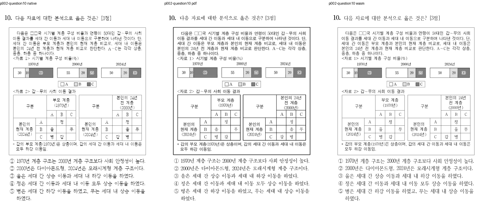
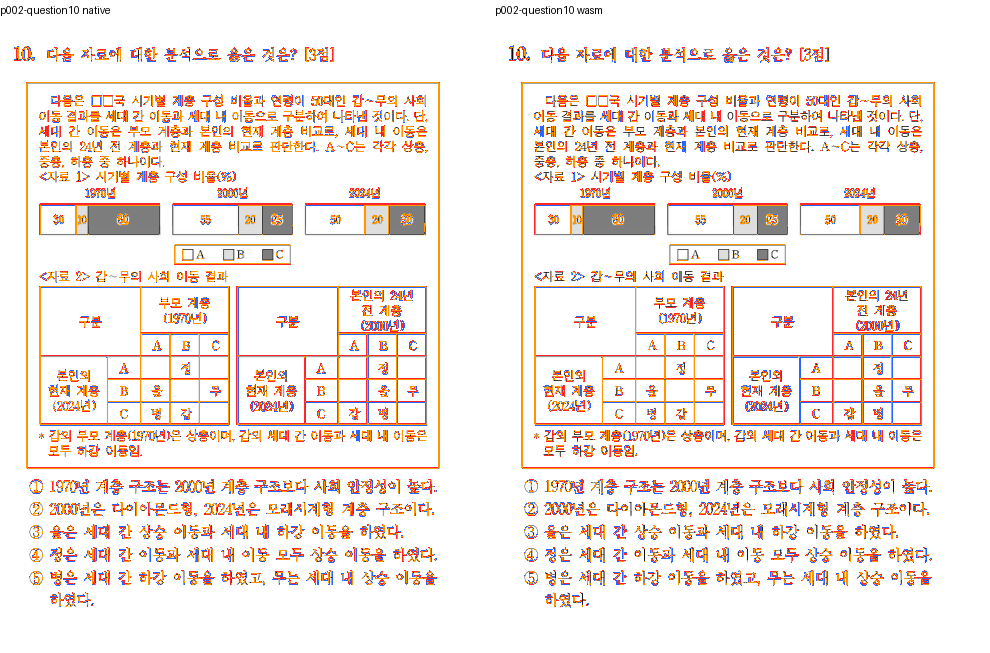
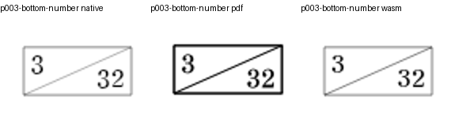
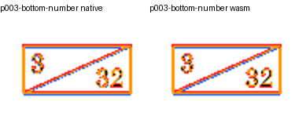
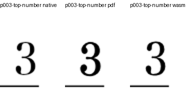
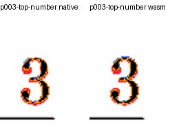
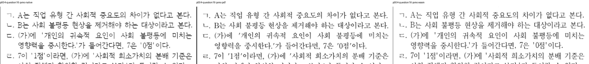
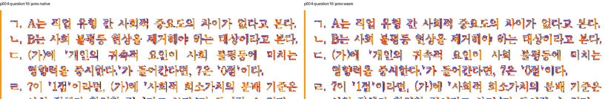
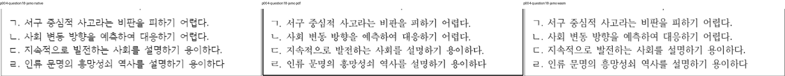
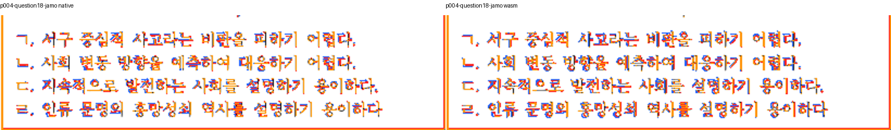

# #7763 사회 시험 HWPX의 완료 범위 확인

원 이슈의 전체 원문을 확인하고 이전 판정의 표 위치·쪽번호·보기 자모를 실제 현재 출력과 대조했다. 원본은 이슈가 지정한 경로를 사용하고 현재 입력 SHA를 아래에 고정했다. 기준은 같은 원본의 새 한컴 2020 Print이며 원문 용지와 같은 771×1116pt, 전4쪽이다. 옛 PDF 파일명이나 과거 수치를 현재 결과로 재사용하지 않았다.

- 원본: `samples/hwpx/exam_social.hwpx`, SHA-256 `c11b117dfc55606bb3ea703f9ea5b0a14481f7e70e918bc09ce4e202a04c9fd0`.
- 독립 Print: `pdf/issue7642-exam-print/exam-13-exam_social-hwpx-print-2020.pdf`, SHA-256 `ef470c55d315f900220e6bcbd83df10f374a99d2cd010ffb29abd2e214eb7000`.
- 출력 생산자: `d7d4d2ea6ed427f2f3bc8b59a936a5f99aca852b`, Print / 96dpi. 최종 head와 제품 함수 내용 동등성을 별도로 확인한다.
- 원본 전쪽 [Native TSV](../final_sweep_20261019/n/056.tsv) / [fresh WASM TSV](../final_sweep_20261019/w/056.tsv).

| 쪽 | Native raw | fresh WASM raw |
| ---: | ---: | ---: |
| 1 | 98.88036% | 98.91383% |
| 2 | 99.87989% | 99.88756% |
| 3 | 99.88361% | 99.87649% |
| 4 | 98.07087% | 98.05641% |

## 직접 대조한 원 이슈의 세 범위

- 2쪽 문항 10의 표·후속 선택지: Print와 같은 본문 원점·내용 순서이며 이전처럼 표 전체가 앞당겨지지 않는다.
- 3쪽 머리 번호와 하단 3/32: 두 backend에서 원문 표시가 보존되고 하단 번호가 대각선 상자 안에 표시된다. 처음 잘못 잡은 빈 상단 crop은 증거에 포함하지 않았다.
- 4쪽 문항 16/18의 보기: 양쪽 실제 출력에서 ㄱ·ㄴ·ㄷ·ㄹ이 표시되며 숫자 16/18로 대체되지 않는다.
- 글자 형태·굵기·경계 선색의 잔차는 남아 있다. 세 결함의 보정과 전쪽 raw 통과를 픽셀 완전일치로 바꾸어 보고하지 않는다.
- 기존 `verified_social_print_host_frames`의 원문 본문·표·후속 내용 관계와 새 `exam_all_52_source_equations_and_print_page`의 원본/쪽 소속 검사를 정식 전체 suite에서 확인했다. 기존 4개와 새 all-52 검사가 모두 통과했고 전체 11,014PASS/0FAIL이다. 이슈 종료는 코드 PR의 정확한 head CI 성공과 머지 뒤 후속 처리에서 확인한다.

## 대표 review와 overlay

