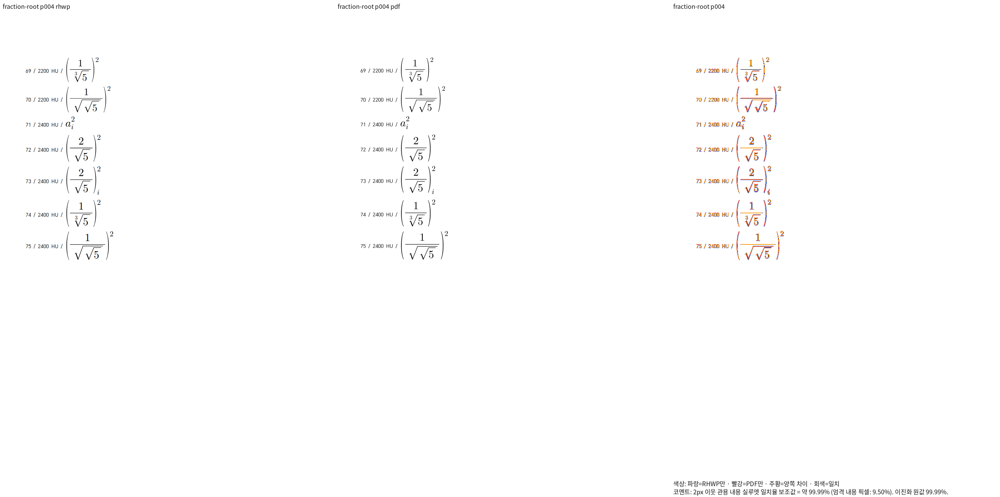
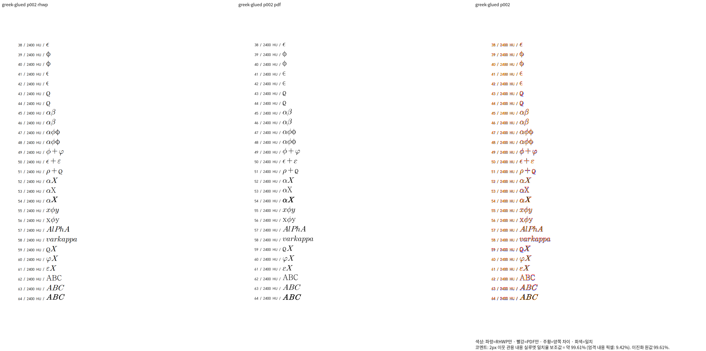
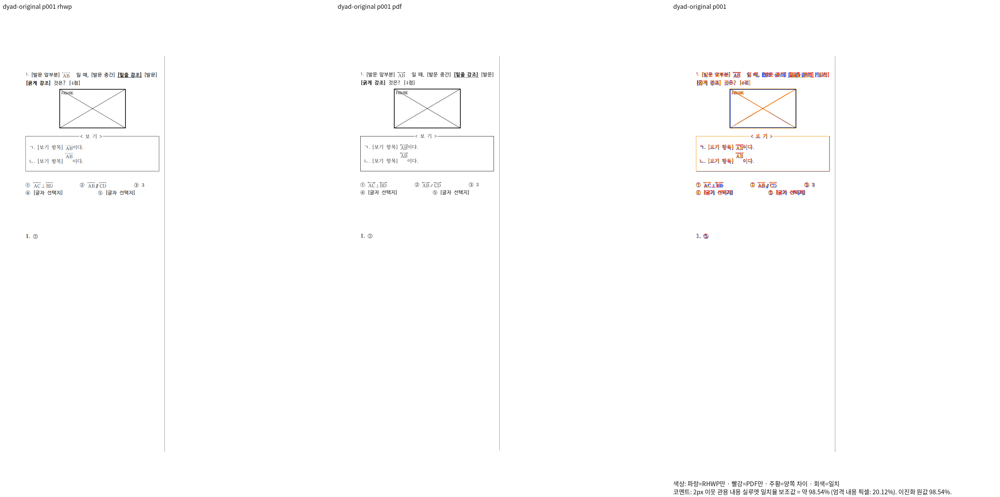

# 한컴 글리프 출력의 원문 소유·기준선 대조

- 검증 source: `4533d1c95f392e70e27323696369a9f675af92bf`.
- Native build: stage556. fresh WASM: stage557, source 해시 유지·Studio 동기화 확인.
- 전체 페이지 TSV: ignored stage563/564. 새 PNG: stage570. 96dpi, Print profile, 전체 글꼴 공급.
- 분수 아래첨자 1쪽 100%, 근 지수 4쪽 최저 99.76090%, 붙인 그리스 기호 2쪽 최저 99.61445%, dyad 원본 1쪽 98.53778%. Native와 fresh WASM은 각 입력의 같은 전체 쪽수와 최저값으로 통과했다.
- 입력·독립 Print: `pdf/issue7642-extended-base-script-diagnostic/{extended-base-script,extended-base-script-v4,extended-base-script-v11}-2024.{hwp,pdf}`와 `samples/issue7593/repro-equation-issue7593.hwpx`, `pdf/issue7593/repro-equation-issue7593-hwpx-2020.pdf`.
- 같은 영역을 직접 판독해 근 지수·분수의 첨자 소유, 그리스 변형과 뒤의 X, AB 정체·화살표와 뒤 본문의 순서·간격을 확인했다. 점수는 2px 관용 실루엣 보조값이며 모든 픽셀이 동일하다는 뜻이 아니다.
- 검사 helper의 기존 Text/FontGlyph 외에 실제 HancomGlyphs 문자를 인식하도록 보완했다. 내용·소유·첨자 기준선·본문 비겹침·최종 잉크의 관계와 기존 기대값은 유지한다. 검증에 없는 문자·구조는 조용히 통과시키지 않는다.
- 이후 source 변경은 이 캡처의 head와 구분해 재검증한다. 전체 문서·전체 회귀·PR 검토 완료의 증거로 확대하지 않는다.

