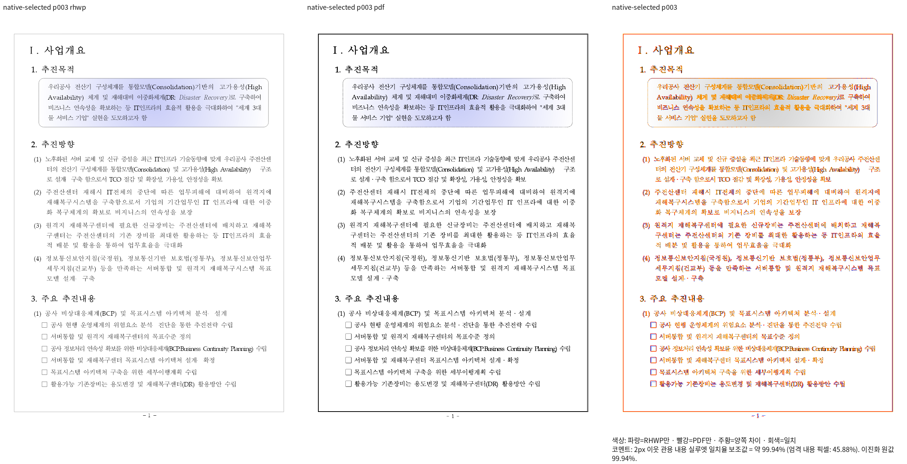
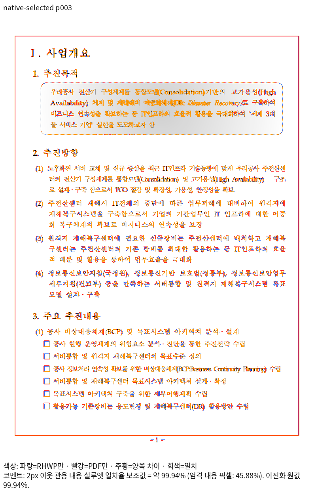
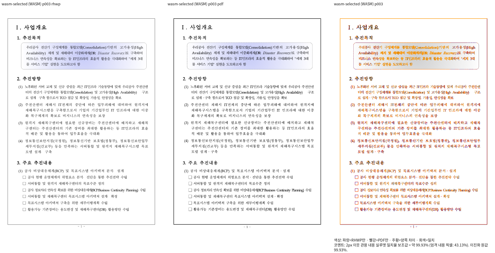
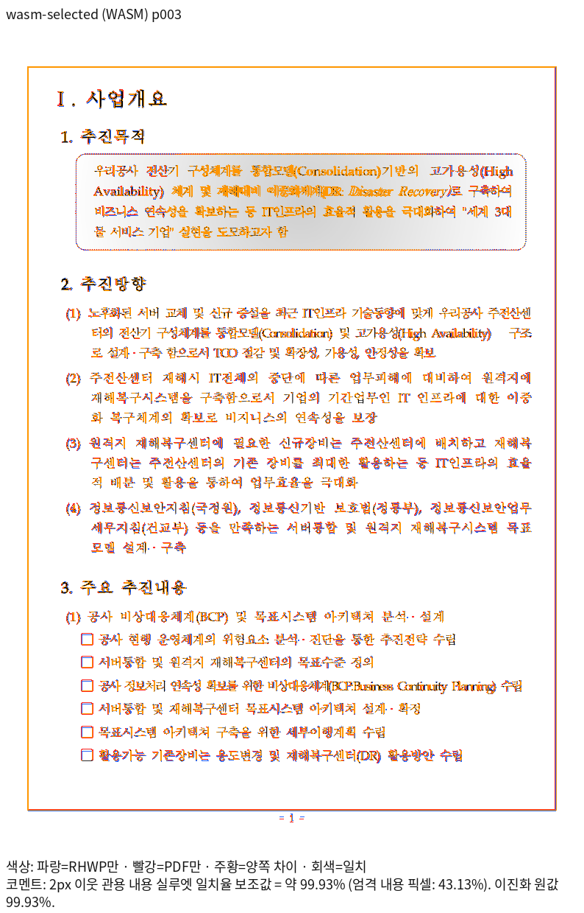

# Issue #7642: HWP3 원본 제목·점선의 검증 자료

- 원본: [hwp3-sample16.hwp](../../../../samples/hwp3-sample16.hwp)
- 독립 기준: [원본 Print PDF](../../../../pdf/issue7642-hwp3-original-print/hwp3-sample16-2020.pdf)
- Print 출처: [기존 출력 근거](../../../../pdf/issue7642-hwp3-original-print/print-provenance.json)
- 생산 코드: `a29eba18e83da0e7a77ad805aa485c89465bed0d`
- 절차·입력/생산물 해시·명령·회귀: [단계 기록](../../../working/task_m100_7642_stage1533.md)

한컴 11.0.0.9136·engine 2020·PrintMethod 0의 원본 무변경 전쪽 출력이다.
Native/fresh WASM 모두 원본과 같은 64쪽이며, 전쪽 최저는 각각
92.25853%, 95.76171%다. 대표 3쪽은 각각 **99.94303%, 99.92693%**다.
96dpi·Print profile·compat 2022·Poppler none으로 측정했다.

첫 제목의 작성 공백·확장 제어 위치와 점선 상자를 확대 판독했다.
3쪽의 독립 제목 원점·기준선·상자 외곽만 ±2 CSS px로 보호하고,
쪽·문단·개체 소유와 내용 보존·포함·비겹침 검사도 유지한다.
6쪽의 기존 수식 폭·장식 차이는 이 자료로 완료 처리하지 않는다.

전체 페이지 TSV 원본과 실행 로그는 ignored
`output/pr-review/issue7642/failed-inputs-20261008/stage15-current-validation/`의
`stage1523-hwp3-native-qualification/` 및 `stage1530-hwp3-wasm-qualification/`에 있다.
Git에는 대표 PNG만 포함한다. 원본 HWP와 독립 Print PDF는 기존 추적 파일을 재사용한다.

## Native

## fresh WASM

