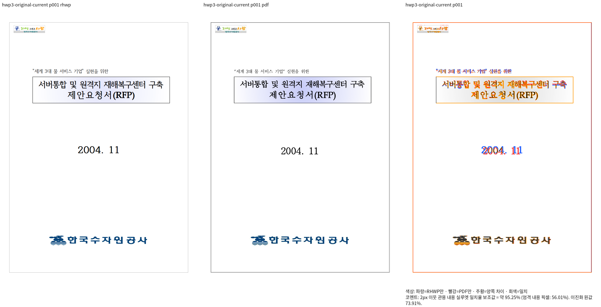
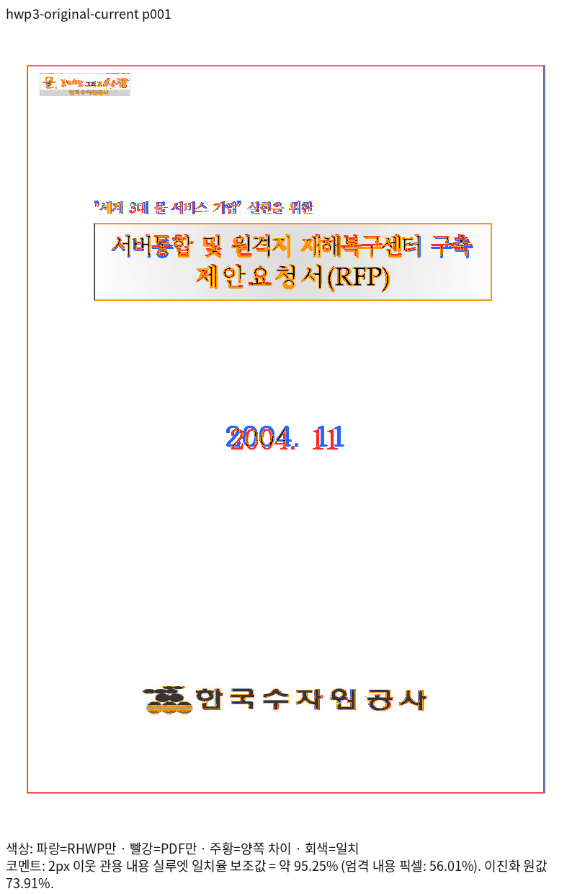

# HWP3 빈 후속 글줄의 호스트 전진 대조

- 입력: `samples/hwp3-sample16.hwp`, 독립 기준: `pdf/issue7642-hwp3-original-print/hwp3-sample16-2020.pdf`.
- 실제 렌더 source: `2b88bc76970038f99ecb44de2c7e27fc0a9a98d1`. stage580 바이너리로 Native Print SVG를 새로 산출했다. 이후 parser 변경을 포함한 최신 head의 결과가 아니다.
- 선택 페이지 1·3·33·64의 실루엣 일치율은 각각 95.25199%·90.80201%·99.38672%·97.97455%다. 전체 64쪽 수는 일치하지만 전쪽 시각 검증 완료를 의미하지 않는다.
- 첫 페이지의 이전 53.09324% 결과는 source `4533d1c95f392e70e27323696369a9f675af92bf`의 stage558이다. 빈 후속 글줄에도 기존 저장 사다리 전진 질의를 적용한 뒤 큰 세로 이동이 해소됐다. 제목과 날짜의 글자 모양·기준선 차이는 확대 대조가 남아 있다.
- `native-first-page-review.png`와 overlay는 stage582의 같은 Native/PDF raster를 정본 Visual Sweep 함수로 합성했다. stage588에서 새 렌더를 한 것은 아니다. 로그·TSV·입력/PDF 해시·명령은 ignored `output/pr-review/issue7642/failed-inputs-20261008/stage15-current-validation/stage582-current-selected-native.json` 및 stage588 provenance에 보존했다.

