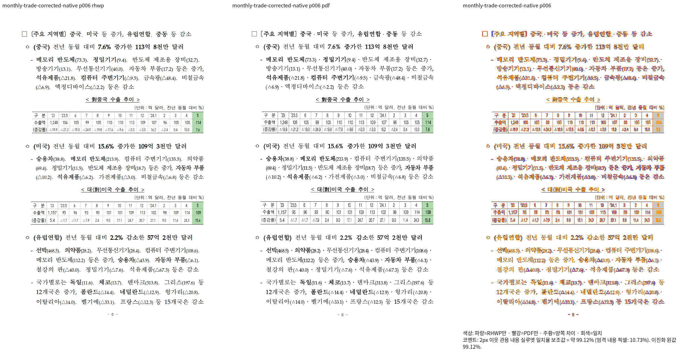

# 월간 수출입 문서의 기호 글꼴 슬롯 보정 증적

- 렌더 source: `3212c78ff6c08ab4062b403d8fb8ffc54010ba89`.
- 원본: `samples/156636617_240617 2024년 5월 월간 수출입 현황(확정치).hwp`.
- 입력 SHA-256: `83fca0151c67e2adeb7a85203f5c75204d8e53af4e44902958c96b85adf6845e`.
- 독립 한컴 Print 기준: `pdf/156636617-monthly-trade-hwp-2020.pdf`.
- 기준 SHA-256: `5a04f0ffdbfcde8d707ea6fe6e99bb446236daa7ae2c0b32830ae4303aec395b`.
- Native 전 19쪽 측정 및 실제 쪽수 일치. 최저 92.48467%, 미달 없음.
- 대표 6쪽: 보정 전 86.62049% → 보정 후 99.12239%.
- U+2024를 원본 글자모양의 기호 슬롯으로 분류해 한양신명조의 원본 폭 계약을 사용한다. 문서별 좌표나 글꼴별 임의 폭은 추가하지 않았다.
- 직접 판독: 같은 쪽의 제목, 본문 줄바꿈, 기호 주변 간격, 두 표의 외곽과 행을 대조했다. 전체 페이지의 미세 판독 및 최신 head의 fresh WASM 검증 완료를 의미하지 않는다.
- 명령과 전쪽 TSV는 ignored `output/pr-review/issue7642/failed-inputs-20261008/stage15-current-validation/stage636-equation-control-requalification.json`과 `stage636-monthly-trade-native/monthly-trade-native/silhouette.tsv`에 보존한다.
- PNG는 stage636의 실제 두 raster로 stage648에서 합성했다. 현재 코드의 새 렌더로 표시하지 않는다.

