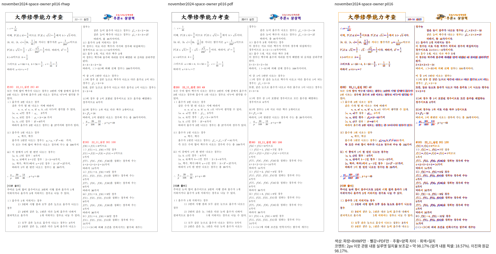
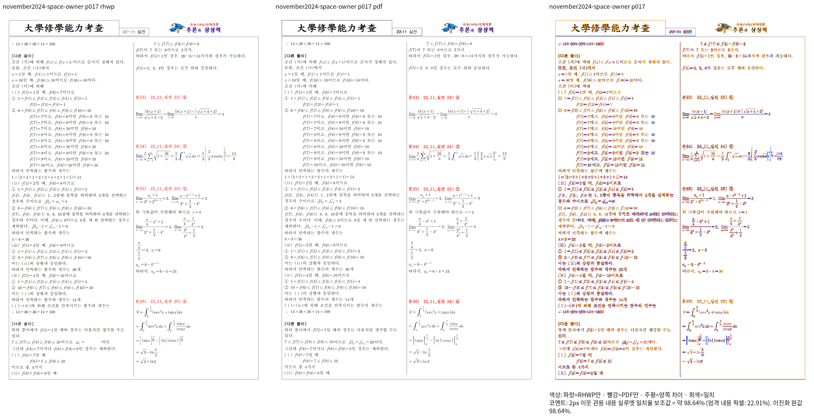

# 11월 시험지의 명시적 공간 기저 보정 대조

- 렌더 source: `81b2c01ce980ab35abc9c0d6a6bc64c0e67cdb37`의 stage584 Native 바이너리. stage585 receipt와 일치한다. 이후 첨자 뒤 새 그룹 경계를 바꾼 최신 source의 결과가 아니다.
- 입력: `samples/3-11월_실전_통합_2024-구분선없음구분선위20미주사이20구분선아래20.hwp`.
- 독립 한컴 2024 Print PDF: `mydocs/pr/assets/pr_7600_control_print_20261006/input-10-3-11월_실전_통합_2024-구분선없음구분선위20미주사이20구분선아래20-2024.pdf`.
- 전체 22쪽 Native 최저 실루엣 일치율 96.80453%, 90% 미만 0쪽, 출력 쪽수 일치. 이전 source `e6c4d315b9b01b54eeaa7ca414b951b36f3d1553`의 52.22684%/미달 16·17쪽과 구분한다.
- 16·17쪽은 stage585의 같은 Native/PDF raster를 stage606에서 정본 함수로 review/overlay 합성했다. 17쪽 첫 식의 쪽 소속이 Print와 일치하는 방향으로 개선됐다. 수식·미세 간격 확대 확인과 새 그룹 본체 크기 보정 후 최신 source 재출력은 남아 있다. 최신 head/fresh WASM/전체 범위 완료로 판정하지 않는다.
- TSV·명령·입력/PDF 해시·로그는 ignored `output/pr-review/issue7642/failed-inputs-20261008/stage15-current-validation/stage585-equation-control-requalification.json` 및 stage606 provenance에 보존한다.

