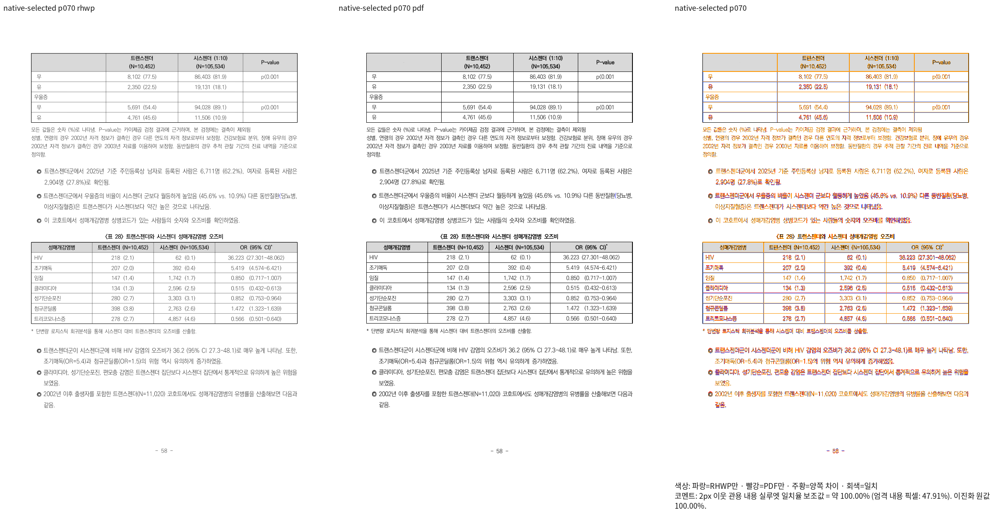
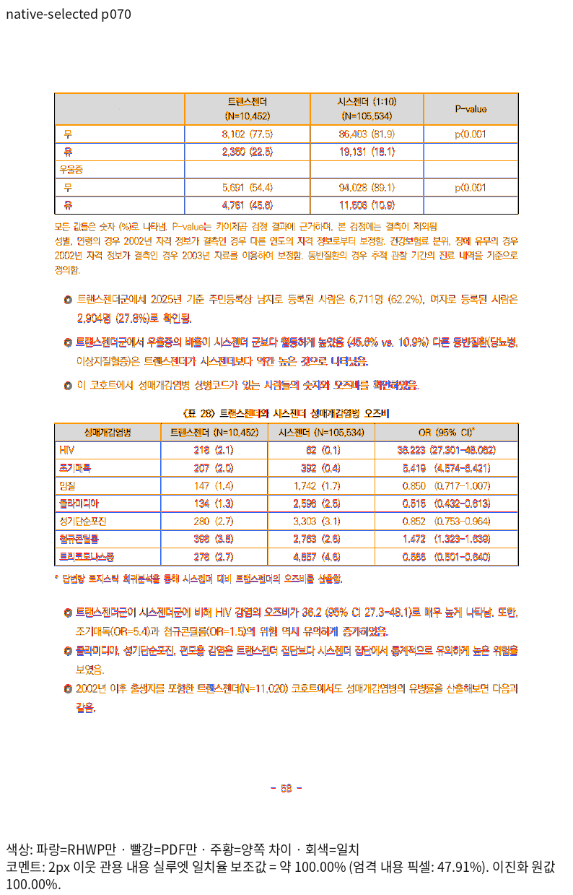
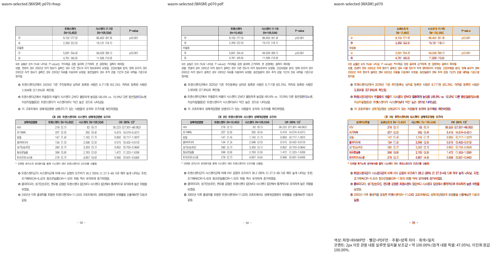
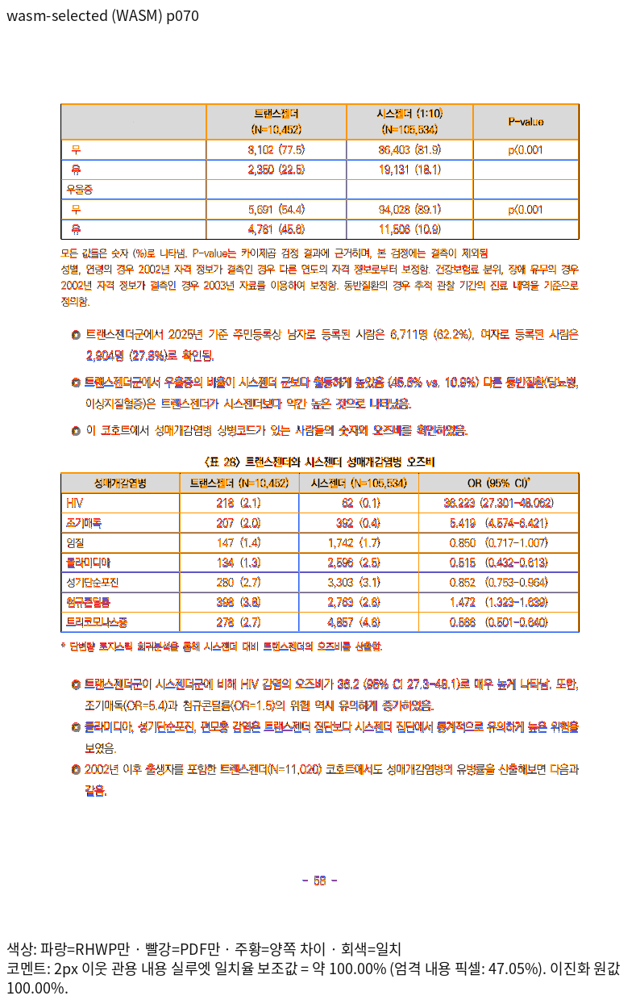

# PrEP 70쪽 표 이어받기와 후속 본문 증적

Issue: #7642

## 원본과 독립 기준

- [원본 HWPX](../../../../samples/issue2006/1790387_prep_final_report.hwpx):
  SHA-256 `c68baed24096386f9041930d24d39409b61ac99463bf04dfd242440dfdeb739f`.
- [독립 한컴 Print PDF](../../../../pdf/issue2006/1790387_prep_final_report-hwpx-2024.pdf):
  12,228,923바이트, 140쪽,
  SHA-256 `732baa118fbe380cf4c5e12e080eee5acb1eb8372070390fef47e53e2469f729`.
- 원본 저장 제품은 한컴 2024 `13.0.0.564`다. 원본 그대로 MCP `engine=2024`,
  한컴 `13.0.0.3901`, `pdf_print_method=0`, `frame_print_to_pdf_ex_one_up`으로 인쇄했다.
  Print job: `08f19553-0306-494b-b69a-4866aa257ea8`.
- 실제 실행의 PDF 경로는
  `pdf/issue7642-prep-recheck-20261016/1790387_prep_final_report-2024.pdf`다.
  위 커밋 대상은 같은 바이트를 형식·엔진이 표시된 canonical 이름으로 복사한 파일이다.
  기존 기준 PDF와 실제 출력 경로의 파일은 보존했다.

## 생산 코드와 전체 페이지 확인

생산 코드 `057a584e9eafc9f8ec12f7557326ca6a6c010b15`의 1,600개 제품 소스와
Native·fresh WASM producer의 해시 일치를 확인했다. `--compat 2024`, Print profile,
96dpi, 좌상단 CSS px, PDF thin-line mode `none`을 사용했다.

| 범위 | Native 최저 | fresh WASM 최저 | 전체 쪽수 |
| --- | ---: | ---: | --- |
| 원본 전체 140쪽 | 91.54965% | 92.43307% | 양쪽 140쪽, 독립 PDF와 일치 |
| 완료된 물리 70쪽 | 100.00000% | 100.00000% | 반복 머리행·마지막 행·후속 본문 직접 판독 |

전체 Native/fresh WASM TSV와 실행 로그는 ignored 증적 루트
`output/pr-review/issue7642/failed-inputs-20261008/stage15-current-validation/`에 보존한다.

| TSV | 원본 파일 SHA-256 |
| --- | --- |
| `stage1566-rebased-native-qualification/native-whole/native-whole/silhouette.tsv` | `7e3845688c7158f00efa3a5a0a57001c972be6fefd9540aa37f4546372688907` |
| `stage1568-rebased-wasm-qualification/wasm-whole/wasm-whole/silhouette.tsv` | `674919ced3300432eed07d5691bc09f48656832514f7a6e0d3a1474ddbaae34c` |

## 새 회귀 검사

[새 이름의 검사](../../../../tests/cases/verified_prep_completed_table_page.rs)는 원본의 표·셀·문단
소유로 대상을 찾는다. 원본 셀 198개, 반복 머리행, 표 사이·뒤의 본문 10개 문단을 대조하고
행·열 순서, 누락·중복, 겹침, 셀 내부 글자 포함을 검사한다. 69쪽은 캡션과 행 소유 관계를
검사하며, 양쪽 100%인 70쪽의 표 시작·머리행·마지막 행·표 종료만 독립 PDF의 괘선과
±2 CSS px로 대조한다.

같은 판정 함수로 보정 전 `a29eba18e83da0e7a77ad805aa485c89465bed0d`의 실제 RenderTree를
검사하면 32번 행의 쪽 소유로 실패한다. 현재 출력은 통과한다. 빌드 실패를 결함 검출로
세지 않았다. 자세한 명령과 결과는 [단계 보고서](../../../working/task_m100_7642_stage1577.md)에 있다.

67쪽의 어절 경계와 27쪽 차트 내부는 미해결이다. 전체 90% 통과나 이 페이지의 100%를
PrEP 전체의 시각 보정 완료로 해석하지 않는다.

## Native

## fresh WASM

