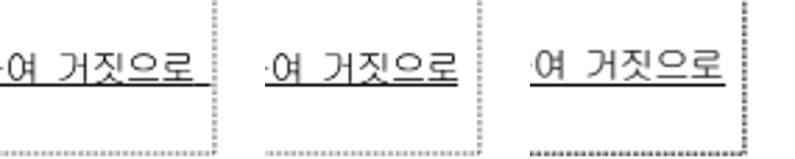

# nested 11쪽의 분리된 공백 밑줄 보정

`2c90fa288b`의 공통 paint 보정으로 fresh WASM의 공식 일치율을99.09%에서
보호값99.10%로 복원했다. Native도99.08%에서99.09%로 상승했다.
기준 PDF·글꼴 공급·2px 판정·공식 두 자리 표시 규칙은 변경하지 않았다.

| 경로 | 보정 전 raw | 보정 후 raw | 보정 후 공식 표시 |
| --- | --- | --- | --- |
| Native | 99.08498% | 99.08811% | 99.09% |
| fresh WASM | 99.09499% | 99.09810% | 99.10% |

입력은 `samples/basic/issue2007_nested_cell_pagination_42065.hwp`이며 독립 기준은
`pdf/review-integration-20261026/issue2007_nested_cell_pagination_42065-2020.pdf`의
한컴 2020 Print 11쪽이다. 96 DPI·compat2022로 재생성했다. 입력·PDF의 식별자와
동일성 대조는 [페이지 비교](page11-comparison.json), 새 빌드 식별자는
[producer](producer.json)에 기록한다. Mac WASM은 locked wrapper의
`--target web --out-dir pkg --no-opt` 로컬 대체 빌드다.

마지막 가시 TextRun 뒤의 별도 ASCII 공백 TextRun을 기존 장식선 검색이 건너뛰어
밑줄이 표 오른쪽 테두리까지 이어졌다. soft-wrap이 소비한 공백을 모든 분리 구간에서
제외하도록 공통 LayerBuilder를 수정했다. 본문·bbox·글자 전진폭은 바꾸지 않았고,
전후 render tree와 PDF raster는 각각 동일함을 실제 확인했다.

기존 #6117·#6028 계약을 보완하는 관계 검사7건은 보정 전3PASS/4FAIL,
보정 후7PASS다. 문단 끝 공백·명시적 줄바꿈·공백 전용 입력란은 보존한다.
[보정 전 검사](before-tests.txt)와 [보정 후 검사](after-tests.txt)를 보존한다.

확대 그림의 순서는 **보정 전 → 보정 후 → 독립 PDF**다.

[Native review](native/review-011.png) · [Native overlay](native/overlay-011.png) ·
[WASM review](wasm/review-011.png) · [WASM overlay](wasm/overlay-011.png)

이는 11쪽의 실제 보정 검증이다. 나머지 필수 게이트와 보호 문서 전쪽 검증 완료를
대신하지 않는다. 모든 필수 검증을 완료한 뒤 사용자 승인에 따라 PR·CI·병합·후속 처리를 진행한다.

같은 새 소스의 전17쪽도 Native·fresh WASM 모두 보호값 하락0쪽으로 통과했다.
최저값은 각각98.60%·98.59%이며4쪽은 양쪽100.00%다.
[전쪽 결과](whole17-results.json)와 두 경로의 `whole17-silhouette.tsv`를 보존한다.
