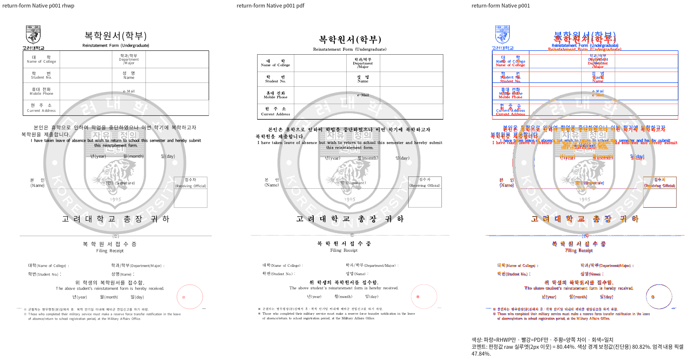
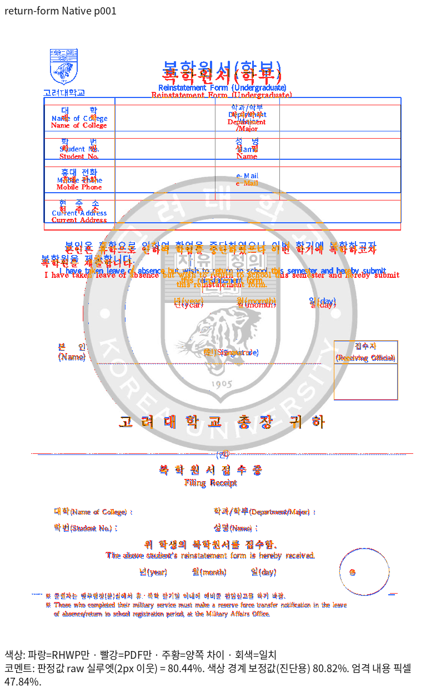

# #7756 복학원서: overlay 검사 후속 이관

기존 공통 하위 이슈 [#7756](https://github.com/edwardkim/rhwp/issues/7756)는
복학원서의 전체 피델리티와 기존 layer/snapshot 계약을 추적하며 현재 OPEN이다.
이번에는 같은 원본의 실제 실패한 overlay 함수1건만 추가로 이관한다.
출력 결함 해결·시각 통과·이슈 종료로 보고하지 않는다.

## 고정 입력과 base/head 비교

- 원본: [samples/복학원서.hwp](../../../../samples/복학원서.hwp),
  SHA-256 `da81b4010331bcac290f900c7cf224c97ee8355399614725ce46c197ff1a22a4`.
- 독립 한컴 기준: [pdf/복학원서-hwp-2020.pdf](../../../../pdf/복학원서-hwp-2020.pdf),
  SHA-256 `ed28f2655a27d22acdbf214520115522ad3124a3643d18fba58beebba1935068`,1쪽.
  기존 PR#7212의 동일 입력·PDF provenance를 재사용한다.
- 실제 기준 빌드/전쪽 TSV: `552514f423ec91f1b7171f6e6b0882a4efe034f2`.
  현재 devel `fe5725dc384689b45d60ef8ea4c83138bc2701d8`까지
  renderer/paint/parser/model/document_core 변경은0이며 이를 diff로 확인했다.
  새 devel에서 TSV를 다시 실행했다고 표기하지 않는다.
- 실제 후보 출력: 고정 v2 Native/fresh WASM. 빌드 당시 HEAD는
  `4246468203100a0bd2a7c9f4523c281ac962f521`이며 당시 변경된 생산 파일이
  이후 커밋 `619a12d91bd98a07cf9ac9f911775fcae45677e8`의 내용과 같음을
  `wmf-rgb555-v2-committed-content-verification.json`에서 확인했다.
  현재 HEAD에서 다시 출력한 TSV로 재표기하지 않는다. 최종 변경 후에도 남는
  정상 SVG 검사와 해당 문서 무회귀는 현재 코드에서 다시 확인한다.

| 전체1쪽 raw | 고정 base | 후보 |
| --- | ---: | ---: |
| Native |80.43535%|80.43535%|
| fresh WASM |80.28219%|80.28219%|

양쪽1쪽 누락 없이 산출했으며 원본·PDF 모두1쪽이다. 제목/표 시작과 행 경계,
본문·서명·접수 상자의 기존 위치 차이를 review/overlay에서 직접 확인했다.
90% 미달이 기존 base에도 있고 이번 출력에서 새로 악화하지 않았다.

## 제거와 보존 범위

- 제거한 함수: `tests/issue_938.rs::issue_938_overlay_watermark_is_hancom_baked_png`.
  이전 함수 전체는 [자동 수집하지 않는 원문](issue_938_overlay_watermark.rs.txt)에 보존했다.
  제거 전 소스는 `d06b3e03c:tests/issue_938.rs`에도 있다.
- 전체 Rust에서 이 함수는 밝기/대비 메타데이터 `-50/70` 기대와 실제 `70/-50` 때문에 실패했다.
  전체 출력 미달 상태에서 기존 기대값·baseline을 새 값으로 갱신하지 않는다.
- 정상 `issue_938_svg_watermark_is_hancom_baked_png` 함수 본문과 공용 원본/PDF,
  `tests/golden_svg`의 기존 golden은 유지한다. 같은 공용 입력을 쓰는 정상 계약을
  동반 제거하거나 입력을 다른 원본으로 바꾸지 않는다.
- 활성 테스트 감소는1건이다. ignore/조용한 return/새 수집 제외 분기는 추가하지 않는다.
  suite manifest를 다시 prepare하고 남은 SVG 검사와 lint를 실행한다.

## 재현과 복원

동일 원본/기준에 `scripts/visual_sweep.py --file-target return-form
samples/복학원서.hwp pdf/복학원서-hwp-2020.pdf --compat 2024 --silhouette-only
--rasterizer png`를 사용했다. 고정 base/head의 실행 파일과 후보 `--wasm-pkg`,
서버의 동일5개 한컴/KoPub 글꼴 경로를 각 실행에 지정했다.
전체 명령·TSV·로그는 ignored `output/pr-review/pr7494-20261016/`의
`issue938-{base,head}-{native,wasm}/` 및 대응 `logs/`에 보존한다.
현재 overlay는 위 후보 PNG의 직접 비교이며 새 head 재출력으로 혼동하지 않는다.

#7756에서 같은 원본의 Native/fresh WASM 관련 전쪽90% 이상과 직접 확대 판독을
마친 뒤 효과 속성·실제 payload·중복 색 처리 방지 계약을 독립 기대값으로 복원한다.

9단계 Native에서도1쪽80.43535%이며, 이전 PNG와 새 PNG의 SHA-256은
`57211128488d130f7f336290f32c1a0d4b1d6e92b49d273a3fb7f68435949150`으로 같다.
유지 SVG 함수는9단계 focused 묶음에서 실행해 통과했다.
