# 규제영향분석서의 현재 줄 구성과 물리 프레임

Issue: #7765. 이 자료는 `86712_regulatory_analysis.hwp` 한 문서의 보정 증거다.
통합 브랜치의 전체 검증이나 PR 제출 완료를 뜻하지 않는다.

## 입력과 생산 출처

- 원본: [86712_regulatory_analysis.hwp](../../../../../samples/86712_regulatory_analysis.hwp),
  SHA-256 `ee82c7755617003cb972ba398da9cffadfed24ac0fa068eee1a5347da7658a88`.
- 독립 기준: [공급 글꼴 한컴 2024 Print PDF](../../../../../pdf/issue7382-regression-review/86712_regulatory_analysis-font-supplied-2024.pdf),
  64쪽, Hancom 13.0.0.3901,
  SHA-256 `ac34bb60492e3749a53183cfb63c814f86379895937dd1309d3bc3d2d1b8126a`.
- 고정 devel: `9418ed0c7cf289c5c4ac2b3bb8cdc18a1b637a9a`.
  보정 전 부모: `dd6119d2b916704dbb11fdd7aa8ebc950c8811b1`.
- 보정 소스 18개와 Native binary·fresh WASM 해시는 [validation.json](validation.json)에 고정했다.
  이 자료를 담은 Git commit과 실제 측정한 소스의 부모·diff 신원을 구분한다.
- PDFium, Print, 96 CSSpx, 2px 이웃 관용의 raw 값이다. 글꼴은 실제 KoPub Dotum Light를
  공급했다. PDF의 사용 글리프 200개와 TTF 전진·윤곽을 대조했으며, 이를 전체 글꼴 동일성으로
  확대하지 않는다. 비공개 글꼴 바이너리는 이 자료에 포함하지 않는다.
- fresh WASM은 Mac locked wrapper의 `--target web --out-dir pkg --no-opt` 로컬 대체 빌드다.
  Docker 최적화 검증이나 실제 Studio 초기화·CanvasKit 검증을 대신하지 않는다.

## 원인과 공통 소비 경로

원본 TTF로 측정한 현재 줄 구성이 저장된 줄 경계와 달랐지만, 뒤 문단과 중첩 표는 과거의
물리 프레임을 다시 사용했다. 글꼴 이름이나 줄 수 감소만으로 저장 캐시를 버리지 않고,
같은 가로 상자에서 실제 본문 글자가 앞줄로 이동하는지 확인한다.

`composer/stored_word_tail.rs`의 현재 줄 결과를 render normalization이 소비해 뒤 문단의 원점을
함께 이동한다. `register_rendered_text_partitions`는 원본·파생 표와 조상에 현재 줄 소속을
등록한다. 표의 `cell_units`·컷 수용·`table_partial` 배치는 이 결과를 함께 소비하며,
현재 유닛으로 갱신한 표에 과거 절대 vpos를 다시 적용하지 않는다. 편집용 원본 IR은 유지한다.

중첩 표가 닫히는 로컬 사다리는 본체와 간격의 소유를 따로 입증한다. 같은 표의 원본은
`16944 + 283 + 283 - 100 = 17410HU`, 한컴 재저장본은
`15467 + 283 + 283 - 100 = 15933HU`다. 공통 float placement 생성자는 이 등식을 인증한 뒤
재조판된 본체 높이를 사용한다. 측정과 배치는 같은 점유 끝·다음 줄 원점을 소비하고,
문단 앞 간격과 저장 끝 줄간격을 중복 가산하지 않는다. 마지막 빈 종료 문단의 실제 줄 상자도
보존하며, 본문과 빈 종료 유닛의 소유를 합치지 않는다.

## 전쪽 결과

| 생산 소스 | Native 최저 | fresh WASM 최저 | 90% 미만 쪽 |
| --- | ---: | ---: | --- |
| 고정 devel | 30.85317% | 30.86172% | 양쪽 21·25·26·27·28·29·34 |
| 보정 전 부모 | 30.80108% | 30.80964% | 양쪽 25·26·27·28·29 |
| 현재 보정 | **94.31413%** | **94.07347%** | **없음** |

전 64쪽을 각각 다시 산출했다. 최저 쪽은 양쪽 14쪽이며, 굵은 본문 획과 미세 간격 차이는
남아 있다. 고정 devel 및 부모 대비 0.1%p 이상 하락은 없다. 바뀐 PNG는 양쪽 각각
25~29쪽뿐이고, 나머지 59쪽은 부모와 실제 PNG 바이트까지 같다. 양쪽 전 64쪽의 본문은
서로 같고, 변경된 25~29쪽은 독립 PDF의 본문 내용·순서와도 같다. PDF의 표 내부 stream
순서가 다른 나머지 쪽까지 전체 텍스트 순서 동일로 주장하지 않는다.

| 생산 소스 | Native 전쪽 TSV | fresh WASM 전쪽 TSV |
| --- | --- | --- |
| 고정 devel | [원문](tsv/devel-native.tsv) | [원문](tsv/devel-wasm.tsv) |
| 보정 전 부모 | [원문](tsv/parent-native.tsv) | [원문](tsv/parent-wasm.tsv) |
| 현재 보정 | [원문](tsv/candidate-native.tsv) | [원문](tsv/candidate-wasm.tsv) |

## 대표 review와 overlay

### 26쪽 · 끝 문장과 수식 줄 소속

| 출력 | review | overlay |
| --- | --- | --- |
| Native | 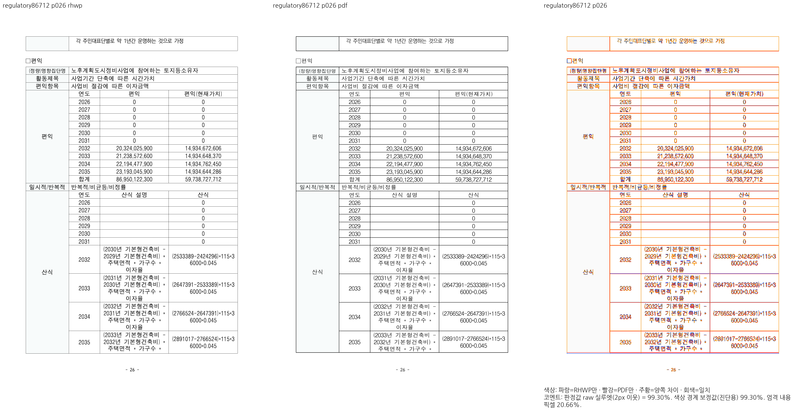 |  |
| fresh WASM |  | 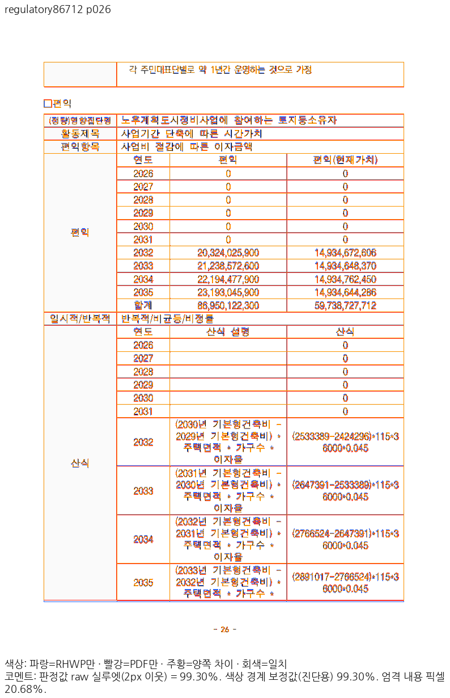 |

### 27쪽 · 이자율 수식과 행 소속

| 출력 | review | overlay |
| --- | --- | --- |
| Native |  | 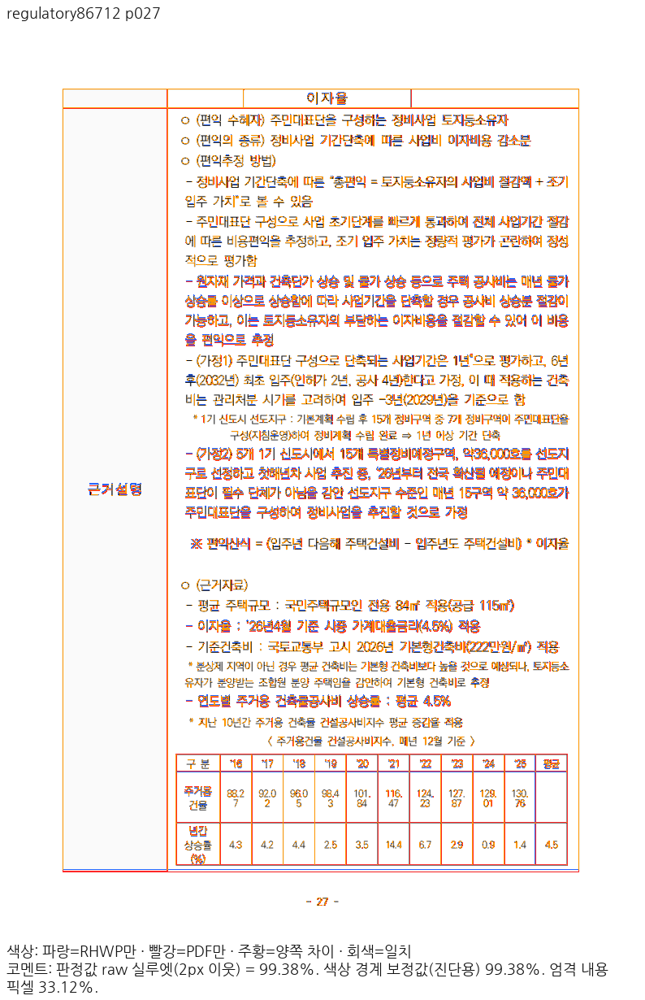 |
| fresh WASM | 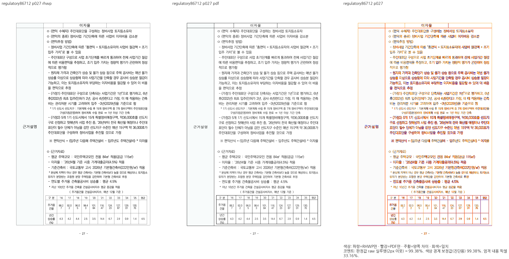 | 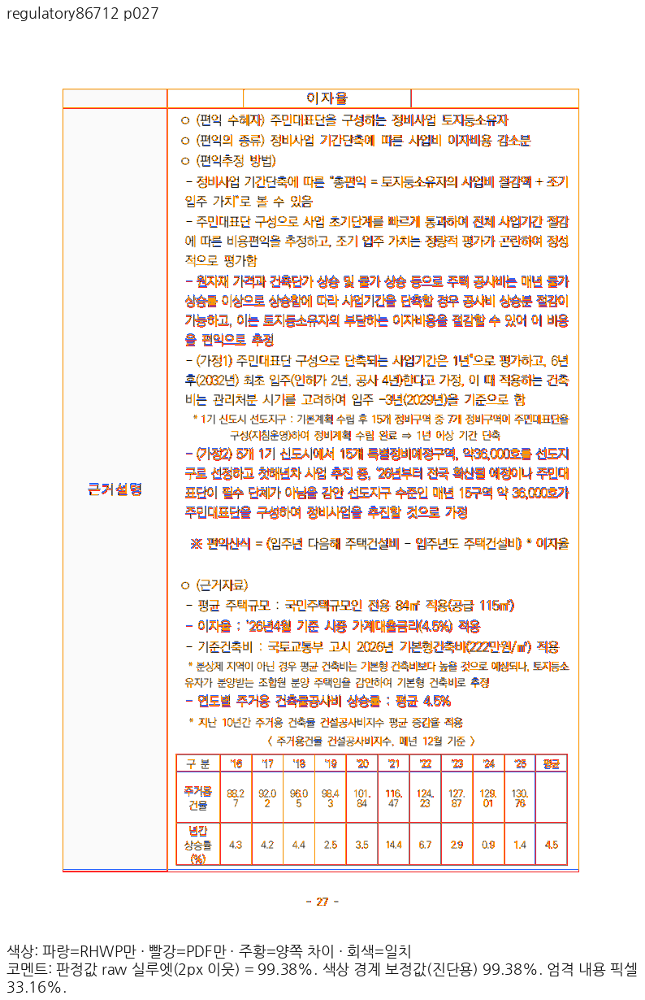 |

### 28쪽 · 첫 표 종료와 다음 표 원점

| 출력 | review | overlay |
| --- | --- | --- |
| Native | 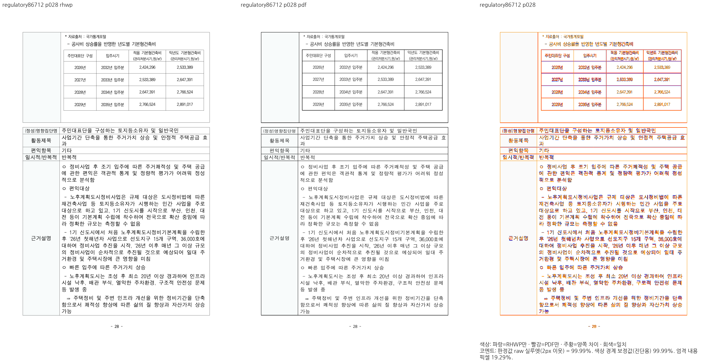 | 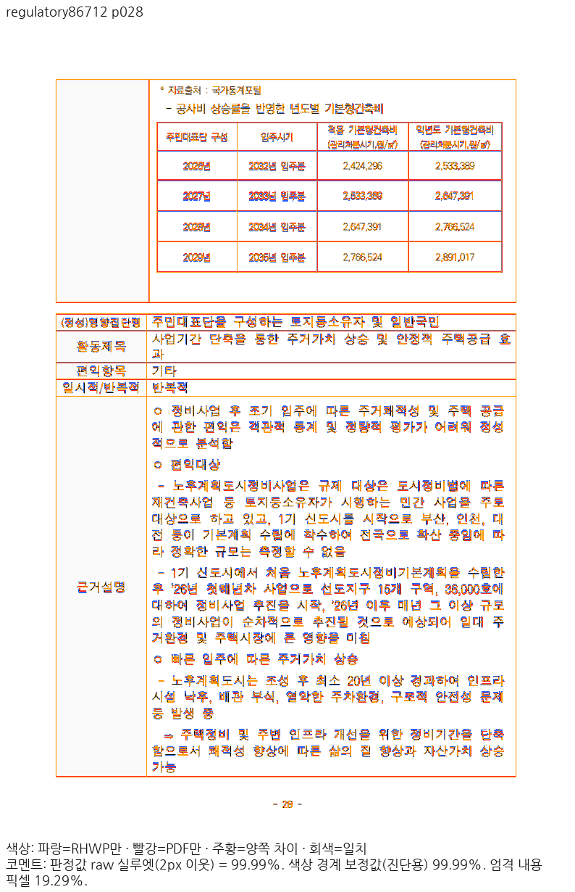 |
| fresh WASM | 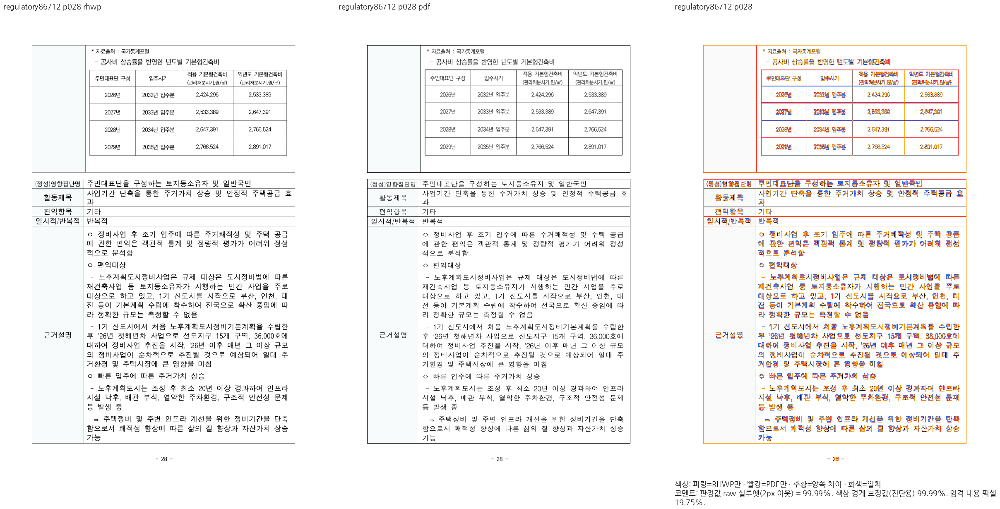 | 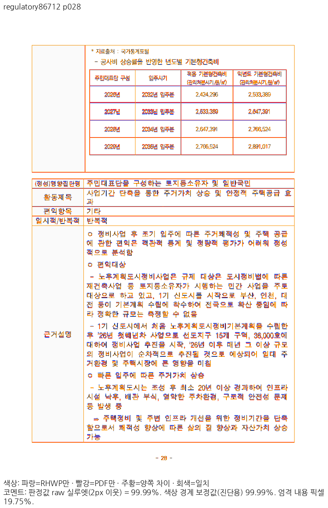 |

### 29쪽 · 빈 종료 줄과 마지막 괘선

| 출력 | review | overlay |
| --- | --- | --- |
| Native |  | 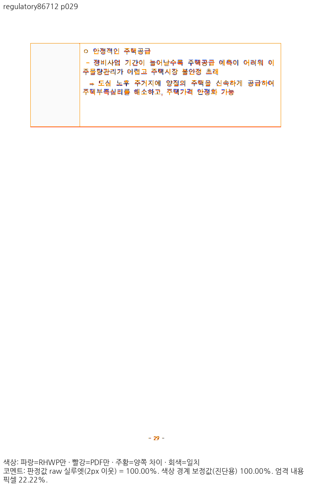 |
| fresh WASM | 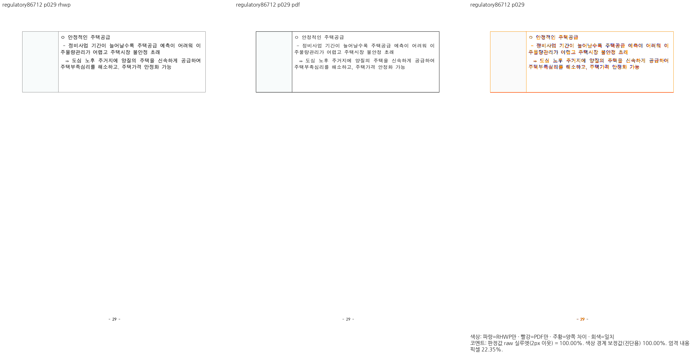 | 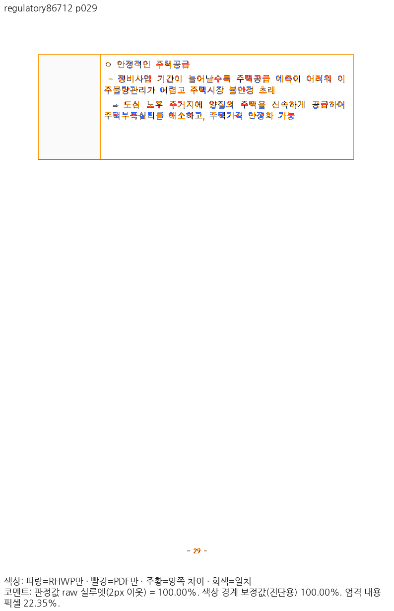 |

## 정식 검사와 정상 대조군

양쪽 전쪽 90% 이상, 중요한 25~29쪽은 양쪽 98% 이상임을 확인하고 직접 판독한 뒤
`tests/cases/issue_7765_current_source_frames.rs`에 3건을 추가했다. 독립 Print p28·p29의
괘선을 ±2 CSSpx로 보호하며, 문장 소유·누락·중복·표 비겹침 관계도 함께 검사한다.
같은 컴파일된 검사에서 부모 CLI는 **1 PASS / 2 FAIL**, 현재 CLI는 **3 PASS**다.
두 건은 이번 배치 결함 검출이고 한 건은 부모에서도 정상인 내용 소유 보호다.

기존 #8105 검사 3건은 통과했다. 정책연구 대조군은 부모/현재 전 215쪽의 소속 JSON과
24·67·215쪽 Native PNG가 바이트까지 같았다. 이는 정책연구 독립 Print 전쪽 수용 검증이 아니다.
현재 CLI의 HWPX export/reparse 검증은 IR 차이 0이며, 별도의 렌더 직후 저장 순차 시험은 아니다.

실행 로그·중간 JSON·전체 PNG는 ignored `output/pr-review/planet6897-20261024/source-program-cache-v37/`에
보존한다. 최종 통합 소스의 전체 회귀·필수 게이트·다른 문서 전쪽·실제 Studio 소비와
온새미로 변환본의 48/46쪽 보정은 남아 있다. 이 단계에서 PR 제출이나 이슈 종료를 하지 않는다.
