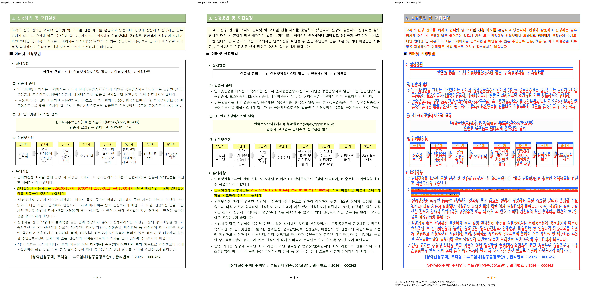
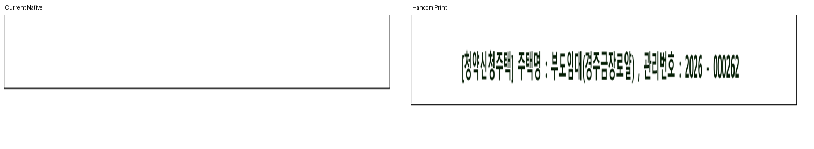

# #7830 이관 회귀 증적

#7445 후속 이슈 #7830의 사용자 승인 이관이다. `.rs.txt`는 변경 전 전체 source이며
활성 Rust test로 수집하지 않는다. source commit과 SHA256은 `archive-sha256.json`에 기록했다.
원문·독립 Print는 다른 정상 검사가 참조하므로 기존 공유 경로에 보존한다.

기존 base 미달과 현재 새 회귀는 이슈 본문에 구별했다. 검사 제거는 출력 개선이나 PR 승인
판정이 아니다. Native/fresh WASM 관련 전체 페이지90% 이상과 확대 판독 후 관계형 검사로
복원한다. 실행 로그·전쪽 TSV는 ignored `output/pr-review/planet6897-20261008/linux-validation-20261011/`에 보존한다.

이관: `issue_7063_midpage_fragment_box_does_not_pull_next_page_rows`만 제거한다.
같은 파일의 HWPX19쪽 정상 검사는 유지한다.

192dpi review의 현재 일치율은53.04352%다. renderer source는
`d0528fb55f225fba8b4b65b9ed670a8dee9c654b`이며 새 진단 commit 출력으로 간주하지 않는다.
