# 온새미로의 현재 본문 프레임과 인쇄 문자·괘선

Issue: #7881. 실제 변환 원본의 전 46쪽을 독립 한컴 Print와 대조한 문서별 보정 증거입니다.
전체 통합 브랜치 검증·Studio 소비·이슈 종료를 의미하지 않습니다.

## 입력과 검증 환경

- [원본](<../../../../../samples/hwpx/hancom-hwp/[2027] 온새미로 1 본교재.hwp>):
  SHA-256 `c9ef761953944665e7f9886f5414955c9d52291f1b2e2fd12f62277aafdafa3e`.
- [독립 한컴 Print PDF](<../../../../../pdf/hwpx/hancom-hwp/[2027] 온새미로 1 본교재-hwp-2020.pdf>):
  SHA-256 `58ff2fdc358d38c503d61a1e35a78320099b0671860047f1ac40151787247f3d`, 46쪽.
  입력은 Hancom 2010 저장본이고 기준 PDF는 Hwp 2022 Print입니다.
- 부모 `3024c89246cf7d2e255f1c3e45f2ad3bb5070034`, 고정 devel
  `9418ed0c7cf289c5c4ac2b3bb8cdc18a1b637a9a`. 실제 생산 소스 파일·Native·fresh WASM 해시는
  [validation.json](validation.json)에 구분했습니다.
- PDFium, Print, 96 CSSpx, 2px 관용 raw 값입니다. 원본·PDF·문턱은 바꾸지 않았습니다.
- [명시적 Print 글꼴 환경](print-reference-environment.json)의 두 없는 family에 독립 Print가 실제 사용한
  Haansoft Batang을 공급했습니다. PDF 19·46쪽 27개 글리프 기록(25개 고유 문자)의 전진폭·윤곽이
  공급 파일과 같았습니다. 파일 전체 동일성으로 확대하지 않으며 비공개 글꼴 bytes는 커밋하지 않습니다.
  기본 환경 미달을 이 환경의 통과로 덮어쓰지 않습니다.
- fresh WASM은 Mac locked wrapper `--target web --out-dir pkg --no-opt` 로컬 대체 빌드입니다.
  Docker 최적화·실제 Studio 초기화·CanvasKit 검증으로 보고하지 않습니다.

## 원인과 공통 소비 경로

| 위반된 계약 | 공통 생산과 소비 | 비적용·대조 경로 |
| --- | --- | --- |
| 현재 한 줄인데 저장 두 줄의 높이를 다음 원점에서 소비 | 현재 본문 폭으로 재구성한 줄을 측정·실제 배치·후속 문단 원점에 함께 전달 | 유효한 원본 줄은 유지; 정상 저장 대조군 전 46쪽 tree 동일 |
| 줄 안 그림이 점유한 높이를 이유로 다음 문단 앞 간격까지 제거 | 이미 줄 높이에 포함한 TAC 그림과 문단의 선언 before/after 밴드를 구분 | 배경·비자리차지 개체는 흐름 높이를 추가하지 않음 |
| 번호 12pt인데 줄 높이는 과거 10pt 캐시 | 원본 번호 글자 모양의 높이를 현재 줄과 다음 줄간격 계산에 함께 적용 | 저장 메트릭이 현재 요소를 수용하면 기존 경로 유지 |
| Unicode U+2007과 HWP 코드31을 같은 1/4em 공백으로 취급 | scalar 출처를 파싱·편집·분할·병합·저장·run 측정에 전달; 실제 선택 SFNT의 공백 전진 공급 | 코드31의 고정 1/4em 계약 유지; PUA 기호 공급 프로그램과 별도 세션 슬롯 |
| 인쇄의 가는 실선이 장치에서 잉크 문턱 아래로 소실 | source 좌표·색·속성 폭을 유지하고 Native/WebCanvas/CanvasKit raster paint가 최소 장치 1px 폭 소비 | screen·점선·복합선·화살표·대각선·그림자는 기존 경로 유지 |

선폭 기대값은 PDFium RasterizeStroke의 최소 장치 폭 계약과 독립 Print 관측을 대조했습니다.
[PDFium 원 구현](https://pdfium.googlesource.com/pdfium/+/a697e197f3a729db2a65b02d46b636644491293a/core/fxge/agg/cfx_agg_devicedriver.cpp)의
`RasterizeStroke`를 참조했습니다. SVG/PDF의 원본 속성 폭을 1px로 덮어쓰지 않습니다.

## 결과와 회귀 검사

| 경로 | 쪽수 | 최저 raw | 90% 미만·누락 | 전쪽 원본 |
| --- | --- | --- | --- | --- |
| Native | 46/46 | 94.65583% (14쪽) | 0 | [TSV](tsv/native.tsv) |
| fresh WASM | 46/46 | 94.55536% (14쪽) | 0 | [TSV](tsv/wasm.tsv) |

[정식 검사](<../../../../../tests/cases/issue_7881_current_body_frame.rs>)는 현재 프레임·다음 원점,
TAC 뒤 문단 간격, 원본 번호 크기와 다음 전진, Unicode/고정 공백 저장 구분, 19쪽 괘선의 실제 잉크,
scalar 편집·분할·병합 출처 보존을 보호합니다. 동일 검사 바이너리로 해당 보정 이전 CLI를 각각
실행해 5개 결함의 실제 FAIL을 확인했고 현재 6개는 PASS입니다. 수정 전에 검출하지 못했던 초기
번호 검사와 0건 실행은 최종 증거에서 제외했습니다.

독립 CFB 원시 PARA_TEXT와 Native/fresh WASM render tree에서 비어 있지 않은 최상위 본문 문단
468개의 원문·소속·순서를 대조했습니다. 원본에 번호 속성이 있는 문단만 생성 번호 접두어를
허용했고 누락·중복·순서 역전은 없었습니다. 중첩 표·도형 텍스트 전부의 검증으로 확대하지 않습니다.
정상 한컴 저장 대조군은 전 46쪽의 render tree가 부모와 현재 바이트까지 동일했습니다.

## 직접 판독과 남은 차이

12쪽의 한 줄 문단과 후속 원점, 19쪽의 연한 괘선·꼬리말, 26쪽의 그림 뒤 NOTE 밴드와 다음 문단,
46쪽 제목 대체 글꼴을 직접 확인했습니다. 14쪽은 양쪽 최저이며 본문·보기의 소속과 줄바꿈은
보존됐으나 글자 획과 미세 간격 차이가 남습니다. 13쪽 표제·기출 꼬리의 작은 장평·위치 차이,
11쪽 일부 줄과 테두리 차이도 남아 있으므로 완전한 픽셀 동일성을 주장하지 않습니다.
26쪽 `NOTE 02.` 마침표는 원문과 최종 TextRun에 보존됩니다.

### Print 12쪽 ↔ rhwp 12쪽

| 경로 | review | overlay |
| --- | --- | --- |
| Native |  | 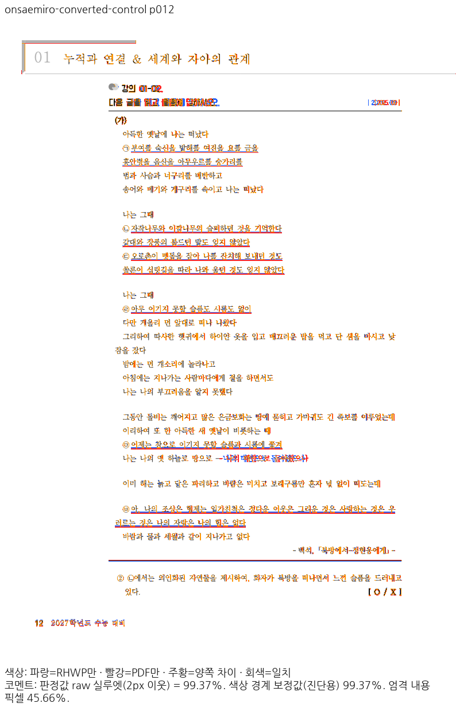 |
| fresh WASM | 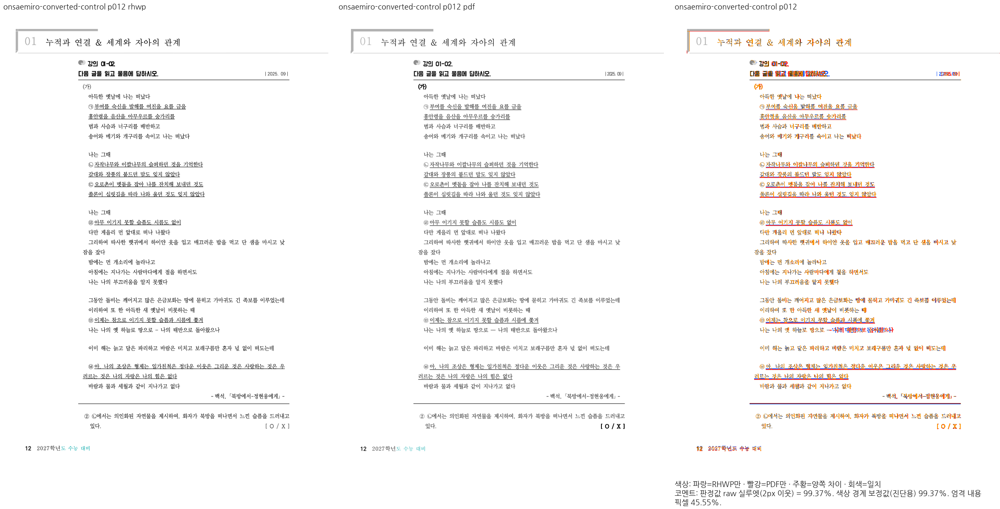 | 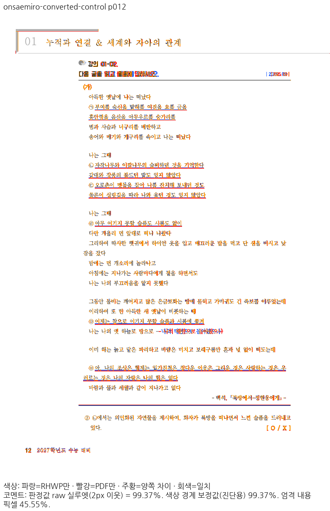 |

### Print 14쪽 ↔ rhwp 14쪽

| 경로 | review | overlay |
| --- | --- | --- |
| Native |  | 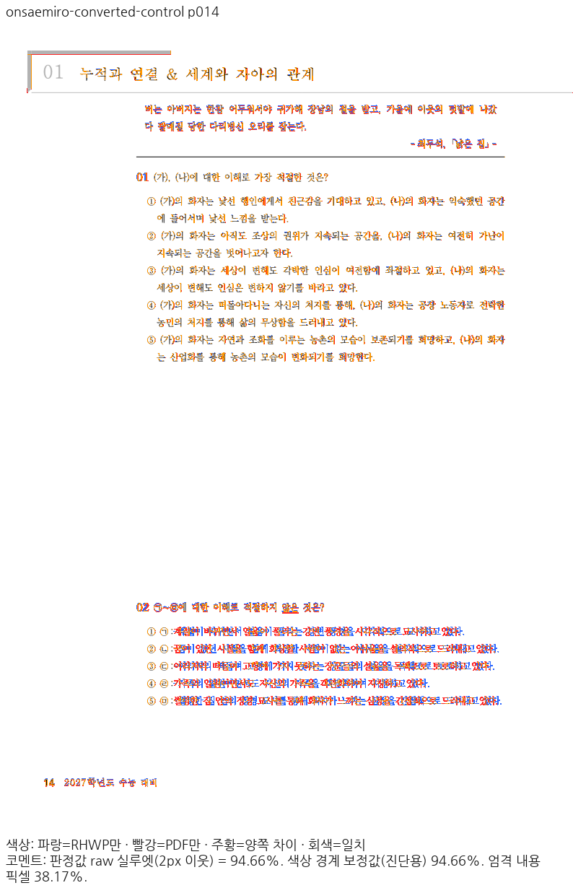 |
| fresh WASM | 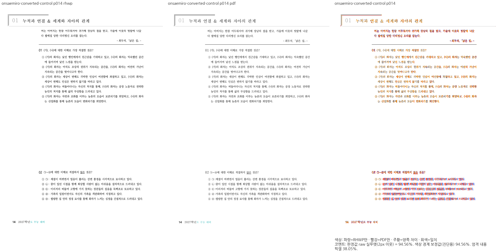 |  |

### Print 19쪽 ↔ rhwp 19쪽

| 경로 | review | overlay |
| --- | --- | --- |
| Native |  |  |
| fresh WASM | 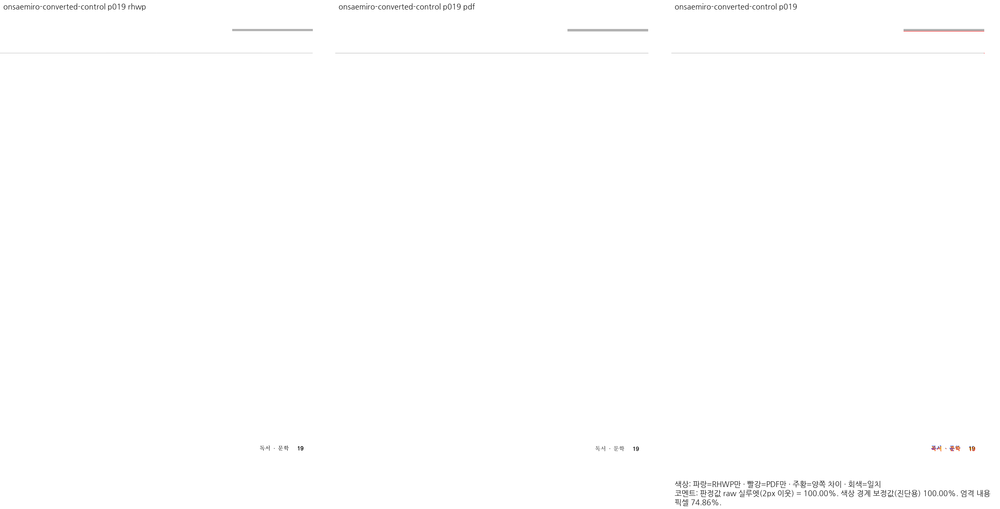 | 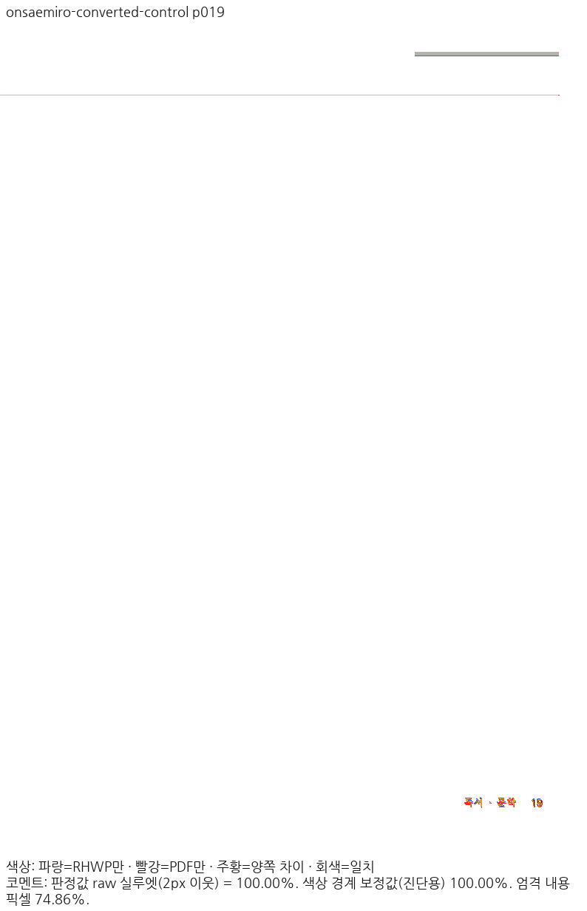 |

### Print 26쪽 ↔ rhwp 26쪽

| 경로 | review | overlay |
| --- | --- | --- |
| Native |  | 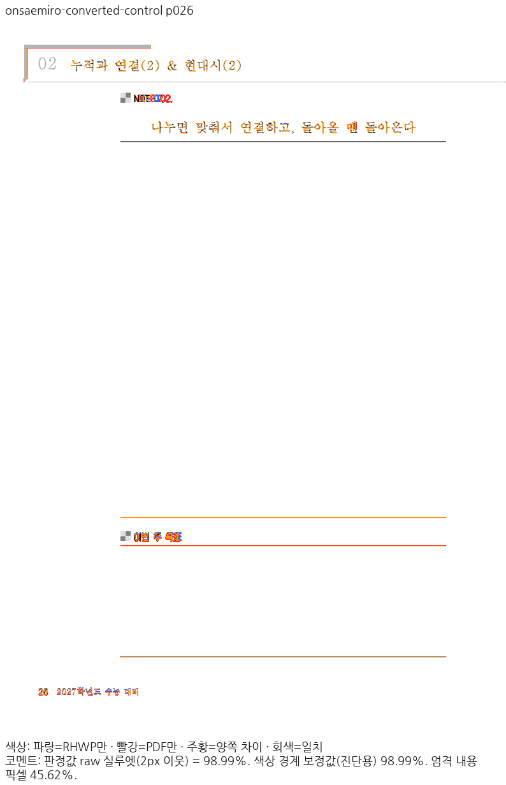 |
| fresh WASM | 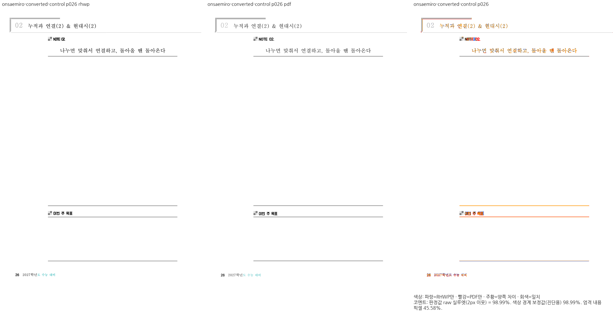 |  |

### Print 46쪽 ↔ rhwp 46쪽

| 경로 | review | overlay |
| --- | --- | --- |
| Native | 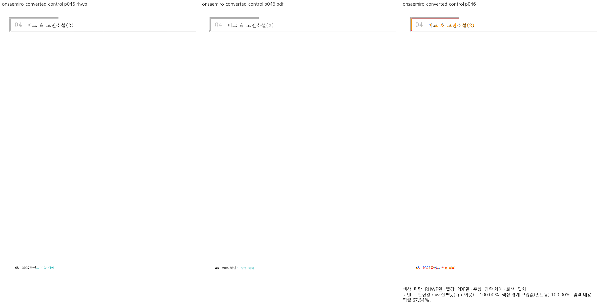 |  |
| fresh WASM |  | 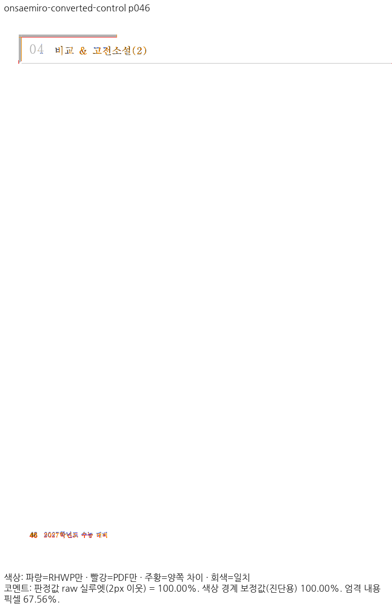 |

## 제출 전 남은 검증

최신 통합 소스의 전체 문서 TSV·고정 devel 대비 페이지별 0.1%p 하락 대조, 전체 nextest·필수 게이트,
Studio 실제 소비와 초기화 JS/WASM 해시 검증은 통합 검증 단계에서 완료해야 합니다.
