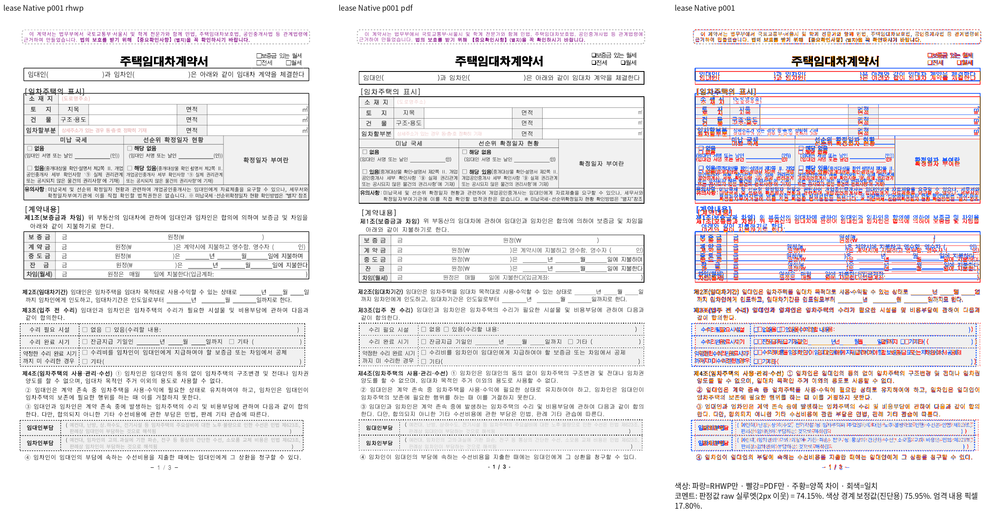
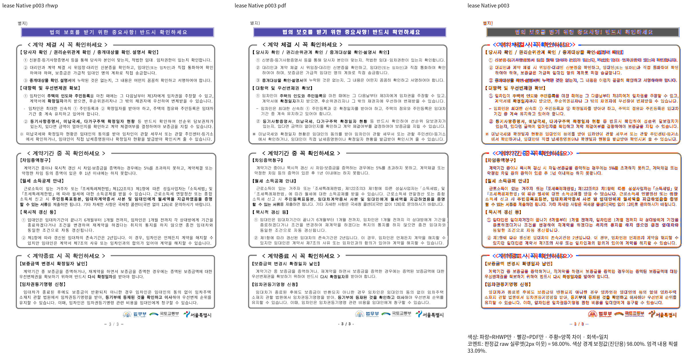

# #7955 주택임대차계약서의 과거 제목 표 px 검사 이관

[후속 이슈 #7955](https://github.com/edwardkim/rhwp/issues/7955)는
[#7445](https://github.com/edwardkim/rhwp/issues/7445)의 하위 이슈이며 본문 표에도
등록했다. 이관은 출력 개선 완료나 이슈 종료를 뜻하지 않는다.

## 입력·독립 기준·범위

- [공용 HWP 원본](../../../../tests/fixtures/issue_7047/housing-lease-standard-form.hwp),
  SHA-256 `fe295c12c5f9bd9e7e73a540c7c7ecd044f18ed58ea9826c0de5d55ba2710439`.
- [독립 한컴2020 PDF3쪽](../../../../pdf/housing-lease-standard-form-2020.pdf),
  SHA-256 `f73f17d57b566d35f1641eef4ba1ab580aaf13725493b29e5ec88e7496e64e39`.
- 기준 Native 실제 빌드 `552514f423ec91f1b7171f6e6b0882a4efe034f2`.
  최신 `fe5725dc384689b45d60ef8ea4c83138bc2701d8`까지 관련
  renderer/paint/parser/model/document_core diff0이다. 새 SHA에서 다시 실행한
  결과로 바꾸어 표기하지 않는다.
- 현재 Native는 `d06b3e03c`+9단계 저장 원점 보정의 소스/바이너리 SHA를 고정했다.
  `stage9-native-provenance.json` 참조. 아래 fresh WASM은 직전8단계의 실제 결과다.

| 쪽 | 고정 base Native | 현재 Native | 직전 fresh WASM |
| --- | ---: | ---: | ---: |
|1|73.62054%|74.14829%|73.94026%|
|2|99.04231%|99.04231%|99.07815%|
|3|97.76720%|98.00453%|97.90961%|

96dpi/2px raw 지표다. 원본·PDF3쪽을 누락 없이 비교했다.
현재1쪽의 제목/주소/서명 등 글자 간격과 표 위치 차이를 PNG로 대조한다.
3쪽의 제목 표 원점은 Print110.1/488.9/847.1px, 현재110.253/489.467/848.040px로
과거108.4/487.6/846.2px보다 근접했다. 현재 수정의 새 회귀를 이관하는 것이 아니다.

## 검사 제거와 정상 범위 보존

[제거 전 소스 전체](issue_7047_textless_host_ladder_spacing.rs.txt)에 원문을 보존했다.
원래 `tests/cases/issue_7047_textless_host_ladder_spacing.rs`에서 제거한 함수는2건이다.

- `the_floating_title_tables_follow_the_same_ladder`: 과거 y108.4/487.6/846.2px 핀.
- `the_remaining_table_gap_stays_within_the_outer_margin`: Print보다 위라는 부호 핀.

두 함수 전용 `TABLE_TOPS`, `TABLE_TOPS_ORACLE`, `TABLE_OM_TOP_LIMIT_PX`도 제거했다.
새 좌표 핀·ignore·조용한 return·수집 제외·baseline 완화는 추가하지 않았다.
정상 글상자 사다리, 제목/첫 본문 비겹침, 로고 정렬/본문 관계3함수는 유지했다.
이 공용 입력을 사용하는 정상 계약을 위해 HWP/PDF도 기존 경로에 유지했다.
최종 유지 검사·manifest/lint는 새 코드에서 실행해 작업 기록에 연결한다.

## 재현과 복원

동일 원본·PDF에 `scripts/visual_sweep.py --file-target lease <위 HWP> <위 PDF>
--compat 2024 --silhouette-only --rasterizer png`를 사용했다. 고정 실행 파일과
후보 `--wasm-pkg`, 동일5개 한컴/KoPub 시스템 글꼴 경로를 지정했다.
전체 명령·TSV·실행 로그는 ignored `output/pr-review/pr7494-20261016/`의
`issue7047-base-native/lease/`, `stage9-lease-native/lease/`,
`issue7047-stage8-wasm/lease/`와 대응 `logs/`에 보존한다.

#7955에서 전쪽 Native/fresh WASM raw90% 이상·쪽수/내용 보존·직접 확대 판독을
완료한 뒤 제목/글상자의 소속·순서·비겹침과 원본 바깥여백 계약을 보호한다.
해당 쪽의 양쪽 raw98%와 직접 판독을 충족하면 독립 ±2px 핀을 별도 적용한다.

