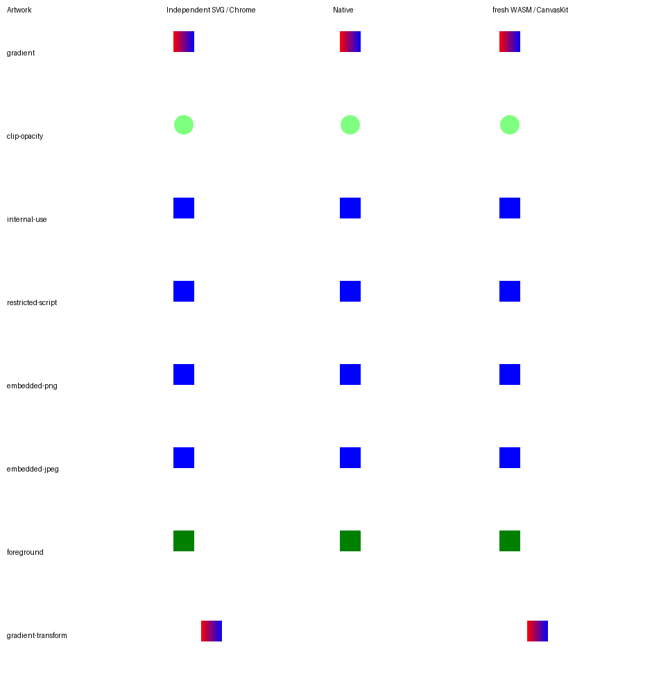

# #8174 V2-S04 검증 자료

제품 source와 필수 실행 결과는 [S04 기록](../../../../working/task_m100_8174_v2_stage4.md)에
연결한다. 실행 로그·브라우저 profile·임시 draft는 ignored `output/`에 남기며 여기에 커밋하지 않는다.

## Source와 출력

- 공통 Rust 제품·Native producer: `e6d7b774c1437ad502a1e702bf8f01f2b6541c28`.
- 최적화 WASM producer: `e6d7b774c1437ad502a1e702bf8f01f2b6541c28`.
- 전체 Rust gate checkout: `e6d7b774c1437ad502a1e702bf8f01f2b6541c28`.
- 최종 Studio 제품·브라우저·전쪽 시각 source: `e6d7b774c1437ad502a1e702bf8f01f2b6541c28`.
- 위 source 사이의 `src/`, `vendor/`, `crates/`, `Cargo.toml`, `Cargo.lock`은 같다.
  Rust producer를 새로 만들고 이후 TypeScript 소비 보정을 검증했다. 다른 source의 결과를
  같은 실행으로 표시하지 않는다. 각 producer의 파일 SHA-256·크기는 `metadata/`에 있다.

[visual-summary.json](visual-summary.json)은 byte 그대로 복사한 전체 TSV의 해시와 최솟값을
제공한다. `pdf/{native,wasm,studio}/`의 41개 입력은 **실제 Studio Worker에서 만든 같은
HWPX**를 사용한다. PDF 입력과 독립 기준은 [fixture 목록](fixtures/pdf-cases.json)에 있다.
각 문서는 한 쪽이며 모든 backend에서 raw 100%다. 전체 RGBA가 Native와 CanvasKit 사이에서
항상 같다는 뜻은 아니다. 같은 producer의 직접 열기와 Worker 경로는 41개 RGBA가 모두 같다.

`forms/{native,wasm}/`에는 동작 전후 한 쪽의 TSV·compare·overlay·review가 있다.
독립 [전](../../../../../pdf/issue8174/studio/button-before-2020.pdf)·
[후](../../../../../pdf/issue8174/studio/button-after-s04-2020.pdf) Print와 대조했다.
TSV는 96.9% 이상이며 한컴 양식 글꼴·classic control 테마 차이는 남아 있다.
계산 값·체크·캡션, 본문 순서·포함·겹침을 직접 판독했으며 절대 px 회귀는 추가하지 않았다.


`svg/`에는 7개 authored artwork와 독립 Chrome SVG 기준·Native·실제 CanvasKit PNG 및
TSV가 있다. 추가 transform은 CanvasKit의 위치 소비를 검사한다. OpenType SVG의 금지 script는
실행하지 않으며 정상 도형은 표시한다. 이 합성 artwork를 한컴 양식 Print 증거로 승격하지 않는다.



일반 표·TAC 문서는 전체 3쪽씩 [보존 결과](preservation/results.json)에 기록했다.
S03 대비 각 backend의 전체 RGB 차이가 0이며 전쪽 TSV도 같다.

## 제어된 명령 단추 입력

[provenance.json](fixtures/provenance.json)에 원본·입력·출력·Print 해시와 CFB stream별 대조를
기록했다. 원본 `samples/form-02.hwp`의 배치는 유지하고 `Scripts/DefaultJScript`와
FileHeader의 script bit만 바꿨다. 명령 단추는 1+2+3+4를 계산해 Edit.Text·CheckBox.Value·
PushButton.Caption을 바꾸며, 실제 pointer click과 HWP/HWPX 저장·재열기로 검사했다.

사용자는 기존 구현된 업무 동작이 없다고 답했다. 이 입력은 재현 가능한 계산 대조군이며
기존 고객 업무의 호환성이나 무제한 JScript 지원을 주장하지 않는다. 한컴 Print 서비스는
`input_preprocess: scripts_disabled`를 적용했다. 따라서 Print는 정적 출력 기준으로만 사용하며,
한컴에서 Click이 실행되거나 script가 보존됐다는 근거로 사용하지 않는다.

## 브라우저 재현

저장소 루트에서 실행한다. Node·Studio 의존성·Chrome/Chromium과 최신 최적화 WASM을 먼저
[개발 가이드](../../../../manual/dev_environment_guide.md)에 따라 준비한다.
`rhwp-studio/public/`과 `pkg/`의 JS/WASM producer가 같아야 한다.
실제 build 명령·환경은 [builds.json](metadata/builds.json)에 있다. WASM은 `CARGO_BUILD_JOBS=4`,
공용 절대 `CARGO_TARGET_DIR`, `CARGO_PROFILE_RELEASE_CODEGEN_UNITS=16`으로
`scripts/wasm-pack-locked.sh --target web --out-dir pkg`를 실행하고 wasm-opt까지 완료했다.
별도 터미널에서 Studio 개발 서버와 배포 preview를 실행한다.

```bash
npm --prefix rhwp-studio run dev -- --host 127.0.0.1 --port 7704 --strictPort
```

```bash
npm --prefix rhwp-studio run build
npm --prefix rhwp-studio run preview -- --host 127.0.0.1 --port 7706 --strictPort
```

설치된 Chrome의 실행 파일 경로를 `CHROME_PATH`로 지정한다. 테스트는 전용 profile과 합성 암호
문서만 사용하며 실제 사용자 파일 저장은 fake File System Access sink로 캡처한다.
다른 사용자 서버나 browser profile을 종료·삭제하지 않는다.

```bash
export CHROME_PATH=/absolute/path/to/chrome
export VITE_URL=http://127.0.0.1:7704
export PREVIEW_URL=http://127.0.0.1:7706
export ISSUE8174_EVIDENCE=output/pr-review/issue8174/v2-s04-reproduce
for case in forms pdf svg links recovery recovery-races recovery-open-races matrix direct-matrix distribution production; do
  node "mydocs/pr/assets/issue8174/v2-s04/reproduce/browser-${case}.mjs" || exit 1
done
```

순서는 유지한다. recovery가 후속 race 검사에 필요한 보호 seed를 생성하고 forms가 production의
공개 저장·재열기 검사에 사용할 주소를 기록한다. `matrix`는 실제 Worker의 HWPX와 CanvasKit
PNG를 만들고 `direct-matrix`는 같은 producer의 기존 직접 경로를 대조한다. 정상 흐름에서는
실제 Worker/WASM을 사용한다. timeout/cancel만 실제 Worker의 owner postMessage를 조용히
만들며, KDF 경합만 실제 Web Crypto 호출 앞에 결정적 대기를 넣는다. `runtime/` JSON에
주장 범위와 assertion을 보존했다. 이 스크립트의 실제 최종 실행 결과는 `validation.json`에 기록한다.
`distribution`은 공개 배포용 HWP의 script envelope·HWPX 저장/재열기 계약이며
독립 Print와의 조판 일치나 새 쪽수 기대값을 주장하는 검사가 아니다.

모달 포커스 검사는 정식 기존 E2E 경로에 있다. `rhwp-studio/`에서 다음 명령을 실행한다.

```bash
node e2e/issue8174-modal-focus.test.mjs --mode=headless
```

## 시각·성능 재현 범위

`metadata/visual-commands.json`에는 실제 Visual Sweep 명령을 보존한다. `$REPO`는 이 저장소
루트이며 실행 시 실제 경로로 바꾼다. `matrix`가 생성한 HWPX를 Native와 fresh WASM에 동일하게
입력한다. `VISUAL_SWEEP_CHROME`과 실제 입력 글꼴 경로를 지정한다. TSV의 raw 일치율·전체
쪽수와 별도로 대표 compare·overlay·review의 색·alpha·문자·외곽·배치를 직접 판독해야 한다.

성능은 필수 Cargo 실행 종료 후 같은 호스트에서 측정한다. S03의 보존한 최적화 package와
현재 producer를 각각 `BASE_WASM_PKG`, `CANDIDATE_WASM_PKG`로 지정한다.

```bash
node mydocs/pr/assets/issue8174/v2-s04/reproduce/performance.mjs
```

탭 첫 입력과 warm·module 초기화·WASM 선형 메모리·동일 producer의 direct/Worker handoff·
실제 KDF/암호화 시간을 나눠 기록한다. UI의 의도적 대기·render 시간은 import latency에서 제외한다.
새 탭을 시스템 전체 cold cache로, 선형 메모리를 프로세스 RSS 상한으로 표시하지 않는다.
