# 설날 문서의 원본 공백과 캡션 그림 글머리표

입력은 `samples/basic/NewYear_s_Day.hwp`, 독립 기준은
`pdf/basic/NewYear_s_Day-hwp-2020.pdf`다. 입력·PDF·판정 문턱을 변경하지 않았다.
정본 Visual Sweep은96dpi·PDFium·Print2022·색상 경계 보정 전2px raw다.

- 원본 TTF 한양해서의 한국어 이름에 기존 HYhaeseo 메트릭을 연결했다. 원본 `useFontSpace=1`의 공백341/1024em과 장평90%를 소비하며, 반각 추정으로 제목 간격이 벌어지던 문제를 복구한다.
- 캡션에도 본문과 같은 문단 머리 적용을 연결했다. 원본 그림 글머리표와 점유 칸·뒤 본문 원점을 함께 복구한다. 문서·쪽 분기나 좌표 이동은 없다.
- append-only 글꼴 변경 기록의 1개 별칭만 추가했다. 다른4개 투영의 의미는 유지하며 봉인 v1·기존 폭 표는 바꾸지 않는다.
- 관계형2건은 실제2FAIL→2PASS다. 원본 속성을 끈 반례·마커 없는 반례도 통과한다. 완료한1·2쪽의 독립±2CSSpx 고정형을 추가해 새3PASS다. 고정형의 수정 전 별도 Rust 실행을 주장하지 않으며, 실제 전 CLI의 원점 실패는 별도 JSON이다.
- 기존 관련14건과 글꼴 규칙 Node55건도 통과했다. root pkg·Studio public·실제 Chrome 초기 JS/WASM GET 해시와 같은1쪽 PNG를 확인했다. WASM은 Mac locked wrapper의 no-opt 로컬 대체 빌드다.

## 전3쪽 비교

| 조건 | 경로 | 1쪽 이전→이후 | 2쪽 이전→이후 | 3쪽 이전→이후 |
| --- | --- | --- | --- | --- |
| minimal | native | 98.79863→98.79863% | 98.87449→98.91391% | 98.42814→98.42814% |
| minimal | wasm | 98.79858→98.79858% | 98.87448→98.91391% | 98.42806→98.42806% |
| original | native | 98.79902→98.79902% | 98.87432→98.91375% | 98.45160→98.45160% |
| original | wasm | 98.79897→98.79897% | 98.87432→98.91375% | 98.45155→98.45155% |

공개 대체 글꼴의 최소 환경과 설치 원본 글꼴 대조를 섞지 않는다. 제목이 있는1쪽은 넓은 배경의
실루엣 때문에 원점이 고쳐져도 raw 점수가 같다. 점수만으로 판단하지 않고 제목 네 음절·공백과
캡션 마름모·본문을 Native/fresh WASM의 같은 쪽 review·overlay로 직접 판독했다.
PDF의 원본 프로그램과 로컬 원본4개 face의458개 문자 윤곽·전진이 모두 같음을 읽기 전용으로
확인했다. 이것은 글꼴 파일 전체의 hash 동일성이나 최소 환경의 대체 glyph 동일성을 뜻하지 않는다.
비공개 글꼴을 추출해 저장하거나 배포하지 않았다.

[원인](cause.json) · [글꼴 감사](all-original-font-audit.json) · [검증](validation.json) · [생산](producer.json)

## 같은 페이지의 전후 증적

### native 1쪽

[before raw](before-original-native-p001-raw.png) · [before PDF](before-original-native-p001-pdf.png)

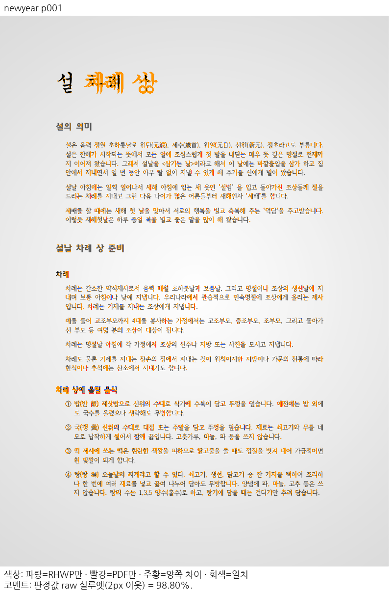

[after raw](after-original-native-p001-raw.png) · [after PDF](after-original-native-p001-pdf.png)

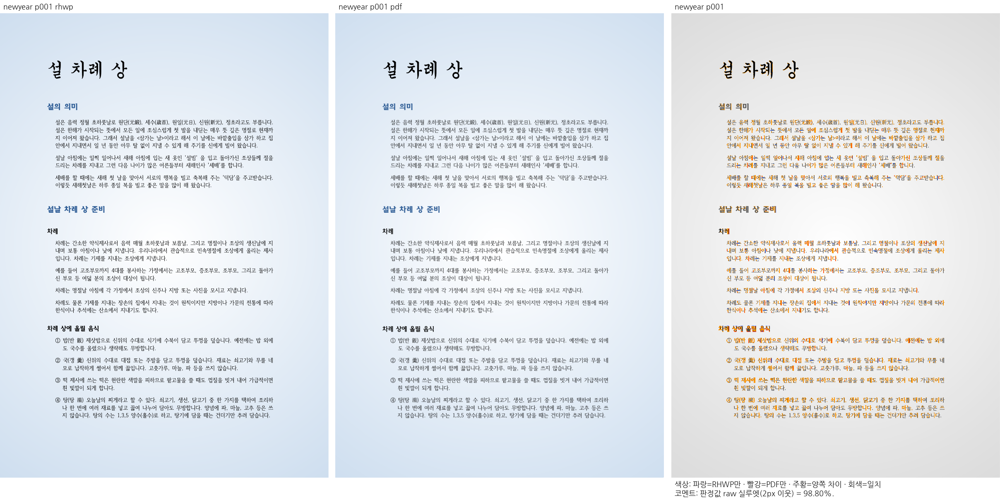

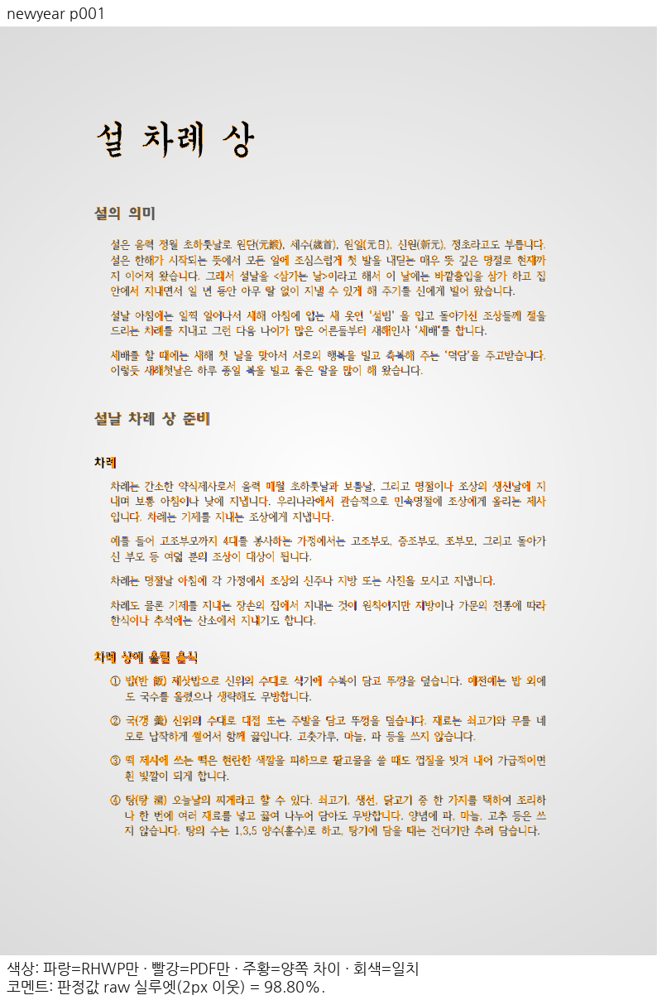

### native 2쪽

[before raw](before-original-native-p002-raw.png) · [before PDF](before-original-native-p002-pdf.png)

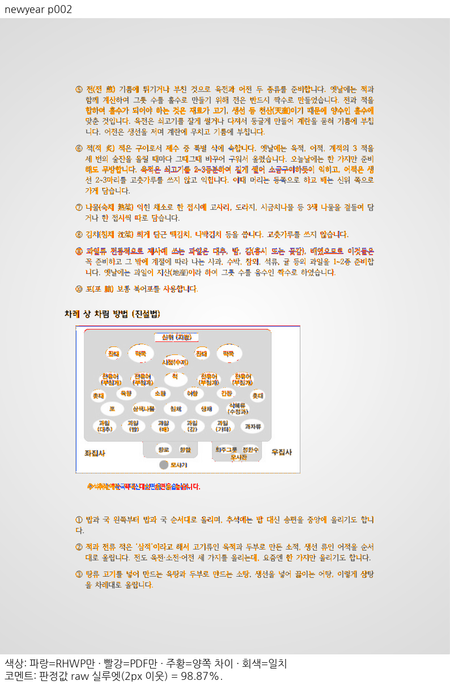

[after raw](after-original-native-p002-raw.png) · [after PDF](after-original-native-p002-pdf.png)

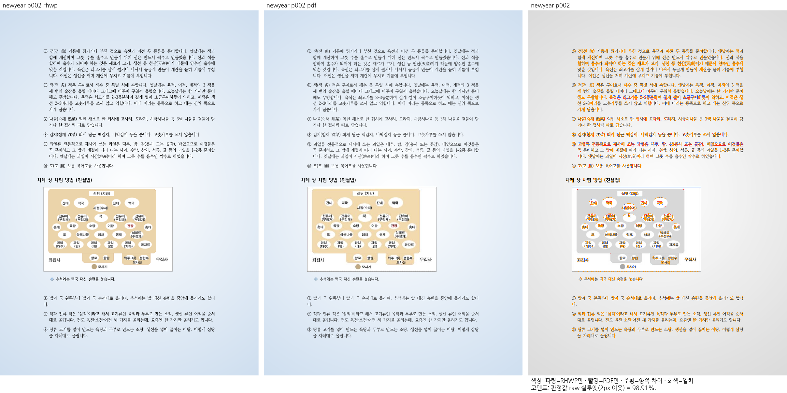

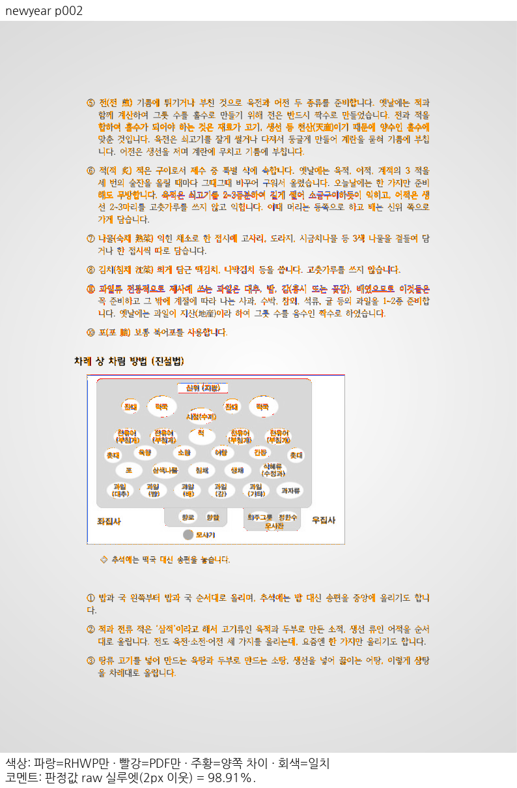

### wasm 1쪽

[before raw](before-original-wasm-p001-raw.png) · [before PDF](before-original-wasm-p001-pdf.png)

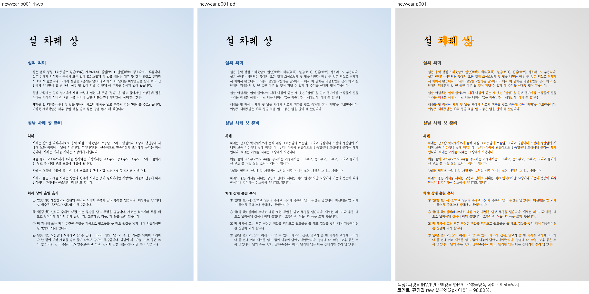

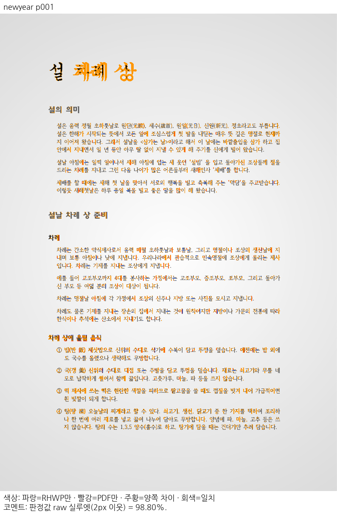

[after raw](after-original-wasm-p001-raw.png) · [after PDF](after-original-wasm-p001-pdf.png)

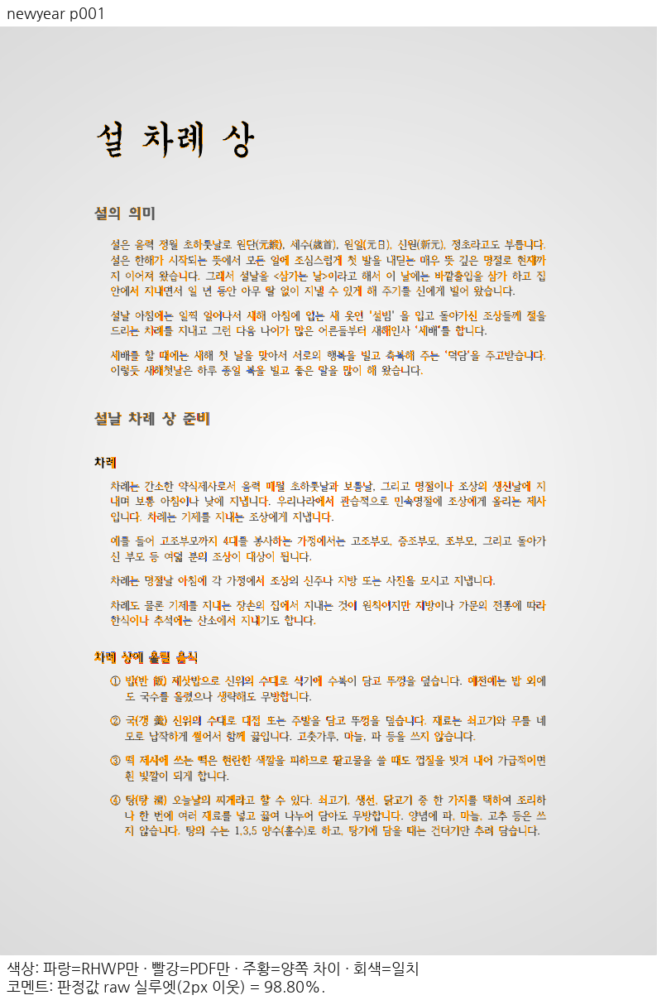

### wasm 2쪽

[before raw](before-original-wasm-p002-raw.png) · [before PDF](before-original-wasm-p002-pdf.png)

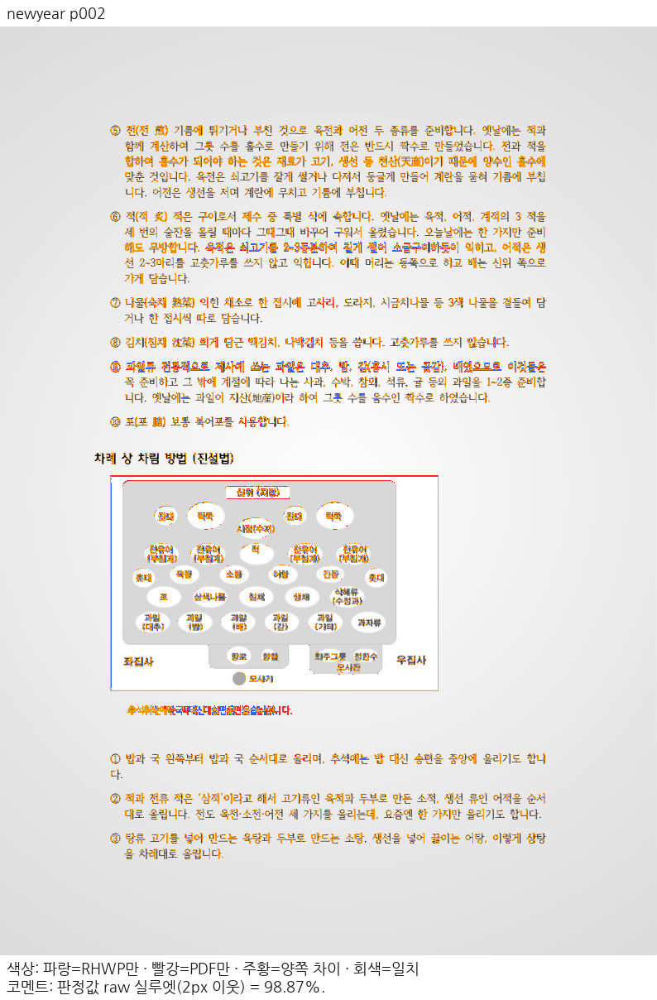

[after raw](after-original-wasm-p002-raw.png) · [after PDF](after-original-wasm-p002-pdf.png)

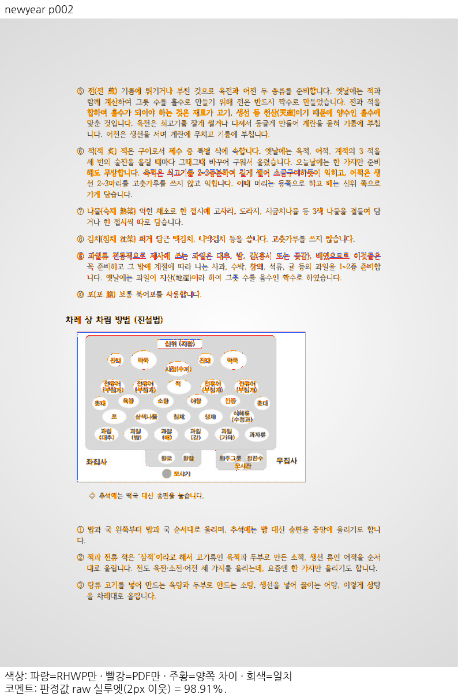

전체219쪽·보호 TSV·편람 gate·최소 글꼴 전체 회귀 및 최종 PR 게이트는 아직 별도 미완료다. 이전8e7867c442의13145PASS/45skip을 이 보정 후 통과로 인용하지 않는다.
