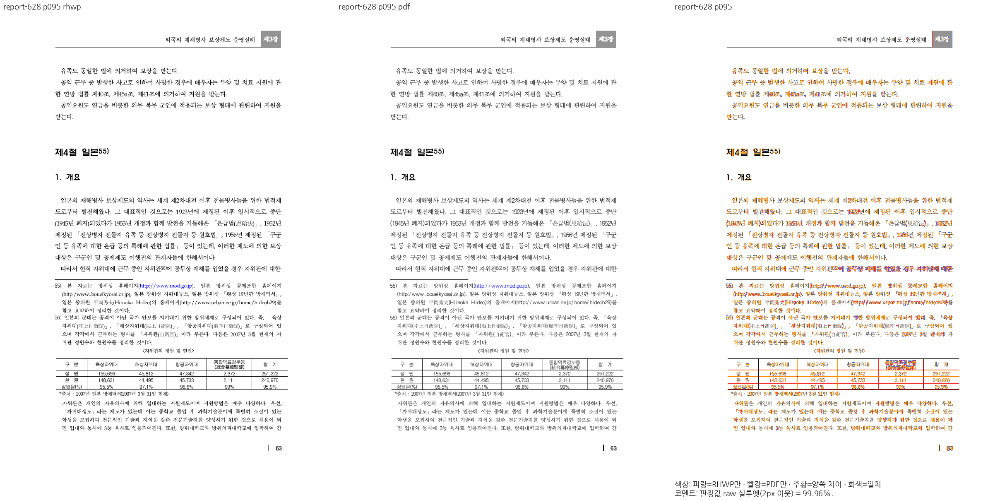
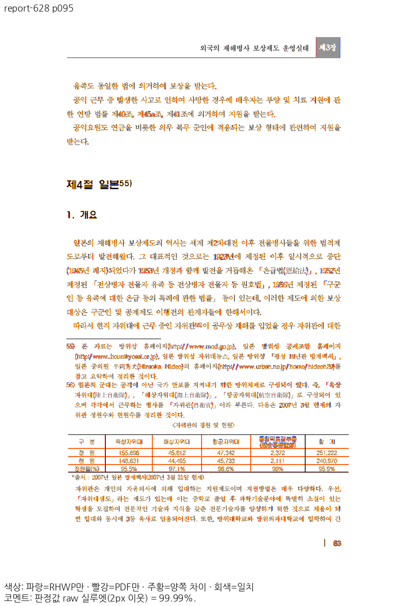
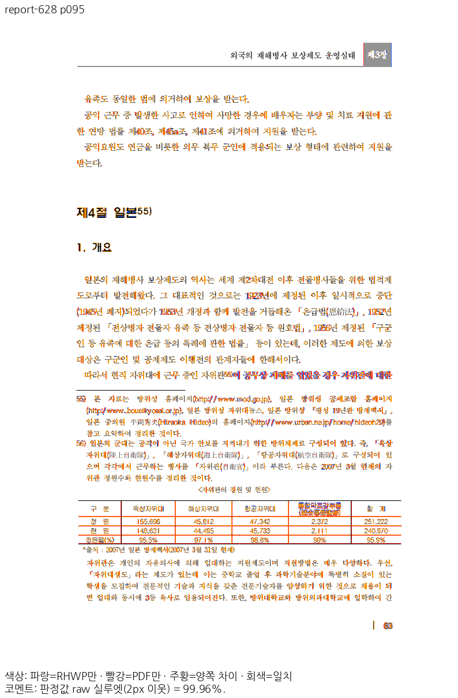
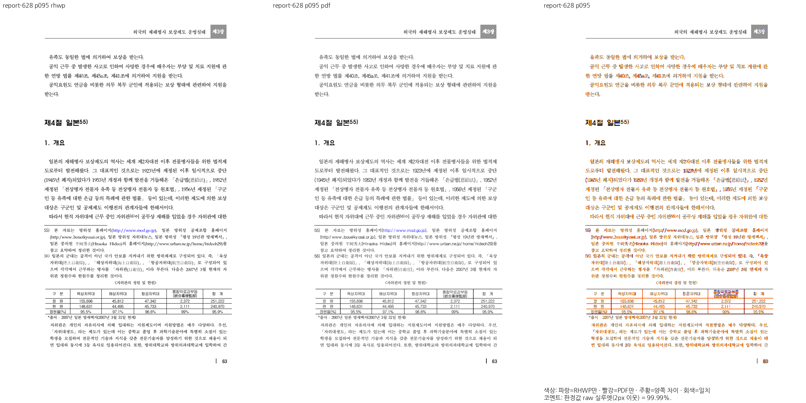
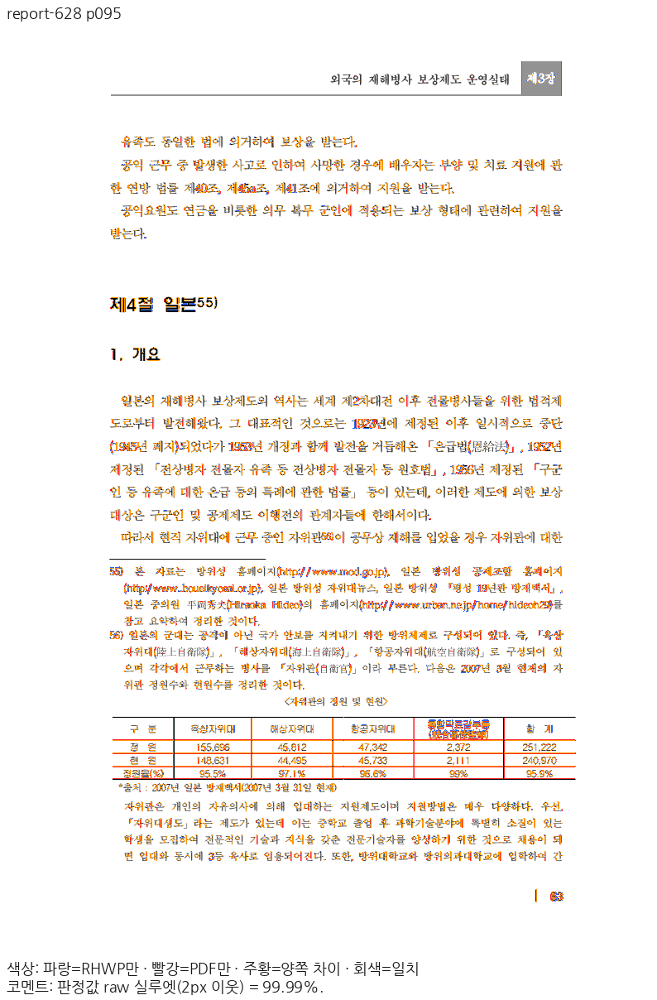

# 참조 번호의 paint 칸과 빈 그림 요청 보정

입력·PDF·판정 기준은 바꾸지 않았다. `report-628-original.hwp`95쪽의 source owner는
구역3·문단472·control0·번호56이다. 참조 번호 paint는 본문 run의 양쪽 정렬·자간·탭을
소비하지 않는데, 측정은 본문 스타일 전체를 복사하여 같은 paint 칸의 폭을13px 또는9px로 바꿨다.
공통 paint 스타일의 자연 칸은15.09375px다. 폭 계산·일반/표 호스트·Native/SVG/Canvas가
같은 공통 결과를 소비하도록 연결했다. 문서명·쪽 번호 분기나 임의 보정값은 없다.

새 관계형2건은 수정 전 runtime에 같은 정식 검사 소스를 연결하여 실제2FAIL,
현재 정식 suite·최소 글꼴 sandbox에서2PASS다. 기존 관련21건과 기존 Native CI 모듈22건도 통과했다.
최소 조건95쪽은 Native97.30697→97.60552%, fresh WASM97.33682→97.63529%다.
원본 글꼴 대조는 Native99.96475→99.99111%, fresh WASM99.96474→99.99110%다.
96쪽 Native99.98260%/WASM99.98259%는 유지했다. 두 조건을 혼용하지 않는다.
이 단계의 증적은95·96쪽 집중 결과이며 새 전체 회귀·보호 TSV 완료를 뜻하지 않는다.

WASM sample10은 원본에 데이터가 비어 있는 그림 칸3개를 보존하면서 빈 URL을 decode해 중단됐다.
빈 payload만 decode하지 않도록 하고, 원본 칸·소속·쪽수는 유지했다. 실제 브라우저에서
수정 전1PASS/1FAIL→이후2PASS다. 비어 있지 않은 손상 PNG의 오류 검출은 유지했다.

Native 전용 기호/그림자 검사의 단일 CI 진입점은 기존 `skia_native_glyph_replay`다.
그림자 fixture만 공용으로 옮기고 기존 exporter 검사 본문을 해당 모듈에 단일 등록했다.
workflow 호출·CI 판정 정책은 바꾸지 않았으며 기존 이름의 중복 wrapper는 없다.

독립 PDF의 숫자 글리프는 실제 내장 Gulim 프로그램이다. 현재 참조의 휴먼명조와 윤곽·전진이
다름을 메모리 대조로 확인했다. 이 글꼴 소유 경로는 다음 단계의 확인 대상이며,
간격 보정·90% 통과만으로 글리프 또는 이슈 전체의 해결을 선언하지 않는다.
글꼴 바이너리·윤곽 복원 자료와 실행 로그는 저장소에 포함하지 않는다.

[생산·검사 범위](validation.json)

## 같은95쪽 원본 글꼴 대조

### Native

### fresh WASM

