# #1891 구판 HWPX 현재 프레임 — 완료 페이지 px 회귀 증거

## 원본과 독립 기준

- [원본 HWPX](../../../../samples/issue1891/80168_regulatory_analysis.hwpx), SHA-256 `1e00b54e1139515258260a657217e0b3baa0b1b652a2cd28dd4b9bc48aa262fe`.
- [독립 한컴2020 Print PDF](../../../../pdf/issue1891/80168_regulatory_analysis-hwpx-2020.pdf), SHA-256 `88996e41ed3e68b15a3cd0eb4eda98845d34225c5dcd2ca547c80ab6e1242744`, 전156쪽. 저장 제품 판정에 따라 compat2022를 사용했다.
- 실제 제품 producer `71e938f4b6e952dfbdd6f33291073f05a0f10ae4`, 비교 base `9418ed0c7cf289c5c4ac2b3bb8cdc18a1b637a9a`. 검사·증적 추가 커밋과 제품 producer를 구분한다.
- 96 DPI CSS px·Print·2px raw 실루엣·canonical PDFium. Native/fresh WASM 전156쪽 최저94.79496%/94.79506%, 양쪽90% 미만0쪽.
- Mac fresh WASM은 locked wrapper `--target web --out-dir pkg --no-opt` 로컬 대체 빌드이며 Docker 최적화 통과가 아니다.

## 실제 회귀와 독립 좌표

[검사 원본](../../../../tests/cases/issue_1891_legacy_hwpx_current_frame.rs)의 기존 관계 검사7건을 유지하고 `completed_table_edges_follow_independent_print_within_two_css_pixels` 1건을 추가했다. 해당 표는 좌표가 아닌 문단 소유와 내용으로 식별한다.

독립 PDF 벡터 괘선 중심의 pt 좌표에96/72를 곱했다. bbox 잉크·글줄 상단과 테두리를 혼동하거나 구현 결과를 기대값으로 복사하지 않았다. 허용 오차는 각 변±2 CSS px다.

| 쪽·표 소유 문단 | 왼쪽 / 위 / 오른쪽 / 아래 기대값(px) | Native / fresh WASM raw(%) | 보호 동작 |
| --- | --- | --- | --- |
| 104·911 | 77.2387 / 240.2174 / 712.2573 / 496.896 | 100 / 100 | 비용 설명 상자의 시작·종료 |
| 104·923 | 77.2387 / 577.448 / 712.2573 / 834.128 | 100 / 100 | 편익 설명 상자와 후속 문단 소유 |
| 56·481 | 96.108 / 392.8507 / 731.2867 / 623.6373 | 100 / 99.99745 | 현재 줄로 조정한 단일 셀 상자 |
| 101·890 | 79.1573 / 534.136 / 714.176 / 628.912 | 99.99195 / 99.98924 | 규제 정비계획 표와 후속 본문 경계 |

동일 핵심 경계의 후보 중 양쪽 raw 최솟값100%→99%대 순서로 선정했다. 표4개·네 변16개를 검사한다. 기존 원문 보존·문단 소유·셀 포함·101→102쪽 이어받기 검사는 그대로 실행한다.

Cargo가 실제 컴파일한 검사 바이너리를 동결한 보정 전 B0 CLI로 실행하면104쪽 문단911의 아래 변이504px로, 독립 PDF496.896px보다7.104px 벗어나 **1건 FAIL**이다. 현재 CLI의 정식 Cargo 실행은 **8 PASS / 0 FAIL**, 새 검사 반복 실행도 **1 PASS / 0 FAIL**이다. nextest의 실행 파일 환경 재지정과 fmt 뒤 suite 재배정 때문에 발생한 초기 준비 진단은 최종 전후 증거에서 제외하고 ignored output에 보존했다.

## 전쪽 TSV 원문과 실제 해시

| 경로 | 전쪽 원본 | SHA-256 | 바이트 |
| --- | --- | --- | --- |
| native | [native.tsv](tsv/native.tsv) | `35912ce54b646c06bd08b5988417d6d98c11000fc2f177b6321c0e3f1d236775` | 4183 |
| wasm | [wasm.tsv](tsv/wasm.tsv) | `6650f24945b246abae5420384d27b59dd7a39f44210958007486d409c29ed30a` | 4163 |

## 56쪽 review·overlay

| 경로 | review | overlay |
| --- | --- | --- |
| native | 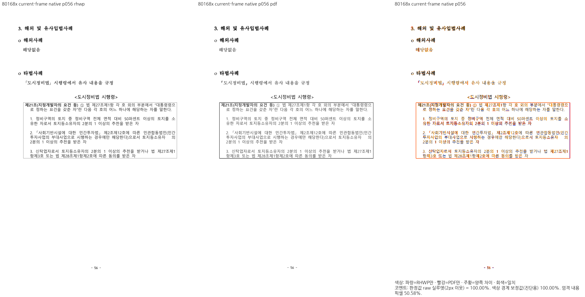 | 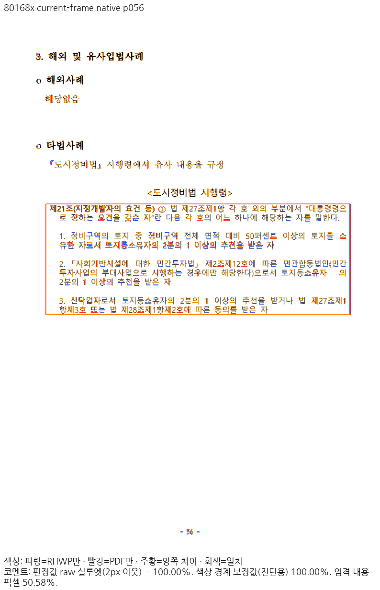 |
| wasm | 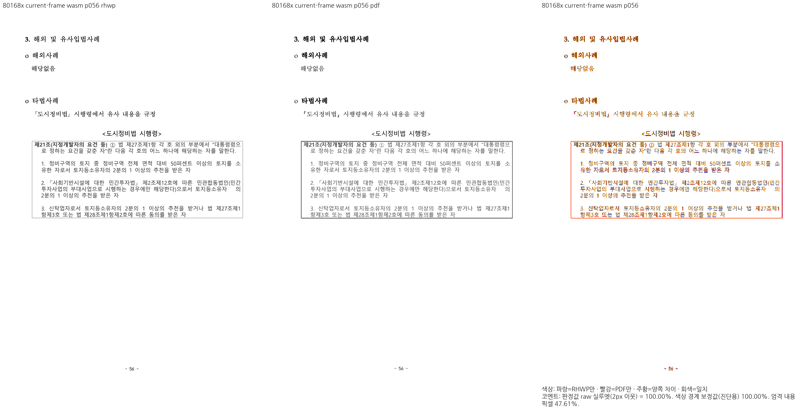 | 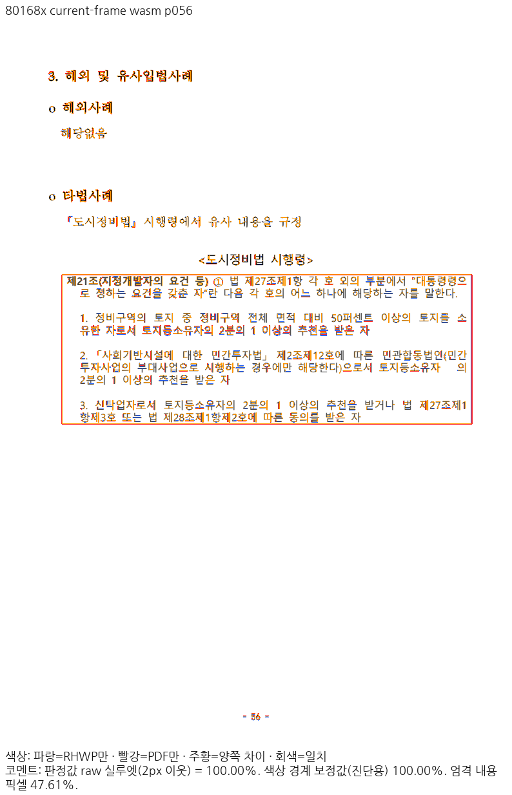 |

## 101쪽 review·overlay

| 경로 | review | overlay |
| --- | --- | --- |
| native | 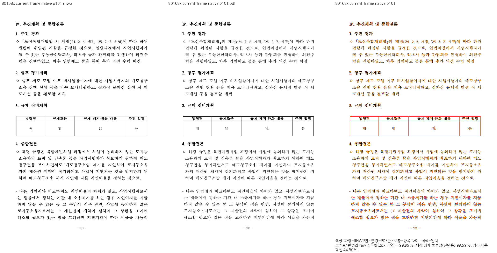 | 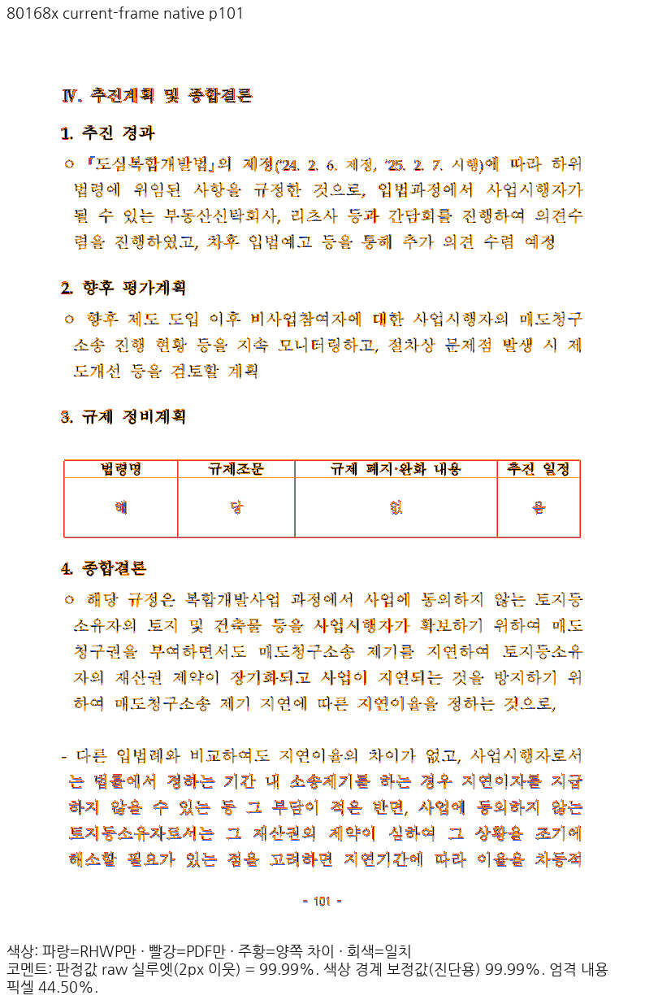 |
| wasm | 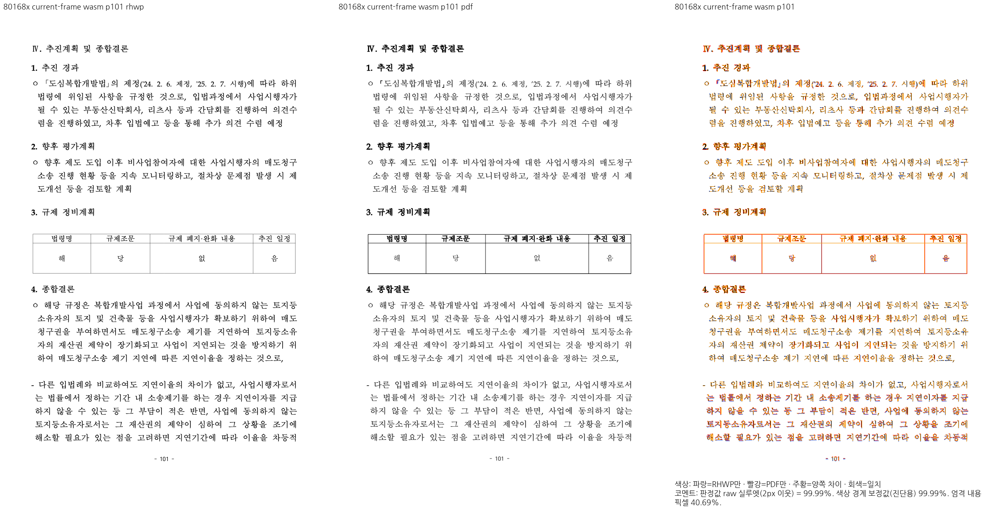 | 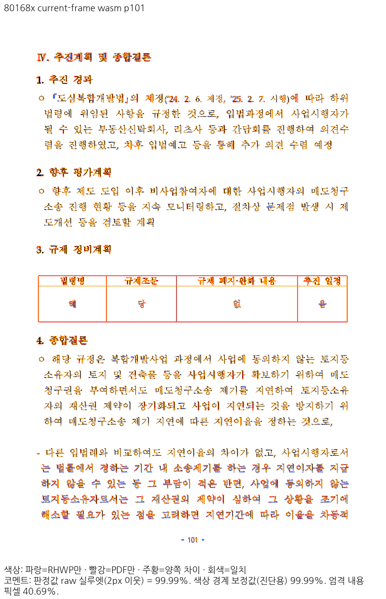 |

## 104쪽 review·overlay

| 경로 | review | overlay |
| --- | --- | --- |
| native | 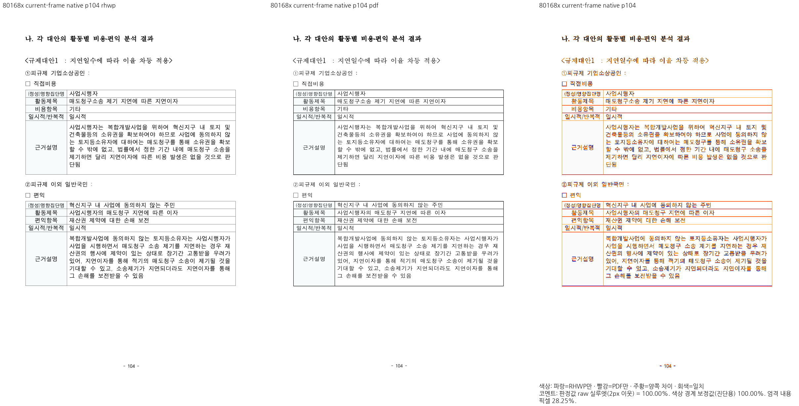 | 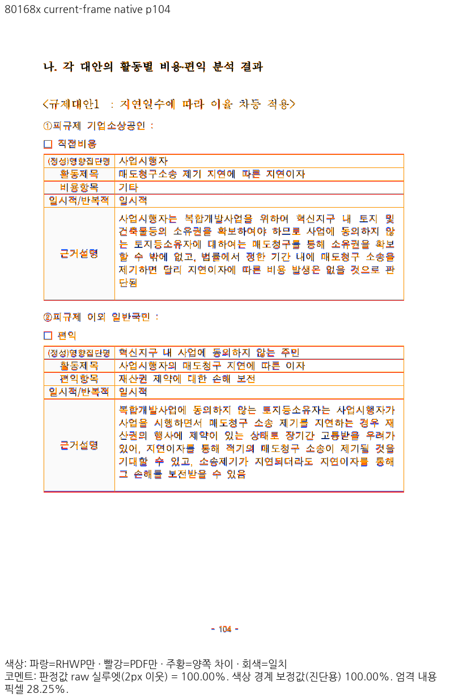 |
| wasm | 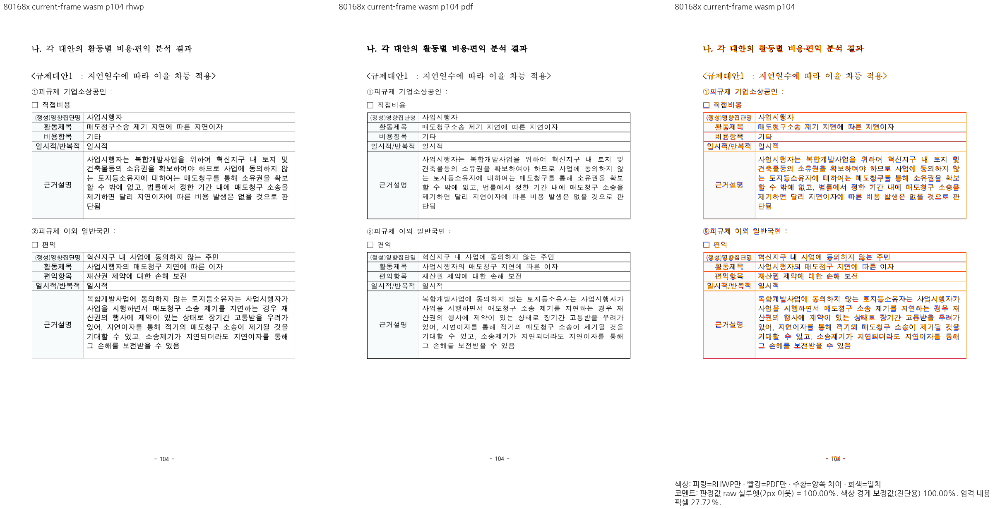 | 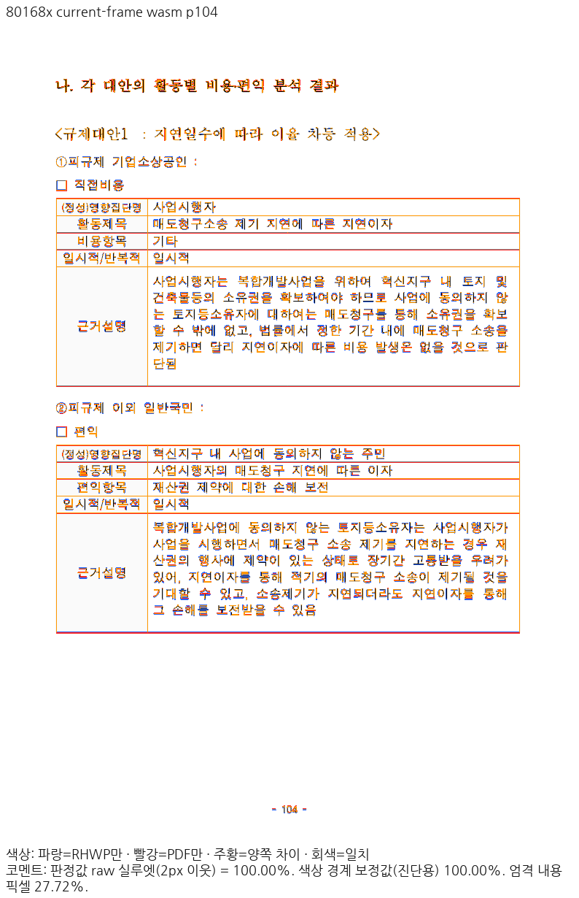 |

직접 판독: 56쪽 인용상자의 첫·끝 줄과 안여백, 101쪽 표와 종합결론·102쪽 꼬리의 소유, 104쪽 비용/편익 두 상자의 테두리와 본문 포함을 확인했다. 글리프 가장자리·획 두께·테두리 raster의 미세 차이는 남고 픽셀 동일성은 주장하지 않는다. [최종 검증 원장](validation.json)에 원본·PDF·글꼴 프로그램·binary/WASM·원본 TSV/PNG 해시와 네 변의 실제 차이를 기록했다.

이 문서의 수용은 통합 PR 전체의 시각 미달·쪽수 불일치 해소 또는 제출 승인을 뜻하지 않는다. 로그·중간 JSON·글꼴 바이너리는 이 증적에 포함하지 않았다.
