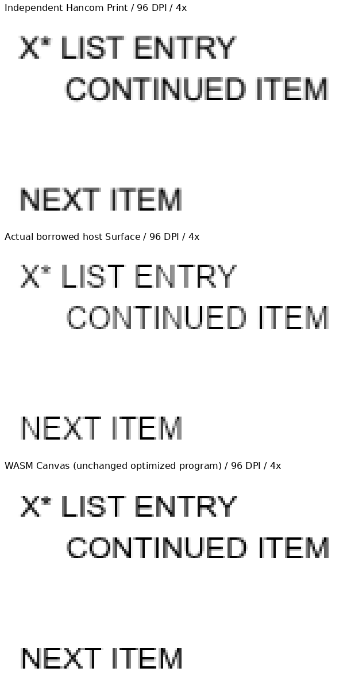
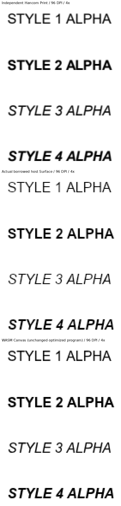
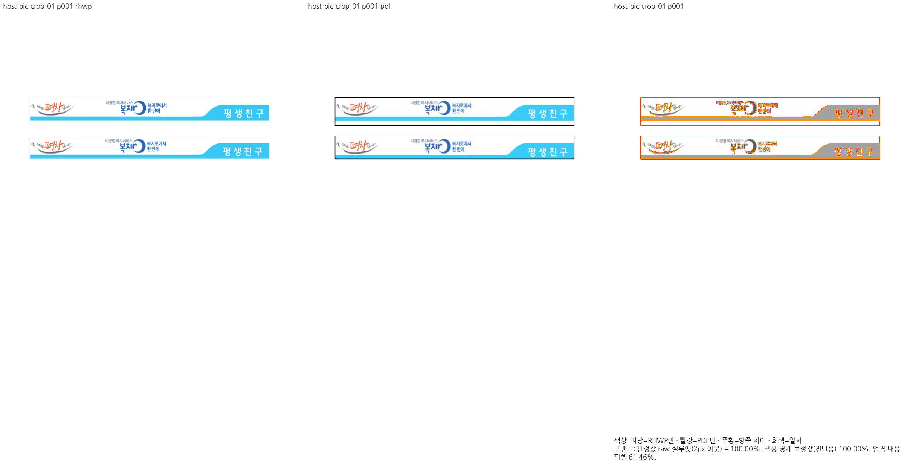
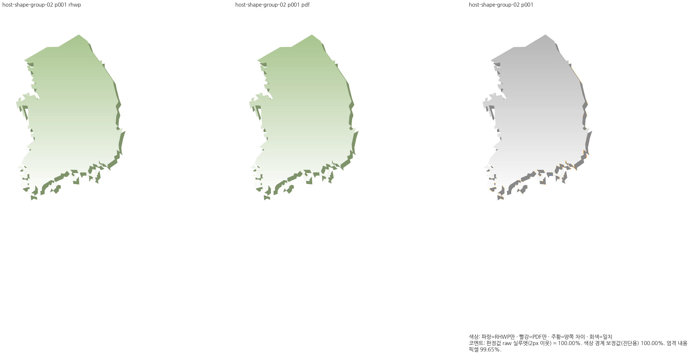

# P66–P68 묶음 검토 증거

## source와 검증 경계

base는 `f45878c7caafb43ca1fd017ddd93484a0acc6ad2`, 원 P68 code head는
`e2c28d8d8eeb75aa73872145b9d076428d832c80`, 통합 code head는
`0b1c97075c0d2f7edb90dba781f9f7585bcfc627`다. 통합 tree
`fd971bc26bd0961b6123cadcaf61108057f0986a`는 최신 base와 원 head의 자동 merge-tree와 같다.
source/test/fixture/workflow 보정은 추가하지 않았다. Draft #7932는 제외했다.

원 P68 head의 [Full CI](https://github.com/edwardkim/rhwp/actions/runs/39396877382),
[CodeQL](https://github.com/edwardkim/rhwp/actions/runs/39396877225),
[Render Diff](https://github.com/edwardkim/rhwp/actions/runs/39396876825)는 실제 성공했다.
검토 중 같은 광범위 Rust 회귀를 반복하지 않았으며, 통합 source의 집중38개는 별도로 실행해
38 PASS를 확인했다. 새 통합 PR의 CI는 아직 실행하지 않았다.

공유 `target/pr-review`에서 Native CLI/lib를 빌드했다. 기존 최적화 WASM은 #8109의
동일 producer `b8c20fcf...640ffe1`을 재사용했다. 이번 production 변경은 native-skia 모듈과
동일 feature로 제외되는 Native session의 field/분기뿐이며 기본 WASM의 실행 코드는 바뀌지 않는다.
현재 입력에서 WASM Canvas를 다시 실행했으나 새 WASM 빌드라고 기록하지 않는다.
상세 파일·font 프로그램 hash는 [producer.tsv](producer.tsv)에 있다. 폰트 bytes는 커밋하지 않았다.

## 전체 페이지와 실제 API

[입력 원장](inputs.tsv)의 기존 원본4개·독립 Print4개 모두 HEAD blob과 실행 파일의 SHA가 같다.
각각 전체1쪽이며 Native/WASM·새 API의 출력도1쪽이다. [base 대조](devel-comparison.tsv)는
Decimal로 비교했고 최대 하락0.00000%p, 0.1%p 이상 하락0쪽이다. base/후보 Native RGB도
네 입력 모두 byte-identical이다. raw는 색상 경계 보정 전2px 실루엣 값이다.

| 문서 p1 | Native base/후보 | WASM base/후보 | prepared / host |
| --- | ---: | ---: | ---: |
| body-list-typed | 100.00000 | 100.00000 | 100.00000 |
| helvetica-styles | 99.63470 | 99.63691 | 99.63470 |
| pic-crop-01 | 99.99508 | 99.29125 | 99.99508 |
| shape-group-02 | 100.00000 | 100.00000 | 100.00000 |

모든 [base Native](base/native/), [후보 Native](candidate/native/),
[동일 producer의 WASM](shared-wasm/)과 [실제 API](consumer/) TSV는 생성 원문을
바이트 그대로 복사했다. Native/WASM 비교 조건은96DPI·compat2022·print·동일 font 공급이다.

[실제 소비 진단 source](consumer_probe.rs)는 product/suite를 대신하지 않는 검증 driver다.
실물4개 × scale0.75/1/1.25에서 공통 plan의 output 크기, prepared의4개 이동/음수/off-page
window와 full-page crop, borrowed Surface의 전체 pixels 및 matrix/clip/save 복원을 검사했다.
prepared/host/full output은 같은 옵션에서 바이트가 같았다. 독립 Print 비교용 PNG는 scale1의
실제 API 출력이다. 세션 cache의 moving windows는 기존 Screen 계약을 별도로 검사했다.
Native renderer는 원장 font6개, 세션은 제한 안의 Arial4개를 명시 공급했다.
처음 전체6개를 Native session에 넣은 시도는 TTC face별 보관량의 기존64MiB 한도로 정상
거절됐다. 이를 제품 회귀로 세지 않았고, 한도를 완화하거나 source를 바꾸지 않았다.

## 확대 판독과 남은 차이

독립 Print·실제 host·WASM의 목록과 네 style을 같은 영역4배로 직접 판독했다.
계속 줄·뒤 본문·baseline·bold/italic·간격이 보존됐다. 그림 두 개의 crop·배치와 그룹 도형의
gradient·외곽·그림자를 review/overlay로 대조했다. 새 위치·내용 누락 차이는 없다.
pic-crop의 PDF 검은 테두리와 rhwp의 가는 회색 테두리, 글자 농도/antialiasing은 기존 base에도
동일한 잔여다. 높은 raw를 RGB100 또는 완전한 한컴 일치로 해석하지 않는다.
overlay PNG의 raw는 pic-crop에서100.00000%, 원문 TSV는99.99508%이며 둘 다 보존한다.
수식·pagination·저장 LineSeg 수용 조건은 이번 변경 대상이 아니다.






## 성능과 선택적 Vulkan

[성능 원문](performance.tsv)은 캐시 off/on 순서를 교차한9쌍이다. 워밍업1쌍은 제외했고,
각 표본은 첫 준비 요청 뒤20개 이동 영역 반환 시간이다. 아래 값은 요청당 중앙값 ms다.

| 문서 | cache off | cache on |
| --- | ---: | ---: |
| body-list-typed | 0.50973 | 0.03842 |
| helvetica-styles | 0.38139 | 0.03940 |
| pic-crop-01 | 1.13168 | 0.03953 |
| shape-group-02 | 1.89224 | 0.03864 |

각 표본의 준비 요청을 포함한 replay는 off21회/on1회, warm hit는 off0회/on20회였다.
이는 Rust Native session의 반환 시간이며 window 표시·GPU present·FPS·장시간 RSS 보증이 아니다.
8MiB 기본 cache·128MiB bitmap 계약은 Skia intermediates·font·호출자 버퍼를 제외한다.

원 P68의 `tools/skia-surface-probe`를 실제 실행해 llvmpipe LLVM20.1.2 Ganesh Vulkan의
borrowed Surface·내부색·상태 복원·invalid 인수의 pixel 보존을 통과했다. 소프트웨어 장치이며
하드웨어 가속·Metal/Windows·presentation 검증으로 표시하지 않는다.

## 재현 명령

```sh
# 공유 target에서 순차 실행한다. source/candidate와 Cargo.lock을 먼저 고정한다.
node scripts/rust-test-suite-manifest.mjs --prepare
CARGO_BUILD_JOBS=6 cargo nextest run --locked --cargo-profile release-test \
  --target-dir /home/edward/mygithub/rhwp/target/pr-review --features native-skia \
  --test regression_suite_010 --test regression_suite_025 \
  --test regression_suite_023 --test regression_suite_007 \
  -E 'test(/(^|::)(skia_region_plan|issue_536_native_region_cache|skia_host_surface|issue_536_native_viewport)::/)' \
  --test-threads 4
CARGO_BUILD_JOBS=6 cargo build --locked --profile release-test \
  --target-dir /home/edward/mygithub/rhwp/target/pr-review --features native-skia --lib --bin rhwp
# Native CLI와 --wasm-pkg의 동일 프로그램을 각각 사용한다. 각 입력의 전체 쪽을 실행한다.
VISUAL_SWEEP_CHROME=<검증한-Chromium> venv/bin/python scripts/visual_sweep.py \
  --silhouette-only --rasterizer png --hwp <inputs.tsv의-input> --pdf <reference> \
  --key <key> --rhwp-bin <고정-producer> --compat 2022 --dpi 96 \
  --font-path <동일-hash의-font-공급> --embed-fonts full --out <backend별-output>
# 실제 API PNG는 --png-pair <API-PNG-dir> <동일-PDF-PNG-dir>로 측정한다.
VK_ICD_FILENAMES=/usr/share/vulkan/icd.d/lvp_icd.json CARGO_BUILD_JOBS=6 \
  CARGO_PROFILE_RELEASE_LTO=false CARGO_PROFILE_RELEASE_CODEGEN_UNITS=16 \
  cargo run --locked --release --manifest-path tools/skia-surface-probe/Cargo.toml \
  --target-dir /home/edward/mygithub/rhwp/target/pr-review
```

진단 driver는 같은 Native build의 rlib와 skia-safe/image/serde_json artifact를 `rustc --extern`으로
연결했다. artifact는 같은 build의 `--message-format=json`으로 확인했다. 입력 manifest는 위 원장의
key/input/reference로 만든 `cases.json`, font 공급은 driver에 명시한 로컬 경로다.
전체 명령·원시 API·로그·중간 JSON은 ignored `output/pr-review/seo-rii-20261021/`에 보존한다.
