# 원본 그림 띠와 중첩 표 종료 경계의 검증 증거

- 렌더 source: `4adb7faf48ec055d45e1db5a0bd2160ff6e6b995`, 기준 devel: `9418ed0c7cf289c5c4ac2b3bb8cdc18a1b637a9a`.
- 원본 HWP와 독립 한컴 Print PDF를 그대로 비교했다. 새 Print 3종의 엔진·방식·입력/PDF SHA는 `pdf/pr7518_review/print-20261024/provenance.json`을 따른다.
- 전체 9조건 52쪽을 Native와 표준 release fresh WASM 각각 검증했다. 원문 TSV는 바이트 그대로 보존했다. 색상 경계 보정 전 raw, 96 DPI, `--compat 2022`다.
- `compat 2022`는 RHWP의 조판 호환 설정이며 한컴 Print 엔진의 연도가 아니다. 새 기준은 한컴 2020 엔진 11.0.0.9136의 Print method 0이다.

| 입력 조건 | 쪽수 | Native 최저 raw | fresh WASM 최저 raw |
| --- | ---: | ---: | ---: |
| picture_band_cell_spaces | 2 | 99.78422% | 99.79300% |
| nested-split | 6 | 99.96132% | 99.95693% |
| terminal-follower | 3 | 96.29239% | 96.25666% |
| terminal-tail | 3 | 99.78422% | 99.79300% |
| valid_orientation-nested-auto-row | 8 | 99.96132% | 99.95693% |
| valid_orientation-nested-mixed-cell | 8 | 99.96132% | 99.95693% |
| valid_generated-nested-split | 6 | 98.18859% | 98.23737% |
| valid_generated-nested-auto-row | 8 | 98.18859% | 98.23737% |
| valid_generated-nested-mixed-cell | 8 | 98.18859% | 98.23737% |

## 직접 판독과 회귀 조건

원본 p2의 그림 띠, 중첩 표 p4의 마지막 빈 행 하단과 p5의 이어받기 원점에 대해 Native/fresh WASM review와 standalone overlay를 같은 독립 PDF와 직접 대조했다. 내용 순서·셀 소속·누락·중복과 앞뒤 물리 프레임을 함께 확인했다. p4는 양쪽 raw 100%, p5는 Native 99.99880% / fresh WASM 100%다.

기존 outer top=0 및 각 행 120px 기대값은 독립 Print와 다르므로 새 이름 `nested_split_fragments_preserve_source_ownership_and_physical_closure`에서 원본 셀의 소유·순서·보존과 부모 포함 관계를 검사한다. 독립 Print 96 DPI 경계는 `completed_nested_split_pages_keep_independent_print_edges`에서 ±2px로 보호하며 관계 검사도 유지한다.

독립 경계: p4 부모 시작/종료 58.4040/437.5507px, 자식 시작/종료 79.9467/431.8053px, p5 자식 시작/종료 63.9893/183.6693px. 이 값은 구현 상수가 아니다. 두 새 검사는 수정 전 d007b6d1f3에서 자식 닫는 띠 포함 위반 및 p4 부모 종료 440.3px로 각각 실패했고, 수정 후 4adb7faf48에서 모두 통과했다. 집중 50모듈은 250 PASS / 0 FAIL / 1 ignore다.

실행 로그와 중간 receipt는 `output/pr-review/semanticist21-20261019/`에만 보존한다. 이 증거는 전체 Rust 및 광범위 fresh WASM 검증의 완료를 대신하지 않는다.

## 대표 이미지

### native picture_band_cell_spaces p002

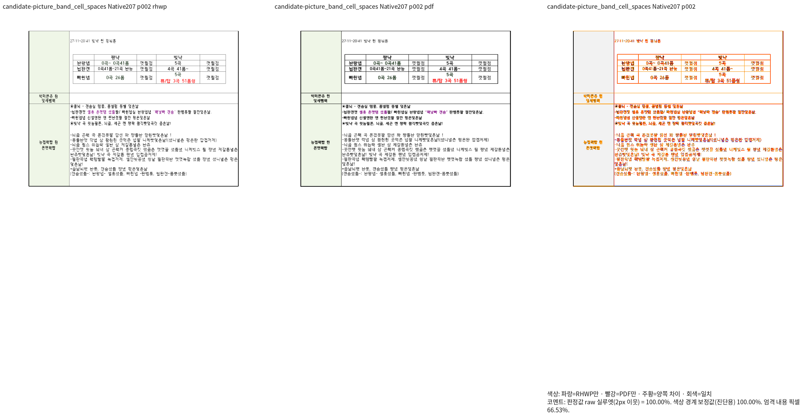
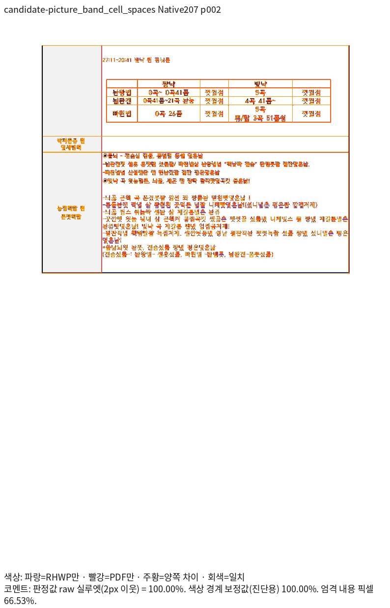

### native nested-split p004

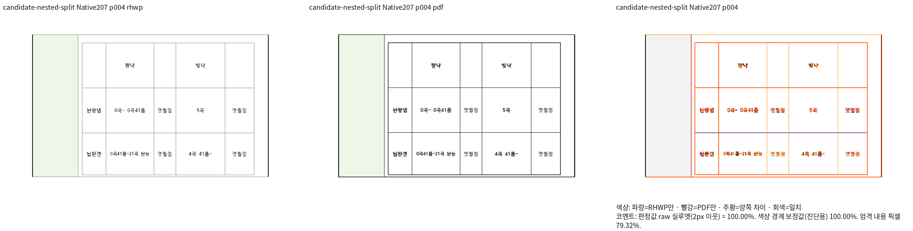
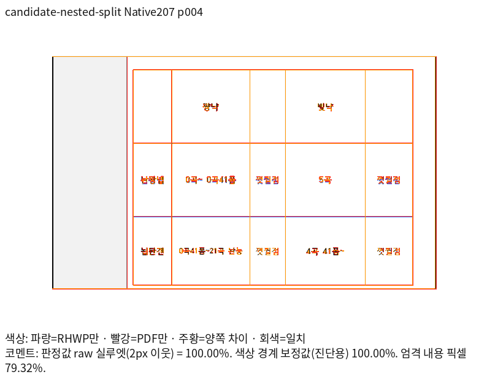

### native nested-split p005

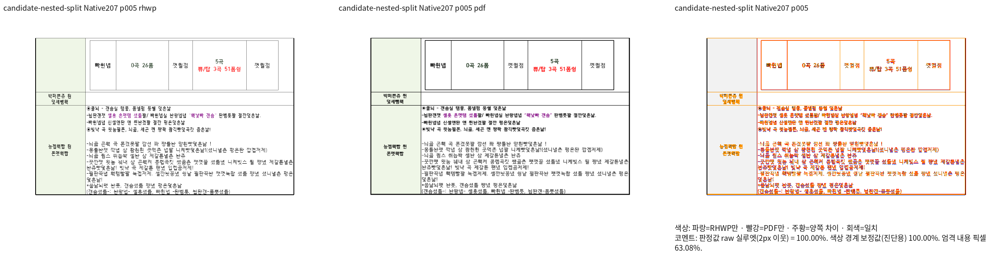
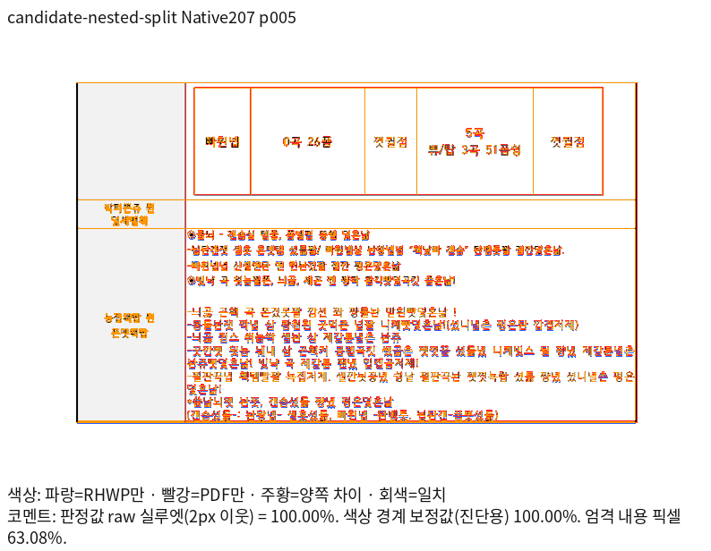

### fresh-wasm picture_band_cell_spaces p002

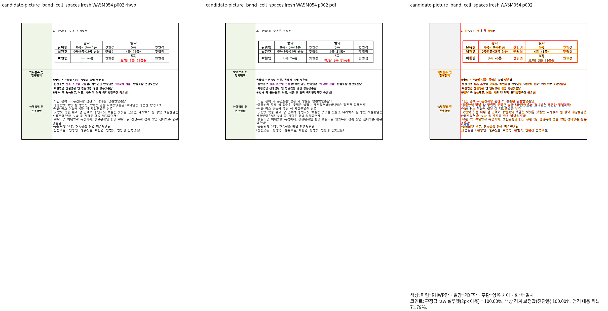
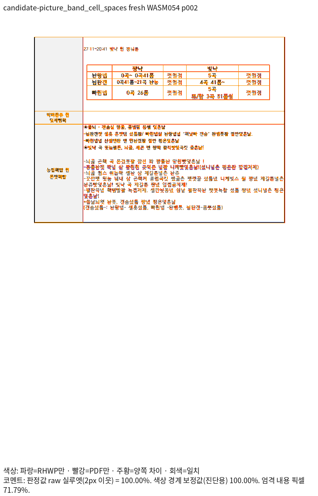

### fresh-wasm nested-split p004

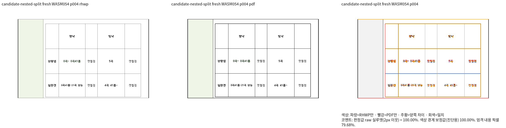
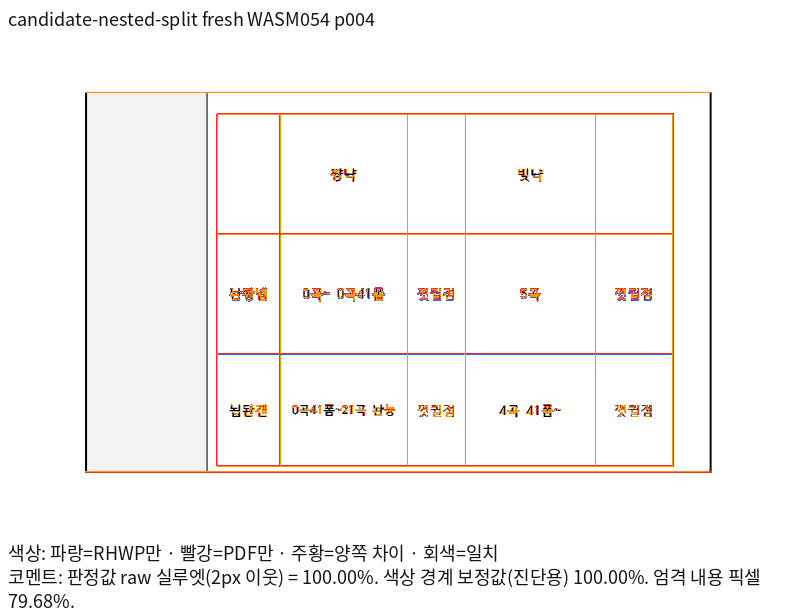

### fresh-wasm nested-split p005

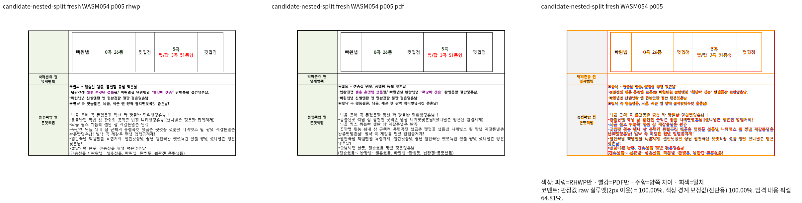
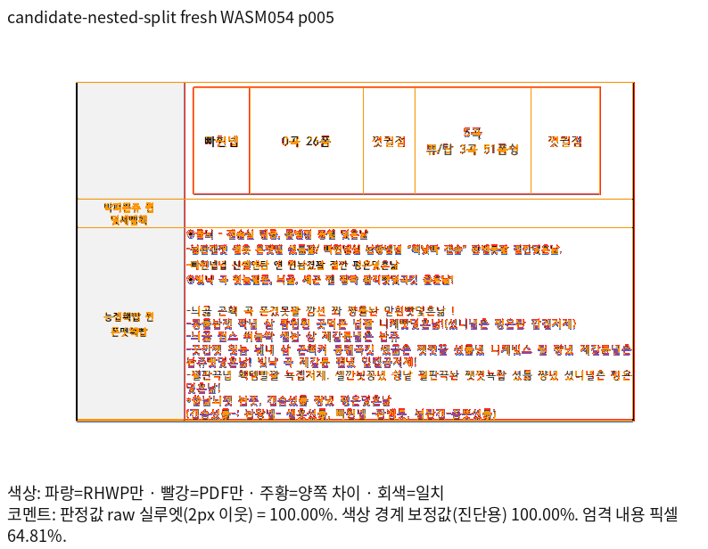
