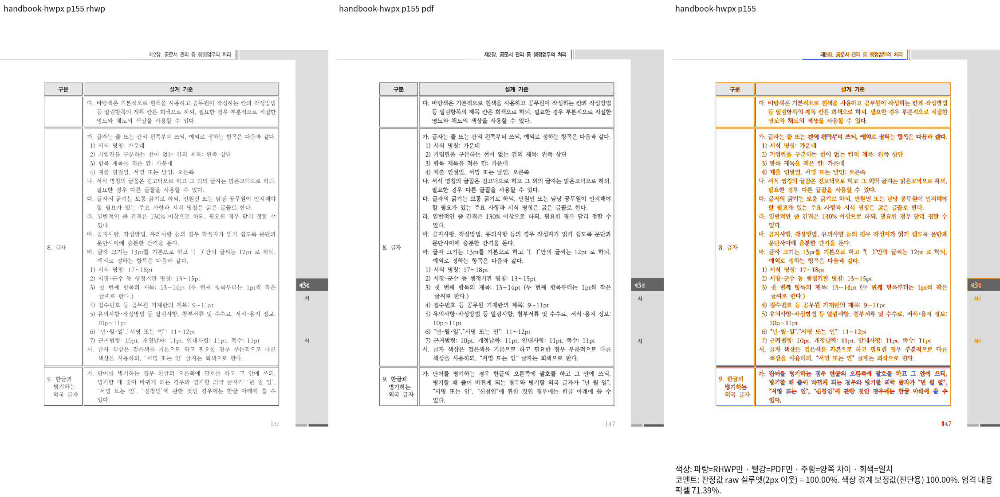
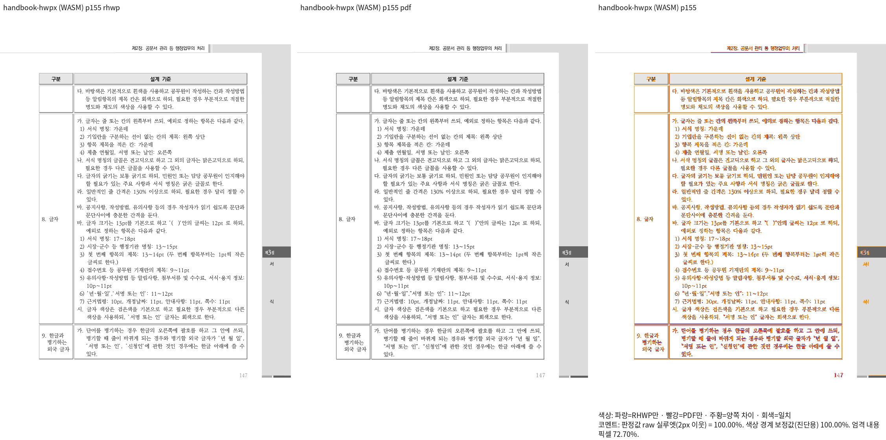

# 편람의 셀 간격과 문단 프레임 경계

## 검증 범위와 실제 producer

원본 HWP/HWPX와 각각 독립 한컴 2024 KoPub Print의 전 383쪽을 비교했습니다.
파일 기준 155쪽은 인쇄된 쪽 번호 147쪽입니다. Native source는
`b7443d43281e10f15c32cdd24ec340f73462b060`이며 새 base는
`a6e9d18fc1061318055b4eb348daec201427ea03`(#8135)입니다.
최적화 WASM은 `f341e9e2b398d79c85f42135a05f33e7f27fff56`에서 실제 빌드했습니다.
리베이스 전후 실제 dep-info의 컴파일 입력 1,532개와 Cargo.toml·Cargo.lock·build.rs가
바이트 단위로 같았고, 새 base의 변경은 WASM에서 제외되는 Native 모듈·검사·도구·문서입니다.
빌드 시 Git SHA를 삽입하지 않으므로 같은 패키지를 재사용했습니다. 실제 빌드 SHA와
현재 Native source SHA를 구분해 기록하며, 새 head의 WASM 재빌드라고 쓰지 않습니다.
WASM SHA-256은 `cf8a26fa8b768a384db18c9bcce1fa2b8b1965ca9edf32aedcc092f7cc21d6b3`입니다.

| 자료 | 경로 | SHA-256 |
| --- | --- | --- |
| 원본 | `samples/2025 행정업무운영 편람(최종).hwp` | `40d6d05eac4d55bdc4b0c62c42d93af104d5123b447581246f36fd15de7bd46f` |
| 독립 Print | `pdf/2025 행정업무운영 편람(최종)-hwp-kopub-2024.pdf` | `3cdf329004cffad0ebacd122586e5e1702aff36b3015cbcb401d038857019593` |
| 원본 | `samples/2025 행정업무운영 편람(최종).hwpx` | `c6dd7e847a99f219681afc5a29c80a9665c04df9cda4d820a3350d739664fdf6` |
| 독립 Print | `pdf/2025 행정업무운영 편람(최종)-hwpx-kopub-2024.pdf` | `299cb2d994bba8b63f78b681bd74580286e298f25689b4ff4f40c66c54bfa85e` |

## 전쪽 TSV와 완료 페이지

색상 경계 보정 전 2px 내용 실루엣의 raw 값입니다. 평균으로 낮은 페이지를 상쇄하지 않았습니다.
TSV는 실제 산출 원문을 바이트 그대로 복사했습니다.

| 입력 | backend | 쪽수 | 전쪽 최저 raw % | 155쪽 raw % | 전체 원문 |
| --- | --- | ---: | ---: | ---: | --- |
| handbook-hwp | native | 383 | 92.49647 | 99.99724 | [handbook-hwp_silhouette.tsv](native/handbook-hwp_silhouette.tsv) |
| handbook-hwpx | native | 383 | 92.49658 | 99.99724 | [handbook-hwpx_silhouette.tsv](native/handbook-hwpx_silhouette.tsv) |
| handbook-hwp | wasm | 383 | 92.51694 | 99.99796 | [handbook-hwp_silhouette.tsv](wasm/handbook-hwp_silhouette.tsv) |
| handbook-hwpx | wasm | 383 | 92.51660 | 99.99864 | [handbook-hwpx_silhouette.tsv](wasm/handbook-hwpx_silhouette.tsv) |

두 형식의 155쪽은 전쪽 90%와 해당 쪽 양쪽 98% 조건을 충족합니다.
원본과 독립 Print의 첫 문단은 같은 소유 셀 안의 한 줄이며,
PDF span origin은 두 형식 모두 `(147.0pt, 209.1599884033203pt)`입니다.
96DPI 환산 좌표는 `x=196.0px`, 기준선 `y=278.87998453776044px`입니다.
이 독립 좌표만 ±2px로 보완하고 소유·내용 순서·누락·중복·셀 내부 포함 관계를 유지합니다.
픽셀 RGB 100% 또는 글꼴 모양까지 완전히 일치한다는 뜻은 아닙니다.

## 원인과 호출 경로

section4/문단47의 두 열 폭은 6,454+32,942=39,396HU이고 선언 폭은 40,161HU입니다.
cellSpacing 255HU의 바깥 두 간격과 내부 한 간격 765HU를 셀 문단의 가용 폭으로
재배분하면 안 됩니다. 마지막 열의 내용 폭은 안 여백 510+510HU를 뺀 31,922HU이며,
저장 LineSeg 폭 31,920HU와 대응합니다. 보정 전에는 765HU를 더해 32,687HU가 전달됐습니다.

`model/table.rs::paragraph_frame_owner_widths`에서 물리 간격을 제외한 열 예산과
span 내부 간격을 사용했습니다. 공통 결과를 `layout/table_rows.rs::paragraph_widths`와
`layout/paragraph_frame_widths.rs::paragraph_frame_width_override`가 소비하고,
cell_units·일반/부분 표 배치가 같은 프레임 폭을 사용합니다. 문서 ID나 좌표 clamp를 넣지 않았습니다.

## 직접 판독과 정식 회귀

[정식 검사](../../../../../tests/cases/issue_7751_separated_cell_text_frames.rs)는 두 형식에서
같은 원본 표·셀·첫 문단의 소유와 내용 보존, 첫 글줄의 전진 끝이 셀 clip 안에 들어가는지
검사합니다. 152·155·156쪽의 표 외곽·줄바꿈·표 뒤 본문과 기준선을 직접 대조했습니다.
155쪽의 글줄 이동과 오른쪽 잘림이 해소됐으며, 기존 글꼴 모양·획 굵기 차이는 남습니다.

보정 전 실제 source `c017c4da82878d5b63c460a2d73649e92ef1348d`의 같은 두 검사는
셀 clip 밖 전진으로 2 FAIL이었습니다. 보정 후 `f341e9e2b3`에서는 2 PASS였습니다.
정식 파일의 동일 assertion도 새 Native source `b7443d4328`에서 실행해 2 PASS를 확인했습니다. 전체 회귀·lint·Skia는
별도 최종 검증이며 이 집중 결과로 통과를 대신하지 않습니다.

```sh
node scripts/run-rust-test.mjs issue_7751_separated_cell_text_frames -- \
  --cargo-profile release-test --target-dir target/pr-review
# 실제 측정 조건: compat 2024, 96DPI, print, 같은 원본과 독립 Print
RHWP_FONT_PATH=/usr/local/share/fonts/hancom-office-2020:/usr/local/share/fonts/hwp-convert-mcp-kopub \
venv/bin/python scripts/visual_sweep.py --silhouette-only \
  --file-target handbook-hwp 'samples/2025 행정업무운영 편람(최종).hwp' \
  'pdf/2025 행정업무운영 편람(최종)-hwp-kopub-2024.pdf' \
  --compat 2024 --dpi 96 --rhwp-bin <검증한-Native-CLI> --out <Native-output>
# HWPX도 같은 방식으로 전쪽을 측정하며, WASM은 --wasm-pkg <검증한-pkg>를 더합니다.
```





standalone overlay와 compare는 같은 접두어의 `-overlay.png`와 `-compare.png`에 보존했습니다.
실행 로그·중간 JSON·dep-info 증명은 ignored `output/pr-review/planet6897-20261018/`에 두었습니다.
