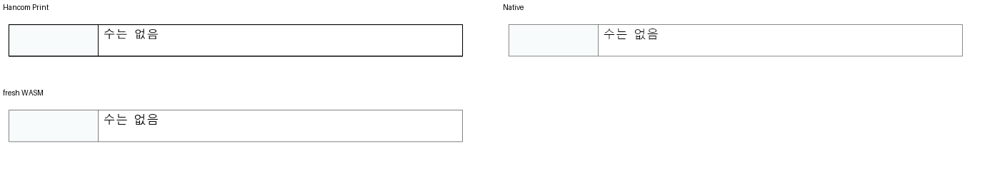

# #7806: 저장 흐름 원점과 가시 제목 상자를 혼동한 두 단언 보관

## 판정과 보존 범위

같은 원본·독립 Print의 전쪽 미달은 [기존 이슈 #7806](https://github.com/edwardkim/rhwp/issues/7806)에 이미 등록돼 있다.
고정 base `2e3b4f880bd11d35398e6ea0100846611f13a72d`와 후보의 같은 조건 비교에서
7·8·9·17쪽은 기존 미달이다. 이번 변경으로 생긴 21쪽의 별도 높이 회귀는 먼저 공통
구현에서 보정하고 Native/fresh WASM으로 복원을 확인했다. 그 회귀를 이관으로 숨기지 않는다.

원본은 `samples/issue6111/56345_regulatory_impact_analysis.hwp`, 독립 한컴 2020 Print는
`pdf/issue6111/56345_regulatory_impact_analysis-hwp-2020.pdf`다. 양쪽 모두 21쪽이며
정확한 입력·PDF SHA, 원 코드의 commit·Git blob·SHA-256은 [보존 원장](preservation.json)에 있다.
닫힌 #6111은 빈 누름틀 표시 축의 해결 기록이며 문서 전체가 보정됐다는 근거가 아니다.

다음 두 부적합 단언만 활성 검사에서 제외했다. 기대 좌표나 허용치를 새 값으로 바꾸지 않았다.

| 보관한 단언 | 부적합한 전제 | 유지한 정상 검사 |
| --- | --- | --- |
| 11쪽 pi186→187의 가시 bbox 간격=저장 흐름 원점 간격 | 저장 흐름 원점과 위여백이 반영된 가시 제목 상자는 다른 좌표다. 정확한 제목 잉크를 과거 bbox에 맞추면 독립 Print에서 후퇴한다. | 뒤 표 괘선의 독립 PDF 좌표 436.961344px 및 기존 허용치, 별도 오프셋 표 대조군 |
| 20쪽 pi357·358의 가시 bbox=저장 흐름 원점, 오차0.05px | 같은 원점 혼동으로 위 바깥여백을 반영한 실제 제목 위치를 거부한다. | pi359 후속 표의 존재와 본문 내부 포함 |

제거 전 두 모듈 전체와 helper는 같은 폴더의 `.rs.txt`로 바이트 그대로 보존했다.
기존 함수 이름과 정상 assertion, 공유 입력·PDF 및 범위 밖 검사는 유지한다.
이는 문서 전체의 결함 해결이나 검사 두 함수의 삭제가 아니다.

## 실제 출력과 실행

보정 runtime은 `3a8785316cb6d4a34b29737959ff8890cab01ee8`, 96dpi, Print/compat2022다.
Native는 최적화 Skia CLI, fresh WASM은 wasm-opt 완료 bundle의 Canvas2D 출력이다.
같은 저장 바이트를 기존 독립 Print와 비교했으며 글꼴 바이너리는 복사·개명·배포하지 않았다.

| 관측 | 범위 | raw 결과 |
| --- | --- | --- |
| [고정 base Native](base/native/silhouette.tsv) | 전21쪽 | 최저19.47205%, 7·8·9·17쪽 미달 |
| [고정 base에 대응하는 WASM](base/wasm/silhouette.tsv) | 전21쪽 | 최저19.60130%, 7·8·9·17쪽 미달 |
| [보정 Native](current/native/silhouette.tsv) | 전21쪽 | 최저19.47399%, 기존4쪽 미달 유지. 21쪽49.68880→99.96897% 복원 |
| [보정 fresh WASM](current/wasm/impacted-pages.tsv) | 11·20·21쪽 | 각각98.93522·98.79966·99.37946%. 전쪽 WASM 재측정으로 표시하지 않는다. |

base WASM의 실제 생산 SHA는 `efc52afb738bd408ac821c4e156101b8d26e5cbd`다.
고정 base와의 runtime 소스 차이는 Native clipboard 파일 하나뿐임을 확인했으며
renderer·조판·WASM 경로는 동일하다. 출처가 다른 SHA를 같은 SHA의 새 빌드라고 보고하지 않는다.

21쪽에서 같은 마지막 문장과 표 외곽을 Print/Native/fresh WASM의 같은 좌표로 직접 비교했다.
자식 종료 RowCut 뒤 실제 저장 빈 줄의 점유를 보존한 결과이며, 배치의 셀을 clamp하지 않았다.
표 외곽 높이와 내용 보존은 복원됐고 괘선 농도·글자의 안티앨리어싱 차이는 남는다.

현재 두 단언 제외 뒤 기존 집중 검사는 **18 PASS/0 FAIL**이다. manifest 준비·검사,
format·diff 검사도 통과했다. 명령·실제 로그는 ignored
`output/pr-review/planet6897-20261018/issue7806-retained-controls-20261021/`에 보존한다.
이 집중 통과를 새 전체 nextest 성공이나 문서 전체 시각 통과로 보고하지 않는다.

## 복원 조건

#7806에서 같은 원본·독립 Print의 전쪽 Native/fresh WASM 최저90% 이상, 쪽수·내용 소속,
누락·중복·포함·겹침 및 확대 판독을 확인한 뒤 해당 미해결 범위의 관계형 회귀를 복원한다.
가시 원점은 저장 흐름 원점과 구분한다. 양쪽 raw98% 이상·직접 판독을 마친 완료 페이지에만
독립 기대 좌표의 ±2px 보호를 추가하며, 현재 기록을 기존 미달4쪽의 정상 baseline으로 삼지 않는다.
