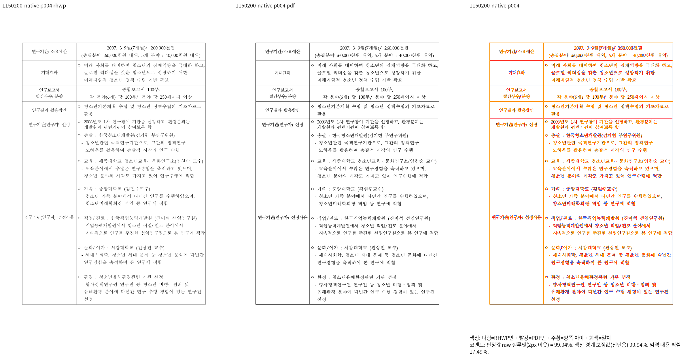
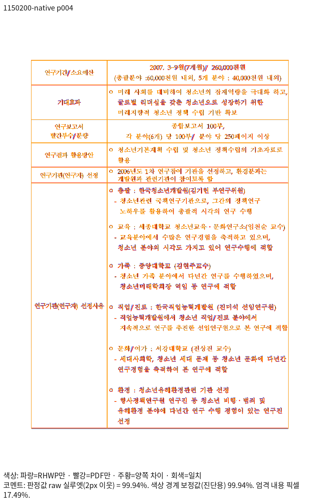
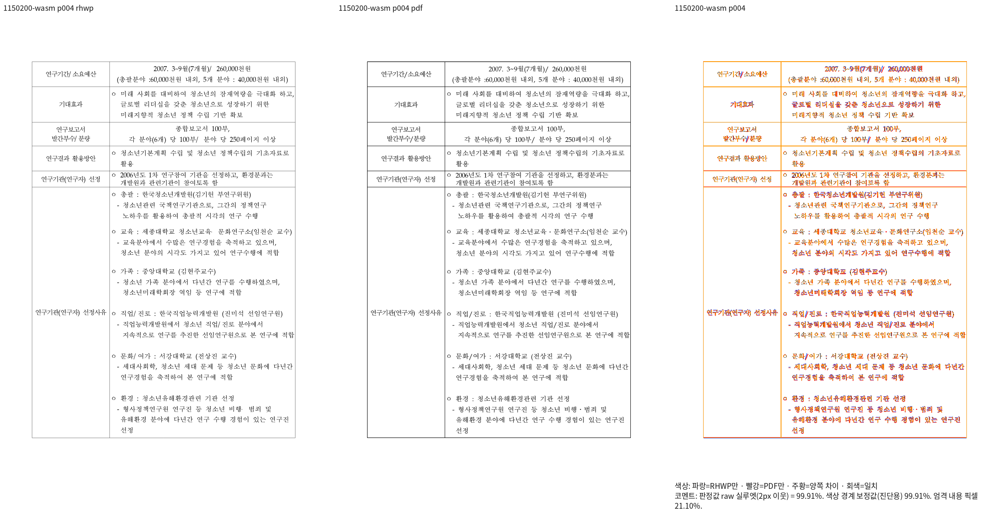
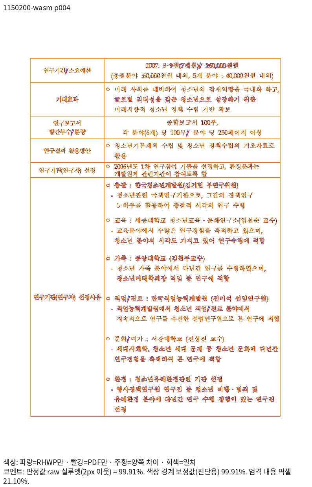

# #7840 신청서의 마지막 표 조각 회귀 근거

검증 code SHA는 `c96354d4e67fd88c0eadd9eecb5aebbe043d7373`다.
원본은 `samples/issue7840/1150200_youth_vision2030_application.hwp`, 독립 기준은
`pdf/pr-review-planet6897-20261018/1150200-source-hancom-print-2020.pdf`다.
입력·PDF·실제 Native/WASM 생산자와 아래 자산 해시는 [`evidence.json`](evidence.json)에 있다.
이 기록은 해당 회귀의 추가 조건을 입증하며 통합 PR 전체의 검증 완료를 뜻하지 않는다.

## 전쪽 시각 선행 조건

같은 원본·2020 Print·compat2022·96dpi·Print profile·2px 실루엣으로 실행했다.
독립 PDF와 Native/fresh WASM은 모두 4쪽이며 누락·90% 미달이 없다.

| 출력 | 전쪽 raw 최저 | 4쪽 raw | TSV 원문 |
| --- | ---: | ---: | --- |
| Native Skia | 99.39534% | 99.93592% | [Native TSV](native-silhouette.tsv) |
| 최적화 fresh WASM Canvas2D | 99.36649% | 99.91154% | [WASM TSV](wasm-silhouette.tsv) |

두 TSV는 실제 실행 결과를 바이트 그대로 보존했다. 공동 최솟값이 가장 높은 4쪽에서
마지막 조각·후속 여섯 행·마지막 문구를 선택했다. 전체 쪽에 좌표 핀을 추가하지 않았다.
양쪽의 같은 영역을 독립 PDF와 직접 대조했고 괘선·본문 순서·마지막 내용이 유지됐다.
글리프 안티앨리어싱과 끝 괘선의 약 1px 차이는 남지만 누락·중복·빈 끝 쪽은 없다.

## 회귀가 보호하는 계약

`tests/cases/issue_7840_application_completed_boundary.rs`는 전체 4쪽과 원본 표 소유를
먼저 검사한다. 마지막 6행·2열의 각 원본 문단과 실제 내용을 대조해 순서·누락·중복을
보호하고 마지막 문구와 내용 기준선이 해당 칸 안에 있는지 확인한다. 독립 PDF의
좌우·위아래 괘선은 72pt를 96dpi로 환산한 좌표를 ±2px로 보완한다. 명목 글꼴 bbox와
PDF 잉크 외곽을 같은 것으로 가정하지 않는다.

앞의 긴 행도 전쪽에서 같은 원본 표 소유를 따라 수집해 내용 순서·누락·중복을
검사한다. 독립 PDF 2/3쪽에서 확인한 자동 표제 번호 ②교육분과·③가족분과·
④직업/진로분과·⑤문화/여가분과·⑥환경분과는 IR 본문 문자열과 별개로 보호한다.
번호를 지우고 비교하지 않는다. 처음의 검사 초안은 IR 문자열에 자동 번호가 있다고
가정해 실패했으며, 독립 PDF의 실제 표제를 확인해 기대 내용을 바로잡고 통과했다.
이 실패는 출력 구현의 회귀로 세지 않는다.

고정 devel `80968497c2c178eeecb3b2e1d04d086ad27a0dc7`의 실제 라이브러리에서는
5쪽이 되어 독립 4쪽 assertion으로 실패했고, 현재 라이브러리에서는 같은 검사가
통과했다. 컴파일 실패나 입력 누락으로 만든 수정 전 FAIL이 아니다.
정식 `tests/cases/` 자동 수집과 전체 회귀 경로를 사용하며 개별 CI 호출을 추가하지 않는다.

## 생산·재현 조건

- Native: `CARGO_BUILD_JOBS=8 cargo build --locked --profile release-test --features native-skia --lib --bin rhwp --target-dir target/pr-review`
- WASM: `CARGO_BUILD_JOBS=8 CARGO_TARGET_DIR=target/pr-review CARGO_PROFILE_RELEASE_CODEGEN_UNITS=16 scripts/wasm-pack-locked.sh --target web --out-dir pkg`
- TSV: `venv/bin/python scripts/visual_sweep.py --silhouette-only --file-target 1150200 samples/issue7840/1150200_youth_vision2030_application.hwp pdf/pr-review-planet6897-20261018/1150200-source-hancom-print-2020.pdf --compat 2022 --dpi 96 --page-workers 2 --rhwp-bin target/pr-review/release-test/rhwp --out output/pr-review/issue7840-native`
- WASM TSV는 같은 명령에 `--wasm-pkg pkg`를 추가하고 `--out output/pr-review/issue7840-wasm`으로 구분한다.
- 로컬 공급 경로는 `/usr/local/share/fonts/hancom-office-2020`과 `/usr/local/share/fonts/hwp-convert-mcp-kopub`다. 글꼴 파일을 이 자산에 복사하지 않았다.

## 직접 판독 PNG

### 신규 공개 원본의 IR 래칫 등록

입력 SHA-256 `0ca950ef7424e197a432df115aabb8a8c4169f9f4a4f0ccce7816c8931bb6744`를
devel `80968497c2c178eeecb3b2e1d04d086ad27a0dc7`과 현재 셀 폭 보정 빌드에서
각각 `sweep_hwp5_rebuild_roundtrip`으로 실행했다. 양쪽 모두 원본의 빈
`raw_ctrl_extra`가 재직렬화 때 대표 Language 및 확장 영역의 10바이트 0으로
정규화됐다. 전체 집계는 다음 두 경로가 각각 1건이며 양쪽 결과가 같다.

- `sections[].section_def.raw_ctrl_extra.len`: 0 → 10바이트, 1건
- `sections[].paragraphs[].controls[].section_def.raw_ctrl_extra.len`: 0 → 10바이트, 1건

신규 sample 등록 절차(`local_validation.md` 4.3.1)에 따라 위 두 신규 행만
IR 래칫에 추가한다. 기존 sample의 기준값·직렬화 구현은 변경하지 않는다.
기존 issue5941·issue6057·issue6921의 원본에도 같은 경로의 원장이 있다.
실행 명령·동결 라이브러리 SHA·원본/왕복 후 바이트와 전체 집계는
`output/pr-review/planet6897-20261018/1150200-rebuild-ir-20261021/`의
`results.json`, `probe.rs`, 양쪽 `*-run.log`에 보존했다.
