# #5585·#7840 저장 프레임의 하단과 후속 본문 검증

- 검증한 runtime source: `8be45687fc55b5cf2055ce5b9160f020015e256e`.
- 기준 devel: `f45878c7caafb43ca1fd017ddd93484a0acc6ad2` (#8132).
- 입력: `tests/fixtures/issue6923/148738070_wrapper_table_stored_page_frame.hwp`.
- 입력 SHA-256: `41f8f0349840a72476606a45843caf01b12013b5e536fca5f6214ff76872ceb3`.
- 독립 Print: 같은 경로의 `148738070_wrapper_table_stored_page_frame-2020.pdf`, 7쪽.
- Print SHA-256: `0dde093557a0a11cec2f01af94f3a8dcf5004c30d267f6f5ea3fa5ac65f9b4bf`.
- 비교 조건: print profile, compat 2022, 96dpi, PNG 직접 출력, 색상 경계 보정 전 2px 내용 실루엣.
- 설치된 글꼴 공급: `/usr/local/share/fonts/hancom-office-2020`, `/usr/local/share/fonts/hwp-convert-mcp-kopub`. 글꼴 파일은 이 자산에 배포하지 않는다.
- Native CLI SHA-256: `050d9572dc6925339649423fa2122e4e6f9a24f9cda32d2931d0ac2d976e5594`.
- 최적화 fresh WASM SHA-256: `964c7148f441d08f7bc8b2f35b643106ed88317441b2b392fea4866aab0f305f`.

## 전쪽 결과

| 쪽 | Native raw % | fresh WASM raw % |
| ---: | ---: | ---: |
| 1 | 98.34102 | 98.38504 |
| 2 | 99.08202 | 99.10267 |
| 3 | 98.58083 | 98.60216 |
| 4 | 98.48559 | 98.53228 |
| 5 | 98.40193 | 98.46281 |
| 6 | 99.77456 | 99.79332 |
| 7 | 99.28086 | 99.30862 |

Native/fresh WASM 모두 독립 Print와 같은 7쪽이다. TSV는 생성 원본을 바이트 그대로 보존했다.
일반 PNG 실행의 원본 PNG에서 공식 `--silhouette-only --png-pair`로 추출한 WASM TSV와,
전쪽 `--silhouette-only --file-target` 실행의 Native TSV를 구분한다.

## 중요한 경계와 정식 회귀

`tests/cases/issue_5585_overlapping_line_boxes_are_not_resets.rs`의 기존 두 검사는
선택적 외부 코퍼스·조용한 return·500px 영역 핀을 커밋된 원본의 검사로 바꾼다.
7쪽과 함께 감싼 표의 1~5쪽 소유, 6~7쪽 후속 표 소유, 마지막 원문 순서·누락·중복·
실제 하단선 내부의 기준선, 후속 표의 원본 칸 소유·내용을 검사한다.

3·4쪽의 어려웠던 이어받기 하단과 5쪽 마지막 하단을 독립 PDF 좌표 ±2px로 검사한다.
같은 후속 본문 중 양쪽 raw 최솟값이 가장 높은 6쪽도 독립 표 외곽 ±2px와 내용 관계로 보호한다.
기대 좌표는 구현 높이 공식에서 가져오지 않았다. PDF의 괘선 중심을 72pt→96dpi로 환산했다.

| 쪽 | 독립 PDF 하단 px | 현재 Native 하단 px |
| ---: | ---: | ---: |
| 3 | 1016.968017578125 | 1017.960000 |
| 4 | 1010.254638671875 | 1011.226667 |
| 5 | 832.3693033854166 | 833.173333 |

이전 진단의 3·4쪽 하단은 각각 1022.95px로 약 5.98px·12.70px 어긋났다.
보정 직전 `c017c4da82878d5b63c460a2d73649e92ef1348d`를 실제로 재빌드해 같은 정식
검사 3건을 실행했다. 관계 검사 2건은 PASS, 새 하단선 검사는 3쪽의
`1016.968018px` 기대와 실제 `1022.906667px` 차이로 FAIL했다.
수정 후 runtime `8be45687fc55b5cf2055ce5b9160f020015e256e`의 같은 검사 3건은 모두 PASS다.
단독 rustc 진단으로 실행한 뒤 최종 정식 suite·전체 회귀도 별도로 확인한다.
실행 명령·원본 로그는 작업 output의 `post8132-wrapper-prepatch-rebuild-20261022/`에 있다.

## 직접 판독

Native/fresh WASM의 3·4·5·6쪽 review PNG를 직접 열어 같은 독립 Print와 대조했다.
이어받기 하단과 마지막 하단이 약 1px 안에서 정렬되고, 마지막 첨부 문구가 표 안에 남으며
후속 표·본문의 소속과 순서가 보존된다. 기존 글꼴 모양·획 굵기 차이는 남아 있다.
이 자산은 그 글꼴 차이까지 해결했다는 주장이 아니며, 해당 경계의 새 줄바꿈·큰 간격 변화는 관측하지 않았다.

| 쪽·출력 | review | overlay |
| --- | --- | --- |
| 3 · native | 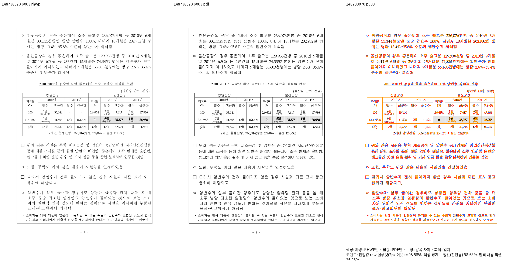 | 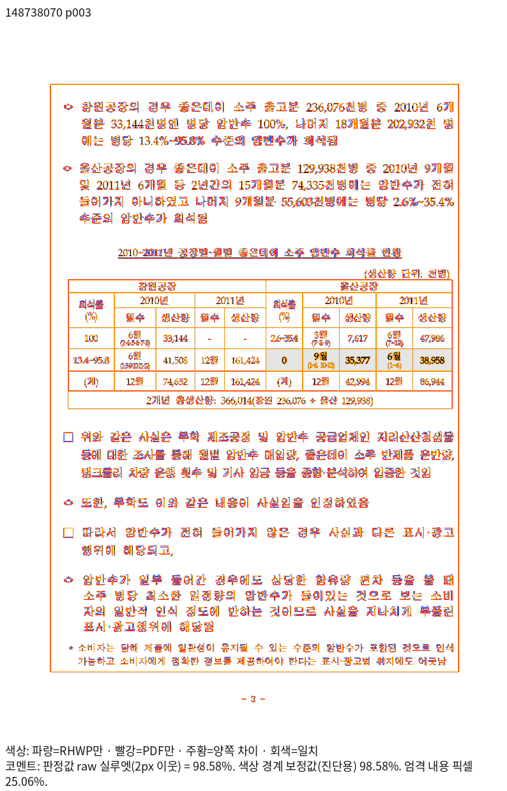 |
| 3 · wasm | 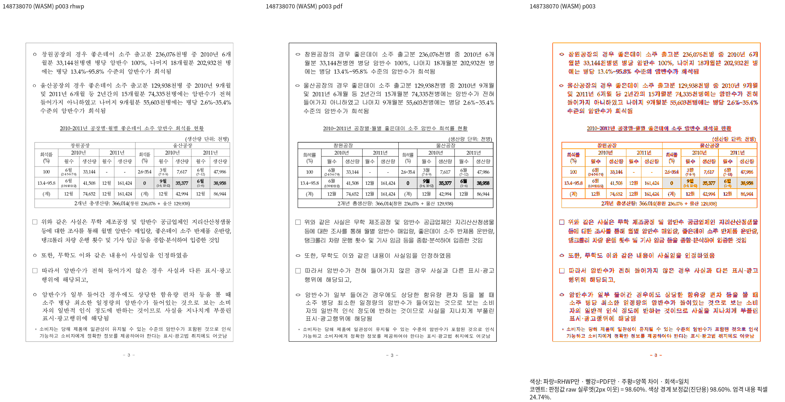 | 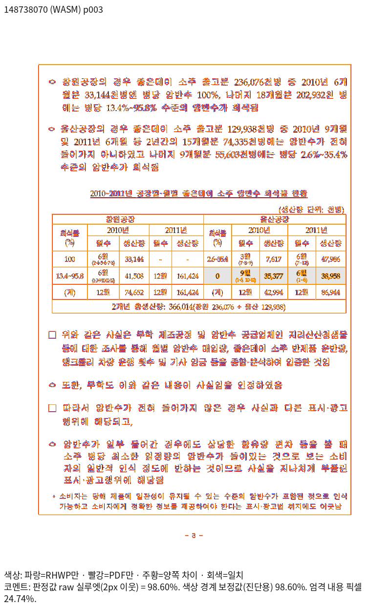 |
| 4 · native | 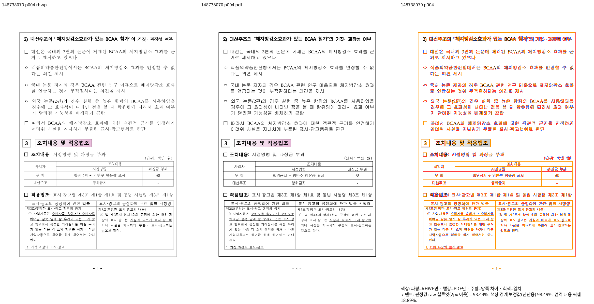 | 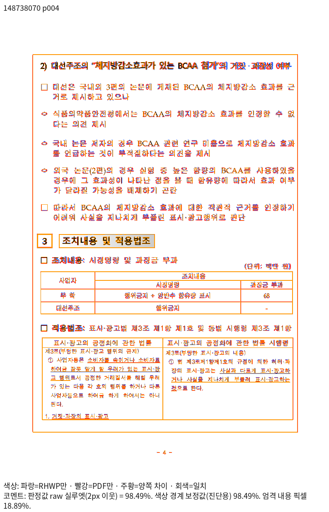 |
| 4 · wasm |  | 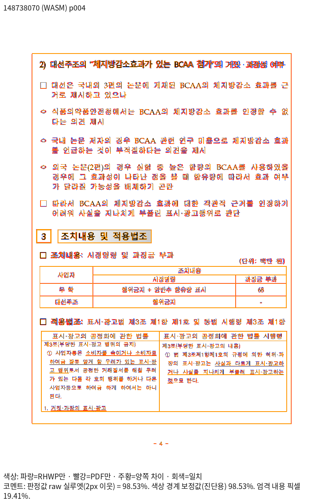 |
| 5 · native | 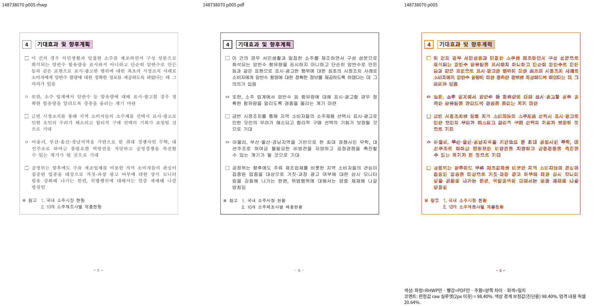 | 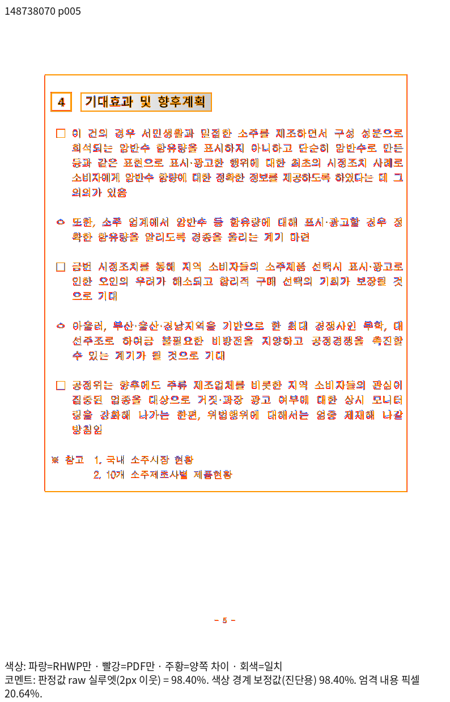 |
| 5 · wasm | 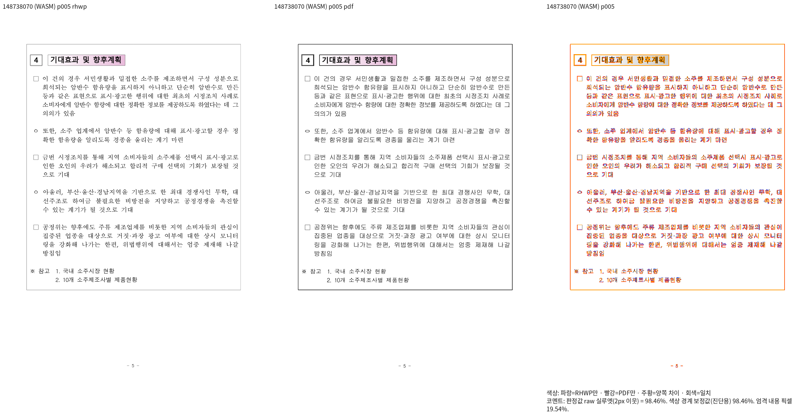 | 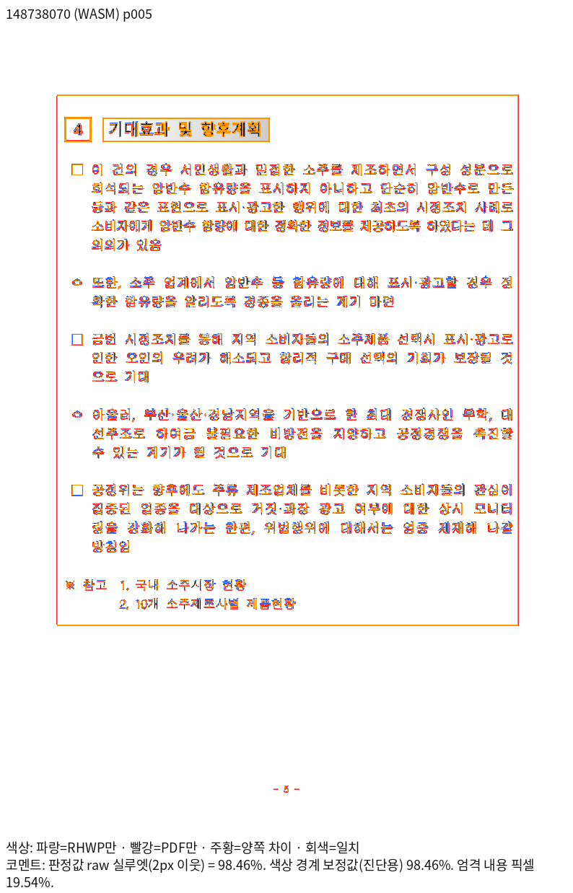 |
| 6 · native |  | 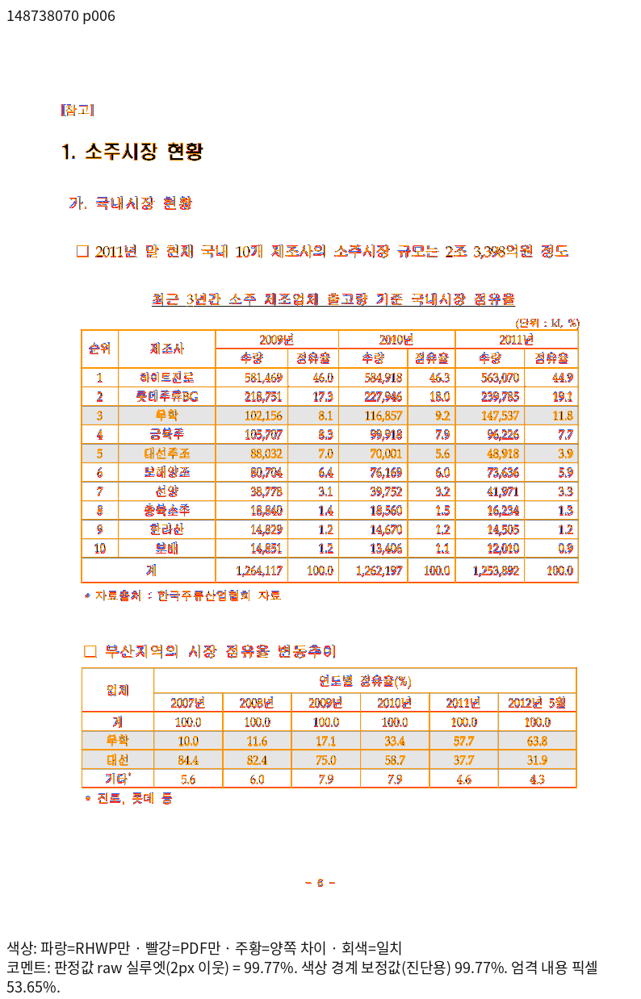 |
| 6 · wasm | 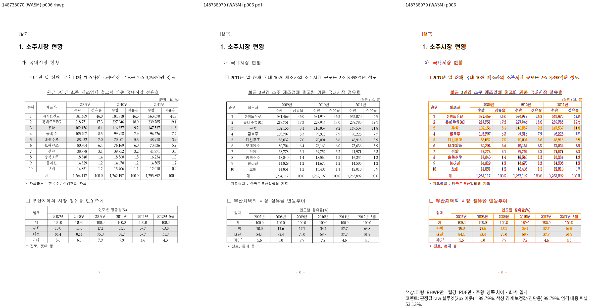 | 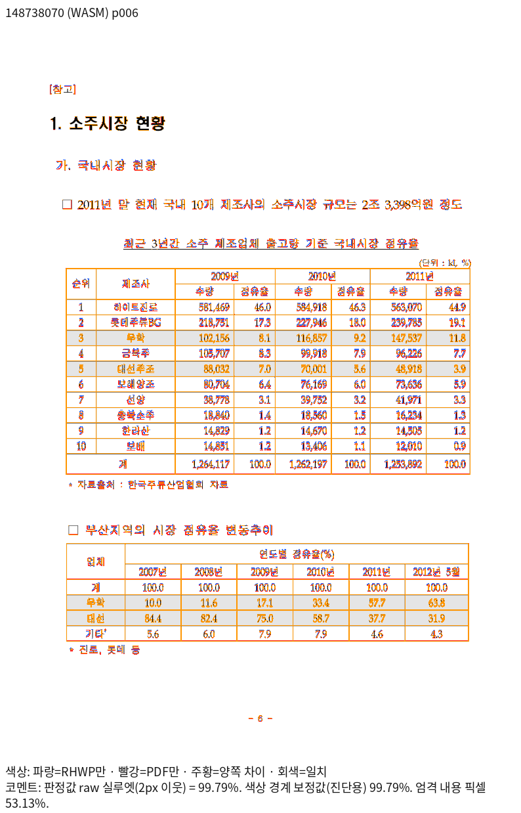 |

## 재현 명령

```bash
venv/bin/python scripts/visual_sweep.py --silhouette-only \
  --file-target 148738070 \
  tests/fixtures/issue6923/148738070_wrapper_table_stored_page_frame.hwp \
  tests/fixtures/issue6923/148738070_wrapper_table_stored_page_frame-2020.pdf \
  --compat 2022 --dpi 96 --page-workers 2 \
  --rhwp-bin <검증한 Native CLI> --out output/pr-review/<작업>/native
# fresh WASM은 같은 명령에 --wasm-pkg <최적화한 package>를 추가한다.
# compare/review/overlay PNG는 --silhouette-only를 빼고 --pages 3,4,5,6으로 생성한다.
```

- native TSV SHA-256: `08996d8d83e826ecf193454be4b3476606a53015f9b7e27c04d2426c8ba540cc`, 280바이트.

- wasm TSV SHA-256: `fbd8ef9c06118a5b6bef3c24ca97a523fbd05772a5f848b4c0b5daf1ea2c5db9`, 280바이트.
