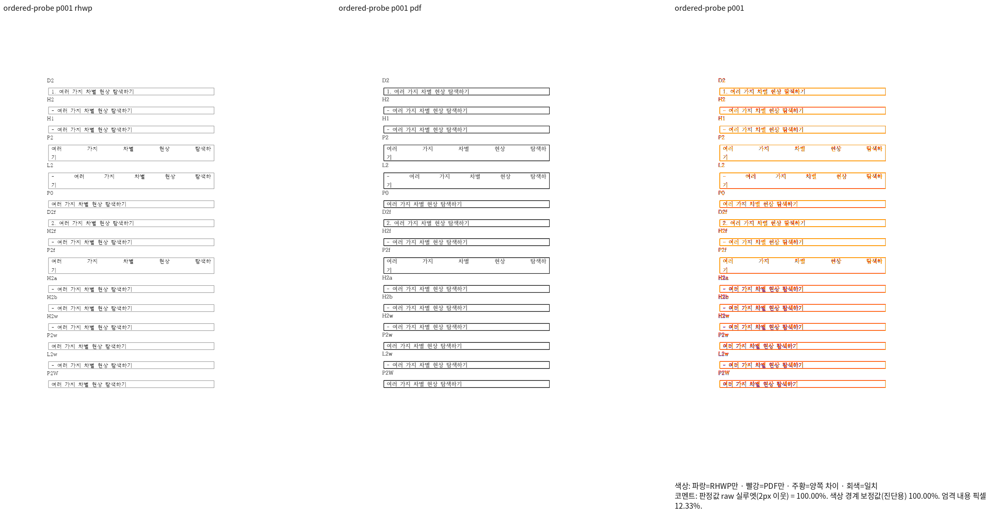
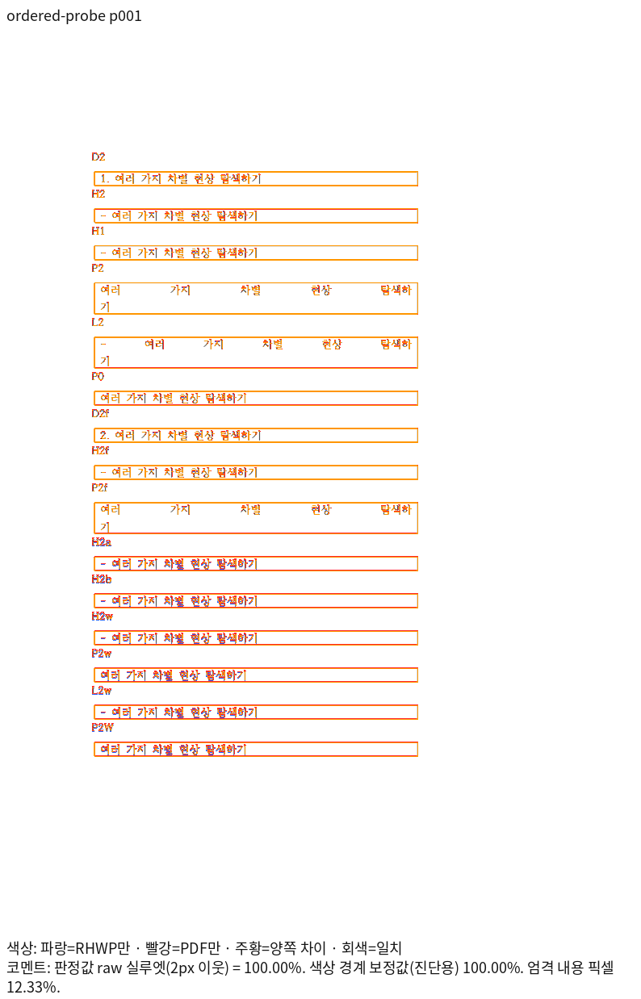
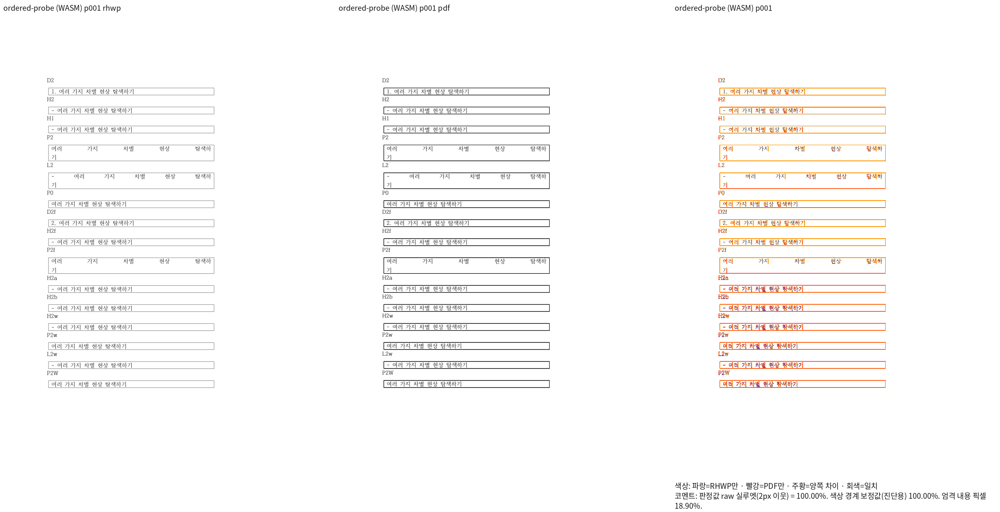
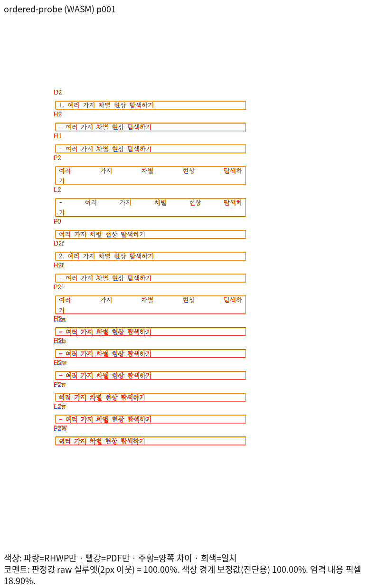

# #8105 번호·저장 폭 대조군의 회귀 근거

검증 code SHA는 `91203ff1947966679629993ed11b3503d6b04fba`다.
입력은 `tests/fixtures/issue8105/numbered_stale_tail_ordered.hwpx`, 독립 기준은
`pdf/issue8105/numbered_stale_tail_ordered-2024.pdf`다. 해시는 [evidence.json](evidence.json)에 있다.

## 입력 생성과 독립 기준

`mydocs/tech/investigations/issue-8105/probes/make_numbered_stale_tail.py`로 만든 수동 대조군이다.
이전 실험은 새 paraPr ID를 기존 배열 중간에 넣어 한컴의 번호·들여쓰기가 달라졌다.
원 실험 HWPX와 PDF는 원래 경로에 그대로 보존했다. 새 입력은 속성 내용·본문을 바꾸지 않고
속성 배열 순서를 ID에 맞게 정리한 것과 ZIP 멤버별 바이트가 동일하다.
수동 appVersion 문자열을 실제 한/글 2014 저장 출처로 주장하지 않는다.

이 입력을 한컴 2024 13.0.0.3901, PrintMethod=0, 1-up으로 직접 출력한 PDF는 1쪽이다.
번호 두 종류, 일반/직접 대시 문단, 저장 줄 유무, 줄 flags, 실제 셀 안쪽 폭과 맞는/다른
캐시 폭을 15개 표로 대조했다. 번호 문단은 한 줄, 번호 없는 정확한 폭의 저장 문단
P2/L2/P2f는 두 줄, 폭이 다른 P2w/L2w/P2W는 한 줄이다. 기대값은 독립 PDF에서 정했다.

## 시각 선행 조건과 직접 판독

| backend | 전체 쪽수 | 최저 raw | TSV 원문 |
| --- | ---: | ---: | --- |
| Native Skia | 1 | 100.00000% | [Native TSV](native-silhouette.tsv) |
| 최적화 fresh WASM Canvas2D | 1 | 100.00000% | [WASM TSV](wasm-silhouette.tsv) |

96dpi, Print profile, compat2024, 2px 실루엣으로 같은 입력·PDF를 비교했다.
두 출력의 review와 overlay를 직접 대조했다. 번호와 들여쓰기, 마지막 음절의 줄 소속,
정확한 폭의 양쪽 정렬 두 줄, 폭이 다른 문단의 한 줄 전환, 표 외곽과 앞뒤 순서를 확인했다.
안티앨리어싱·획 농도 차이는 남지만 줄·외곽의 큰 차이, 누락·중복은 없다.
이 합성 대조군 통과를 실제 1342000 전체 문서나 통합 PR 전체 통과로 확대하지 않는다.

## 정식 회귀 검사

`tests/cases/issue_8105_numbered_stored_word_tail.rs`의 기존 실제 문서 검사 두 개를 유지하고
`ordered_probe_preserves_exact_width_cache_and_reflows_different_widths`를 추가했다.
15개 표의 문단 소유·유일성·순서·내용 보존·자동 번호·줄 수를 검사한다.
한 쪽의 Native/fresh WASM raw가 모두 100%이고 직접 판독했으므로 독립 PDF의 세로 벡터
괘선 중심을 72pt에서 96dpi px로 바꿔 ±2px 검사도 함께 추가했다.
좌표 원문은 [independent-pdf-frames.json](independent-pdf-frames.json)이다.

동일한 새 검사와 입력을 실제 이전 `dcb10ad325` 라이브러리에 연결하면 P2w의
`[여러가지차별현상탐색하, 기]` 두 줄 때문에 FAIL한다. 실제 `91203ff194`에서는 PASS한다.
입력 누락·컴파일 오류로 만든 수정 전 FAIL이 아니다. 정상 반례 P2/L2/P2f의 두 줄도 유지된다.
정식 자동 수집 경로를 사용하며 CI에 중복 호출을 추가하지 않는다.

## 재현

```bash
python3 mydocs/tech/investigations/issue-8105/probes/make_numbered_stale_tail.py \
  samples/hwpx/basic-table-01.hwpx output/numbered_stale_tail_ordered.hwpx '9, 1, 1, 3933'
venv/bin/python scripts/visual_sweep.py --silhouette-only \
  --file-target ordered-probe tests/fixtures/issue8105/numbered_stale_tail_ordered.hwpx \
  pdf/issue8105/numbered_stale_tail_ordered-2024.pdf --compat 2024 --dpi 96 \
  --rhwp-bin target/pr-review/release-test/rhwp --out output/issue8105-native
```

WASM은 같은 명령에 `--wasm-pkg pkg`를 추가하고 출력 폴더를 분리한다.
대표 이미지는 `--silhouette-only`를 빼고 `--pages 1`로 산출했다.
글꼴은 설치된 두 시스템 경로를 사용했으며 이 자산에 글꼴 파일을 복사하지 않았다.








