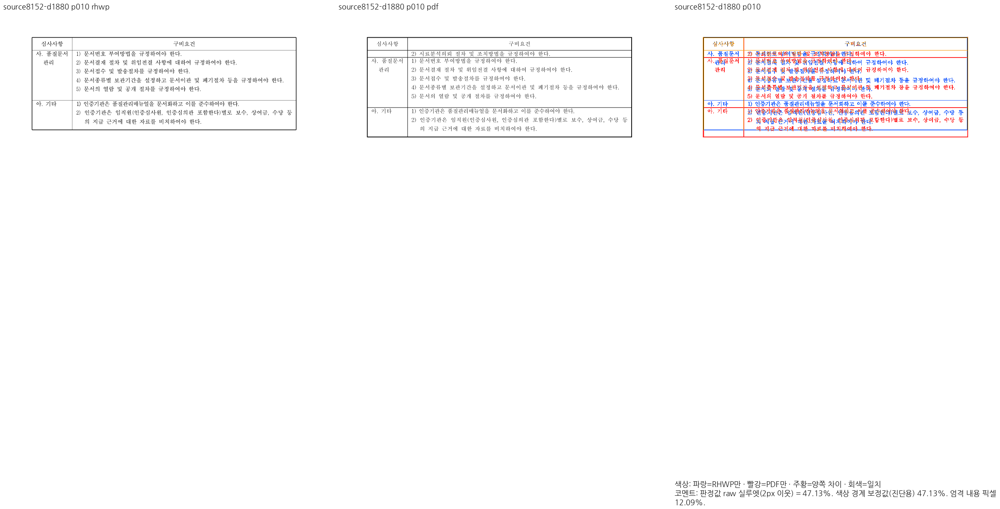
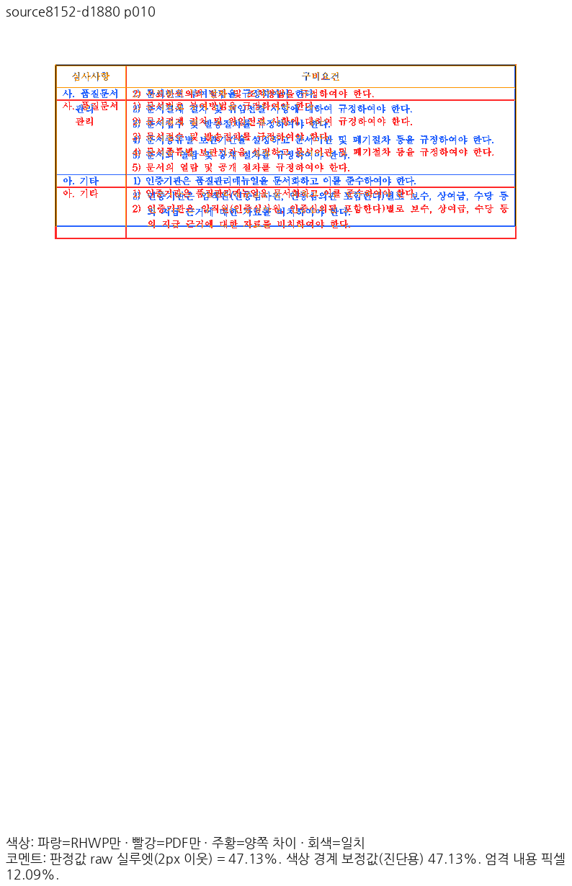
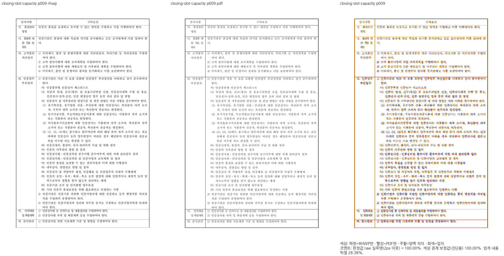
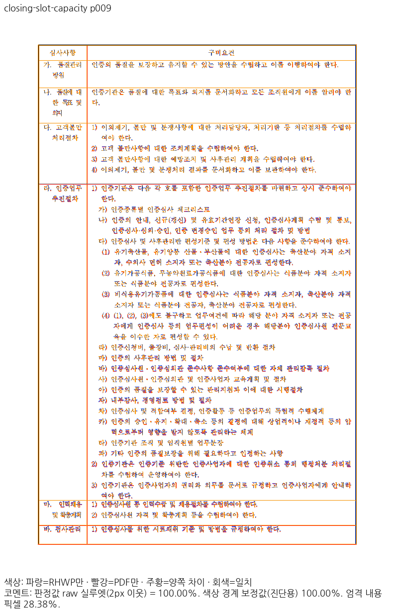
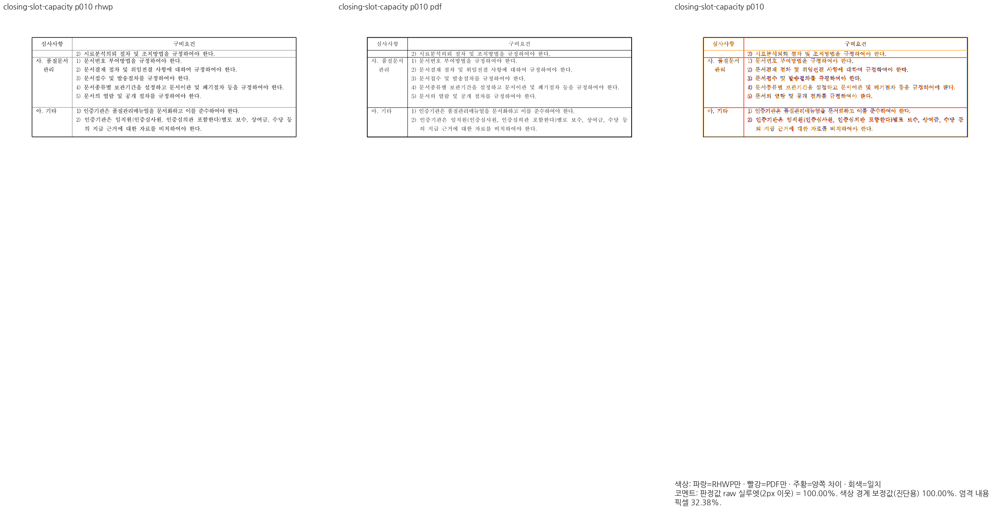
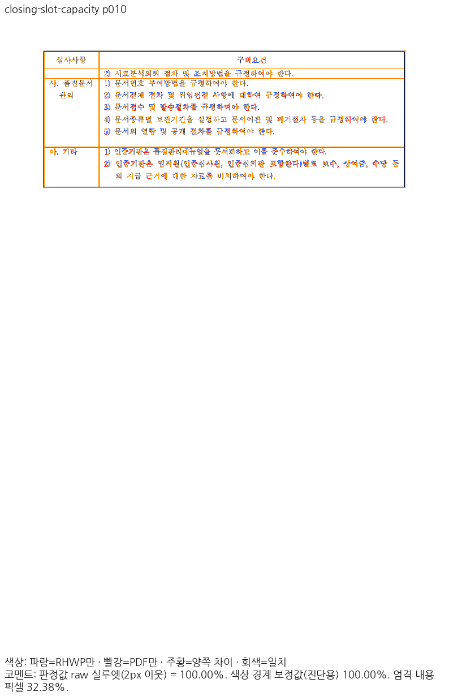
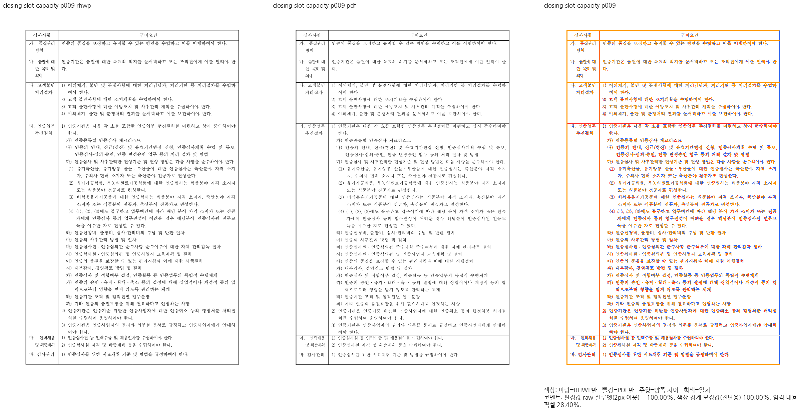
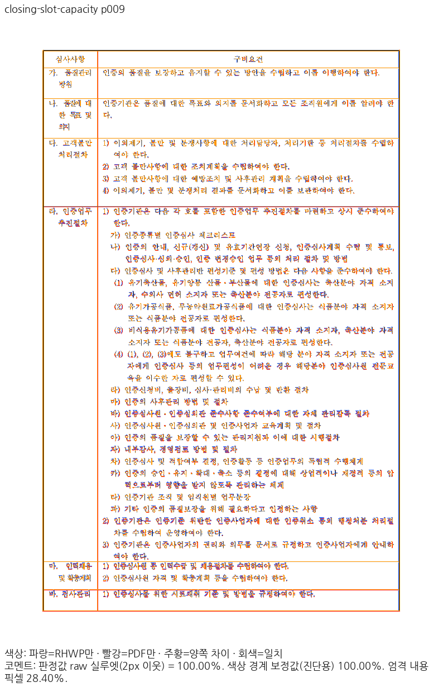
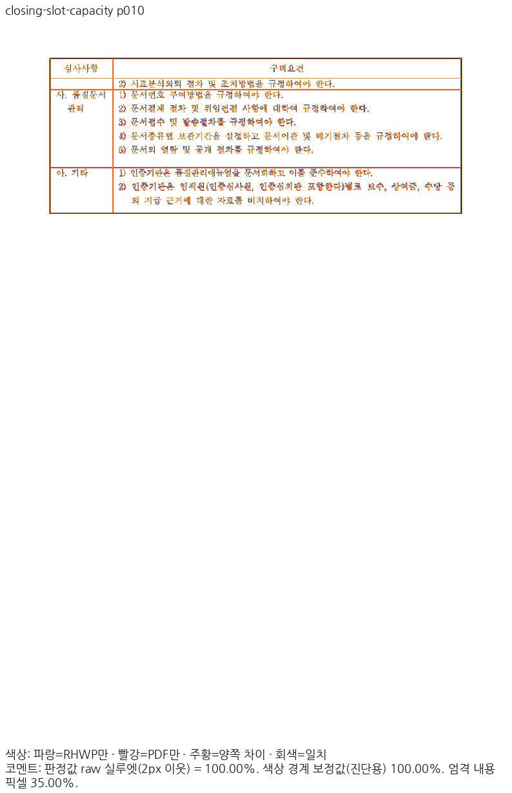

# #8105 완료 셀의 마지막 슬롯과 이어받는 내용 소속

## 범위와 독립 기준

원 PR #8152가 남은 문제로 기록한
[`issue1880_takeplace_host_before.hwpx`](../../../../samples/issue1880_takeplace_host_before.hwpx)의
9–10쪽 경계를 보정합니다. 같은 원본의
[한컴 2024 독립 Print PDF](../../../../pdf/issue1880/issue1880_takeplace_host_before-2024.pdf)는
검사관리의 `2) 시료분석의뢰 절차 및 조치방법을 규정하여야 한다.`를 10쪽 첫 이어받기 칸에 둡니다.
파일명 속 #1880의 기존 전체 이슈 해결을 새로 주장하지 않습니다. #8105의 부분 보정입니다.

- 정책 비교 base: `9418ed0c7cf289c5c4ac2b3bb8cdc18a1b637a9a`.
- 보정 전 통합 제품 source: `b0c5f9b4c898f706c99e2aa67398b0e5bfaaa545`.
- 보정 후보의 부모: `037cd8a9a1956711601c87196952e4596779e617`.
- 캡처는 부모에 이 보정을 적용한 소스로 수행했습니다. 실제 source 파일 해시·Native/WASM
  프로그램 해시·기준 PDF·원본 해시는 [validation.json](validation.json)에 고정했습니다.
- 유일한 포맷 전후 차이인 `row_block_cut.rs` 인자 목록 줄바꿈은 알려진 파일명 헤더를 제외한
  전체 rustfmt 출력이 동일함을 확인했습니다. 캡처 producer 해시와 포맷 후 소스 해시를 구분합니다.

## 원인과 공통 보정

일반 위 정렬 칸이 전체 저장 슬롯 뒤에도 독립 선언 최소 높이를 가지면 마지막 슬롯도
완결 수용량에 포함됩니다. 기존 생산자는 셀 마지막 줄의 다음 전진을 제외하고,
행 스캔은 그 잉크 높이만 남은 공간에 들어가도 행을 완결했습니다.
이 원본의 행 6 우측 칸은 선언 `3968HU`, 두 저장 슬롯과 안여백 합 `3482HU`로
별도 최소 높이가 남지만, 잘린 수용량 때문에 마지막 줄을 9쪽으로 당겼습니다.

`stored_complete_cell_slot_capacity`는 이 조건의 원본 일반 칸에만 완결 수용량을 반환합니다.
`CellCutFrame::fitting_height`와 `row_cut_height(Capacity)`가 같은 질의를 사용합니다.
`Occupied`와 원본 `CellUnit` 높이는 유지하므로 이어받은 칸 뒤에 종료 전진을 다시 더하지 않습니다.
문서명·쪽 번호로 분기하거나 고정 높이 보정값을 더하지 않습니다. 편집·재조판·병합 칸,
빈 종료 줄과 인증되지 않은 저장 프레임은 이 질의를 사용하지 않습니다.

## 전쪽 Visual Sweep

96DPI, Print, compat2024, 문서별 동일 글꼴, 현재 정본 `visual_sweep.py`,
보정 전 raw 2px 관용·90% 문턱으로 **각 경로 전10쪽**을 산출했습니다.
Mac fresh WASM은 locked wrapper의 `--target web --out-dir pkg --no-opt` 로컬 대체 빌드입니다.
Docker 최적화 빌드 통과를 주장하지 않습니다. 루트 pkg와 Studio public의 JS/WASM 해시가 같습니다.

| 경로 | devel 전쪽 최저 | 보정 전 전쪽 최저 | 보정 후 전쪽 최저 | 보정 후 9·10쪽 | 미달 | 0.1%p 이상 하락 |
| --- | ---: | ---: | ---: | --- | ---: | ---: |
| Native Skia | 47.12761% | 47.12761% | 98.39726% | 각각 100% | 0 | 0 |
| fresh WASM | 47.11770% | 47.11770% | 98.39669% | 각각 100% | 0 | 0 |

| 경로 | devel 원 TSV | 보정 전 원 TSV | 보정 후 원 TSV |
| --- | --- | --- | --- |
| Native | [base](tsv/base-native.tsv) | [before](tsv/before-native.tsv) | [after](tsv/after-native.tsv) |
| fresh WASM | [base](tsv/base-wasm.tsv) | [before](tsv/before-wasm.tsv) | [after](tsv/after-wasm.tsv) |

Native의 1–8쪽 PNG 바이트는 보정 전과 같습니다. 9·10쪽만 달라졌습니다.
반복 머리글을 별도로 대조한 뒤 나머지 본문 13,544자의 source 소속·문자·순서는 모두 같습니다.
반복 머리글 문자 57자도 같습니다. 쪽 소속 이동을 누락·중복으로 숨기지 않았습니다.

## 대표 review와 overlay

아래 이미지는 같은 전쪽 실행에서 만든 PNG를 사용했습니다. 새 캡처나 다른 기준 PDF가 아닙니다.
9·10쪽의 표 줄 경계와 내용 소속을 독립 Print와 직접 대조합니다.
100%는 raw 2px 관용 판정값이며 모든 색상 픽셀이 동일하다는 뜻은 아닙니다.
미세한 글리프 가장자리 차이는 남습니다.

| 조건 | review | overlay |
| --- | --- | --- |
| Native 보정 전10쪽 |  |  |
| Native 보정 후9쪽 |  |  |
| Native 보정 후10쪽 |  |  |
| WASM 보정 전10쪽 |  |  |
| WASM 보정 후9쪽 |  |  |
| WASM 보정 후10쪽 |  |  |

## 회귀 검사와 반례

전쪽 Native/fresh WASM 최저90% 이상을 확인한 뒤
[`issue_8105_complete_cell_closing_slot`](../../../../tests/cases/issue_8105_complete_cell_closing_slot.rs)을 추가했습니다.

1. 독립 Print의 다음 쪽 소속과 source 셀을 검사하며 마지막 줄이 전쪽에 정확히 한 번만 존재하는지 확인합니다.
2. 이어받은 셀이 마지막 잉크와 원본 아래 안여백 뒤에서 닫히는지 검사합니다. JSON bbox 끝점의
   반올림 오차만 허용하며 절대 위치·영역 픽셀 핀은 사용하지 않습니다.

같은 실제 Rust 테스트 실행 파일로 frozen Native CLI를 바꾸어 실행했습니다.
기존 CLI 테스트의 `CARGO_BIN_EXE_rhwp` 런타임 override 관례를 사용하고 실제 CLI 해시를 기록했습니다.
수정 전 **0 PASS / 2 FAIL**, 내용 소속만 고치고 종료 전진을 paint에도 더한 반례 **1 PASS / 1 FAIL**,
현재 후보 **2 PASS / 0 FAIL**입니다. 반례는 소속 검사만으로 잘못된 paint를 승인할 수 없음을 검출합니다.
검증 source·실행 파일·단계별 CLI 해시는 validation.json에 있습니다.
정식 Cargo target `regression_suite_025`에서도 새2검사를 실행해 **2 PASS / 0 FAIL**을 확인했습니다.
기존 #8105의9개 모듈도 따로 실행해 **16 PASS / 0 FAIL**이며, 0 tests를 통과로 세지 않았습니다.
manifest의 고정 base 비교 검사와 문서 상대 링크 검사도 통과했습니다.

Native 정책연구 HWP 76–78쪽은 보정 전후 수치가 같고, CBTA 187–190쪽도 하락 없이
최저99.13818%입니다. 선택한 대조군의 결과를 각각 전체 문서 통과로 확대하지 않습니다.

이 증거는 이 입력과 관련 보정의 증거입니다. 통합 전체 전쪽 검증·새 전체 회귀,
Studio 실제 소비 경로·최신 CI의 완료를 뜻하지 않습니다. 나머지 미달·쪽수 불일치가 해결되기 전
통합 PR 제출은 보류합니다. 실행 로그·임시 산출물은 ignored output에만 보관합니다.
