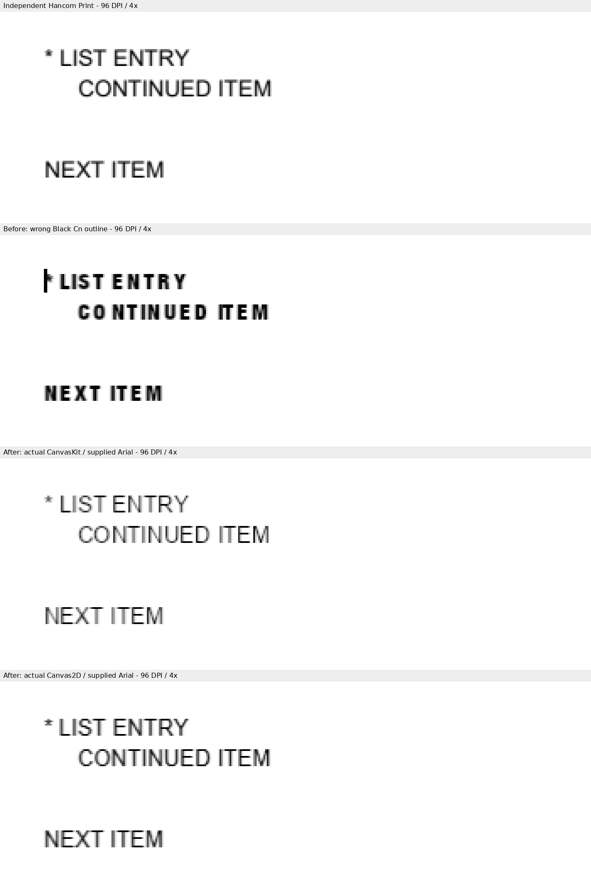
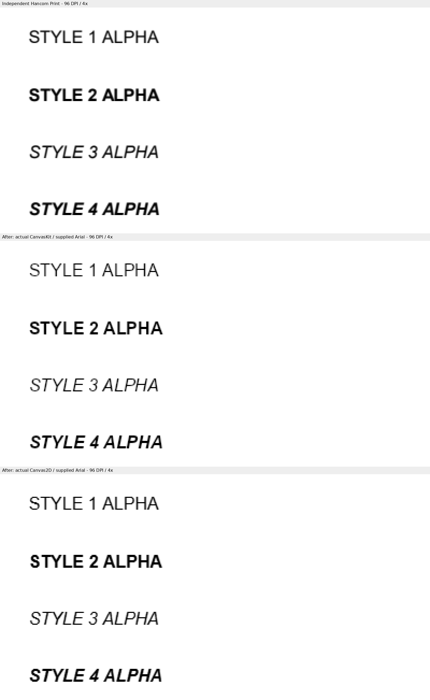
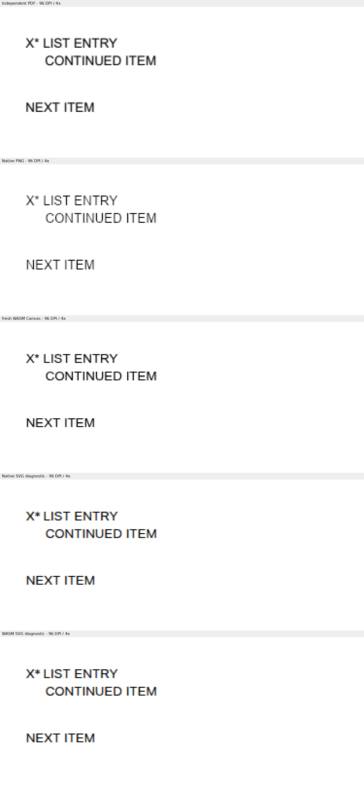

# #8109 최종 시각 증적

Rust 생산 커밋은 `5699a377885e3068947400e69a2336af5759112c`, base는
`80968497c2c178eeecb3b2e1d04d086ad27a0dc7`다. 같은 Rust 코드의 최종 CLI와 최적화 WASM,
Studio 소비 보정 소스·테스트의 SHA-256은 [producer.tsv](producer.tsv)에 있다.
이 절의 Studio 소스 신원은 `f1ae43d70`의 1차 기능 검증 기록이다.
성능 보정 뒤 현재 Studio 소스와 새 캡처의 신원은 [4단계](../stage4/README.md)에 있다.

[inputs.tsv](inputs.tsv)는 Native PNG37·fresh WASM Canvas37·SVG 경계6의 전체80행이다.
검증한 입력·독립 기준 PDF의 저장소 경로와 SHA-256, 전쪽 원문 TSV를 연결한다.
TSV는 생성 파일을 바이트 그대로 복사했다. `studio/`의 최종 화면4개와 보정 전 CanvasKit1개를
합하면85개다. 모든 입력은1쪽이며 전체 쪽수가 일치한다. 각 쪽 최저값은 다음과 같다.

| 경로 | 쪽 수 | 최저 raw% |
| --- | ---: | ---: |
| Native Skia PNG | 37 | 99.63470 |
| fresh WASM Canvas | 37 | 98.35575 |
| Native SVG 진단 | 3 | 99.14358 |
| WASM SVG 진단 | 3 | 99.14358 |
| 실제 Studio CanvasKit / Canvas2D | 각2 | 99.40245 / 99.70580 |

모든 값은 색상 경계 보정 전2px `silhouette_raw_match_percent`다. `--silhouette-only`의
`not_evaluated`를 판정으로 사용하지 않았다. 양 backend의 대표4개 정식 review·overlay gate는
모두 `passed`이며, 목록·스타일·교차 저장의 같은 영역을4배 확대해 직접 판독했다.
font 예외와 baseline/허용치 완화는 없다. embedded-program 비적용 대조군의 기존 font·농도
차이는 남고 base 대비 하락은0이다. 새 embedded-program 지원으로 분류하지 않는다.

저장 결과는 `tests/fixtures/issue_8109_saved_fonts/`, 새 독립 한컴2020 Print는
`pdf/issue8109/print/`에 보존했다. engine2020·실제 Hancom11.0.0.9136·Print method0·one-up
driver 계약으로 생성했다. 이전 Print 입력과 바이트가 같은 최종 Studio 저장본18개는 기존
Print를 재사용했다. source/control의 base 비교는 동일 입력·기준·font 공급·DPI의
[2단계 before 원문](../stage2/before/)을 재사용했다. 원본/대조군11개에서0.1%p 하락은 없다.

실행은 review worktree에서 DPI96·compat2022·print profile·같은6개 font 프로그램으로 했다.
상용 font bytes는 포함하지 않고 이름·hash만 기록했다. 재현 명령은 다음과 같다.

```bash
VISUAL_SWEEP_CHROME=<chrome> venv/bin/python scripts/visual_sweep.py \
  --silhouette-only --rasterizer png --hwp <inputs.tsv의_input_repository_path> \
  --pdf <reference_repository_path> --key <key> \
  --rhwp-bin /home/edward/mygithub/rhwp/target/pr-review/release-test/rhwp \
  --compat 2022 --dpi 96 --font-path <동일_hash의_font_공급_디렉터리> \
  --embed-fonts full --out output/pr-review/issue8109/stage3/visual/png/native
# WASM에는 --wasm-pkg <최종_pkg> 추가. SVG는 --rasterizer svg.
# 대표 compare/overlay/review는 --silhouette-only 없이 별도 out에서 실행.
```

Actual Studio는 Windows Chrome155 CDP·software CanvasKit/Canvas2D·zoom1·DPR1이다.
목록·네 스타일 화면은 paper 사각형 안의 정수 픽셀을 캡처했고, 원문을 가리거나 보정하지 않았다.
초기화 응답 WASM은 `b8c20fcfe5952ed2a1d3f4188842438275f4a964bceaa55f1f170fc6d640ffe1`로
최종 Docker 산출물과 같다. JS 생성 파일도 같으며 Vite의 WASM URL 변경1곳과 inline source map을
대조했다. Canvas2D의 개별 glyph face는 API상 `notObserved`로 유지했다.





source/build 신원·전체 명령·개별 page count·Print job·직접 판독은
[3단계 보고](../../../../working/task_m100_8109_stage3.md)에 연결했다.
로그와 중간 JSON은 ignored `output/pr-review/issue8109/stage3/`에만 보존한다.
