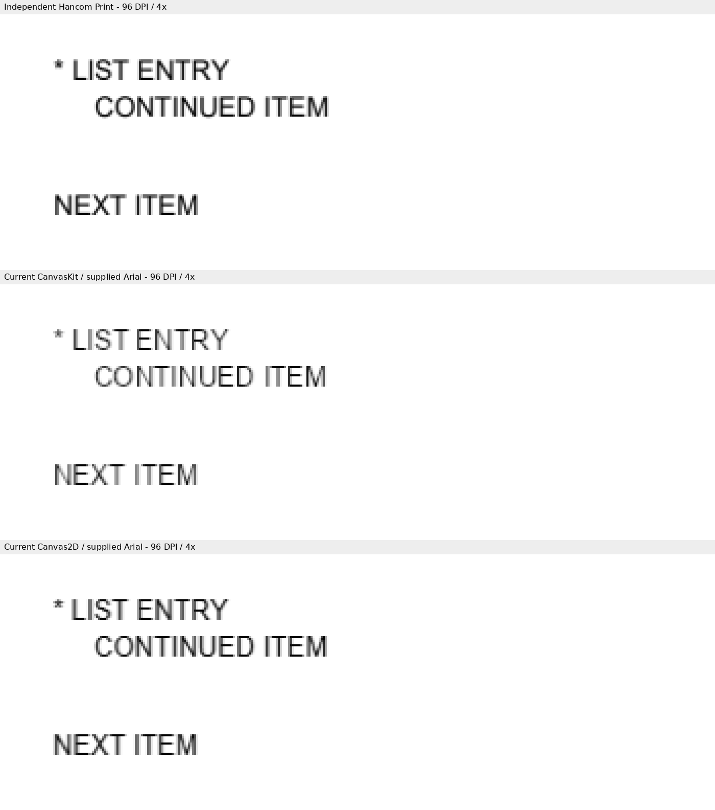
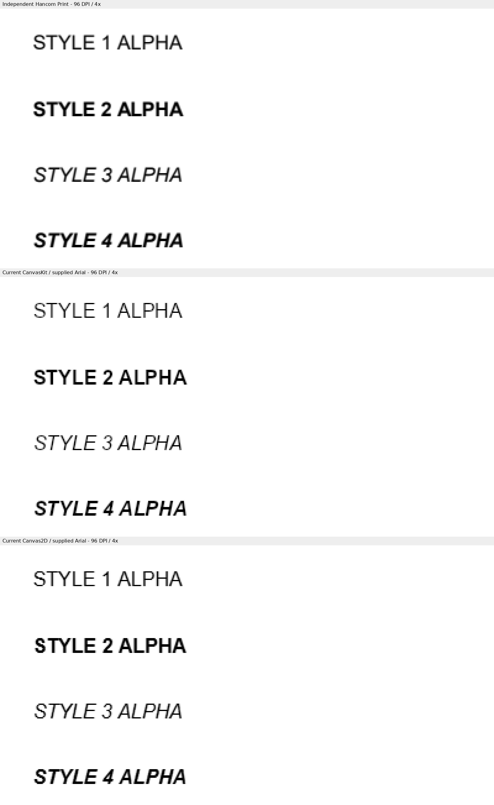

# #8109 성능 보정 뒤 최종 Studio 검증

원본 face·PDF advance·문서 대체·style·저장 계약을 유지한다. incomplete preflight는 즉시
fallback하며 정상 준비는 같은 report의 family/style 선언을 공유한다. 선택된 face와 Tree를
캐시하지 않아 local/host 가용성 변경은 준비 시 다시 해소한다.

[성능 원시 TSV](performance.tsv)는 같은 Chrome155·최적화 WASM에서 보정 전 `f1ae43d70`와
현재 Studio를 순서 교차9쌍 측정한 원문이다. 77쪽 auto 열기·뷰 준비 중앙값은
1,284.9 → 626.2ms, 추가 Tree 조회77 → 0회이며 Canvas2D 직접 지정은487.7 → 487.5ms다.

[최종 source·producer·새 캡처 SHA](producer.tsv)를 확인한다. Rust source·test·manifest와
Native/WASM 프로그램은 [3단계](../stage3/README.md)의 검증 대상과 동일하다. 그 단계의
전쪽 Native37·fresh WASM37·SVG6 TSV와 base 비교는 해당 동일 producer에 재사용한다.
이번에는 새 TS에서 실제 Studio4쪽을 다시 캡처·측정했고4개 PNG 모두 이전과 바이트가 같았다.
따라서 [Studio TSV4개](../stage3/studio/)는 같은 원문을 재사용하며 새 중복 파일을 만들지 않았다.

| 현재 실제 화면 | raw% | 쪽수 |
| --- | ---: | --- |
| CanvasKit 목록 | 100.00000 | 1=1 |
| Canvas2D 목록 | 99.94072 | 1=1 |
| CanvasKit 네 스타일 | 99.40245 | 1=1 |
| Canvas2D 네 스타일 | 99.70580 | 1=1 |

독립 Print와 같은 영역을4배 확대해 목록·계속 줄·뒤 본문, regular/bold/italic/bolditalic,
기준선·글자 간격을 직접 확인했다. 미세한 antialiasing 차이는 유지되며 새로운 배치·간격 차이는 없다.
수식은 이번 출력 경계에 없고 실제 물리 face·style 소비는 기존 E2E도 다시 통과했다.

## Self-review의 devel 비교 보완

기존 원장은 원본·대조군11개의 base 비교만 포함하고 저장·편집 결과26개의 기준 값은
비어 있었다. 같은 입력·독립 Print·96DPI·compat2022·font 프로그램으로 고정 devel
`80968497c2c178eeecb3b2e1d04d086ad27a0dc7`의 보존된 Native/WASM producer를 실행했다.
새 기준 TSV는 Native26·WASM26·SVG6의58개이며 [devel/](devel/)에 바이트 그대로 복사했다.
기존 기준22개와 합쳐 [전체80행 비교](devel-comparison.tsv)를 Decimal로 계산했다.
쪽수는 모두1=1이고 최대 하락은0.00000%p, 0.1%p 이상 하락은0쪽이다.
기준 producer SHA는 [producer.tsv](producer.tsv)에 추가했다. 후보 TSV·PNG·소스는 변경하지 않았다.

