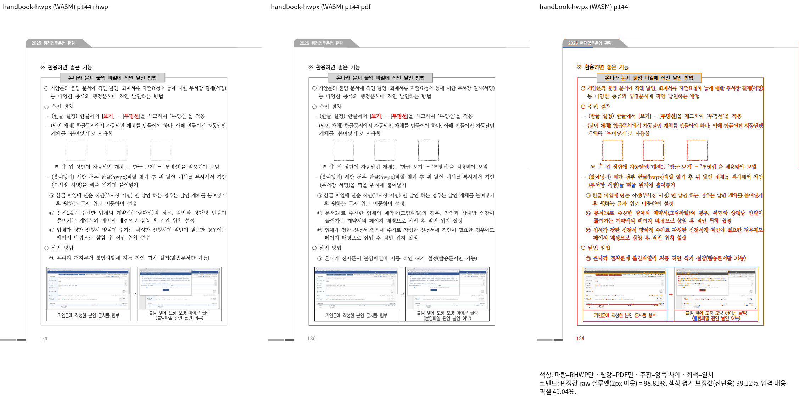
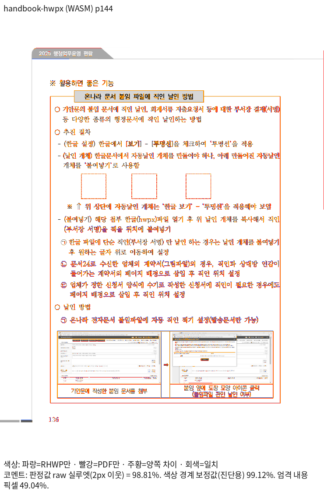
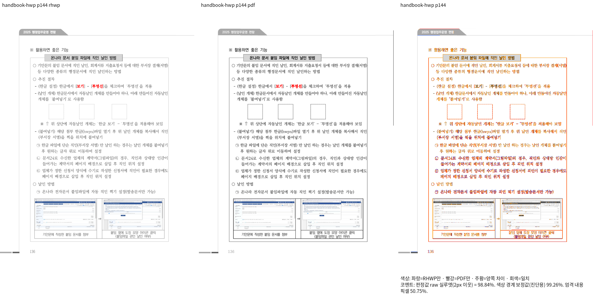
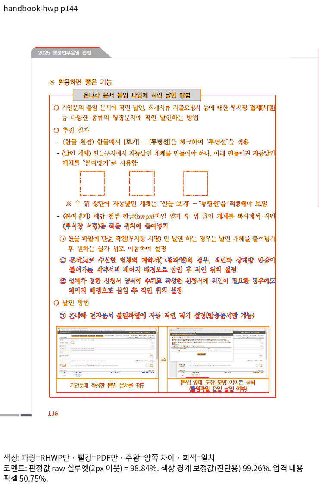
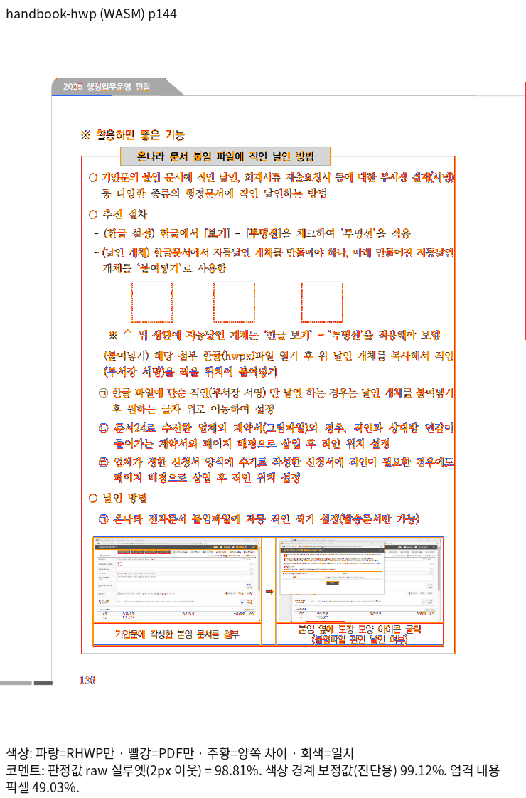

# Issue #8151 편람 144쪽 정합성 및 PR #8148 corpus 영향 검증

## 최종 로컬 검증 결과

144쪽 도장 표의 공통 가로 앵커·바깥여백 처리를 보정했다. 아래 같은 글꼴 조건의 최종 TSV에서 두 편람 모두 전 383쪽 Native/fresh WASM raw 90% 이상이며, 144쪽은 각각 98% 이상이다. 전체 Rust 회귀 **11,359 PASS / 0 FAIL / 45 SKIP**, Native Skia·필수 lint·최적화 fresh WASM 빌드를 완료했다.

#8148 입력 원장 72개(67 HWP/HWPX + 5 PDF), 1,529쪽을 두 backend의 base/후보에서 비교했다. 총 3,058개 페이지/backend 쌍 중 **편람 이외 70개 입력의 1,526개 쌍은 raw·실제 RGB·render tree가 모두 동일**하다. 편람의 작은 raw 하락은 아래처럼 별도로 공개하며 무하락이라고 보고하지 않는다. 원본·PDF SHA와 쪽수 누락은 없다.

## 입력·실행 신원

- Issue: https://github.com/edwardkim/rhwp/issues/8151
- base: `2e087a5b4bc1515ad877e8020b30114639a59392` (#8148 merge)
- 후보 runtime: `d81b8b4410779017d50a8891caa6a83ebec994d6`
- 회귀·lint code/test head: `1c8294dd523fab69b303ccb4cb45bb55de003a72`; 이후 증적·설명 변경은 runtime·검사 구현을 바꾸지 않는다.
- 원본·독립 Print의 경로·SHA·바이트·compat·쪽수: [입력 원장](inputs.tsv).
- 실제 producer source·binary/WASM SHA·바이트: [producer 원장](producer-integrity.tsv).
- profile print, 96dpi, compat2024(두 편람). 나머지 corpus는 원장에 고정한 compat2022/2024.
- Native는 실제 Skia PNG, fresh WASM은 최적화된 package의 실제 Chromium Canvas 출력이다.
- Native/fresh WASM 모두 `/usr/local/share/fonts/hancom-office-2020`, `/usr/local/share/fonts/hwp-convert-mcp-kopub`를 명시 공급했다. [213개 face의 프로그램 메타데이터](font-programs.tsv)만 보존하며 글꼴 바이너리를 배포하지 않는다.
- 최초 명시 글꼴 공급이 누락된 WASM 진단 TSV·PNG는 최종 제출 증적에서 교체했다. 최종 새 base는 #8148 게시 TSV와 **3,058쪽 모두 수치가 동일**하다. [게시값 대비 새 base 차이](pr8148-published-to-refreshed-base-drift.tsv)는 header만 있는 0행이다.

## 144쪽 보정과 독립 기대값

| 형식 | backend | base raw % | 후보 raw % |
| --- | --- | ---: | ---: |
| handbook-hwpx | native | 97.88889 | 98.84256 |
| handbook-hwpx | wasm | 97.85537 | 98.81159 |
| handbook-hwp | native | 97.88860 | 98.84240 |
| handbook-hwp | wasm | 97.85582 | 98.81185 |

원본은 구역 3/문단 71의 표 1723619577, r2c0 문단 4에 도장 표 3개를 가진다. 크기는 4251HU 정사각형, 가로 offset은 4868/13553/22830HU, 왼쪽 바깥여백은 283HU다. 독립 Print의 왼쪽 세로선 중심은 139.289/225.956/318.616pt, 윗변은 271.654pt다. 96dpi 기대 x는 185.718667/301.274667/424.821333px, y는 362.205333px다. bbox와 stroke 중심 차이를 구분해 ±2px로 보호한다.

기존 overlay의 `inline_x_override=Some(inner_area.x)`는 공통 중첩 가로 앵커의 여백·정렬을 우회했다. override를 제거하고 셀 단 원점에서 기존 `compute_table_x_position`을 소비한다. overlay에는 앞 텍스트 pen 전진을 포함하지 않는다. 확정 세로 원점·흐름 점유·비 overlay 경로는 기존 처리를 유지한다. 문서 ID나 새 좌표 보정값은 없다.

경로는 `layout_table` 셀의 `Control::Table` → `ctrl_area` → 중첩 `layout_table(inline_x_override=None)` → 공통 `compute_table_x_position` → 실제 Table bbox → 공통 render tree의 Native Skia/Canvas 소비다. 최종 paint에서 가로 위치를 덮어쓰는 보정은 추가하지 않았다. 측정의 `nested_overlay_outer_frame`, 확정 세로 원점과 분할 컷·예약 높이·종료 계약은 변경하지 않는다.

독립 Print와 같은 배율로 도장 3개·안내문·앞뒤 본문·하단 예시 표를 확인했다. 목표는 가로 원점이며 기존 glyph/rasterizer 차이까지 전쪽 100%로 해결했다고 주장하지 않는다.

## 144쪽 실제 출력

| 입력·backend | review | overlay |
| --- | --- | --- |
| HWPX Native |  |  |
| HWPX fresh WASM |  |  |
| HWP Native |  |  |
| HWP fresh WASM |  |  |

## 전쪽 TSV와 차이

| 입력 | backend | 쪽수 | 후보 최저 raw % | 개선 | 하락 | 동일 |
| --- | --- | ---: | ---: | ---: | ---: | ---: |
| handbook-hwp | native | 383 | 92.49647 | 2 | 4 | 377 |
| handbook-hwp | wasm | 383 | 92.51694 | 2 | 4 | 377 |
| handbook-hwpx | native | 383 | 92.49658 | 2 | 4 | 377 |
| handbook-hwpx | wasm | 383 | 92.51660 | 2 | 4 | 377 |

편람 변화는 116·144쪽 개선, 85·86·87·179쪽 작은 raw 하락이다. 최대 하락은 0.02427%p이며 0.1%p 이상 하락은 0쪽이다. 85·179쪽은 불일치 픽셀 수가 같고 겹침 개선으로 합집합 분모만 줄었다. 86·87쪽은 표가 Print의 올바른 x로 옮겨지며 기존 PDF 글자 불일치의 2px 이웃 지원이 변했다. 본문 RGB 자체는 해당 새 불일치 위치에서 전후 모두 흰색이며 새 본문 이동이 아니다. 자세한 분해·독립 좌표·crop은 [페이지 변화 분석](page-change-analysis.md)에 있다.

| 입력·backend | 기준 TSV | 후보 TSV | 전쪽 차이 |
| --- | --- | --- | --- |
| handbook-hwpx native | [원문](tsv/base/native/handbook-hwpx.tsv) | [원문](tsv/head/native/handbook-hwpx.tsv) | [383쪽 차이](tsv/delta/handbook-hwpx-native-page-delta.tsv) |
| handbook-hwpx wasm | [원문](tsv/base/wasm/handbook-hwpx.tsv) | [원문](tsv/head/wasm/handbook-hwpx.tsv) | [383쪽 차이](tsv/delta/handbook-hwpx-wasm-page-delta.tsv) |
| handbook-hwp native | [원문](tsv/base/native/handbook-hwp.tsv) | [원문](tsv/head/native/handbook-hwp.tsv) | [383쪽 차이](tsv/delta/handbook-hwp-native-page-delta.tsv) |
| handbook-hwp wasm | [원문](tsv/base/wasm/handbook-hwp.tsv) | [원문](tsv/head/wasm/handbook-hwp.tsv) | [383쪽 차이](tsv/delta/handbook-hwp-wasm-page-delta.tsv) |

## 전체 corpus 증적과 회귀 보호

- [전체 3,058쪽 base/후보 차이](pr8148-page-delta.tsv) · [변경 쪽만](pr8148-changed-pages.tsv) · [문서별 요약](pr8148-document-summary.tsv).
- [실제 RGB·render tree 동일성](pr8148-visual-identity.tsv)에서 편람 이외의 점수와 실제 출력이 모두 같음을 확인했다.
- [전체 288개 TSV 조건의 SHA-256·바이트·producer](tsv-integrity.tsv). 아래 원문은 산출한 파일과 바이트가 같다. 두 편람의 8개 TSV는 이번 asset에 보존하고, 변화가 없는 70개 입력의 280개 조건은 이미 커밋된 #8148 원본과 바이트가 같음을 확인해 그 파일을 재사용한다.
- 기존 #3820은 고정 크기 selector를 소유 정보 selector로 바꾸고 독립 Print x/y ±2px를 보호한다. 기존 상자 수·공통 y·원본 4251HU 크기 계약도 유지했다.
- 신규 `tests/cases/issue_8151_nested_overlay_outer_margin.rs`는 원본과 왼여백 0 대조군의 실제 x 이동을 원본 283HU에 대조한다. y·표 크기·쪽수 보존 및 순서·비겹침을 함께 검사한다.
- 동일 검사 소스를 frozen base/head rlib에 연결해 base FAIL(exit 101) / 후보 PASS(exit 0)를 확인했고, 정식 자동 suite의 기존 2건·신규 1건도 통과했다.
- [검증 명령·정식 회귀·lint 결과](validation-commands.md).

## 범위와 후속 목표

사용자는 전쪽 100% 보정은 나중에 진행하고 현재 144쪽 개선을 PR로 준비하도록 범위를 조정했다. 후속 목표는 #8153(두 문서 전쪽 raw 100% 및 각 페이지 중요 영역 ±2px 회귀)이다. 이번 변경으로 #8153을 닫지 않는다. #7751·#7752의 완료된 기존 범위도 다시 미완료로 바꾸지 않는다.

실행 로그·중간 JSON·전체 PNG·frozen producer는 ignored `output/pr-review/handbook-hwpx-p144-20261022/`에 둔다. 글꼴 바이너리·중간 SVG·실행 로그는 커밋하지 않는다. PR review·오늘할일은 PR 채번 및 정확한 code head CI 성공 후 역할 절차에 따라 기록한다.

## 입력별 전쪽 TSV 원문

| 입력 | 기준 Native | 후보 Native | 기준 fresh WASM | 후보 fresh WASM |
| --- | --- | --- | --- | --- |
| night-guard | [원문](../planet6897_20261018/tsv/current/native/night-guard.tsv) | [원문](../planet6897_20261018/tsv/current/native/night-guard.tsv) | [원문](../planet6897_20261018/tsv/current/wasm/night-guard.tsv) | [원문](../planet6897_20261018/tsv/current/wasm/night-guard.tsv) |
| merged-80168 | [원문](../planet6897_20261018/tsv/current/native/merged-80168.tsv) | [원문](../planet6897_20261018/tsv/current/native/merged-80168.tsv) | [원문](../planet6897_20261018/tsv/current/wasm/merged-80168.tsv) | [원문](../planet6897_20261018/tsv/current/wasm/merged-80168.tsv) |
| curriculum-1342000 | [원문](../planet6897_20261018/tsv/current/native/curriculum-1342000.tsv) | [원문](../planet6897_20261018/tsv/current/native/curriculum-1342000.tsv) | [원문](../planet6897_20261018/tsv/current/wasm/curriculum-1342000.tsv) | [원문](../planet6897_20261018/tsv/current/wasm/curriculum-1342000.tsv) |
| 148738070 | [원문](../planet6897_20261018/tsv/current/native/148738070.tsv) | [원문](../planet6897_20261018/tsv/current/native/148738070.tsv) | [원문](../planet6897_20261018/tsv/current/wasm/148738070.tsv) | [원문](../planet6897_20261018/tsv/current/wasm/148738070.tsv) |
| 156465345 | [원문](../planet6897_20261018/tsv/current/native/156465345.tsv) | [원문](../planet6897_20261018/tsv/current/native/156465345.tsv) | [원문](../planet6897_20261018/tsv/current/wasm/156465345.tsv) | [원문](../planet6897_20261018/tsv/current/wasm/156465345.tsv) |
| 1150200 | [원문](../planet6897_20261018/tsv/current/native/1150200.tsv) | [원문](../planet6897_20261018/tsv/current/native/1150200.tsv) | [원문](../planet6897_20261018/tsv/current/wasm/1150200.tsv) | [원문](../planet6897_20261018/tsv/current/wasm/1150200.tsv) |
| merged-grid-fixture | [원문](../planet6897_20261018/tsv/current/native/merged-grid-fixture.tsv) | [원문](../planet6897_20261018/tsv/current/native/merged-grid-fixture.tsv) | [원문](../planet6897_20261018/tsv/current/wasm/merged-grid-fixture.tsv) | [원문](../planet6897_20261018/tsv/current/wasm/merged-grid-fixture.tsv) |
| nested-tac-fixture | [원문](../planet6897_20261018/tsv/current/native/nested-tac-fixture.tsv) | [원문](../planet6897_20261018/tsv/current/native/nested-tac-fixture.tsv) | [원문](../planet6897_20261018/tsv/current/wasm/nested-tac-fixture.tsv) | [원문](../planet6897_20261018/tsv/current/wasm/nested-tac-fixture.tsv) |
| eq-rm-space | [원문](../planet6897_20261018/tsv/current/native/eq-rm-space.tsv) | [원문](../planet6897_20261018/tsv/current/native/eq-rm-space.tsv) | [원문](../planet6897_20261018/tsv/current/wasm/eq-rm-space.tsv) | [원문](../planet6897_20261018/tsv/current/wasm/eq-rm-space.tsv) |
| eq-plusminus | [원문](../planet6897_20261018/tsv/current/native/eq-plusminus.tsv) | [원문](../planet6897_20261018/tsv/current/native/eq-plusminus.tsv) | [원문](../planet6897_20261018/tsv/current/wasm/eq-plusminus.tsv) | [원문](../planet6897_20261018/tsv/current/wasm/eq-plusminus.tsv) |
| eq-uppercase-greek | [원문](../planet6897_20261018/tsv/current/native/eq-uppercase-greek.tsv) | [원문](../planet6897_20261018/tsv/current/native/eq-uppercase-greek.tsv) | [원문](../planet6897_20261018/tsv/current/wasm/eq-uppercase-greek.tsv) | [원문](../planet6897_20261018/tsv/current/wasm/eq-uppercase-greek.tsv) |
| original-nested-tac-row-drop | [원문](../planet6897_20261018/tsv/current/native/original-nested-tac-row-drop.tsv) | [원문](../planet6897_20261018/tsv/current/native/original-nested-tac-row-drop.tsv) | [원문](../planet6897_20261018/tsv/current/wasm/original-nested-tac-row-drop.tsv) | [원문](../planet6897_20261018/tsv/current/wasm/original-nested-tac-row-drop.tsv) |
| original-eq-rm-quarterspace | [원문](../planet6897_20261018/tsv/current/native/original-eq-rm-quarterspace.tsv) | [원문](../planet6897_20261018/tsv/current/native/original-eq-rm-quarterspace.tsv) | [원문](../planet6897_20261018/tsv/current/wasm/original-eq-rm-quarterspace.tsv) | [원문](../planet6897_20261018/tsv/current/wasm/original-eq-rm-quarterspace.tsv) |
| added-issue7092-substitute-font-hft-hwpx | [원문](../planet6897_20261018/tsv/current/native/added-issue7092-substitute-font-hft-hwpx.tsv) | [원문](../planet6897_20261018/tsv/current/native/added-issue7092-substitute-font-hft-hwpx.tsv) | [원문](../planet6897_20261018/tsv/current/wasm/added-issue7092-substitute-font-hft-hwpx.tsv) | [원문](../planet6897_20261018/tsv/current/wasm/added-issue7092-substitute-font-hft-hwpx.tsv) |
| added-issue7092-substitute-font-none-hwpx | [원문](../planet6897_20261018/tsv/current/native/added-issue7092-substitute-font-none-hwpx.tsv) | [원문](../planet6897_20261018/tsv/current/native/added-issue7092-substitute-font-none-hwpx.tsv) | [원문](../planet6897_20261018/tsv/current/wasm/added-issue7092-substitute-font-none-hwpx.tsv) | [원문](../planet6897_20261018/tsv/current/wasm/added-issue7092-substitute-font-none-hwpx.tsv) |
| added-issue7092-substitute-font-ttf-hwpx | [원문](../planet6897_20261018/tsv/current/native/added-issue7092-substitute-font-ttf-hwpx.tsv) | [원문](../planet6897_20261018/tsv/current/native/added-issue7092-substitute-font-ttf-hwpx.tsv) | [원문](../planet6897_20261018/tsv/current/wasm/added-issue7092-substitute-font-ttf-hwpx.tsv) | [원문](../planet6897_20261018/tsv/current/wasm/added-issue7092-substitute-font-ttf-hwpx.tsv) |
| added-issue7679-tac-after-text-2024-hwp | [원문](../planet6897_20261018/tsv/current/native/added-issue7679-tac-after-text-2024-hwp.tsv) | [원문](../planet6897_20261018/tsv/current/native/added-issue7679-tac-after-text-2024-hwp.tsv) | [원문](../planet6897_20261018/tsv/current/wasm/added-issue7679-tac-after-text-2024-hwp.tsv) | [원문](../planet6897_20261018/tsv/current/wasm/added-issue7679-tac-after-text-2024-hwp.tsv) |
| added-issue7687-empty-host-hwpx | [원문](../planet6897_20261018/tsv/current/native/added-issue7687-empty-host-hwpx.tsv) | [원문](../planet6897_20261018/tsv/current/native/added-issue7687-empty-host-hwpx.tsv) | [원문](../planet6897_20261018/tsv/current/wasm/added-issue7687-empty-host-hwpx.tsv) | [원문](../planet6897_20261018/tsv/current/wasm/added-issue7687-empty-host-hwpx.tsv) |
| added-issue7695-footnote-page-tail-2024-hwp | [원문](../planet6897_20261018/tsv/current/native/added-issue7695-footnote-page-tail-2024-hwp.tsv) | [원문](../planet6897_20261018/tsv/current/native/added-issue7695-footnote-page-tail-2024-hwp.tsv) | [원문](../planet6897_20261018/tsv/current/wasm/added-issue7695-footnote-page-tail-2024-hwp.tsv) | [원문](../planet6897_20261018/tsv/current/wasm/added-issue7695-footnote-page-tail-2024-hwp.tsv) |
| added-issue7696-page-anchored-band-2024-hwp | [원문](../planet6897_20261018/tsv/current/native/added-issue7696-page-anchored-band-2024-hwp.tsv) | [원문](../planet6897_20261018/tsv/current/native/added-issue7696-page-anchored-band-2024-hwp.tsv) | [원문](../planet6897_20261018/tsv/current/wasm/added-issue7696-page-anchored-band-2024-hwp.tsv) | [원문](../planet6897_20261018/tsv/current/wasm/added-issue7696-page-anchored-band-2024-hwp.tsv) |
| added-issue7696-page-anchored-band-hwpx | [원문](../planet6897_20261018/tsv/current/native/added-issue7696-page-anchored-band-hwpx.tsv) | [원문](../planet6897_20261018/tsv/current/native/added-issue7696-page-anchored-band-hwpx.tsv) | [원문](../planet6897_20261018/tsv/current/wasm/added-issue7696-page-anchored-band-hwpx.tsv) | [원문](../planet6897_20261018/tsv/current/wasm/added-issue7696-page-anchored-band-hwpx.tsv) |
| added-issue7870-flow_37-hwpx | [원문](../planet6897_20261018/tsv/current/native/added-issue7870-flow_37-hwpx.tsv) | [원문](../planet6897_20261018/tsv/current/native/added-issue7870-flow_37-hwpx.tsv) | [원문](../planet6897_20261018/tsv/current/wasm/added-issue7870-flow_37-hwpx.tsv) | [원문](../planet6897_20261018/tsv/current/wasm/added-issue7870-flow_37-hwpx.tsv) |
| added-issue7870-tac_37-hwpx | [원문](../planet6897_20261018/tsv/current/native/added-issue7870-tac_37-hwpx.tsv) | [원문](../planet6897_20261018/tsv/current/native/added-issue7870-tac_37-hwpx.tsv) | [원문](../planet6897_20261018/tsv/current/wasm/added-issue7870-tac_37-hwpx.tsv) | [원문](../planet6897_20261018/tsv/current/wasm/added-issue7870-tac_37-hwpx.tsv) |
| added-issue7972-inactive-cell-margin-hwpx | [원문](../planet6897_20261018/tsv/current/native/added-issue7972-inactive-cell-margin-hwpx.tsv) | [원문](../planet6897_20261018/tsv/current/native/added-issue7972-inactive-cell-margin-hwpx.tsv) | [원문](../planet6897_20261018/tsv/current/wasm/added-issue7972-inactive-cell-margin-hwpx.tsv) | [원문](../planet6897_20261018/tsv/current/wasm/added-issue7972-inactive-cell-margin-hwpx.tsv) |
| added-issue7993-soft-hyphen-2024-hwp | [원문](../planet6897_20261018/tsv/current/native/added-issue7993-soft-hyphen-2024-hwp.tsv) | [원문](../planet6897_20261018/tsv/current/native/added-issue7993-soft-hyphen-2024-hwp.tsv) | [원문](../planet6897_20261018/tsv/current/wasm/added-issue7993-soft-hyphen-2024-hwp.tsv) | [원문](../planet6897_20261018/tsv/current/wasm/added-issue7993-soft-hyphen-2024-hwp.tsv) |
| added-issue7993-soft-hyphen-hwpx | [원문](../planet6897_20261018/tsv/current/native/added-issue7993-soft-hyphen-hwpx.tsv) | [원문](../planet6897_20261018/tsv/current/native/added-issue7993-soft-hyphen-hwpx.tsv) | [원문](../planet6897_20261018/tsv/current/wasm/added-issue7993-soft-hyphen-hwpx.tsv) | [원문](../planet6897_20261018/tsv/current/wasm/added-issue7993-soft-hyphen-hwpx.tsv) |
| added-issue8067-flow_L1-hwpx | [원문](../planet6897_20261018/tsv/current/native/added-issue8067-flow_L1-hwpx.tsv) | [원문](../planet6897_20261018/tsv/current/native/added-issue8067-flow_L1-hwpx.tsv) | [원문](../planet6897_20261018/tsv/current/wasm/added-issue8067-flow_L1-hwpx.tsv) | [원문](../planet6897_20261018/tsv/current/wasm/added-issue8067-flow_L1-hwpx.tsv) |
| added-issue8067-flow_L1_tablepad-hwpx | [원문](../planet6897_20261018/tsv/current/native/added-issue8067-flow_L1_tablepad-hwpx.tsv) | [원문](../planet6897_20261018/tsv/current/native/added-issue8067-flow_L1_tablepad-hwpx.tsv) | [원문](../planet6897_20261018/tsv/current/wasm/added-issue8067-flow_L1_tablepad-hwpx.tsv) | [원문](../planet6897_20261018/tsv/current/wasm/added-issue8067-flow_L1_tablepad-hwpx.tsv) |
| added-issue8067-flow_L3-hwpx | [원문](../planet6897_20261018/tsv/current/native/added-issue8067-flow_L3-hwpx.tsv) | [원문](../planet6897_20261018/tsv/current/native/added-issue8067-flow_L3-hwpx.tsv) | [원문](../planet6897_20261018/tsv/current/wasm/added-issue8067-flow_L3-hwpx.tsv) | [원문](../planet6897_20261018/tsv/current/wasm/added-issue8067-flow_L3-hwpx.tsv) |
| added-issue8067-flow_L3_tablepad-hwpx | [원문](../planet6897_20261018/tsv/current/native/added-issue8067-flow_L3_tablepad-hwpx.tsv) | [원문](../planet6897_20261018/tsv/current/native/added-issue8067-flow_L3_tablepad-hwpx.tsv) | [원문](../planet6897_20261018/tsv/current/wasm/added-issue8067-flow_L3_tablepad-hwpx.tsv) | [원문](../planet6897_20261018/tsv/current/wasm/added-issue8067-flow_L3_tablepad-hwpx.tsv) |
| added-issue8067-tac_L1-hwpx | [원문](../planet6897_20261018/tsv/current/native/added-issue8067-tac_L1-hwpx.tsv) | [원문](../planet6897_20261018/tsv/current/native/added-issue8067-tac_L1-hwpx.tsv) | [원문](../planet6897_20261018/tsv/current/wasm/added-issue8067-tac_L1-hwpx.tsv) | [원문](../planet6897_20261018/tsv/current/wasm/added-issue8067-tac_L1-hwpx.tsv) |
| added-issue8067-tac_L3-hwpx | [원문](../planet6897_20261018/tsv/current/native/added-issue8067-tac_L3-hwpx.tsv) | [원문](../planet6897_20261018/tsv/current/native/added-issue8067-tac_L3-hwpx.tsv) | [원문](../planet6897_20261018/tsv/current/wasm/added-issue8067-tac_L3-hwpx.tsv) | [원문](../planet6897_20261018/tsv/current/wasm/added-issue8067-tac_L3-hwpx.tsv) |
| footnote8081-span36 | [원문](../planet6897_20261018/tsv/current/native/footnote8081-span36.tsv) | [원문](../planet6897_20261018/tsv/current/native/footnote8081-span36.tsv) | [원문](../planet6897_20261018/tsv/current/wasm/footnote8081-span36.tsv) | [원문](../planet6897_20261018/tsv/current/wasm/footnote8081-span36.tsv) |
| footnote8081-span38 | [원문](../planet6897_20261018/tsv/current/native/footnote8081-span38.tsv) | [원문](../planet6897_20261018/tsv/current/native/footnote8081-span38.tsv) | [원문](../planet6897_20261018/tsv/current/wasm/footnote8081-span38.tsv) | [원문](../planet6897_20261018/tsv/current/wasm/footnote8081-span38.tsv) |
| edit7866-a_whole_bold_after | [원문](../planet6897_20261018/tsv/current/native/edit7866-a_whole_bold_after.tsv) | [원문](../planet6897_20261018/tsv/current/native/edit7866-a_whole_bold_after.tsv) | [원문](../planet6897_20261018/tsv/current/wasm/edit7866-a_whole_bold_after.tsv) | [원문](../planet6897_20261018/tsv/current/wasm/edit7866-a_whole_bold_after.tsv) |
| edit7866-a_whole_bold_before | [원문](../planet6897_20261018/tsv/current/native/edit7866-a_whole_bold_before.tsv) | [원문](../planet6897_20261018/tsv/current/native/edit7866-a_whole_bold_before.tsv) | [원문](../planet6897_20261018/tsv/current/wasm/edit7866-a_whole_bold_before.tsv) | [원문](../planet6897_20261018/tsv/current/wasm/edit7866-a_whole_bold_before.tsv) |
| edit7866-b_first_char_bold_after | [원문](../planet6897_20261018/tsv/current/native/edit7866-b_first_char_bold_after.tsv) | [원문](../planet6897_20261018/tsv/current/native/edit7866-b_first_char_bold_after.tsv) | [원문](../planet6897_20261018/tsv/current/wasm/edit7866-b_first_char_bold_after.tsv) | [원문](../planet6897_20261018/tsv/current/wasm/edit7866-b_first_char_bold_after.tsv) |
| edit7866-b_first_char_bold_before | [원문](../planet6897_20261018/tsv/current/native/edit7866-b_first_char_bold_before.tsv) | [원문](../planet6897_20261018/tsv/current/native/edit7866-b_first_char_bold_before.tsv) | [원문](../planet6897_20261018/tsv/current/wasm/edit7866-b_first_char_bold_before.tsv) | [원문](../planet6897_20261018/tsv/current/wasm/edit7866-b_first_char_bold_before.tsv) |
| edit7866-c_second_char_bold_after | [원문](../planet6897_20261018/tsv/current/native/edit7866-c_second_char_bold_after.tsv) | [원문](../planet6897_20261018/tsv/current/native/edit7866-c_second_char_bold_after.tsv) | [원문](../planet6897_20261018/tsv/current/wasm/edit7866-c_second_char_bold_after.tsv) | [원문](../planet6897_20261018/tsv/current/wasm/edit7866-c_second_char_bold_after.tsv) |
| edit7866-c_second_char_bold_before | [원문](../planet6897_20261018/tsv/current/native/edit7866-c_second_char_bold_before.tsv) | [원문](../planet6897_20261018/tsv/current/native/edit7866-c_second_char_bold_before.tsv) | [원문](../planet6897_20261018/tsv/current/wasm/edit7866-c_second_char_bold_before.tsv) | [원문](../planet6897_20261018/tsv/current/wasm/edit7866-c_second_char_bold_before.tsv) |
| edit7866-d_red_longer_after | [원문](../planet6897_20261018/tsv/current/native/edit7866-d_red_longer_after.tsv) | [원문](../planet6897_20261018/tsv/current/native/edit7866-d_red_longer_after.tsv) | [원문](../planet6897_20261018/tsv/current/wasm/edit7866-d_red_longer_after.tsv) | [원문](../planet6897_20261018/tsv/current/wasm/edit7866-d_red_longer_after.tsv) |
| edit7866-d_red_longer_before | [원문](../planet6897_20261018/tsv/current/native/edit7866-d_red_longer_before.tsv) | [원문](../planet6897_20261018/tsv/current/native/edit7866-d_red_longer_before.tsv) | [원문](../planet6897_20261018/tsv/current/wasm/edit7866-d_red_longer_before.tsv) | [원문](../planet6897_20261018/tsv/current/wasm/edit7866-d_red_longer_before.tsv) |
| edit7866-e_para_start_after | [원문](../planet6897_20261018/tsv/current/native/edit7866-e_para_start_after.tsv) | [원문](../planet6897_20261018/tsv/current/native/edit7866-e_para_start_after.tsv) | [원문](../planet6897_20261018/tsv/current/wasm/edit7866-e_para_start_after.tsv) | [원문](../planet6897_20261018/tsv/current/wasm/edit7866-e_para_start_after.tsv) |
| edit7866-e_para_start_before | [원문](../planet6897_20261018/tsv/current/native/edit7866-e_para_start_before.tsv) | [원문](../planet6897_20261018/tsv/current/native/edit7866-e_para_start_before.tsv) | [원문](../planet6897_20261018/tsv/current/wasm/edit7866-e_para_start_before.tsv) | [원문](../planet6897_20261018/tsv/current/wasm/edit7866-e_para_start_before.tsv) |
| edit7866-f_para_end_after | [원문](../planet6897_20261018/tsv/current/native/edit7866-f_para_end_after.tsv) | [원문](../planet6897_20261018/tsv/current/native/edit7866-f_para_end_after.tsv) | [원문](../planet6897_20261018/tsv/current/wasm/edit7866-f_para_end_after.tsv) | [원문](../planet6897_20261018/tsv/current/wasm/edit7866-f_para_end_after.tsv) |
| edit7866-f_para_end_before | [원문](../planet6897_20261018/tsv/current/native/edit7866-f_para_end_before.tsv) | [원문](../planet6897_20261018/tsv/current/native/edit7866-f_para_end_before.tsv) | [원문](../planet6897_20261018/tsv/current/wasm/edit7866-f_para_end_before.tsv) | [원문](../planet6897_20261018/tsv/current/wasm/edit7866-f_para_end_before.tsv) |
| edit7866-g_table_cell_after | [원문](../planet6897_20261018/tsv/current/native/edit7866-g_table_cell_after.tsv) | [원문](../planet6897_20261018/tsv/current/native/edit7866-g_table_cell_after.tsv) | [원문](../planet6897_20261018/tsv/current/wasm/edit7866-g_table_cell_after.tsv) | [원문](../planet6897_20261018/tsv/current/wasm/edit7866-g_table_cell_after.tsv) |
| edit7866-g_table_cell_before | [원문](../planet6897_20261018/tsv/current/native/edit7866-g_table_cell_before.tsv) | [원문](../planet6897_20261018/tsv/current/native/edit7866-g_table_cell_before.tsv) | [원문](../planet6897_20261018/tsv/current/wasm/edit7866-g_table_cell_before.tsv) | [원문](../planet6897_20261018/tsv/current/wasm/edit7866-g_table_cell_before.tsv) |
| edit7866-h_prev_bold_match_plain_after | [원문](../planet6897_20261018/tsv/current/native/edit7866-h_prev_bold_match_plain_after.tsv) | [원문](../planet6897_20261018/tsv/current/native/edit7866-h_prev_bold_match_plain_after.tsv) | [원문](../planet6897_20261018/tsv/current/wasm/edit7866-h_prev_bold_match_plain_after.tsv) | [원문](../planet6897_20261018/tsv/current/wasm/edit7866-h_prev_bold_match_plain_after.tsv) |
| edit7866-h_prev_bold_match_plain_before | [원문](../planet6897_20261018/tsv/current/native/edit7866-h_prev_bold_match_plain_before.tsv) | [원문](../planet6897_20261018/tsv/current/native/edit7866-h_prev_bold_match_plain_before.tsv) | [원문](../planet6897_20261018/tsv/current/wasm/edit7866-h_prev_bold_match_plain_before.tsv) | [원문](../planet6897_20261018/tsv/current/wasm/edit7866-h_prev_bold_match_plain_before.tsv) |
| edit7866-i_shorter_after | [원문](../planet6897_20261018/tsv/current/native/edit7866-i_shorter_after.tsv) | [원문](../planet6897_20261018/tsv/current/native/edit7866-i_shorter_after.tsv) | [원문](../planet6897_20261018/tsv/current/wasm/edit7866-i_shorter_after.tsv) | [원문](../planet6897_20261018/tsv/current/wasm/edit7866-i_shorter_after.tsv) |
| edit7866-i_shorter_before | [원문](../planet6897_20261018/tsv/current/native/edit7866-i_shorter_before.tsv) | [원문](../planet6897_20261018/tsv/current/native/edit7866-i_shorter_before.tsv) | [원문](../planet6897_20261018/tsv/current/wasm/edit7866-i_shorter_before.tsv) | [원문](../planet6897_20261018/tsv/current/wasm/edit7866-i_shorter_before.tsv) |
| edit7866-j_longer_partial_after | [원문](../planet6897_20261018/tsv/current/native/edit7866-j_longer_partial_after.tsv) | [원문](../planet6897_20261018/tsv/current/native/edit7866-j_longer_partial_after.tsv) | [원문](../planet6897_20261018/tsv/current/wasm/edit7866-j_longer_partial_after.tsv) | [원문](../planet6897_20261018/tsv/current/wasm/edit7866-j_longer_partial_after.tsv) |
| edit7866-j_longer_partial_before | [원문](../planet6897_20261018/tsv/current/native/edit7866-j_longer_partial_before.tsv) | [원문](../planet6897_20261018/tsv/current/native/edit7866-j_longer_partial_before.tsv) | [원문](../planet6897_20261018/tsv/current/wasm/edit7866-j_longer_partial_before.tsv) | [원문](../planet6897_20261018/tsv/current/wasm/edit7866-j_longer_partial_before.tsv) |
| edit7866-k_two_shapes_then_plain_after | [원문](../planet6897_20261018/tsv/current/native/edit7866-k_two_shapes_then_plain_after.tsv) | [원문](../planet6897_20261018/tsv/current/native/edit7866-k_two_shapes_then_plain_after.tsv) | [원문](../planet6897_20261018/tsv/current/wasm/edit7866-k_two_shapes_then_plain_after.tsv) | [원문](../planet6897_20261018/tsv/current/wasm/edit7866-k_two_shapes_then_plain_after.tsv) |
| edit7866-k_two_shapes_then_plain_before | [원문](../planet6897_20261018/tsv/current/native/edit7866-k_two_shapes_then_plain_before.tsv) | [원문](../planet6897_20261018/tsv/current/native/edit7866-k_two_shapes_then_plain_before.tsv) | [원문](../planet6897_20261018/tsv/current/wasm/edit7866-k_two_shapes_then_plain_before.tsv) | [원문](../planet6897_20261018/tsv/current/wasm/edit7866-k_two_shapes_then_plain_before.tsv) |
| eq7873-eq-font-fraction | [원문](../planet6897_20261018/tsv/current/native/eq7873-eq-font-fraction.tsv) | [원문](../planet6897_20261018/tsv/current/native/eq7873-eq-font-fraction.tsv) | [원문](../planet6897_20261018/tsv/current/wasm/eq7873-eq-font-fraction.tsv) | [원문](../planet6897_20261018/tsv/current/wasm/eq7873-eq-font-fraction.tsv) |
| eq7873-eq-font-state | [원문](../planet6897_20261018/tsv/current/native/eq7873-eq-font-state.tsv) | [원문](../planet6897_20261018/tsv/current/native/eq7873-eq-font-state.tsv) | [원문](../planet6897_20261018/tsv/current/wasm/eq7873-eq-font-state.tsv) | [원문](../planet6897_20261018/tsv/current/wasm/eq7873-eq-font-state.tsv) |
| added-issue7873-font-state-document-hwpx | [원문](../planet6897_20261018/tsv/current/native/added-issue7873-font-state-document-hwpx.tsv) | [원문](../planet6897_20261018/tsv/current/native/added-issue7873-font-state-document-hwpx.tsv) | [원문](../planet6897_20261018/tsv/current/wasm/added-issue7873-font-state-document-hwpx.tsv) | [원문](../planet6897_20261018/tsv/current/wasm/added-issue7873-font-state-document-hwpx.tsv) |
| handbook-hwp | [원문](tsv/base/native/handbook-hwp.tsv) | [원문](tsv/head/native/handbook-hwp.tsv) | [원문](tsv/base/wasm/handbook-hwp.tsv) | [원문](tsv/head/wasm/handbook-hwp.tsv) |
| handbook-hwpx | [원문](tsv/base/native/handbook-hwpx.tsv) | [원문](tsv/head/native/handbook-hwpx.tsv) | [원문](tsv/base/wasm/handbook-hwpx.tsv) | [원문](tsv/head/wasm/handbook-hwpx.tsv) |
| declared-row-band | [원문](../planet6897_20261018/tsv/current/native/declared-row-band.tsv) | [원문](../planet6897_20261018/tsv/current/native/declared-row-band.tsv) | [원문](../planet6897_20261018/tsv/current/wasm/declared-row-band.tsv) | [원문](../planet6897_20261018/tsv/current/wasm/declared-row-band.tsv) |
| numbered-stale-tail-hwp | [원문](../planet6897_20261018/tsv/current/native/numbered-stale-tail-hwp.tsv) | [원문](../planet6897_20261018/tsv/current/native/numbered-stale-tail-hwp.tsv) | [원문](../planet6897_20261018/tsv/current/wasm/numbered-stale-tail-hwp.tsv) | [원문](../planet6897_20261018/tsv/current/wasm/numbered-stale-tail-hwp.tsv) |
| pdf8120-operators | [원문](../planet6897_20261018/tsv/current/native/pdf8120-operators.tsv) | [원문](../planet6897_20261018/tsv/current/native/pdf8120-operators.tsv) | [원문](../planet6897_20261018/tsv/current/wasm/pdf8120-operators.tsv) | [원문](../planet6897_20261018/tsv/current/wasm/pdf8120-operators.tsv) |
| pdf8120-cell | [원문](../planet6897_20261018/tsv/current/native/pdf8120-cell.tsv) | [원문](../planet6897_20261018/tsv/current/native/pdf8120-cell.tsv) | [원문](../planet6897_20261018/tsv/current/wasm/pdf8120-cell.tsv) | [원문](../planet6897_20261018/tsv/current/wasm/pdf8120-cell.tsv) |
| pdf8120-retained | [원문](../planet6897_20261018/tsv/current/native/pdf8120-retained.tsv) | [원문](../planet6897_20261018/tsv/current/native/pdf8120-retained.tsv) | [원문](../planet6897_20261018/tsv/current/wasm/pdf8120-retained.tsv) | [원문](../planet6897_20261018/tsv/current/wasm/pdf8120-retained.tsv) |
| pdf8120-body-columns | [원문](../planet6897_20261018/tsv/current/native/pdf8120-body-columns.tsv) | [원문](../planet6897_20261018/tsv/current/native/pdf8120-body-columns.tsv) | [원문](../planet6897_20261018/tsv/current/wasm/pdf8120-body-columns.tsv) | [원문](../planet6897_20261018/tsv/current/wasm/pdf8120-body-columns.tsv) |
| pdf8120-solid-control | [원문](../planet6897_20261018/tsv/current/native/pdf8120-solid-control.tsv) | [원문](../planet6897_20261018/tsv/current/native/pdf8120-solid-control.tsv) | [원문](../planet6897_20261018/tsv/current/wasm/pdf8120-solid-control.tsv) | [원문](../planet6897_20261018/tsv/current/wasm/pdf8120-solid-control.tsv) |
| ordered-numbered-tail | [원문](../planet6897_20261018/tsv/current/native/ordered-numbered-tail.tsv) | [원문](../planet6897_20261018/tsv/current/native/ordered-numbered-tail.tsv) | [원문](../planet6897_20261018/tsv/current/wasm/ordered-numbered-tail.tsv) | [원문](../planet6897_20261018/tsv/current/wasm/ordered-numbered-tail.tsv) |
| mirrored-83818 | [원문](../planet6897_20261018/tsv/current/native/mirrored-83818.tsv) | [원문](../planet6897_20261018/tsv/current/native/mirrored-83818.tsv) | [원문](../planet6897_20261018/tsv/current/wasm/mirrored-83818.tsv) | [원문](../planet6897_20261018/tsv/current/wasm/mirrored-83818.tsv) |
| paragraph-border-exam-eng | [원문](../planet6897_20261018/tsv/current/native/paragraph-border-exam-eng.tsv) | [원문](../planet6897_20261018/tsv/current/native/paragraph-border-exam-eng.tsv) | [원문](../planet6897_20261018/tsv/current/wasm/paragraph-border-exam-eng.tsv) | [원문](../planet6897_20261018/tsv/current/wasm/paragraph-border-exam-eng.tsv) |
| paragraph-border-exam-kor | [원문](../planet6897_20261018/tsv/current/native/paragraph-border-exam-kor.tsv) | [원문](../planet6897_20261018/tsv/current/native/paragraph-border-exam-kor.tsv) | [원문](../planet6897_20261018/tsv/current/wasm/paragraph-border-exam-kor.tsv) | [원문](../planet6897_20261018/tsv/current/wasm/paragraph-border-exam-kor.tsv) |
