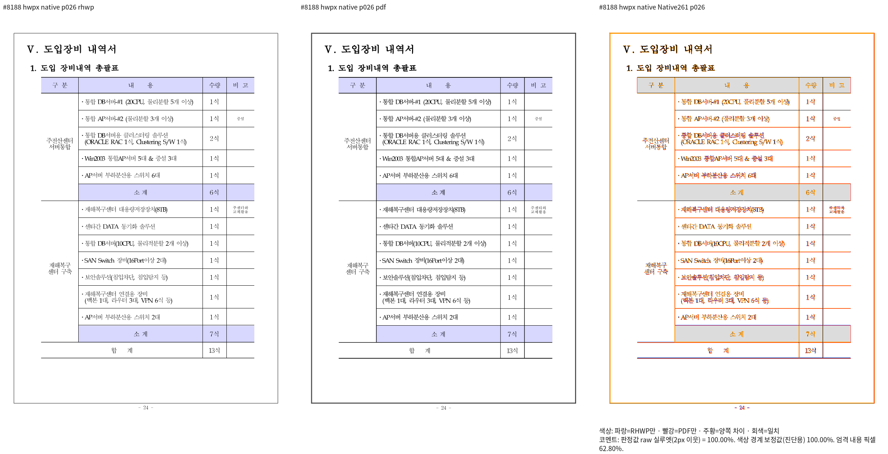
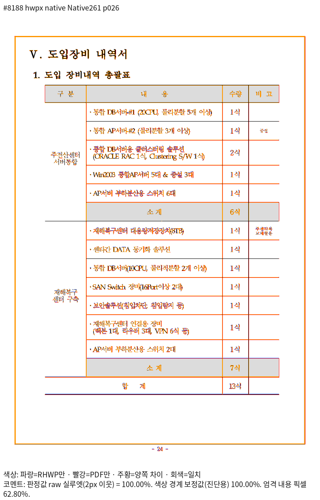
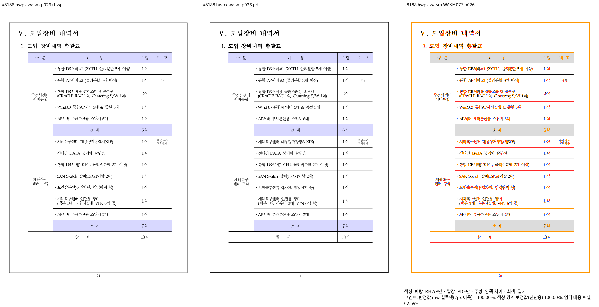
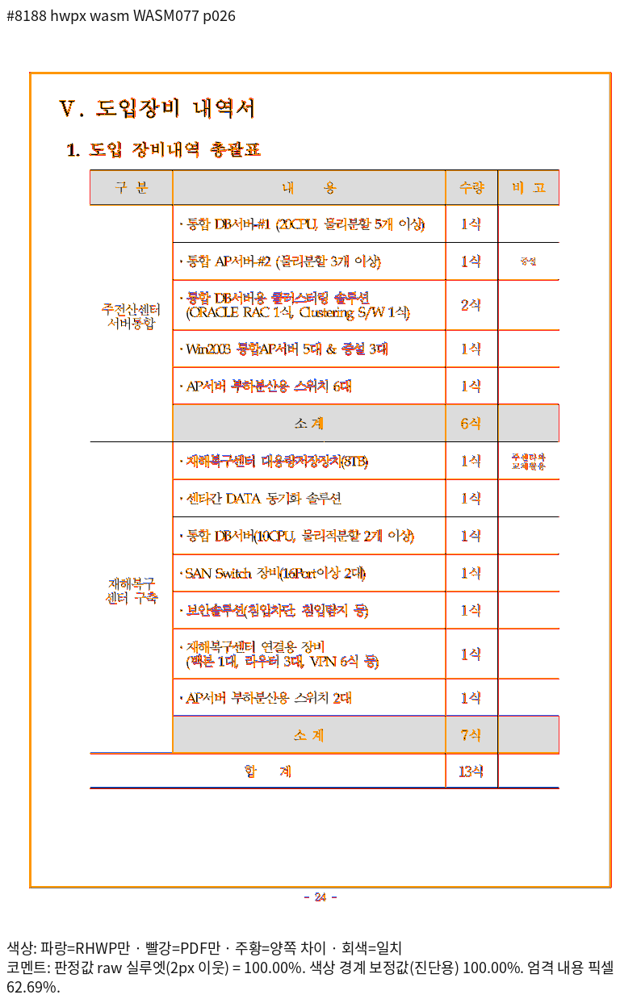
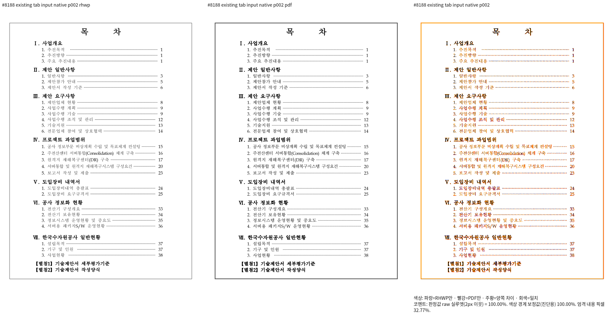
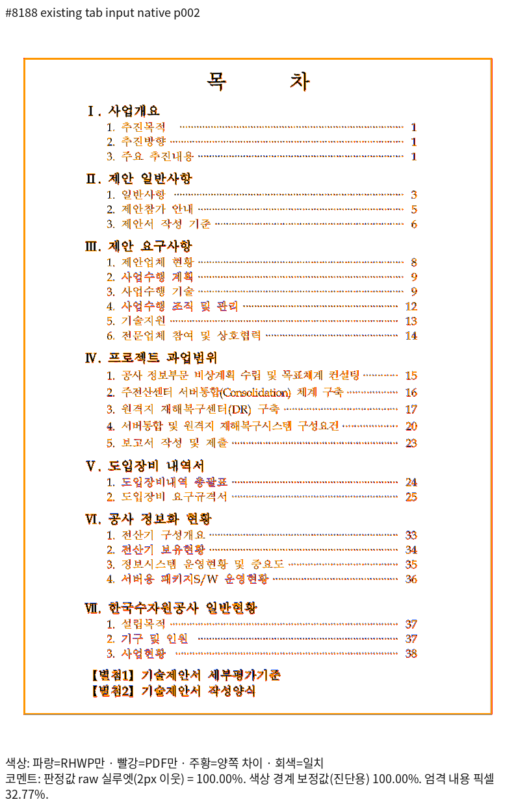
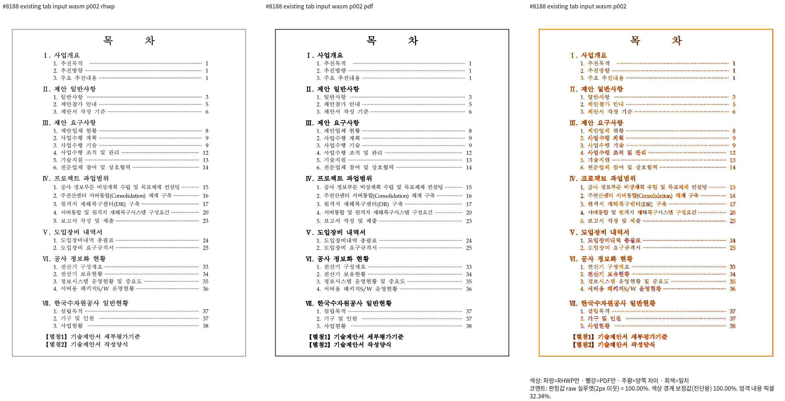
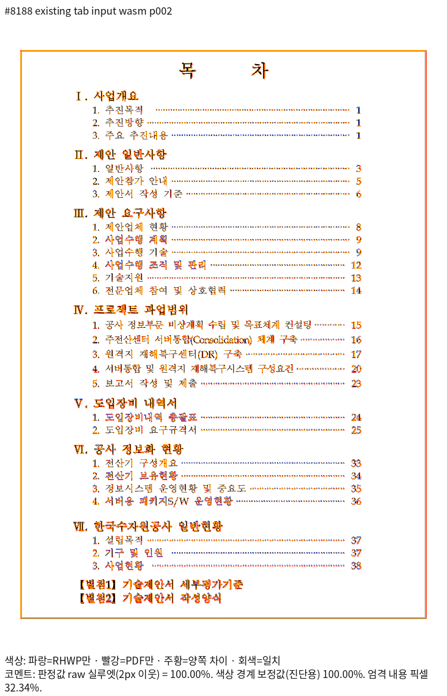

# #8188 리베이스 보정과 26쪽 종단 서식 회귀 증적

검증한 제품 source는 `c2513250ef976cc8189671a5766cd646d75bc4ed`, 기준 devel은
`2546c8b2ab7041399fb15fe82e0f50c1ade21724`다. 이 기록은 #8188의 동일한 변환본
3개와 새 26쪽 회귀 검사의 결과이며, 통합 브랜치 전체의 PR 제출 완료 판정은 아니다.

## 전체 페이지 결과

96dpi 인쇄 프로필, 색상 경계 보정 전 2px 이웃 실루엣 기준이다. Native와 최적화한 fresh WASM에서
각각 192/192쪽이 raw 100%이고, 각 쪽의 양방향 미대응 잉크 수는 모두 0이다.
RGB 픽셀의 완전 일치라는 뜻은 아니다. 일반 TSV의 미달 표시 0은 90% 미만이 없다는 뜻이므로
#8188의 100% 계약을 대신하지 않는다. 반올림 전 값과 정수 미대응 수를 별도로 확인했다.

전체 TSV와 기존 원본·독립 한컴 Print PDF의 해시는 아래 표에 기록했다. 입력·PDF 및 실제 공급한
글꼴 프로그램 217개의 해시를 #8188 원 증적과 대사했다. 글꼴 파일은 로컬 검증에만 사용했고
커밋하지 않았다. `hwp2022`는 저장 호환 모드이며 대응 PDF는 기존 한컴 2020 Print다.

## 새 회귀 검사와 독립 좌표

[검사 소스](../../../../../tests/cases/issue_8160_terminal_style_cell_frame.rs)의
`terminal_style_preserves_printed_cell_baselines_and_source_ownership`를 정식 자동 수집 경로에 추가했다.
기존 `issue_8160_all_pages`의 26쪽 검사는 제목과 다른 셀 두 곳만 확인하여 아래 두 문구를 놓쳤다.
기존 정확한 기대값은 유지하고, 새 이름으로 누락된 검사를 추가했다.

대상은 HWPX 26쪽, 원본 문단 490의 control 0, model cell 26이다. 서로 다른 두 문단의
같은 셀 소유·내용 순서·누락/중복 없음·가로 범위 및 기준선의 셀 내부 포함을 확인한다.
양쪽 raw 100%와 직접 판독을 완료한 페이지이므로 독립 Print의 좌표를 ±2px로 함께 보호한다.

| 문구 | 독립 PDF 기준선(pt) | 기대 기준선(96dpi CSS px) |
| --- | --- | --- |
| 주센타와 | 402.3599853515625 | 536.47998046875 |
| 교체활용 | 410.6399841308594 | 547.5199788411459 |

독립 PDF의 가로 원점은 474.8399963378906pt, 즉 633.1199951171875 CSS px다.
PDF 1pt를 4/3 CSS px로 변환했으며 구현의 계산 결과를 기대값으로 복사하지 않았다.
보정 전 첫 기준선은 534.1600000000001px로 독립 기대값과 2.31998px 이상 달라 실패한다.

| 실행 | 결과 |
| --- | --- |
| 같은 정식 검사 + 보정 전 Native260 | FAIL, exit 101 |
| 같은 정식 검사 + 보정 후 Native261 | PASS, exit 0 |
| 자동 수집 `regression_suite_007`의 새 검사 | 1 PASS, 291개 필터 제외, exit 0 |
| 기존 `issue_8160_all_pages` 검사 | 3 PASS, 기존 기대값 유지 |
| 최적화한 fresh WASM077의 Canvas 브라우저 계약 | 8 PASS, 0 FAIL, 0 skip |

검사 source SHA-256: `9aa049a6011eb30702cb2964b254c4e5d1faf12480e7b43813d3db73f668d7dc`.

## 직접 판독과 대표 이미지

26쪽의 두 문구, 셀 괘선과 위아래 행의 위치를 Native261/fresh WASM077 및 독립 Print에서
같은 페이지로 대조했다. 가시 글자 8pt와 종단 빈 run 10pt를 포함하는 저장 줄의 기준선과
문단 순서를 확인했다. raw 100%를 모든 색상·획의 동일성으로 해석하지 않는다.

향후 PR 본문과 merge 후 contributor comment에는 아래 26쪽 review·overlay를 실제 이미지로
표시한다. 게시 시 실제 PR head SHA, merge 후에는 merge SHA로 URL을 고정한다.
전쪽 중간 PNG·render-tree·실행 로그·글꼴 파일은 커밋하지 않는다.









## 재현 명령과 제품 식별

모든 Cargo 작업은 공유 `target/pr-review`와 빌드 잡 8개를 사용했고 동시에 실행하지 않았다.
fresh WASM은 `scripts/wasm-pack-locked.sh --target web --release --out-dir pkg` 후 실제
`wasm-opt -O` 종료와 제품 해시를 확인했다. 검사·문서·증적만 추가하는 후속 커밋에
제품 source c2513250의 검증을 연결하며 새 엔진 빌드라고 기록하지 않는다.

```bash
CARGO_BUILD_JOBS=8 cargo nextest run \
  --cargo-profile release-test --target-dir target/pr-review \
  --features native-skia,pdf-jbig2,pdf-jpeg2000 \
  --test regression_suite_007 \
  -E 'test(issue_8160_terminal_style_cell_frame)' \
  --test-threads 12 --no-fail-fast
```

| 제품 | SHA-256 |
| --- | --- |
| Native261 | `8ac268b00798d80dbf38de0746b43cb51081a521783e027e83a2b50d316432a9` |
| fresh WASM077 rhwp.js (Studio public과 동일) | `a48acb46a157950724859baea436fda8d5d3b7c9a0fd10665455c952bf4c2434` |
| fresh WASM077 rhwp_bg.wasm | `8132ffc88b9dcb8089cb6e55b84e52d732608a257266b3db516b4d531a8731c7` |

## 전체 TSV와 입력 해시

| 출력 경로 | 입력 | 최저 raw | 쪽수(출력/Print) | TSV 원문 |
| --- | --- | --- | --- | --- |
| native | hwpx | 100% | 64/64 | [hwpx.tsv](tsv/native/hwpx.tsv) |
| native | hwp2024 | 100% | 64/64 | [hwp2024.tsv](tsv/native/hwp2024.tsv) |
| native | hwp2022 | 100% | 64/64 | [hwp2022.tsv](tsv/native/hwp2022.tsv) |
| wasm | hwpx | 100% | 64/64 | [hwpx.tsv](tsv/wasm/hwpx.tsv) |
| wasm | hwp2024 | 100% | 64/64 | [hwp2024.tsv](tsv/wasm/hwp2024.tsv) |
| wasm | hwp2022 | 100% | 64/64 | [hwp2022.tsv](tsv/wasm/hwp2022.tsv) |

- [hwp3-sample16-hwp5.hwpx](../../../../../samples/hwp3-sample16-hwp5.hwpx): `49e3e809eb41e22b2c059383db32b0cf038787269b5c523d1ff59d1a52b4340c`
- [hwp3-sample16-hwp5-hwpx-2024.pdf](../../../../../pdf/hwp3-sample16-hwp5-hwpx-2024.pdf): `be4a0286d3ad5209a1a0787fd4ff691e110ddbcf7bde3a52a4547958e452a1ee`
- [hwp3-sample16-hwp5-2024.hwp](../../../../../samples/hwp3-sample16-hwp5-2024.hwp): `f737ee22888b0a11171622b3e1c12d71d0f42cf066f729d3c98dde9ca6cc122d`
- [hwp3-sample16-hwp5-2024-hwp-2024.pdf](../../../../../pdf/hwp3-sample16-hwp5-2024-hwp-2024.pdf): `62745aebf90af452bf278f8cfb97c4d523e854496a998279d0e88c7a9a3d9c9b`
- [hwp3-sample16-hwp5-2022.hwp](../../../../../samples/hwp3-sample16-hwp5-2022.hwp): `fec3671c9a83cb8388cbdaab38754cb17a8da54d0314ca7e3f56860e871506fe`
- [hwp3-sample16-hwp5-2022-hwp-2020.pdf](../../../../../pdf/hwp3-sample16-hwp5-2022-hwp-2020.pdf): `c4e05635726869d737f1640db4e4f29c868df9e1c31e350b0b06e115fd210b33`

| 파일 | SHA-256 |
| --- | --- |
| tsv/native/hwpx.tsv | `5429bc2eda944f5ffc11b73079695f3fe1f0c934af9dfb3725ccc2392dd4b97f` |
| tsv/native/hwp2024.tsv | `5429bc2eda944f5ffc11b73079695f3fe1f0c934af9dfb3725ccc2392dd4b97f` |
| tsv/native/hwp2022.tsv | `5429bc2eda944f5ffc11b73079695f3fe1f0c934af9dfb3725ccc2392dd4b97f` |
| tsv/wasm/hwpx.tsv | `5429bc2eda944f5ffc11b73079695f3fe1f0c934af9dfb3725ccc2392dd4b97f` |
| tsv/wasm/hwp2024.tsv | `5429bc2eda944f5ffc11b73079695f3fe1f0c934af9dfb3725ccc2392dd4b97f` |
| tsv/wasm/hwp2022.tsv | `5429bc2eda944f5ffc11b73079695f3fe1f0c934af9dfb3725ccc2392dd4b97f` |

## 실제 전쪽 산출 명령

동일한 로컬 제품·글꼴 경로를 사용한 명령이다. 실행 로그와 중간 manifest는 ignored
`output/pr-review/semanticist21-20261019/`에 보존한다. 영구 제출 증적은 위 TSV와 대표 PNG다.

```bash
/home/tsjang/rhwp/venv/bin/python /home/tsjang/rhwp/scripts/visual_sweep.py --silhouette-only --file-target 8188-hwpx-native-current /home/tsjang/rhwp/samples/hwp3-sample16-hwp5.hwpx /home/tsjang/rhwp/pdf/hwp3-sample16-hwp5-hwpx-2024.pdf --rhwp-bin /home/tsjang/rhwp/output/pr-review/semanticist21-20261019/producers/rhwp-native-current-261 --compat 2024 --dpi 96 --page-workers 4 --out /home/tsjang/rhwp/output/pr-review/semanticist21-20261019/8188-priority-4282/native/hwpx --font-environment /home/tsjang/rhwp/output/pr-review/semanticist21-20261019/8188-original-fonts/original-hft-programs-2024-pua.json --font-path /home/tsjang/rhwp/output/pr-review/semanticist21-20261019/8188-original-fonts --font-path /usr/local/share/fonts/hancom-office-2020 --font-path /usr/local/share/fonts/hwp-convert-mcp-kopub
```

```bash
/home/tsjang/rhwp/venv/bin/python /home/tsjang/rhwp/scripts/visual_sweep.py --silhouette-only --file-target 8188-hwp2024-native-current /home/tsjang/rhwp/samples/hwp3-sample16-hwp5-2024.hwp /home/tsjang/rhwp/pdf/hwp3-sample16-hwp5-2024-hwp-2024.pdf --rhwp-bin /home/tsjang/rhwp/output/pr-review/semanticist21-20261019/producers/rhwp-native-current-261 --compat 2024 --dpi 96 --page-workers 4 --out /home/tsjang/rhwp/output/pr-review/semanticist21-20261019/8188-priority-4282/native/hwp2024 --font-environment /home/tsjang/rhwp/output/pr-review/semanticist21-20261019/8188-original-fonts/original-hft-programs-2024-pua.json --font-path /home/tsjang/rhwp/output/pr-review/semanticist21-20261019/8188-original-fonts --font-path /usr/local/share/fonts/hancom-office-2020 --font-path /usr/local/share/fonts/hwp-convert-mcp-kopub
```

```bash
/home/tsjang/rhwp/venv/bin/python /home/tsjang/rhwp/scripts/visual_sweep.py --silhouette-only --file-target 8188-hwp2022-native-current /home/tsjang/rhwp/samples/hwp3-sample16-hwp5-2022.hwp /home/tsjang/rhwp/pdf/hwp3-sample16-hwp5-2022-hwp-2020.pdf --rhwp-bin /home/tsjang/rhwp/output/pr-review/semanticist21-20261019/producers/rhwp-native-current-261 --compat 2022 --dpi 96 --page-workers 4 --out /home/tsjang/rhwp/output/pr-review/semanticist21-20261019/8188-priority-4282/native/hwp2022 --font-environment /home/tsjang/rhwp/output/pr-review/semanticist21-20261019/8188-original-fonts/original-hft-programs-2020-pua.json --font-path /home/tsjang/rhwp/output/pr-review/semanticist21-20261019/8188-original-fonts --font-path /usr/local/share/fonts/hancom-office-2020 --font-path /usr/local/share/fonts/hwp-convert-mcp-kopub
```

```bash
/home/tsjang/rhwp/venv/bin/python /home/tsjang/rhwp/scripts/visual_sweep.py --silhouette-only --file-target 8188-hwpx-wasm-current /home/tsjang/rhwp/samples/hwp3-sample16-hwp5.hwpx /home/tsjang/rhwp/pdf/hwp3-sample16-hwp5-hwpx-2024.pdf --rhwp-bin /home/tsjang/rhwp/output/pr-review/semanticist21-20261019/producers/rhwp-native-current-261 --compat 2024 --dpi 96 --page-workers 4 --out /home/tsjang/rhwp/output/pr-review/semanticist21-20261019/8188-priority-4282/wasm/hwpx --font-environment /home/tsjang/rhwp/output/pr-review/semanticist21-20261019/8188-original-fonts/original-hft-programs-2024-pua.json --font-path /home/tsjang/rhwp/output/pr-review/semanticist21-20261019/8188-original-fonts --font-path /usr/local/share/fonts/hancom-office-2020 --font-path /usr/local/share/fonts/hwp-convert-mcp-kopub --wasm-pkg /home/tsjang/rhwp/output/pr-review/semanticist21-20261019/fresh-wasm-package-candidate-077
```

```bash
/home/tsjang/rhwp/venv/bin/python /home/tsjang/rhwp/scripts/visual_sweep.py --silhouette-only --file-target 8188-hwp2024-wasm-current /home/tsjang/rhwp/samples/hwp3-sample16-hwp5-2024.hwp /home/tsjang/rhwp/pdf/hwp3-sample16-hwp5-2024-hwp-2024.pdf --rhwp-bin /home/tsjang/rhwp/output/pr-review/semanticist21-20261019/producers/rhwp-native-current-261 --compat 2024 --dpi 96 --page-workers 4 --out /home/tsjang/rhwp/output/pr-review/semanticist21-20261019/8188-priority-4282/wasm/hwp2024 --font-environment /home/tsjang/rhwp/output/pr-review/semanticist21-20261019/8188-original-fonts/original-hft-programs-2024-pua.json --font-path /home/tsjang/rhwp/output/pr-review/semanticist21-20261019/8188-original-fonts --font-path /usr/local/share/fonts/hancom-office-2020 --font-path /usr/local/share/fonts/hwp-convert-mcp-kopub --wasm-pkg /home/tsjang/rhwp/output/pr-review/semanticist21-20261019/fresh-wasm-package-candidate-077
```

```bash
/home/tsjang/rhwp/venv/bin/python /home/tsjang/rhwp/scripts/visual_sweep.py --silhouette-only --file-target 8188-hwp2022-wasm-current /home/tsjang/rhwp/samples/hwp3-sample16-hwp5-2022.hwp /home/tsjang/rhwp/pdf/hwp3-sample16-hwp5-2022-hwp-2020.pdf --rhwp-bin /home/tsjang/rhwp/output/pr-review/semanticist21-20261019/producers/rhwp-native-current-261 --compat 2022 --dpi 96 --page-workers 4 --out /home/tsjang/rhwp/output/pr-review/semanticist21-20261019/8188-priority-4282/wasm/hwp2022 --font-environment /home/tsjang/rhwp/output/pr-review/semanticist21-20261019/8188-original-fonts/original-hft-programs-2020-pua.json --font-path /home/tsjang/rhwp/output/pr-review/semanticist21-20261019/8188-original-fonts --font-path /usr/local/share/fonts/hancom-office-2020 --font-path /usr/local/share/fonts/hwp-convert-mcp-kopub --wasm-pkg /home/tsjang/rhwp/output/pr-review/semanticist21-20261019/fresh-wasm-package-candidate-077
```

## 상속된 탭 소유 검사의 원문·논리 주소 대조

기존 #8188의 `issue_8160_font_program_ownership`가 실제 읽는 원본은
[hwp3-sample16-hwp5.hwp](../../../../../samples/hwp3-sample16-hwp5.hwp)이며, 위 세 목표 파일과 별개의 기존 HWP5 변환본이다.
새 HWP를 수집하거나 삭제된 회귀·corpus 참조를 복원하지 않고, 실패한 상속 검사 자체의 입력만 대조했다.

동일 원본 SHA-256: `6a3cdf2c148bf39f40ab06e847767e7f722543fce59e6ee4328ef44b835f3f45`.
독립 [Print PDF](../../../../../pdf/hwp3-sample16-hwp5-hwp-2024.pdf) SHA-256:
`ba4b10dee6e35e9c5ee71dd8c8004528ad3dd72b47ef5dd0cd859e0431aae381`.

| 경로 | 쪽수(출력/Print) | 전쪽 최저 raw | 전체 TSV |
| --- | --- | --- | --- |
| native | 64/64 | 100% | [TSV 원문](tsv/native/inherited-tab-source.tsv) |
| wasm | 64/64 | 100% | [TSV 원문](tsv/wasm/inherited-tab-source.tsv) |

원문 문단 27의 `추진목적` 행에는 인라인 개체가 원문 탭 앞에 한 칸 있다.
원문 탭은 scalar 12, 공개 논리 캐럿은 13이다. 탭을 포함하는 조각의 논리 시작 12에
조각 내부 위치 1을 더한 13을 그대로 `Paragraph.text.chars().nth(13)`에 넣으면
원문 공백을 읽는다. 이 두 주소를 같게 취급했던 기존 검사 가정이 잘못됐다.

원 PR의 TAC 캐럿 수정 `efec7825d325beb5f2eff65ac921f148818367a5`와
[주소 소비 기록](../../../../working/task_semanticist21_20261022_inline_source_axes.md)에 따라
공개 `HwpDocument.logical_to_text_offset`로 같은 원본의 scalar에 대응시킨다.
원본 탭 여부뿐 아니라 해당 소유 조각의 전체 문자열이 같은 원문 범위와 일치하는지 추가 확인한다.
기존 리더 개수·단일 소유·텍스트 순서/보존·쪽 번호 앞 종료와 독립 px 기대값은 유지한다.
실제 렌더 좌표·형상·캐럿 계약을 바꾸지 않으며 제품 소스는 c2513250과 같다.

Native/fresh의 2쪽 review·standalone overlay에서 목차 점선의 단일 표시·뒤 쪽 번호와
본문 순서를 직접 판독했다. 아래 이미지는 후속 PR 본문과 contributor comment의
주소계 정정 증거로 사용할 계획이며 게시 head/merge SHA에 URL을 고정한다.









전쪽 산출 명령은 위 세 문서와 같은 Native261/fresh077·2024 compat·인쇄 프로필·
217개 원본 글꼴 환경에서 입력/PDF만 상속 검사의 실제 경로로 지정했다.
실제 명령과 실행 결과는 로컬 `8188-existing-tab-input-4308-result.json`에 보존한다.
검사-only 변경 뒤에도 제품 소스 동일성을 확인하고 원 실행 source를 함께 기록한다.

### 정식 전체 재검증 결과

주소계 가정을 정정한 동일 source로 자동 수집 21 target·42 모듈의 #8160 검사
**88 PASS / 0 FAIL / 5,711개 필터 제외**, exit 0을 확인했다.
기존 검사에서 87 PASS / 1 FAIL이었던 실패 목록과 대조했다. 제품·Print·px 좌표를
바꾸지 않고 원문과 논리 주소를 구분했으며, 일반 탭과 원본 HFT 굵은 제목 대조군도 유지했다.
검사 source SHA-256: `580eb38d593dc6ae5caba2e4f6dbe32782fbdc4b810ee83213bd26ad0fd9dc4c`.

현재 브랜치의 전체 Rust/lint·45개 PR 통합 검증 완료를 뜻하지 않는다.


### 최소 셀 폭 보정 뒤 새 출력 — 2026-10-27

공통 reflow 프레임과 최소 물리 셀 폭 보정을 반영한 Native265·표준 최적화 fresh
WASM078로 위 세 변환본과 기존 탭 입력을 전쪽 다시 출력했다. 이전 캡처를 새
실행으로 표시하지 않았다. 같은 원본/Print·217개 원본 글꼴·96 DPI·compat로
Native 256쪽과 fresh 256쪽을 산출하고 양방향 정수 미대응을 직접 세었다.
**512/512쪽 raw100·미대응0/0**, 원본/기준 쪽수 일치다. 이전 검증본과 실제 새
후보 PNG의 SHA도 512쪽 모두 같으며, 새 8개 TSV는 이 폴더의 기존 TSV와 바이트가
같다. 따라서 동일 파일을 중복 커밋하지 않는다.

Native265 실행 파일 SHA-256은
`75991e51cddb71d38dd07923dd7b3ee73d0020437e550fe604358a8603f0fc55`,
fresh078 WASM은 `1ebc656b1b74c2a7e47bf36b9557cb0acd7f9f84b857342da3910debd1cb0e16`,
JS는 `a48acb46a157950724859baea436fda8d5d3b7c9a0fd10665455c952bf4c2434`다.
시작 head8e44c0f233의 작업 트리에서 빌드한 source별 해시는 ignored 4352/4356
receipt에 고정했다. 같은 소스로 #8188 88건·셀 경계 17건·쪽 번호 4건을 자동
수집해 **109 PASS/0 FAIL**을 확인했다. 이후 새 검사 추가의 실행 결과와 구분한다.

현재 실행 정본은 ignored `output/pr-review/semanticist21-20261019/`의
`8188-priority-native-4355-result.json`, `8188-priority-wasm-4362-result.json`,
`minimum-cell-width-inherited-both-preservation-4368.json`,
`logs/reflow-inherited-contracts-nextest-4365.log`다. 로그·중간 JSON은 커밋하지 않는다.
45개 PR의 나머지 미달이나 전체 Rust/lint 완료를 뜻하지 않는다.
