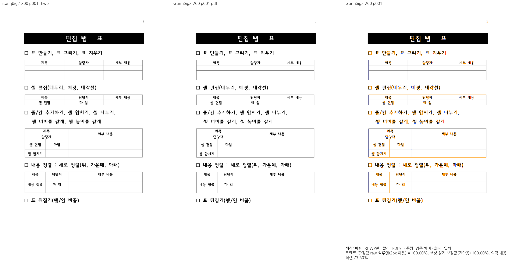
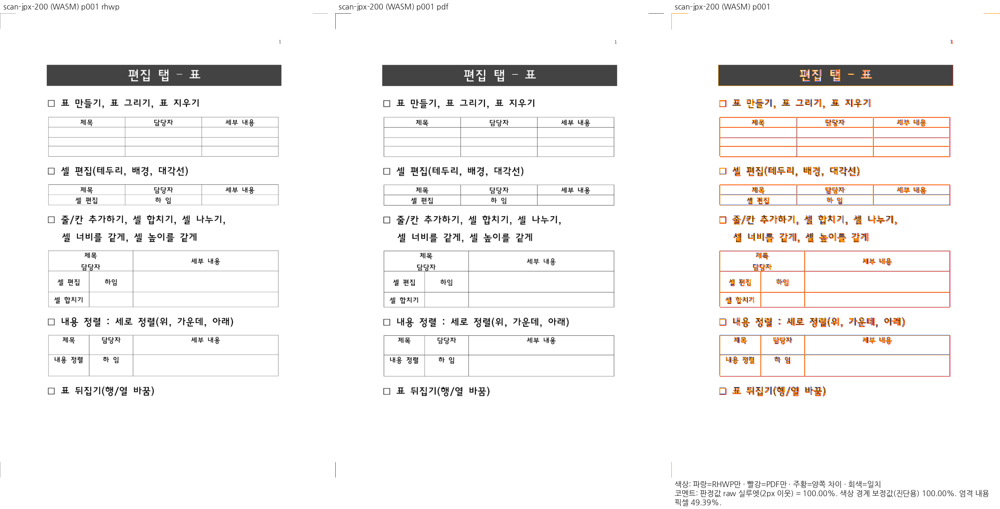
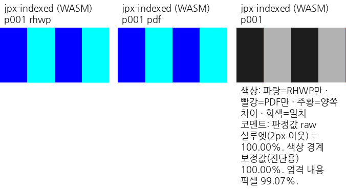
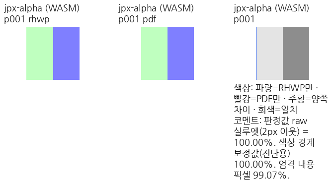

# #8183 제출용 시각 증적

제품 source `cfc5be8fe`, 96 DPI·print·compat 2022의 전쪽 Native/fresh WASM TSV와 대표
compare·standalone overlay·review다. TSV는 작업 원본을 바이트 그대로 복사했다.
17쪽 모두 양쪽 raw 최저 100%이며, 색상·alpha·본문 누락 여부도 별도로 직접 판독했다.

[입력·독립 기준](../../../../pdf/issue8183/README.md),
[작업 기록](../../../working/task_m100_8183_stage3.md),
[TSV hash](provenance.json)를 참고한다. Pixel 완전 일치율과 2px 내용 실루엣 일치율을 구분한다.

