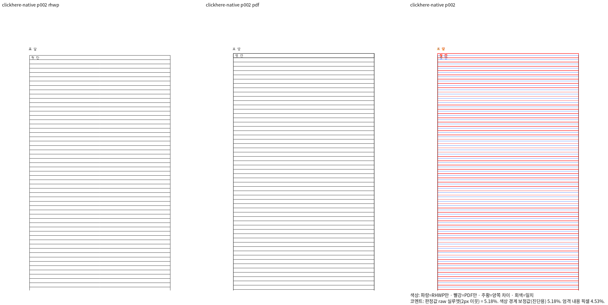
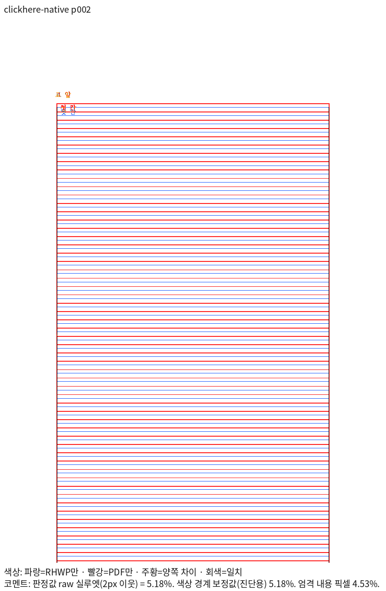
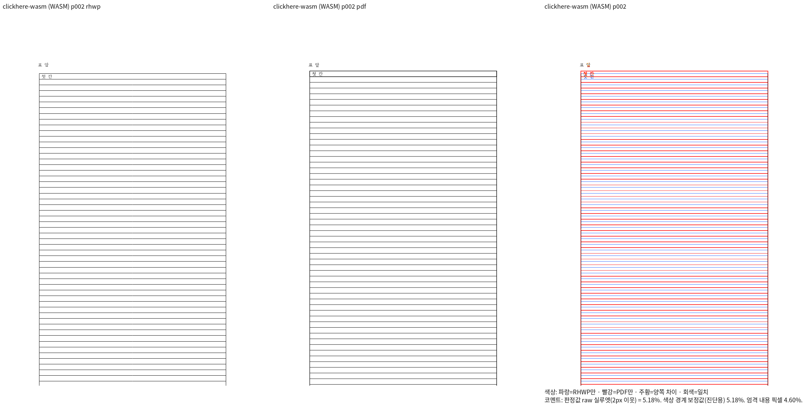
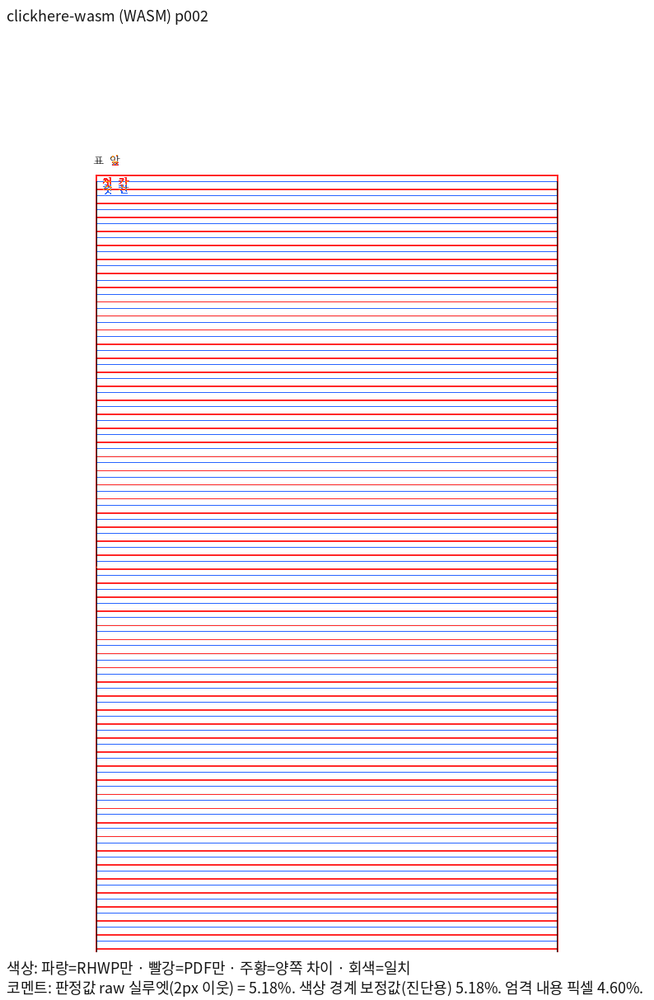

# #8230 투명 래퍼의 기존 분할 회귀 보존

[추적 이슈 #8230](https://github.com/edwardkim/rhwp/issues/8230)의 80행 입력이다. [HWPX](clickhere-split-wrapper.hwpx)와 [한컴 2024 Print PDF](clickhere-split-wrapper-2024.pdf)를 보존했다. PDF는 MCP job `57ccfd99-ac84-4d0e-8cf7-0a976f1d3bdb`, 한컴 `13.0.0.3901`, PrintMethod 0의 1-up 인쇄 결과다. 누름틀 안내가 Print에 보이지 않는 것은 오류로 판정하지 않는다.

## 기존 미달과 제거 범위

고정 devel `238de6de41a208648f4ade6b494fe433a81c1fce`와 런타임 소스가 같은 Native247/fresh WASM070은 4쪽이고 독립 PDF는 3쪽이다. 측정 후보 code `9504cf250a211077a2f6c7f9137a890f8f5db8eb`의 fresh WASM071은 3쪽이나 2쪽 raw가 5.18157%다. [전쪽 원문 TSV](candidate-fresh-wasm.tsv)를 보존했다. 현재 원본의 분할·내용 보존을 정상 회귀로 고정할 자격이 없다.

제거 전 [전체 모듈과 helper](clickhere_wrapper_cell_path.rs.txt)를 바이트 그대로 보존했다. `split_transparent_wrapper_preserves_full_cell_path` 1개와 그 전용 상수만 활성 코드에서 제거했다. `nontransparent_nested_table_preserves_full_cell_path`, `transparent_wrapper_preserves_full_cell_path`, `transparent_wrapper_activation_hides_its_guide` 3개는 같은 helper를 계속 사용한다. 이 세 검사를 통과했다고 이 80행 입력의 Print 정합을 주장하지 않는다.

입력/PDF·source commit·Git blob·SHA-256·함수별 유지/제거 상태는 [복원 원장](restoration_ledger.json)에 있다. `.rs.txt`는 자동 Rust 수집 대상이 아니며 이 HWPX는 renderer 축의 자동 수집에서 명시적으로 제외한다. 실행 로그와 중간 JSON은 커밋하지 않는다.

## 복원 조건

실제 마지막 내용까지 보존하는 유효한 입력을 확보하고 독립 Print의 쪽수·전쪽 Native/fresh WASM raw 90% 이상과 직접 확대 판독을 충족한 뒤 새 이름의 관계형 회귀로 복원한다. 원본의 실패를 새 대조군의 성공으로 대체하거나 점수 마스킹을 하지 않는다. 이 이슈는 이번 통합 PR에서 닫지 않는다.

## 대표 2쪽 직접 판독

동일 입력·Print의 2쪽을 Native248/fresh WASM071에서 다시 산출했다. 표 시작·이어받기 외곽의 차이는 남아 있으며 정상 출력으로 승인하지 않는다.

