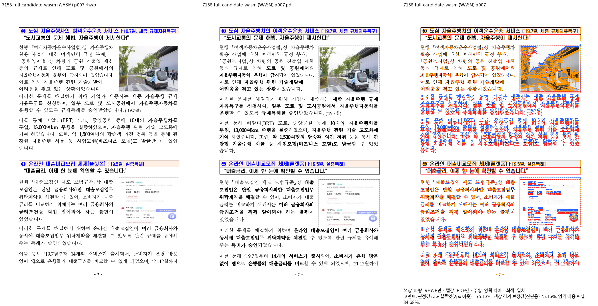
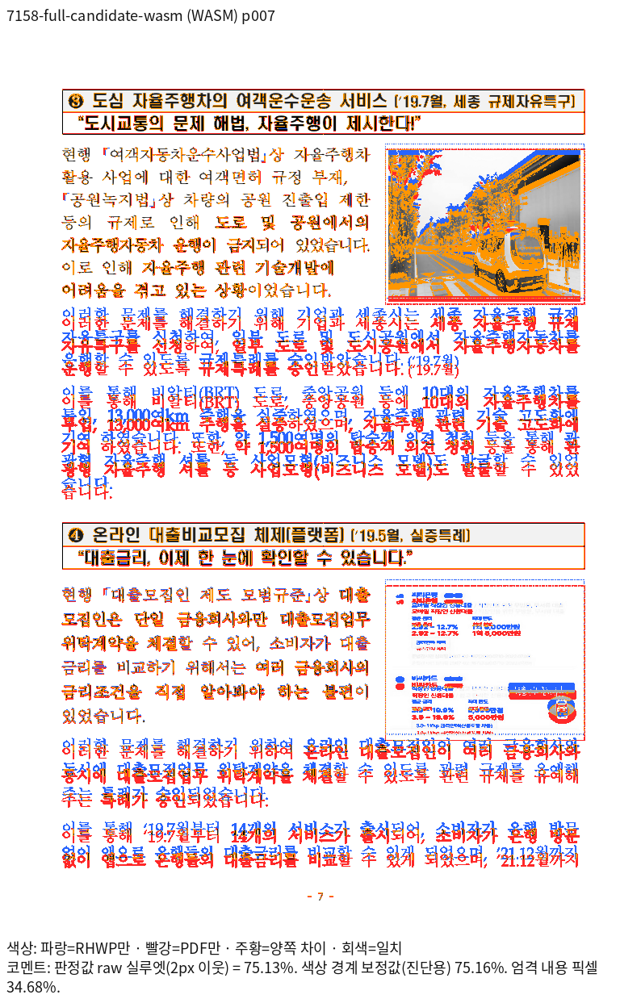
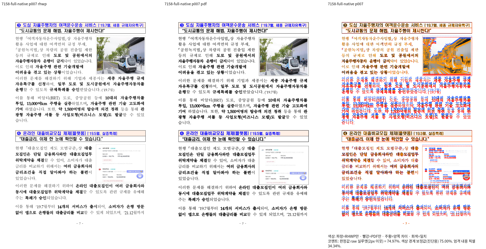
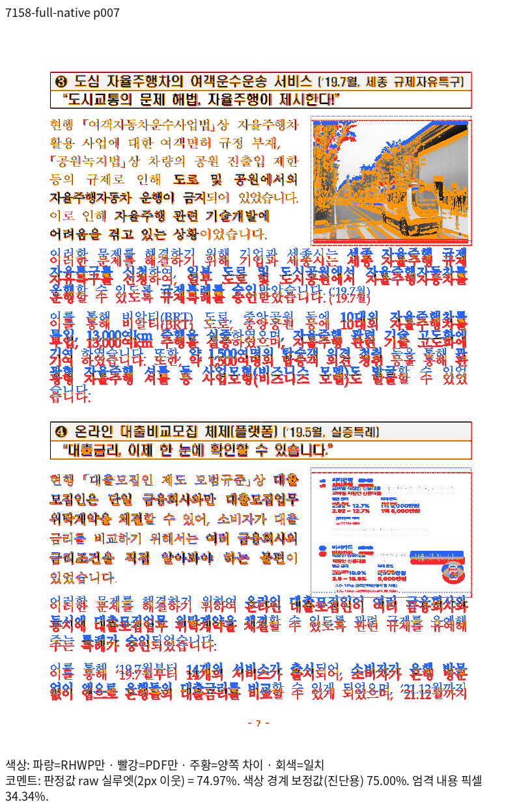
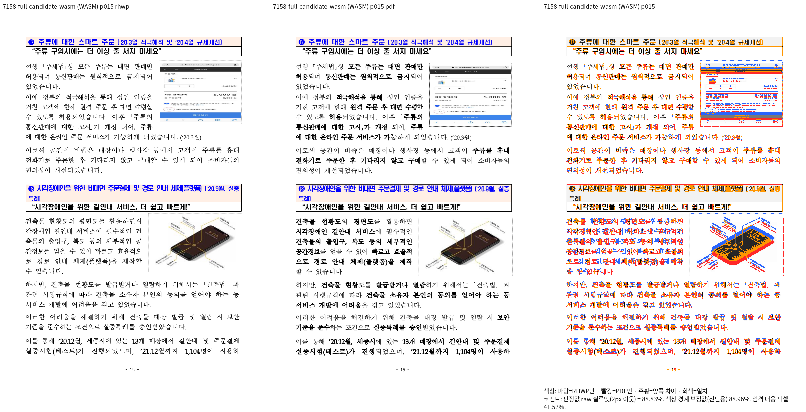
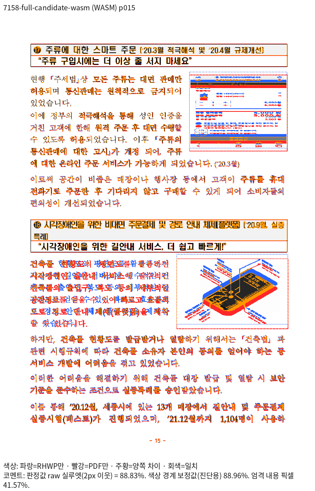
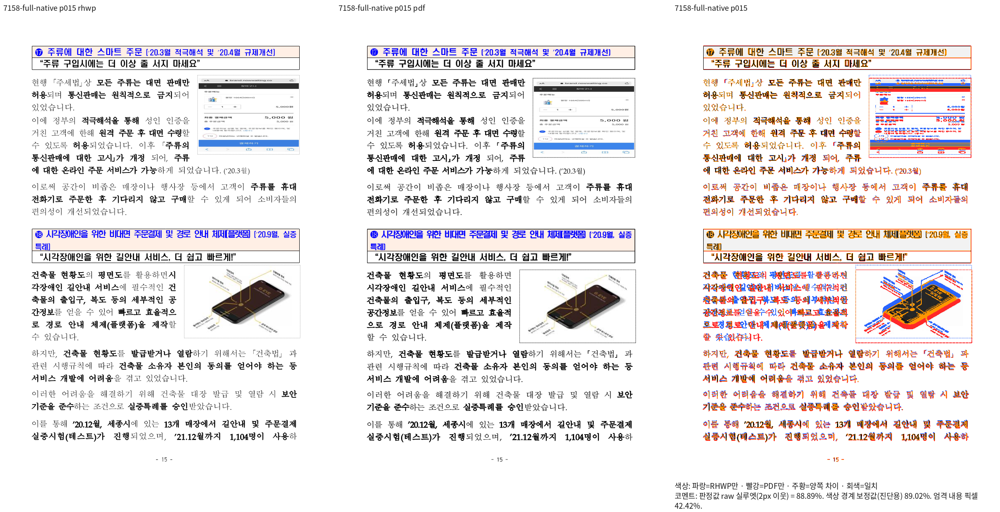
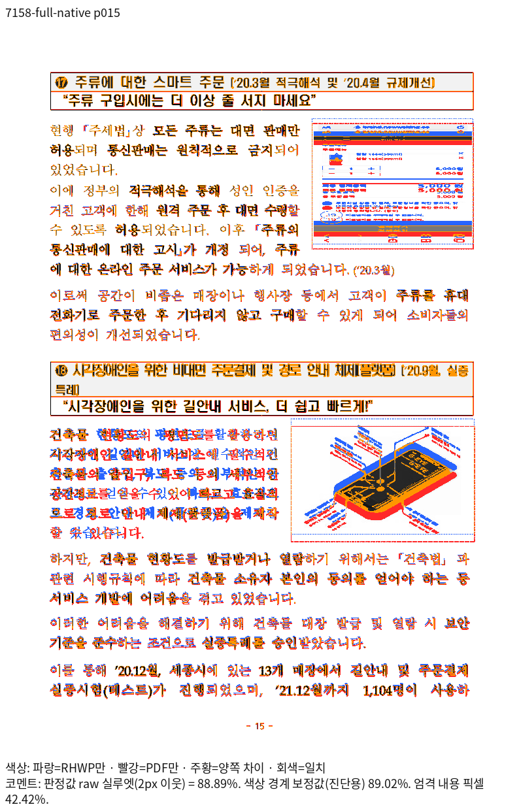

# #8236 규제샌드박스의 기존 미달 회귀 보존

[추적 이슈 #8236](https://github.com/edwardkim/rhwp/issues/8236)의 미해결 재현 자산이다. 이 자료의 낮은 점수를 통합 PR의 정상 출력 증거로 사용하지 않는다. 입력·PDF·전체 검사 코드는 바이트를 보존했다.

## 판정 근거

고정 devel `238de6de41a208648f4ade6b494fe433a81c1fce`와 후보 code `9504cf250a211077a2f6c7f9137a890f8f5db8eb`를 같은 원본·PDF·96 DPI·print·compat2022·시스템 글꼴 공급으로 대조했다. base는 Native247/fresh WASM070, 후보는 Native248/fresh WASM071이다. 이후 실행 불가능한 중복 분기 제거와 검사 helper 보정은 이 측정 후보의 결과로 재귀속하지 않는다.

| 입력 | base Native | 후보 Native | base fresh WASM | 후보 fresh WASM |
| --- | ---: | ---: | ---: | ---: |
| 그림 보존 원본 전 17쪽 | 74.96795% | 74.96784% | 75.12880% | 75.13033% |
| 공유 최소본 전 17쪽 | 56.45794% | 56.45846% | JPEG decode 실패 | JPEG decode 실패 |

그림 보존 원본도 7·15쪽이 90% 미만이다. 7쪽은 사진 뒤 본문의 줄 위치·굵기·간격, 15쪽은 스마트폰 그림 크기·외곽과 주변 본문이 다르다. 최소본의 11개 332바이트 JPEG는 디코딩할 수 없는 스텁이므로 원본 그림의 성공·실패와 구분한다. 두 입력의 Contents XML 3개는 바이트가 같다. 구조 검사의 PASS를 전쪽 시각 정합으로 보고하지 않는다.

## 원본과 기준 PDF

- [그림 보존 원본](156492236-regulatory-sandbox-full.hwpx)과 [독립 한컴 2020 PDF](reference-full-2020.pdf)는 기존 추적 파일을 이동했다.
- [공유 최소본](../../../../../samples/issue4090/156492236_규제샌드박스_min.hwpx)은 parser·serializer 계약 때문에 원래 경로에 보존한다. [대조 PDF](reference-min-2020.pdf)는 이곳으로 이동했다.
- 이미 Print 대조에 사용한 편집본 [여백 750HU](margin750.hwpx)·[PDF](margin750-2020.pdf), [여백 1500HU](margin1500.hwpx)·[PDF](margin1500-2020.pdf)도 원래 바이트로 보존했다. 새 원본이나 새 Print를 생성하지 않았다.
- 입력·PDF·TSV·모듈의 SHA-256과 이전/현재 경로는 [복원 원장](restoration_ledger.json)에 있다. 로그·중간 JSON은 ignored output에만 보존한다.

## 제거·유지한 검사

| 기존 모듈 | 전체 원본 보존 | 제거 함수 수 | 활성 유지 |
| --- | --- | ---: | --- |
| `tests/cases/issue_7158_square_wrap_continuation.rs` | [issue_7158_square_wrap_continuation.rs.txt](issue_7158_square_wrap_continuation.rs.txt) | 3 | 없음 |
| `tests/cases/issue_6887_para_float_outer_margin.rs` | [issue_6887_para_float_outer_margin.rs.txt](issue_6887_para_float_outer_margin.rs.txt) | 3 | 없음 |
| `tests/issue_4090_hwpx_tail_page_break.rs` | [issue_4090_hwpx_tail_page_break.rs.txt](issue_4090_hwpx_tail_page_break.rs.txt) | 1 | 없음 |
| `tests/issue_4090_square_table_left_wrap.rs` | [issue_4090_square_table_left_wrap.rs.txt](issue_4090_square_table_left_wrap.rs.txt) | 1 | 없음 |
| `tests/cases/issue_6778_square_beside_lane_render_flow.rs` | [issue_6778_square_beside_lane_render_flow.rs.txt](issue_6778_square_beside_lane_render_flow.rs.txt) | 1 | maintainer_plain_indents_do_not_rewind_into_the_square_band, maintainer_square_lane_requires_the_right_edge_and_narrow_width, maintainer_first_item_without_stored_vpos_starts_below_the_square_band, square_beside_lane_text_stays_inside_the_body, square_beside_lane_starts_next_to_the_table_not_below_it, square_band_closes_below_the_table_bottom |

합계 9개 렌더링 검사를 분리했다. #6778의 다른 정상 입력을 쓰는 6개 검사는 유지한다. `body_overflow_baseline.tsv`와 `off_canvas_baseline.tsv`의 최소본 행은 원장에 보존하고 활성 래칫에서 제거했다. 공통 renderer 축의 수집은 `deferred_visual_regression_inputs.tsv`에서 정확한 입력 경로로 제외한다. parser·serializer/글자 모양 계약과 생산 코드·PDF 쪽수 상수의 순수 API 계약은 유지한다. sample16·편람의 삭제된 코드나 파일은 복원하지 않았다.

## 전쪽 TSV 원문

각 파일은 실행 산출물의 바이트 그대로다. base와 후보·Native와 fresh WASM을 파일명으로 구분한다.
- [7158-full-candidate-native.tsv](7158-full-candidate-native.tsv) — SHA-256 `abdda7f8fb4a000c35fd41a8b3fe25d3a74b7d3c590dd6df73ca3ab0c8857fad`
- [7158-full-base-native.tsv](7158-full-base-native.tsv) — SHA-256 `c018accc72fb1f0ef55b5bef8125d613aa227e0587f256a8504344bca22e3a63`
- [7158-full-candidate-wasm.tsv](7158-full-candidate-wasm.tsv) — SHA-256 `95cb9c8b701bf626bb0ebea5c99aab8a608c109d22038a8bf349609fe79f6f49`
- [7158-full-base-wasm.tsv](7158-full-base-wasm.tsv) — SHA-256 `fe11a32a92f06cc659cdeebeda8a71d6c7858ef1769f967740dbaf39f00bc5a0`
- [7158-original-base-native.tsv](7158-original-base-native.tsv) — SHA-256 `0adb8ff8ff196d0daac1e9a8b4c9bc18312e62f427cd1681d8baf6a216222154`
- [7158-margin750-base-native.tsv](7158-margin750-base-native.tsv) — SHA-256 `24fbb2890cea1ff4eb69154154840cfdebc982584118aa7069aa98189f2d9699`
- [7158-original-candidate-native.tsv](7158-original-candidate-native.tsv) — SHA-256 `eafebe4d08f9324008bc0ef9a8bad714a510df9a40c90ee7278fdcbf8ceab1ad`
- [7158-margin750-candidate-native.tsv](7158-margin750-candidate-native.tsv) — SHA-256 `de0e8f746660dbedd633904eff2a9226eb2a488d77357f00a3b10b9bece37d64`
- [7158-margin1500-candidate-native.tsv](7158-margin1500-candidate-native.tsv) — SHA-256 `5892291fc5fa0c4f6cdd911bd67590eafb9cbe6024df240776f1dc1a92e16272`

## 대표 페이지 직접 판독

후보 fresh WASM071의 같은 페이지 review와 standalone overlay를 함께 보존한다. Native 대표 PNG도 같은 원본·PDF·Native248로 함께 확인했다.

### 7쪽

### 15쪽

## 복원 조건

같은 원본·필요한 편집 대조군과 독립 한컴 Print의 전체 페이지 Native/fresh WASM raw 90% 이상, 쪽수·내용 순서·누락/중복·확대 판독을 먼저 충족한다. 보존한 모듈·원본 SHA에서 시작해 새 이름의 관계형 회귀로 복원한다. 완료된 해당 페이지가 양쪽 98% 이상이고 직접 판독을 마쳤을 때만 독립 좌표 ±2px를 추가한다. 원본의 실패를 새 대조군으로 숨기거나 허용치를 완화하지 않는다. 이 이슈는 열려 있으며 이번 통합 PR의 Close 대상이 아니다.
