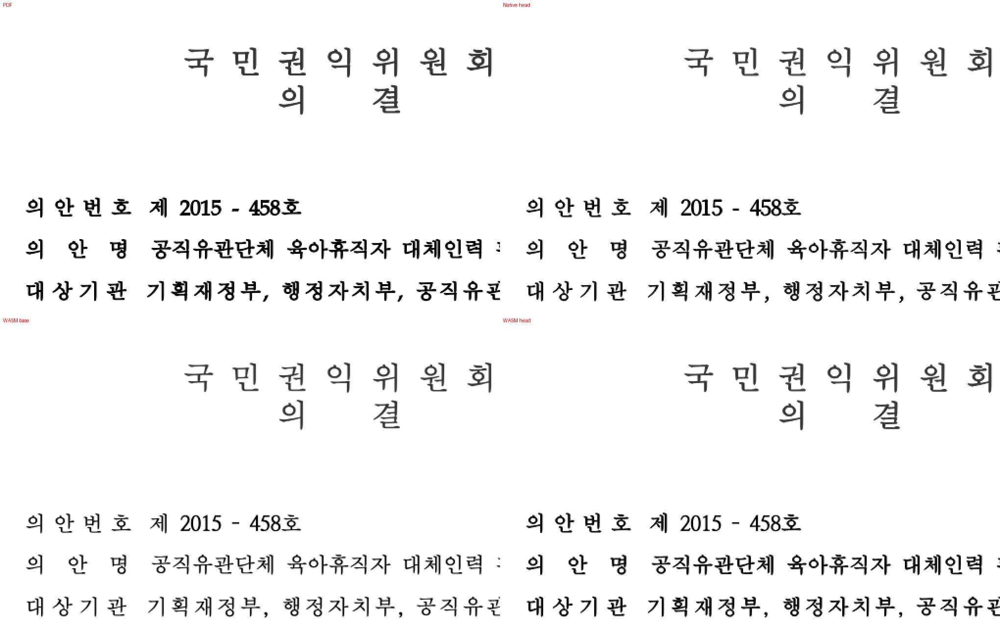

# #8430 WASM 합성 굵기 윤곽 paint 시각 증적

- 측정일: 2026-11-05 (Asia/Seoul)
- code head: `4f8570309e925468552036f4c20d099011d55a35`
  (`upstream/devel` `6e1de406209ba9a58032f6ca6de45b18aa687d1c` + #8430 커밋.
  #8431은 통합 PR #8622로 devel에 반영됐다)
- base: `6e1de406209ba9a58032f6ca6de45b18aa687d1c` (`upstream/devel`, #8430 변경 전)
- 재측정: 처음 제출 head `b0bb24ba91`(base `bdc6037ca6` = `e96b500e3e` + #8431 head merge)를
  위 devel로 rebase한 뒤 base·head Native와 fresh WASM을 모두 다시 빌드해 아래 전쪽 TSV·PNG gate·
  확대 판독·잉크 농도·브라우저 계약 테스트를 다시 산출했다. 전쪽 TSV 8개와 대표 PNG 6장은 이전
  산출물과 바이트 단위로 같고, 수치도 모두 같다.
- 원본: `samples/issue8423/30396-childcare-leave-recommendation.hwp`
  (SHA-256 `f46bfde221a2876cae05e25255698b84f6b34e79df8b13610cb08fa4ff8ccd74`, PR #8431이 추가)
- 기준 PDF: `pdf/issue8423/30396-childcare-leave-recommendation-2022.pdf`
  (Hwp 2022 12.0.0.4547 Print, 25쪽, SHA-256 `ef94efc5825d345f3172829cc5af4c069a375631a7cce5d84fe9d1d53b279a6e`)
- 측정: `scripts/visual_sweep.py --silhouette-only --compat 2022 --dpi 96`,
  지표 `silhouette_raw_match_percent`(색상 경계 보정 전 2px 내용 실루엣 일치율), 전체 25쪽.
  WASM은 같은 code head에서 `scripts/wasm-pack-locked.sh`로 만든 fresh pkg(`--wasm-pkg`)다.
- 글꼴 공급: `--font-path ttfs/opensource`. 실제 휴먼명조·HCI·한양신명조는 이 장비와 저장소에 없다.
  - 기본 글꼴(`plain`): 위 경로만 공급한다.
  - 명시 글꼴 환경(`env`): [`font-environment-humanmyeongjo-batang.json`](font-environment-humanmyeongjo-batang.json)
    (`휴먼명조 → RHWP Public Batang`, OFL)을 `--font-environment`로 Native·WASM에 같이 적용한다.

## 전쪽 TSV 요약

| 경로 | 글꼴 | base 최저 | head 최저 | 90% 미만 쪽 | base 대비 |
|---|---|---|---|---|---|
| Native | env | 93.38% (p25) | 93.38% (p25) | 없음 | 전쪽 동일 |
| fresh WASM | env | 97.63% (p3) | 97.63% (p3) | 없음 | 하락 쪽 없음, p15 +0.14 등 8쪽 상승 |
| Native | plain | 87.57% (p1) | 87.57% (p1) | p1 | 전쪽 동일 |
| fresh WASM | plain | 87.05% (p1) | 87.05% (p1) | p1 | 하락 쪽 없음, p15 +0.14 등 8쪽 상승 |

원본 TSV는 [`tsv/head/`](tsv/head)와 [`tsv/base/`](tsv/base)에 바이트 그대로 둔다.
Native는 변경 코드가 `cfg(target_arch = "wasm32")`·web canvas 전용이라 base와 같다.

## 일반 PNG 모드 gate (p1, p18)

| 경로 | 글꼴 | `pr_review_gate.status` | 쪽수 rhwp/PDF |
|---|---|---|---|
| Native | env | `passed` | 25 / 25 |
| fresh WASM | env | `passed` | 25 / 25 |
| Native | plain | `font_mismatch_exception` (p1 87.57%) | 25 / 25 |
| fresh WASM | plain | `font_mismatch_exception` (p1 87.05%) | 25 / 25 |

기본 글꼴 p1의 예외 증거는 [`font-exception-p1.json`](font-exception-p1.json)
(SHA-256 `e915b4a51a70727bb198057a223c7670d63511c7048456aa624c55adb610eabf`)이다.
p1 overlay에서 줄 시작·기준선·문단 위치는 PDF와 같고, 차이는 대체 face의 글리프 모양·전진폭이다.
같은 쪽은 명시 글꼴 환경에서 Native 99.96% / WASM 99.89%다.

## 확대 판독 (p1 굵은 머리 글, env, 2배)

- 왼쪽 위 PDF, 오른쪽 위 Native head, 왼쪽 아래 WASM base, 오른쪽 아래 WASM head.
- base WASM은 굵게 지정된 `의안번호`·`의안명`·`대상기관` 줄을 보통 굵기처럼 그린다.
  head WASM은 Native와 같은 굵기다. 글자 위치·장평·기준선은 바뀌지 않았다.
- 같은 영역(쪽 폭 5~75%, 높이 22~36%)의 평균 잉크 농도: PDF 20.19, Native 17.50,
  WASM base 13.38 → head 17.17. 실루엣 지표는 이진화하므로 굵기 차이를 거의 반영하지 않는다.
- 제목 `국민권익위원회`는 굵게가 아니며 네 출력 모두 같다.

## 대표 PNG

| 파일 | 내용 |
|---|---|
| [`png/p1_wasm_env_review.png`](png/p1_wasm_env_review.png) | p1 fresh WASM review (env) |
| [`png/p1_wasm_env_overlay.png`](png/p1_wasm_env_overlay.png) | p1 fresh WASM overlay (env) |
| [`png/p1_native_env_review.png`](png/p1_native_env_review.png) | p1 Native review (env) |
| [`png/p18_wasm_env_overlay.png`](png/p18_wasm_env_overlay.png) | p18 fresh WASM overlay (env, #8431의 셀 그림 원점 반영) |
| [`png/p1_wasm_default-font_review.png`](png/p1_wasm_default-font_review.png) | p1 fresh WASM review (기본 글꼴, 글꼴 예외 대상) |
| [`png/p1_wasm_default-font_overlay.png`](png/p1_wasm_default-font_overlay.png) | p1 fresh WASM overlay (기본 글꼴) |

## 적용 범위와 남은 차이

- 윤곽 paint는 Canvas가 그 글자에 고른 face가 `registerTextFontGlyphCoverage`로 등록된
  정적 TrueType(`glyf`) 보통 굵기·정체 face일 때만 적용한다(#8583의 Print TTF 보관소 재사용).
  등록되지 않은 운영체제 대체 face, 가변·컬러·CFF·실제 기울임 face는 기존 `fillText` + `strokeText`를 쓴다.
  그래서 기본 글꼴 sweep(대체 face 미등록)의 WASM 굵기는 base와 같다.
- 한컴 PDF의 굵은 글자는 Native·WASM보다 더 진하다(20.19 vs 17.5). 이 차이는 Native에도 같고
  이 변경의 범위(WASM을 Native와 같은 기준으로 맞춤)가 아니다.
- 브라우저 계약 테스트 `scripts/tests/faux-bold-outline-canvas.browser.mjs`: base pkg에서
  `굵은 글자가 아직 글자 API로 그려짐`(fillText+strokeText 0.64px)으로 실패, head pkg에서 통과.
