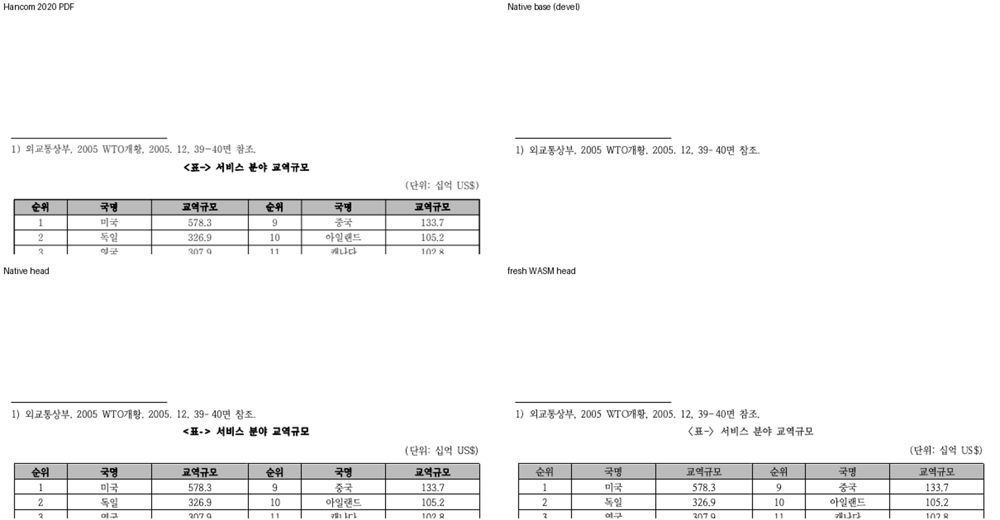

# #8551 각주 안 캡션 달린 글자처럼 취급 표 paint 시각 증적

- 측정일: 2026-11-05 (Asia/Seoul)
- base: `upstream/devel` `e96b500e3ea259c821f05440f0388355916a9e9b`
- 재측정: 최신 `upstream/devel` `ed057276c1e0e07e743218d95641e015b46b6715`로 rebase한 head에서
  합성·원본 109쪽·추출본 Native, 합성·원본 fresh WASM TSV와 대표 PNG를 다시 산출했다.
  모든 head TSV와 PNG가 rebase 전 산출물과 바이트 단위로 같아 아래 파일을 그대로 유지한다.
  편람 383쪽 gate도 rebase head에서 다시 실행했다.
- 측정: `scripts/visual_sweep.py --silhouette-only --compat 2022 --dpi 96`,
  지표 `silhouette_raw_match_percent`(색상 경계 보정 전 2px 내용 실루엣 일치율).
  Native는 sweep 기본 Native 웹폰트 공급, fresh WASM은 같은 code head에서
  `scripts/wasm-pack-locked.sh`로 만든 `pkg`와 `--font-path ttfs/opensource`.

## 원인

각주 3의 둘째 문단은 첫 줄에 캡션(2문단) 달린 9행 6열 글자처럼 취급 표, 둘째 줄에
`주 : …` 글을 가진다. 조성기는 줄을 통째로 차지하는(인라인이 아닌) TAC 표를 줄의 인라인
개체(`tac_controls`)로 싣지 않는다. 본문에서는 pagination의 별도 Table 항목이 그 표를 그리지만
각주 영역에는 그 경로가 없다. 표 단독 문단 경로(`footnote_block_table`)는 캡션·글이 있는
문단을 받지 않는다. 그래서 저장 줄 높이로 자리는 예약하면서 표·캡션을 그리지 않았다.

수정은 각주 일반 문단 경로가 글줄을 배치한 뒤, 글줄 경로가 싣지 않은 TAC 표를
`control_slot_line_index`로 찾은 소유 줄에 그린다. 원점은 그 줄이 실제 발행한 TextLine의
상단 + 바깥 위 여백이고(본문 `tac_table_stored_outer_band_top` 계약), 가로는 기존 표 단독
경로와 같은 문단 여백·들여쓰기·정렬 helper를 공유한다. 위 캡션은 `layout_table`이 표 상자
안에서 표 본체 앞에 둔다. 높이 측정·예약은 바꾸지 않는다.

## 검증 문서

| 문서 | 입력 | 기준 PDF | 쪽수 PDF/rhwp |
|---|---|---|---|
| 합성 (gate 문서) | `samples/issue8551/footnote_captioned_tac_table.hwp` | `pdf/issue8551/footnote_captioned_tac_table-2020.pdf` | 1 / 1 |
| 원본 | rhwp-issue-docs #838 `1430000-200600021_D0150014-2-002_2차 중간보고서.hwp` (SHA-256 `686146869f…`) | 한/글 2020 Print 109쪽 (로컬 보관, SHA-256 `395f379f…`) | 109 / 109 |
| 이슈 재현 추출본 | 원본 1–3쪽 추출 → 한/글 2020 재저장 (SHA-256 `fa6e3a26…`) | 한/글 2020 Print 4쪽 (SHA-256 `79b13213…`) | 4 / 4 |

합성 문서 생성: 추출 재저장본에서 `rhwp edit delete-paragraph`로 본문 문단 0.0–0.3·0.5·0.6을,
`rhwp edit delete-footnote`로 각주 4·5를 지워 본문 문단 0.4와 각주 3만 남긴 뒤
한/글 2020(MCP engine 2020)으로 다시 저장하고 Print PDF(`pdf_print_method` 0, Hwp 2020)를 출력했다.
재저장본 SHA-256 `d73002961c3e15bc475d0696c55fe8ea2fe8fab03c13924a7df9c55883cdbee9`,
PDF SHA-256 `a939ff298875a236d8a614aeccd0d3822027a2968c6f88e517d3aef88f8e346b`.

## 전쪽 TSV 요약

| 문서 | 경로 | base 최저 | head 최저 | 90% 미만 쪽 | base 대비 |
|---|---|---|---|---|---|
| 합성 | Native | 58.82% (p1) | 99.89% (p1) | 없음 | p1 +41.07 |
| 합성 | fresh WASM | — | 99.98% (p1) | 없음 | — |
| 원본 109쪽 | Native | 17.10% (p38) | 17.10% (p38) | 12쪽 (base와 같은 12쪽) | p1 65.72 → 69.34, 나머지 108쪽 동일 |
| 원본 109쪽 | fresh WASM | — | 17.08% (p38) | 13쪽 (Native 12쪽 + p69 89.97%) | — |
| 추출본 4쪽 | Native | 47.46% (p2) | 47.46% (p2) | p1·p2·p3 | p1 65.72 → 69.34, 나머지 동일 |

원본 TSV는 [`tsv/base/`](tsv/base)와 [`tsv/head/`](tsv/head)에 바이트 그대로 둔다.
base fresh WASM은 측정하지 않았다. 레이아웃은 Native·WASM이 같은 render tree를 소비하고,
원본 Native base/head에서 바뀐 쪽은 p1뿐이므로 WASM p69 등은 이 변경의 영향 쪽이 아니다.

원본·추출본의 90% 미만 쪽은 이 변경과 무관한 기존 차이다. 추출본에서 devel은 각주 3을
한컴처럼 2쪽으로 넘기지 않고 1쪽에 두어 각주 영역이 본문과 겹친다(PR #8486 대상의 각주
쪽 경계 문제). 이 변경 뒤 그 1쪽 각주 영역에 표도 그려지므로 겹친 영역에 표가 더해진다.
2쪽은 각주 4 표의 분할 등 각주 pagination 차이다. 이 PR은 이 원본들의 통과를 주장하지 않는다.

## 확대 판독 (합성 p1 각주 영역, 2배)

- 왼쪽 위 PDF, 오른쪽 위 Native base, 왼쪽 아래 Native head, 오른쪽 아래 fresh WASM head.
- base는 `1) 외교통상부…` 줄 아래가 비어 있다. head는 캡션 `<표-> 서비스 분야 교역규모`,
  `(단위: 십억 US$)`, 9행 표, `주 : …` 줄을 PDF와 같은 위치·순서로 그린다.
- fresh WASM은 캡션·머리 행이 굵지 않고 `<`·`>` 글리프 모양이 다르다. 공급 글꼴과 WASM
  합성 굵기(#8430, PR #8605 미병합) 차이이며 배치는 같다.

## 대표 PNG

| 파일 | 내용 |
|---|---|
| [`png/p1_native_review.png`](png/p1_native_review.png) | 합성 p1 Native review |
| [`png/p1_native_overlay.png`](png/p1_native_overlay.png) | 합성 p1 Native overlay |
| [`png/p1_wasm_review.png`](png/p1_wasm_review.png) | 합성 p1 fresh WASM review |
| [`png/p1_wasm_overlay.png`](png/p1_wasm_overlay.png) | 합성 p1 fresh WASM overlay |

## 회귀 테스트

`tests/cases/issue_8551_footnote_captioned_tac_table.rs`(관계형): 각주 영역 소속, 표 1개(중복
없음)·9×6, 캡션·셀·`주 :` 글 보존, 앞 줄 → 캡션 → 표 → `주 :` 줄 세로 순서, 셀 글자의 표
포함, 각주 영역 포함, 본문 비겹침. 수정 전 코드에서 `각주 3의 캡션 표가 각주 영역에 그려짐`
(표 0개)으로 실패하고 수정 후 통과한다.

## 기타 필수 검증 (같은 source)

| 항목 | 결과 |
|---|---|
| Rust lint 묶음(fmt·clippy 3종·workspace build·suite manifest `--check --base-ref e96b500e3e`) | 통과 |
| `cargo nextest run --cargo-profile release-test --tests --no-fail-fast` | 12473 통과, 45 skip |
| Native Skia 3종(`--features native-skia --lib`, `issue_2225_missing_picture_placeholder`, `render_p37_direct_pdf_export`) | 통과 |
| 편람 HWPX Native 383쪽 `--handbook-gate` | `passed`, 최저 99.96%, 100.00% 370쪽 |
| 최소 글꼴 환경 | `RHWP_FONT_PATH` 미설정, 사용자 글꼴 0개, `/Library/Fonts`는 시스템 Arial Unicode 링크 1개, `system_profiler` 294개 전부 `/System/Library` |
