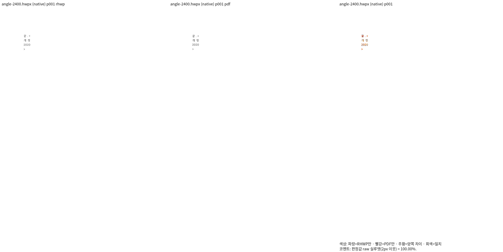
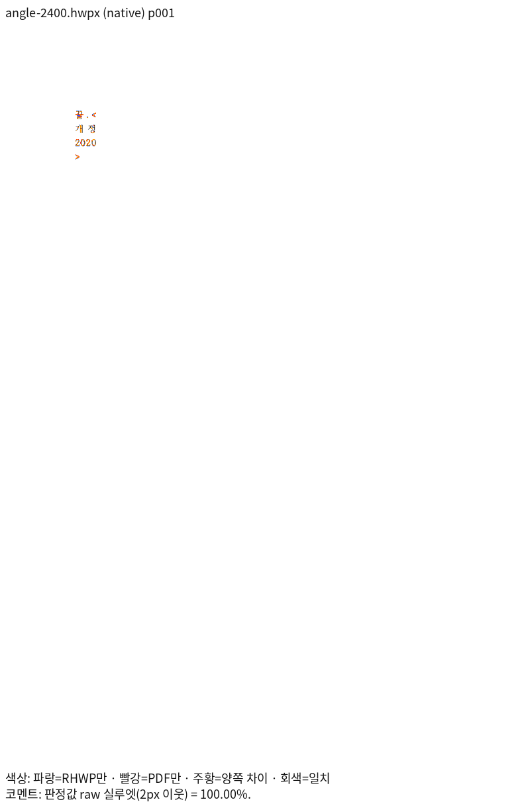
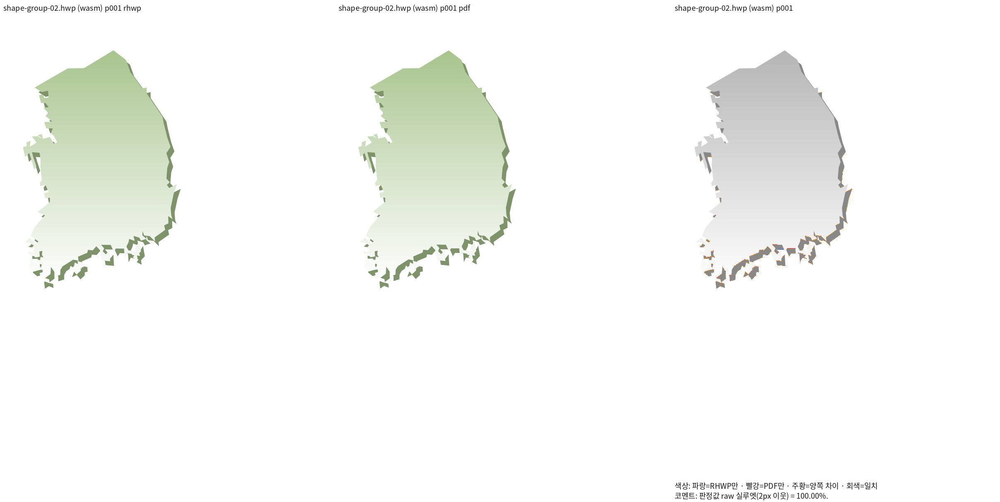
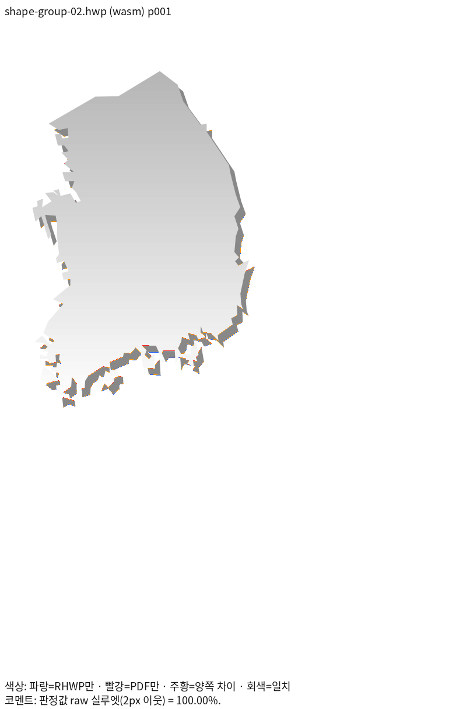

# 이슈 #9101: 기여자 환경의 보호 문서 재현성

Issue: https://github.com/edwardkim/rhwp/issues/9101

## 공개 공통 검사

측정 source: `4e0b20d2922953ee7ab9a1716ac819b921fe484b`.
2026-11-16, 96 DPI, 인쇄 프로필, PDFium, 색상 경계 보정 전 2px raw.
동일 source의 Native Skia와 fresh 최적화 WASM을 사용했다. `--silhouette-only --resume`으로
전쪽을 산출하고 그 PNG로 review·overlay를 만들었다. 기준 PDF는 재출력하지 않았다.

| 문서 | 전체 쪽수 | Native 최저 | fresh WASM 최저 |
| --- | ---: | ---: | ---: |
| 라틴 본문 | 1 | 100.00% | 100.00% |
| 좁은 셀의 괄호·숫자 | 1 | 100.00% | 100.00% |
| 그림 자르기 | 1 | 100.00% | 100.00% |
| 그룹 도형 | 1 | 100.00% | 100.00% |

입력·기존 Print PDF의 경로·해시·compat는 [공통 검사 등록부](../../../../scripts/data/contributor_visual_gate.json),
실제 TSV·PNG 해시는 [증적 목록](common-evidence.json)에 있다.
OS 기본 글꼴을 추가한 측정도 네 문서의 양쪽 raw 100.00%를 확인했다.

## 글꼴 조건과 판독

공개 환경은 Ubuntu의 공개 시스템 글꼴과 저장소의 공개 글꼴 497개 파일만 노출했다.
`/opt/hnc`, 사용자 비공개 글꼴, `safe_font`, `/usr/local/share/fonts`는 숨겼다.
미설치 face는 기존 등록 웹폰트 자동 공급으로 준비했다. Windows 글꼴 실험은 정품 Desktop의 Arial·Times·Courier·맑은 고딕·Symbol·Wingdings
17개 파일과 Korean Supplemental Fonts의 바탕/굴림 TTC 2개를 추가했다.
이는 공식 기본 글꼴 전체의 사본이 아니라 19개 파일을 고정한 공급 조건이다.
해당 파일은 실행용 output에만 두고 저장소에 넣지 않는다. Windows/macOS에서 직접 실행한 결과가 아니다.
Linux 조사의 실제 [격리 실행 스크립트](font-isolation-recipe.py.txt)를 보존한다.
이 스크립트는 조사 당시의 절대 경로를 기록한 증거이며 기여자 공통 CLI의 실행 의존성은 아니다.
최종 가용 516개 파일(공개 497개와 Windows 기본 19개)의 face·스타일·SHA는
[글꼴 프로그램 신원 목록](available-font-programs.json)에 기록했다. 파일 바이트를 포함하지 않는다.

라틴 본문의 세 줄과 끝 위치, 좁은 셀의 한글·숫자·여는/닫는 괄호, 그림의 두 자르기 영역과
테두리, 그룹 도형의 윤곽·채움·그림자를 독립 PDF와 직접 대조했다.
회색 일치와 미세한 래스터 경계 차이를 확인했으며 본문 누락·줄바꿈·굵기·그림 위치 결함은 관측하지 않았다.
100.00%는 픽셀 완전 동일을 뜻하지 않으며 2px raw의 공식 표시값이다.

공개 Helvetica 대체를 쓴 `body-list-typed-hwp.hwp`는 raw 100.00%여도 굵기·장평이 달랐다.
`control-styles-hwp.hwp`도 공개 대체에서 98.46%이며 첫 줄 스타일이 달랐다. 기본 Arial을
추가하면 두 경로 100.00%로 바뀐다. 두 입력은 공개 공통 대상에 포함하지 않았다.
정본의 해당 원본·기대값을 삭제하거나 하향하지 않았다.

[공개 body review](eligibility/public-body-review.png) · [overlay](eligibility/public-body-overlay.png),
[공개 styles review](eligibility/public-styles-review.png) · [overlay](eligibility/public-styles-overlay.png),
[OS 기본 Arial styles review](eligibility/os-styles-review.png) · [overlay](eligibility/os-styles-overlay.png)에서
실제 굵기·장평과 normal/bold/italic/bold-italic 네 행을 확인할 수 있다.

## 대표 증적

## 검증 책임

공통 검사 4개는 일반 기여자의 제출 검사다. 변경 문서 자체의 Native/fresh WASM 전쪽·직접 판독,
편람 gate와 통합 담당자의 정본 전체 특별 검증은 별도로 유지한다.
현재 보고서는 글꼴 환경의 재현성 조사이며, 다른 환경의 미달 결과를 렌더러 보정 완료로 표시하지 않는다.
18개 원본의 [OS 글꼴 환경 전쪽 조사 결과](os-stock-results.md)와 전체 TSV를 보존했다.
원본의 [font-plan 선언 목록](document-font-requests.json)에는 원본 face·대체 face와 공식 OS 공급 분류를 연결했다.
이 목록은 선언된 글꼴 테이블이며 모든 face가 실제 본문에서 사용됐다는 뜻은 아니다. 분류에 없는 이름을 설치 불가로 판정하지 않는다.

## OS별 공식 공급 목록

[기여자 가이드의 OS별 표](../../../manual/verification/visual_sweep_guide.md#os-기본-글꼴과-추가-설치-글꼴의-구분)를
같은 변경에서 보완했다. macOS는 Apple System Fonts의 system/downloadable/document-support,
Windows는 기본 Desktop/한국어 추가 글꼴, Ubuntu는 의존/권장 패키지를 구분한다.
공식 공급 목록과 이번 Linux 실측 결과를 혼동하지 않으며, 글꼴 이름만으로 실제 사용이나
같은 파일·정확한 출력 재현을 판정하지 않는다.
