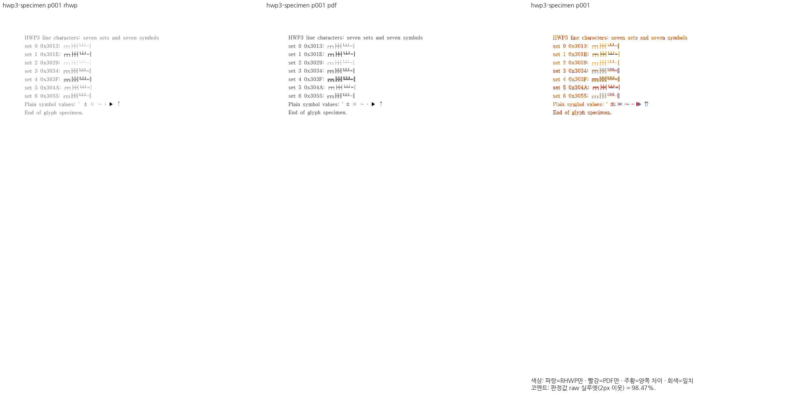
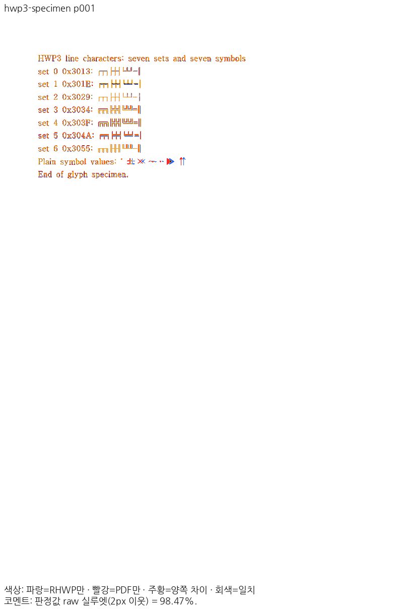
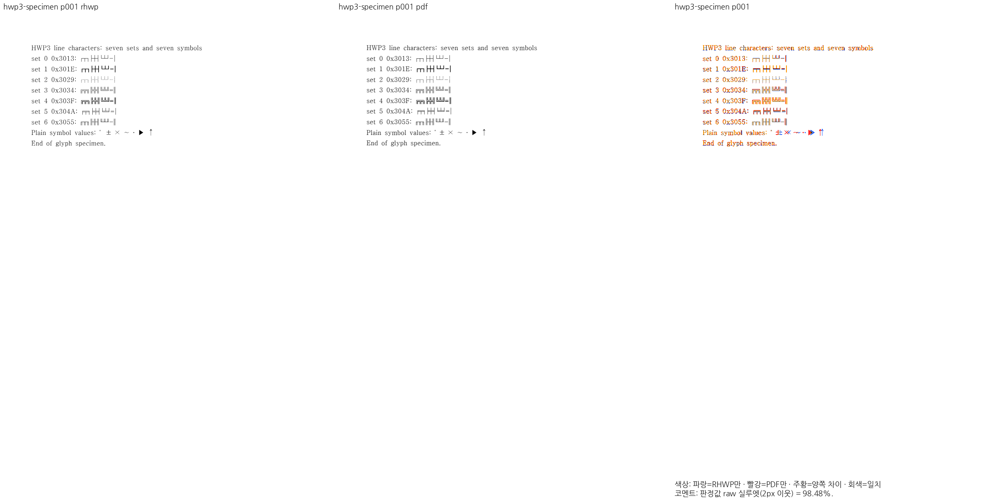
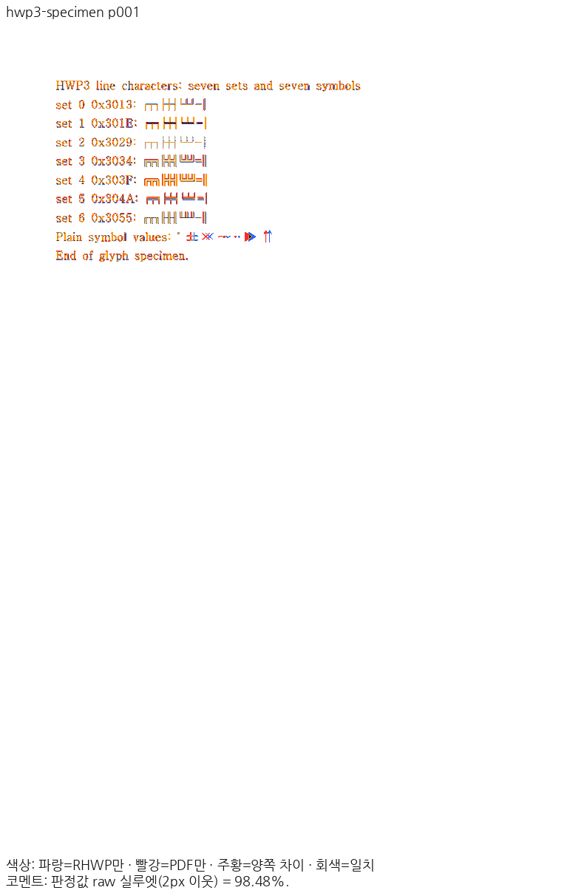
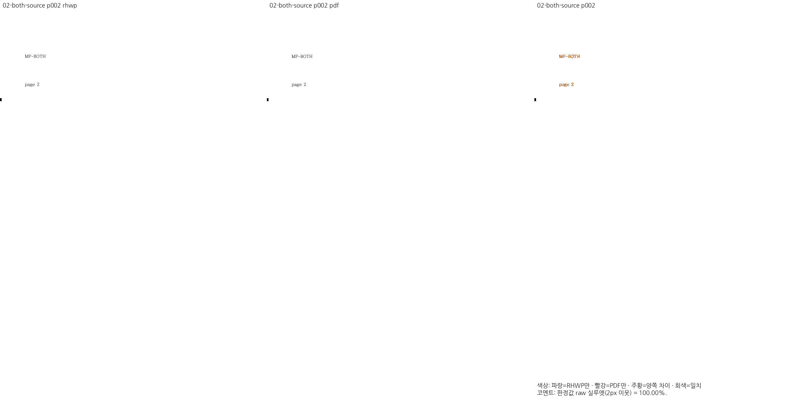
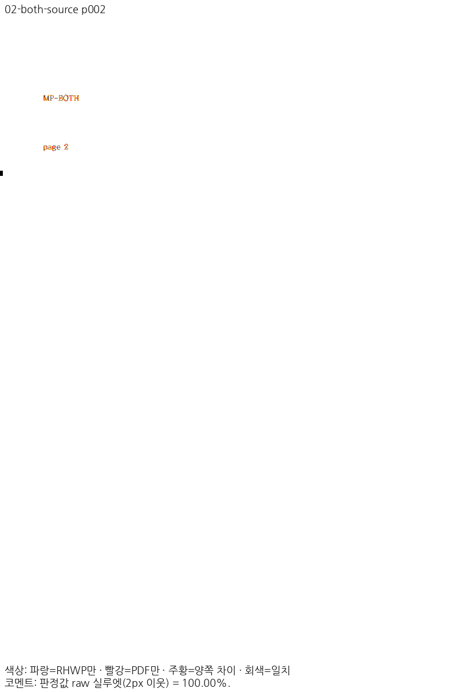
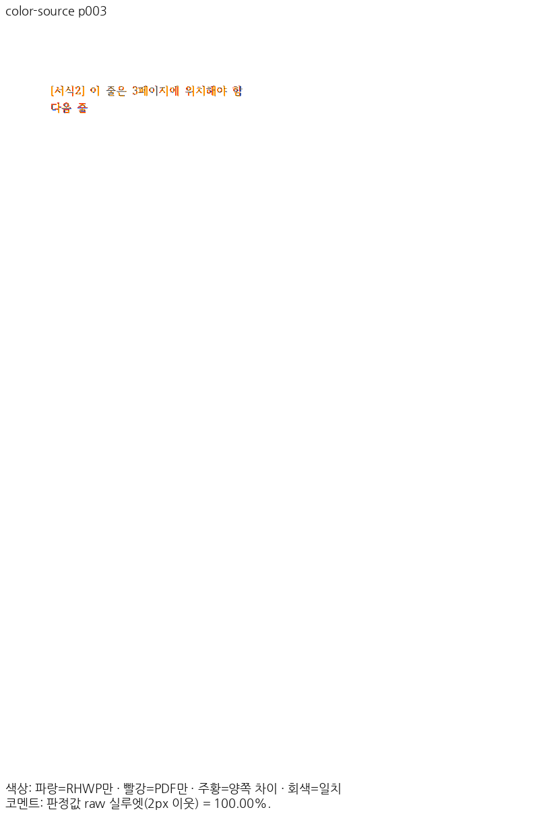
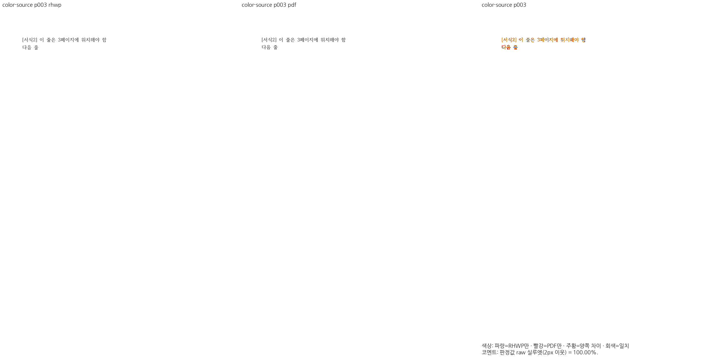
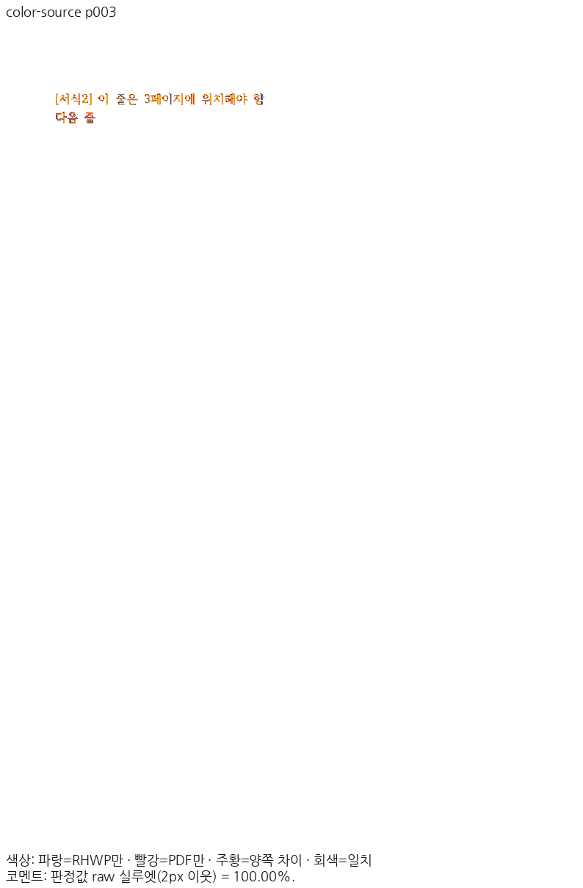

최종 self-review 결과: 승인. 검토 head는 `b6a91166761b212d8501faf70b4b13e19b26474e`입니다.

- 원 기여 [#9070](https://github.com/edwardkim/rhwp/pull/9070)·[#9071](https://github.com/edwardkim/rhwp/pull/9071)·[#9072](https://github.com/edwardkim/rhwp/pull/9072)의 SHA를 모두 보존했습니다. 원 fork branch는 유지합니다.
- 괘선 매핑은 독립 한컴 저장 문자, 바탕쪽·TAC는 공통 원점/소유 줄, 글꼴은 실제 SFNT 형식과 공통 paint 소비로 보정했습니다. 문서별 좌표 상수·마스크·허용치 완화는 없습니다.
- 전체 Rust 13,608건·Native 공식 4,073건 및 필수 lint가 통과했습니다. 보호 3,542행의 공식값 하락 0건이며 최종 실측에서 상승한 19행만 하한을 높였습니다. 기존 차이 예외는 적용하지 않았습니다.
- 최신 devel [#9093](https://github.com/edwardkim/rhwp/pull/9093)을 로컬 병합한 뒤 Studio 2,798건·브라우저 26건, 동일 Chromium에서 base/후보 Canvas 12개 공급 조합을 확인했습니다. 실제 초기화 WASM SHA도 일치했습니다.
- 바탕쪽 fit/배치, 실제 SFNT 유형과 Print 적용/비적용 경계, 그림 소유 순서, 본문/중첩 필드 주소, CLI 실제 render-tree 및 저장 재열기의 코드·회귀·시각 근거를 대조했고 차단 결함을 발견하지 못했습니다.
- [전쪽 TSV·프로그램·입력·명령·직접 판독](https://github.com/edwardkim/rhwp/blob/b6a91166761b212d8501faf70b4b13e19b26474e/mydocs/pr/assets/jinho-von-choi-20261114/final-source-8ad/README.md)과 SHA 고정 원격 증적 272개의 바이트를 확인했습니다.
- 최신 head CI: [CI](https://github.com/edwardkim/rhwp/actions/runs/43717754411) · [CodeQL](https://github.com/edwardkim/rhwp/actions/runs/43717754387) · [Render Diff](https://github.com/edwardkim/rhwp/actions/runs/43717754259) · [Adapter](https://github.com/edwardkim/rhwp/actions/runs/43717754288) · [Proptest](https://github.com/edwardkim/rhwp/actions/runs/43717754344) · [최종 정책 감사](https://github.com/edwardkim/rhwp/actions/runs/43720629727) 모두 success. merge 직전 최신 base 및 정확한 head의 병합 시뮬레이션: base `1805d8f08cb3a54bccda8dfa6647432b7799f074` + head `b6a91166761b212d8501faf70b4b13e19b26474e` → tree `26567f689247ba6e705b08f5c629e786b3801ef2`, exit 0.

부모 [#7445](https://github.com/edwardkim/rhwp/issues/7445)·[#7620](https://github.com/edwardkim/rhwp/issues/7620)은 OPEN을 유지합니다. [#9049](https://github.com/edwardkim/rhwp/issues/9049)는 기존 제품 해결에 대한 회귀 보강, [#7381](https://github.com/edwardkim/rhwp/issues/7381)은 핵심 occurrence·도움말 계약의 완료이며 전체 옵션 리팩터링을 구현했다고 주장하지 않습니다.

### 괘선 specimen · 독립 PDF p1 ↔ rhwp p1

| 출력 | review | standalone overlay |
| --- | --- | --- |
| native |  |  |
| wasm |  |  |

같은 실제 PNG 쌍에 canonical 도구를 적용했습니다. [생산·raw·이미지 SHA](https://raw.githubusercontent.com/edwardkim/rhwp/b6a91166761b212d8501faf70b4b13e19b26474e/mydocs/pr/assets/jinho-von-choi-20261114/final-source-8ad/representatives/receipts.json), [직접 판독](https://github.com/edwardkim/rhwp/blob/b6a91166761b212d8501faf70b4b13e19b26474e/mydocs/pr/assets/jinho-von-choi-20261114/final-source-8ad/review/README.md).

### Both 바탕쪽 · 독립 PDF p2 ↔ rhwp p2

| 출력 | review | standalone overlay |
| --- | --- | --- |
| native |  |  |
| wasm |  |  |

같은 실제 PNG 쌍에 canonical 도구를 적용했습니다. [생산·raw·이미지 SHA](https://raw.githubusercontent.com/edwardkim/rhwp/b6a91166761b212d8501faf70b4b13e19b26474e/mydocs/pr/assets/jinho-von-choi-20261114/final-source-8ad/representatives/receipts.json), [직접 판독](https://github.com/edwardkim/rhwp/blob/b6a91166761b212d8501faf70b4b13e19b26474e/mydocs/pr/assets/jinho-von-choi-20261114/final-source-8ad/review/README.md).

### 표 뒤 문단 · 독립 PDF p3 ↔ rhwp p3

| 출력 | review | standalone overlay |
| --- | --- | --- |
| native |  |  |
| wasm |  |  |

같은 실제 PNG 쌍에 canonical 도구를 적용했습니다. [생산·raw·이미지 SHA](https://raw.githubusercontent.com/edwardkim/rhwp/b6a91166761b212d8501faf70b4b13e19b26474e/mydocs/pr/assets/jinho-von-choi-20261114/final-source-8ad/representatives/receipts.json), [직접 판독](https://github.com/edwardkim/rhwp/blob/b6a91166761b212d8501faf70b4b13e19b26474e/mydocs/pr/assets/jinho-von-choi-20261114/final-source-8ad/review/README.md).
