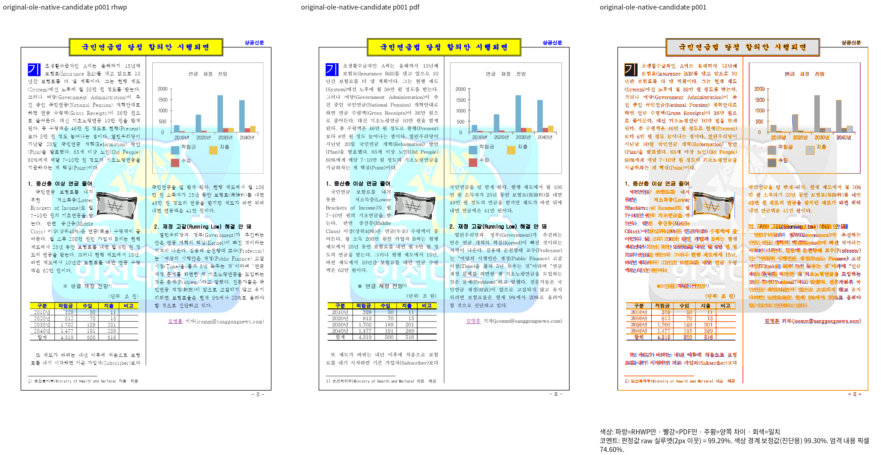
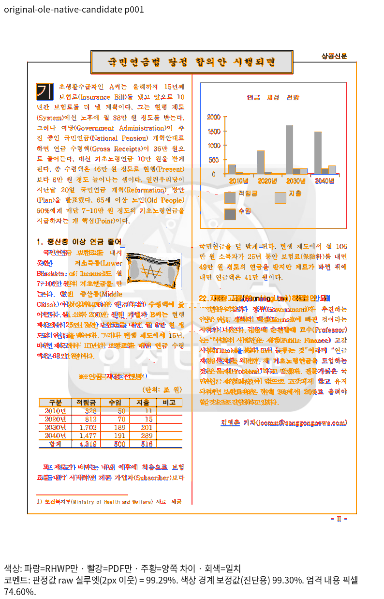
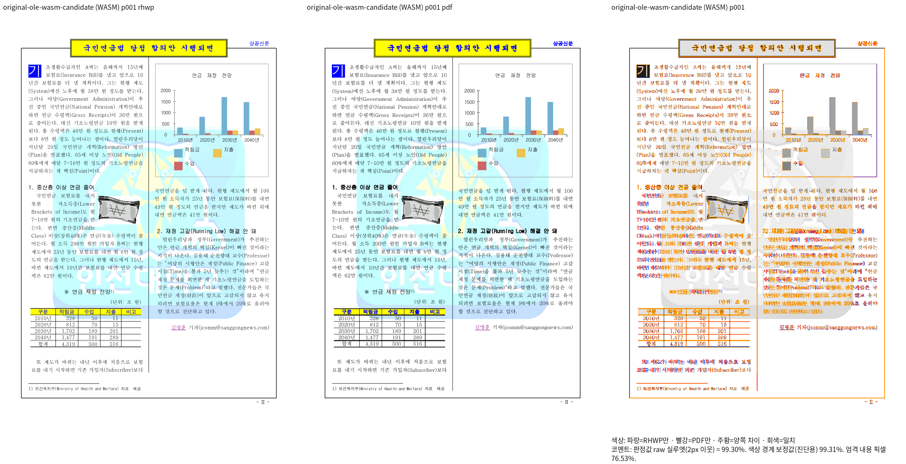
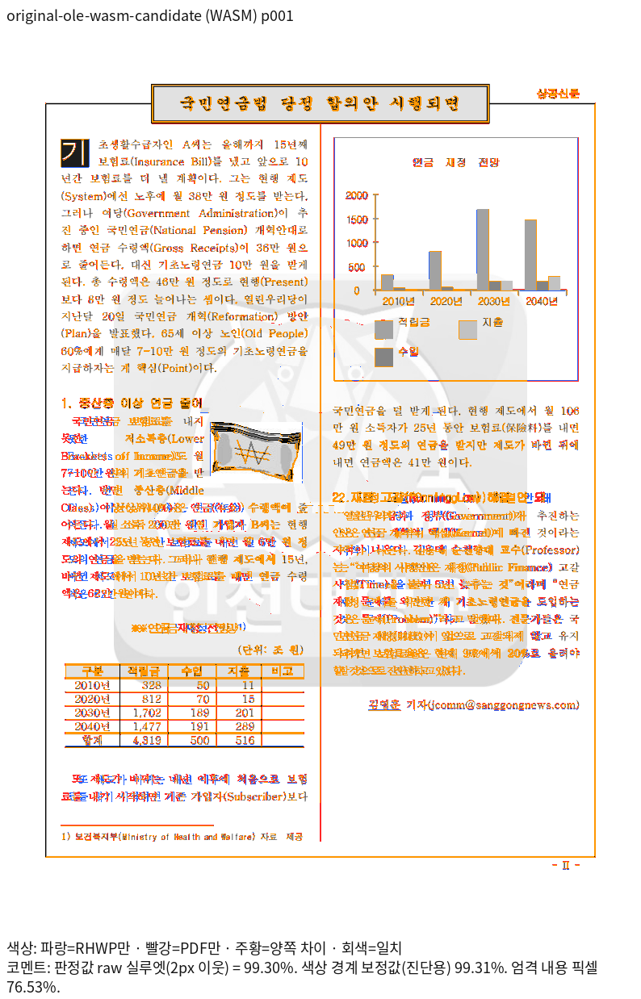

# 기존 OLE 차트 원본의 현재 후보 검증

원본 `samples/143E433F503322BD33.hwp` 한 쪽을 독립 한컴 Print와 비교했다.
고정 devel은 `238de6de41a208648f4ade6b494fe433a81c1fce`, 실제 runtime은
`bbf3aed18dd82bbf344072b77b5ac590e7a71f3a`, 코드·검사 후보는
`61528013511c87c732524f91c6f224286a055337`이다. 이후 문서·증거 커밋은 런타임을 바꾸지 않았다.

| 출력 | base raw | 후보 raw | 후보 − base |
| --- | ---: | ---: | ---: |
| Native255 | 94.51108% | 99.28860% | +4.77752%p |
| 최적화 fresh WASM073 | 94.08200% | 99.30234% | +5.22034%p |

전체 쪽수는 각 출력과 PDF 모두 한 쪽이다. 전쪽 TSV 원문은
[Native base](native/base/silhouette.tsv)·[Native 후보](native/candidate/silhouette.tsv)·
[WASM base](wasm/base/silhouette.tsv)·[WASM 후보](wasm/candidate/silhouette.tsv)다.
90% 미만·0.1%p 초과 하락·누락 쪽은 없다. 이 한 원본의 결과를 전체 corpus의 통과로 일반화하지 않는다.

## 독립 기준과 재현

기준은 이미 추적 중인 [원본 Print PDF](../pdf/original-hwp.pdf)를 그대로 재사용한다.
캡처가 사용한 ignored 경로의 PDF와 SHA-256이 같으므로 중복 PDF를 추가하지 않았다.
MCP job `7d491c2f-4e32-4e5b-900e-d4ec72fda736`은 2026-10-19에 engine 2020,
한컴 `11.0.0.9136`, `pdf_print_method=0`, `hancom2020_pdf_driver_one_up`으로 성공했다.
입력 전처리는 없고 PDF는 147,134바이트·한 쪽이다. [출처와 명령](provenance.json)에
입력·PDF·producer·도구 SHA, DPI 96, 인쇄 프로필, compat 2022와 실제 실행 명령을 기록했다.
compat는 조판 세대이며 MCP engine 연도와 다르다.

Native와 WASM의 실제 공급 글꼴 목록은 Form·정상 중첩 표 검증의
[font_supply.tsv](../../inline_wrap_qualified_20261026/font_supply.tsv)와 파일·해시까지 동일하다.

## 직접 판독

두 출력의 review·standalone overlay를 직접 열어 막대 높이·축·범주·제목·범례·차트 외곽과
뒤 본문 순서를 대조했다. 사용자 지적의 막대·축 이탈이 사라지고 Print와 같은 영역을 점유한다.
배경 그림은 밝기·대비를 한 번 소비하며 색조와 크기가 유지된다. 본문 일부 글자 가장자리와
미세 간격 차이는 남아 있다. 2px raw 점수 통과를 RGB 완전 일치나 모든 글자 메트릭의 일치로 해석하지 않는다.
이번 증거 등록은 입력·PDF·회귀 검사를 새로 만들지 않는다.

### Native

### fresh WASM

