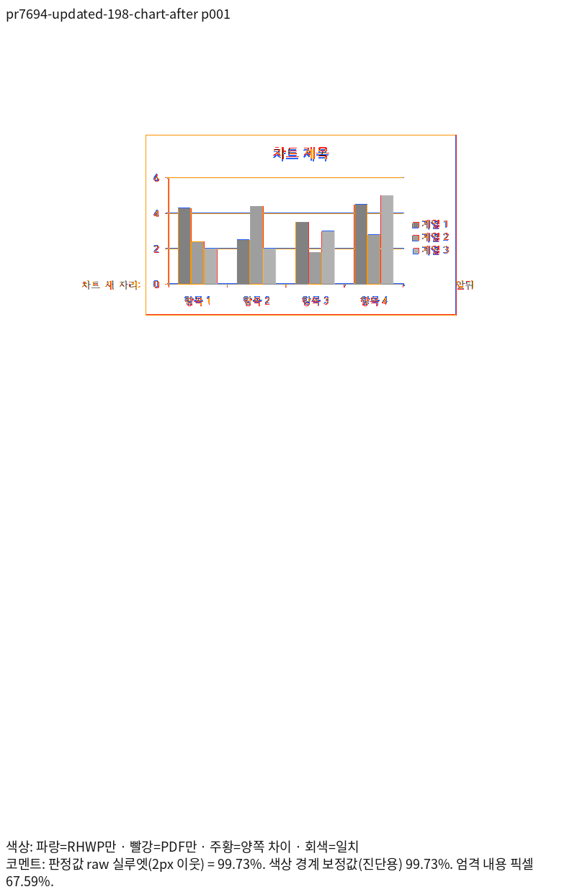

# 인라인 이동 차트의 독립 Print 프레임 회귀

새 검사는 기존 `inline_control_move` 검사를 교체하지 않는다. 같은 기존 HWP/HWPX의 이동
전후 네 입력과 한컴 2020 Print PDF를 재사용한다. 새 실제 문서는 추가하지 않았다.
[독립 기준과 실행 명령](independent-oracle.json)에 원본·PDF·producer·TSV·PNG 해시를 기록했다.

공유 target에서 다른 worktree의 오래된 차트 의존성이 연결되면 축약 RenderTree JSON은
같아도 실제 SVG 플롯·제목·외곽선은 달라질 수 있다. source 파일 해시만으로 실제 linked
의존성의 동일성을 선언하지 않고 새 Native276과 최적화 fresh086의 출력으로 확인했다.

## 시각 자격과 직접 판독

네 입력 모두 독립 Print와 같은 한 쪽이며 Native/fresh WASM raw가 각각 98% 이상이다.
원문 TSV는 각 backend 하위 경로에 바이트 그대로 보존했다. 같은 96dpi·Print profile·기존
compat 2022·동일 글꼴 공급 조건이다. compat 표기와 기준 출력 제품의 연도를 혼동하지 않는다.
이동 전후의 제목·플롯·세 계열·네 항목·범례·앞뒤 본문을 review와 standalone overlay에서
직접 대조했다. 글자 가장자리·선 농도의 잔차는 남으며 raw를 RGB 완전 일치로 부르지 않는다.

## 독립 기대값과 관계 검사

좌표는 RHWP의 SVG나 구현 계산식에서 복사하지 않고 독립 Print의 96dpi raster에서 읽었다.
원래 PDF는 차트를 여러 이미지 띠로 출력하므로 PDF 텍스트/벡터 drawing 목록만으로
차트 위치를 판정하지 않는다. 외곽 네 변, 값축 x와 플롯 위·아래의 좌표를 ±2 CSSpx로
보호한다. 플롯 끝의 래스터 위상이나 글꼴 baseline을 임의로 새로운 상수로 고정하지 않는다.
차트 하나·네 항목·세 범례·열두 막대의 보존, 제목/플롯/범례의 포함·순서와 막대의 같은
기준선 관계도 함께 검사한다. 실제 공개 `export-svg --profile print`의 RawSvg를 검사하므로
payload를 생략하는 축약 RenderTree만 같다고 통과하지 않는다.

정식 Rust 실행과 같은 검사 바이너리의 이전 CLI FAIL/현재 CLI PASS 결과는 실행 종료 후
연결한다. 시각 선행 자료만으로 전체 Rust나 원격 CI 완료를 주장하지 않는다.

## 대표 review와 overlay

Native 이동 전:

fresh WASM 이동 후:

## 정식 실행과 관측한 잘못된 산출물의 검출

검사 코드 `182754a9350f9b3ad1aa0aa9a9453a7974431062`에서 자동 수집한
`regression_suite_008::ooxml_chart_print_frame`의 새 함수는 1 PASS·0 FAIL이었다.
함수 안에서 기존 네 입력을 모두 확인했다. 같은 단계의 `hwpx_cell_frame_print` 2건과
`issue_8160_hwp3_print_boundaries` 5건도 통과했다. fmt·Native/WASM/workspace Clippy·
workspace build·suite/unit-tier 정책은 각각 exit0이었다.

같은 정식 검사 바이너리 SHA-256
`010f1322a7388fe8533aaf4ed0c82dac973777447b6a2f14489a895abebd41c3`로
관측한 잘못된 옛 Native275를 직접 실행하면 1 FAIL·exit101이었다.
독립 Print의 값축 x=145에 대해 실제 x=140.05를 검출했다. Native276을 사용하면
같은 함수가 1 PASS·exit0이었다. source나 기대값은 바꾸지 않았다.

처음에는 nextest 바깥에서 `CARGO_BIN_EXE_rhwp`를 지정했지만 nextest가 이를 현재
CLI로 다시 설정해 옛 제품 음성 대조가 되지 않았다. 이 실행의 PASS를 RED로 기록하지
않고, 같은 검사 바이너리를 직접 실행해 실제 옛 CLI와 현재 CLI를 대조했다.
이는 실행 환경 보정이며 기대 좌표·허용치 변경이 아니다.

여기까지는 새 회귀와 음성 대조의 완료 결과다. 같은 소스의 전체 Rust·전쪽 fresh WASM·
Studio 검증과 원격 CI는 별도로 완료한 뒤 최종 판정에 연결한다.
