# 현재 runtime의 직접 시각 판독

- 실제 runtime source: `3cb5a4c290663343123074be1e2fc0dda18d3db4`; 테스트 head: `3cb5a4c290663343123074be1e2fc0dda18d3db4`. 코드 바이트가 같은 실제 Native와 최적화된 fresh WASM입니다.
- 같은 원본·독립 Print PDF, 96dpi, 입력별 compat와 설치 글꼴을 사용했습니다. 전체 범위는 [전쪽 원장](../README.md), [입력·PDF](../inputs.tsv), [이미지 SHA-256·바이트 원장](../image_integrity.tsv)을 연결합니다.
- 실제 생성된 PNG의 확대는 같은 좌표를 잘라 nearest 방식으로 3배 표시했습니다. 원본 픽셀·글자·좌표를 보정하거나 점수를 변경하지 않았습니다.
- 자동 실루엣 수치와 직접 판독은 구분합니다. 정체/기울임·기호·첨자·분수·앞뒤 본문·셀 소유·외곽·후속 내용을 확인했습니다. 수식과 괘선의 래스터 명암 차이를 완전한 픽셀 동일성으로 표현하지 않습니다.

## 공통 컷 보정 전후의 실제 출력

원래 70개 입력에 대해 두 backend 각각 전 1,501쪽을 직전 완결 후보와 비교했습니다. 1,493쪽은 RGB가 같고 아래 8쪽만 달라졌습니다. 모든 변경 쪽은 raw가 개선됐으며 전후·독립 Print를 같은 영역에서 읽었습니다. 80168의 두 쪽은 [별도 자료](merged-80168.md)에 있습니다. 이후 #7967의 누락 입력 두 개·28쪽은 별도로 기준/후보 전쪽 비교와 직접 판독을 추가해 최종 전체 범위를 72개·1,529쪽으로 보완했습니다.

| 문서·쪽 | 복원한 내용·쪽 소유 | Native 전→후 raw | WASM 전→후 raw | 전후·독립 Print 확대 |
| --- | --- | --- | --- | --- |
| merged-80168 · 17쪽 | `여부`를 17쪽에 보존 | 99.27040 → 99.52324% | 99.23228 → 99.47967% | [review·overlay](merged-80168.md) |
| merged-80168 · 18쪽 | 18쪽에 표제를 중복하지 않음 | 99.22835 → 99.52563% | 99.25115 → 99.50740% | [review·overlay](merged-80168.md) |
| curriculum-1342000 · 217쪽 | `윤리와 사상`의 두 문단을 217쪽 셀에 모두 표시 | 99.76670 → 100.00000% | 99.76965 → 100.00000% | 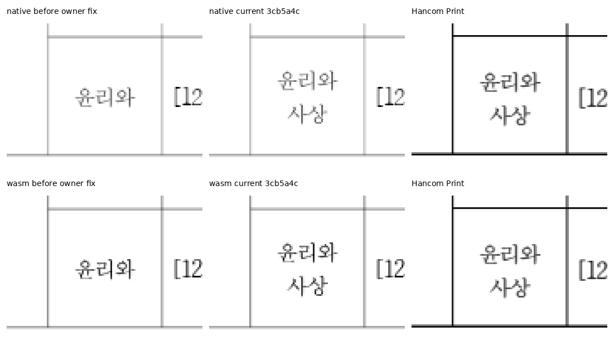 |
| curriculum-1342000 · 218쪽 | 앞쪽에서 소비한 `사상`을 다음 쪽에서 반복하지 않음 | 99.93944 → 100.00000% | 99.92975 → 100.00000% | 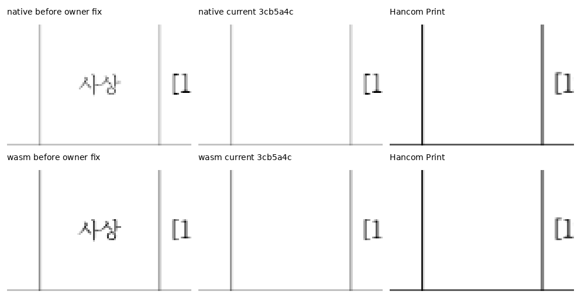 |
| curriculum-1342000 · 259쪽 | `[6국01-02]`를 `[6국01-05]`와 같은 앞쪽 셀에 보존 | 99.43926 → 99.74337% | 99.44392 → 99.73188% | 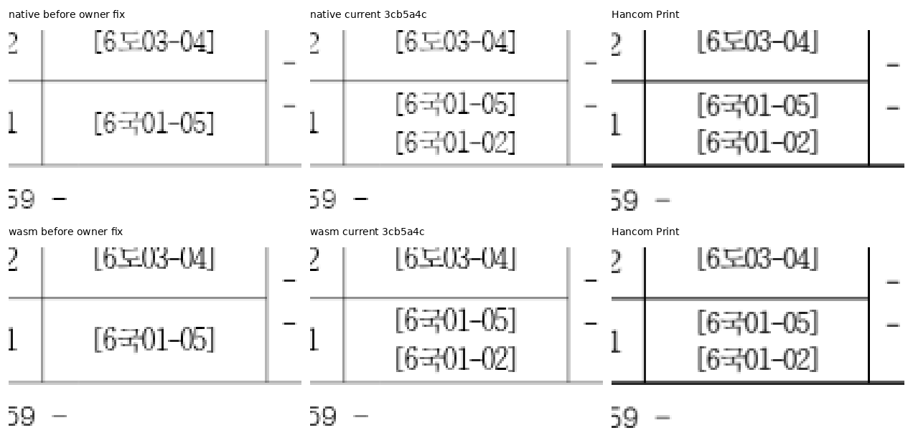 |
| curriculum-1342000 · 260쪽 | 앞쪽에서 소비한 과정 코드를 다음 쪽에서 반복하지 않음 | 98.85475 → 99.01656% | 98.80901 → 98.97100% | 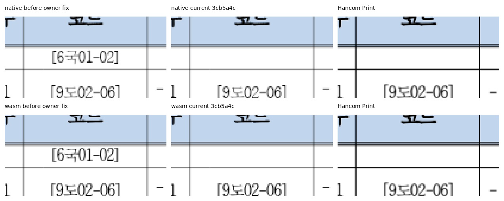 |
| curriculum-1342000 · 366쪽 | `여행 지리`의 두 문단을 366쪽 셀에 모두 표시 | 99.85850 → 100.00000% | 99.85616 → 100.00000% | 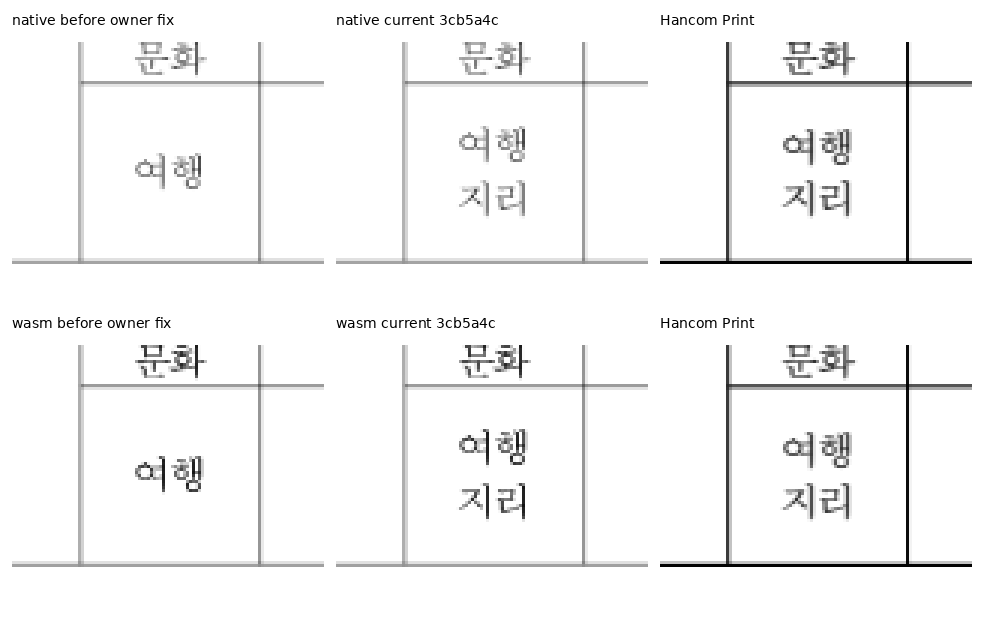 |
| curriculum-1342000 · 367쪽 | 앞쪽에서 소비한 `지리`를 다음 쪽에서 반복하지 않음 | 99.93572 → 100.00000% | 99.94831 → 100.00000% | 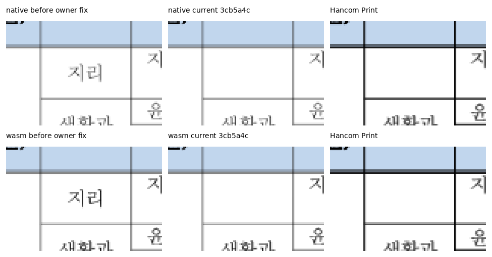 |

## 원래 다른 쪽으로 나뉘어야 하는 정상 대조

76076은 독립 Print에서 18쪽 `11.영향평가`/19쪽 `여부`로 나뉩니다. 보정 전후 Native RGB가 같고, 새 Native/fresh WASM에서도 이 분할과 주변 셀·후속 내용·괘선을 직접 확인했습니다. 모든 두 문단을 같은 쪽에 넣는 문서별 보정이 아닙니다. 이 자료는 정상 대조 18·19쪽에 대한 직접 확인이며 이 문서 전 82쪽을 새 수용 행렬에 더했다고 표시하지 않습니다.

## 기존 지적 영역과 완료 경계

| 입력 | 페이지 | 직접 판독 | Native review | WASM review |
| --- | --- | --- | --- | --- |
| curriculum-1342000 | 202 | 마지막 표 행·세로 괘선·후속 쪽 유지 | 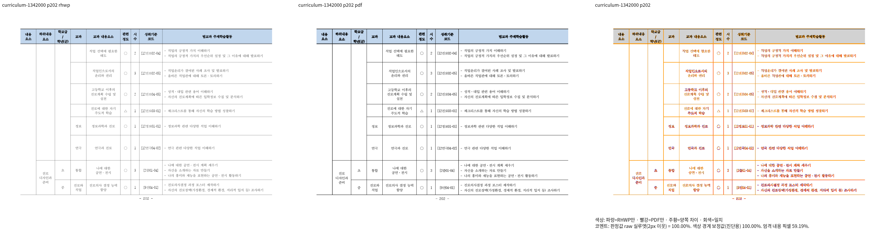 | 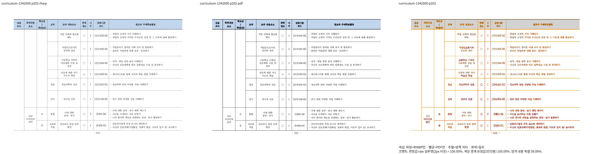 |
| night-guard | 1 | 본문 표와 같은 문단의 별도 표 중복 없음·표 뒤 확인 문단 보존 | 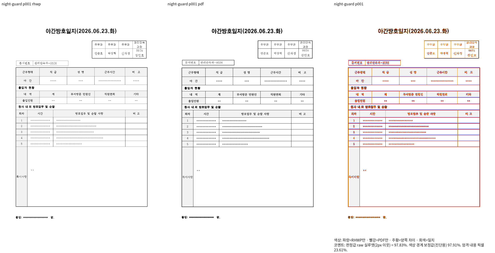 | 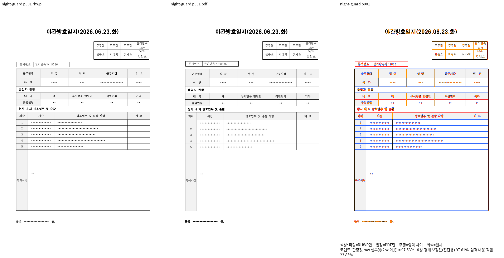 |
| handbook-hwp | 155 | 셀 간격을 본문 폭으로 더하지 않음·첫 문단 소속과 기준선 | 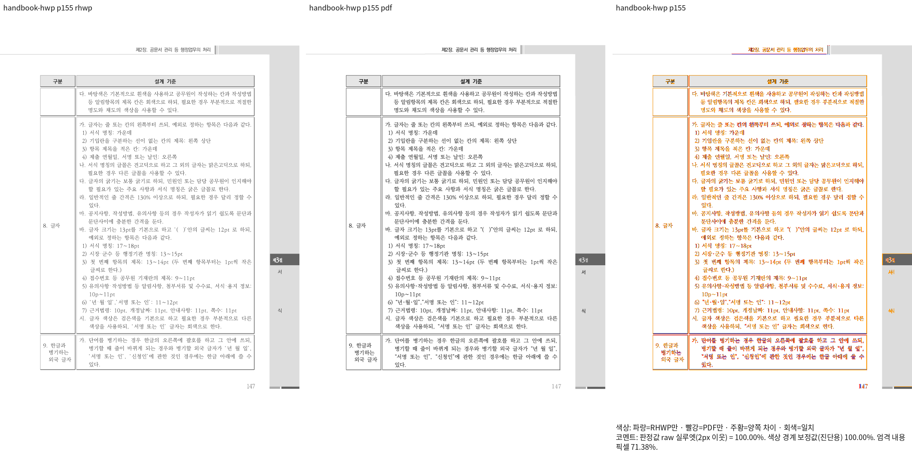 | 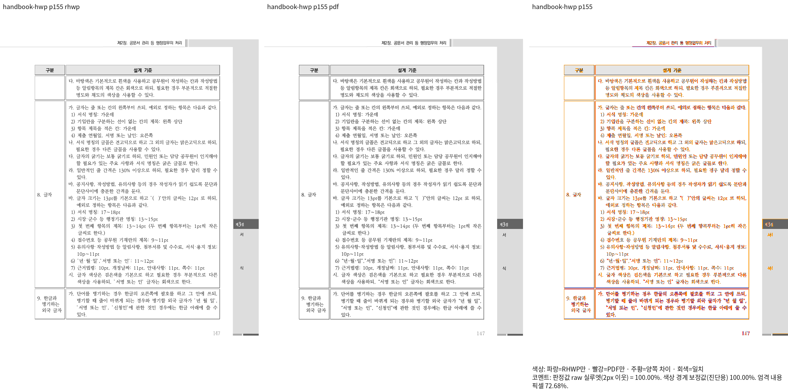 |
| handbook-hwpx | 155 | 동일 핵심 동작의 HWPX 글줄 소유·셀 내부 포함 |  |  |
| 148738070 | 6 | 앞쪽 물리 프레임 종료와 다음 쪽 본문·표 아래 끝점 | 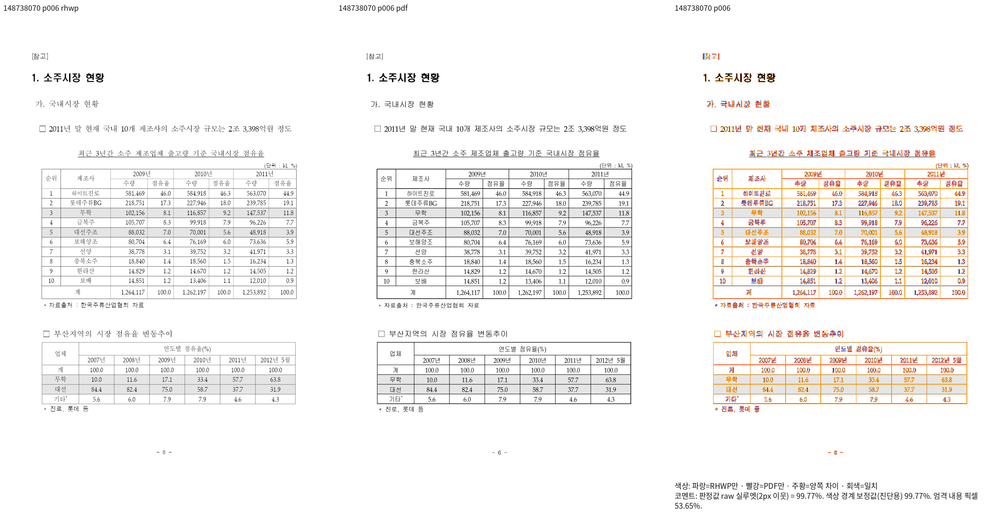 | 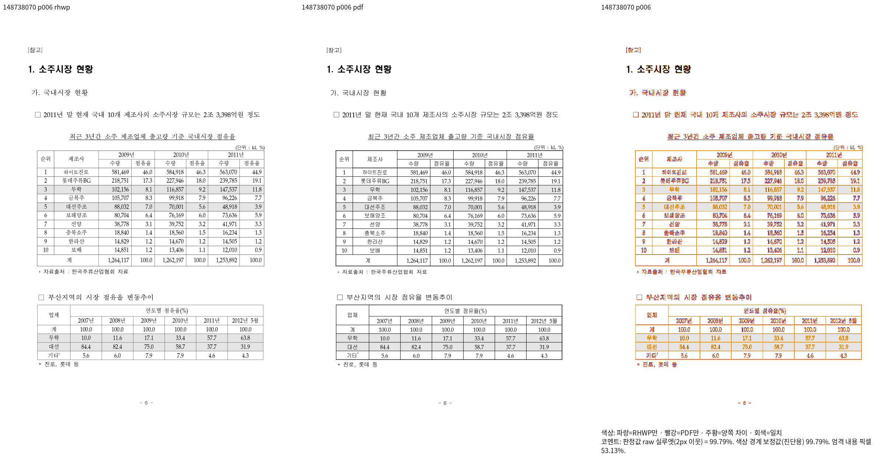 |
| handbook-hwpx | 375 | 양쪽 raw 100%의 두 서식·단 소유·여백·전체 셀 내용 |  | 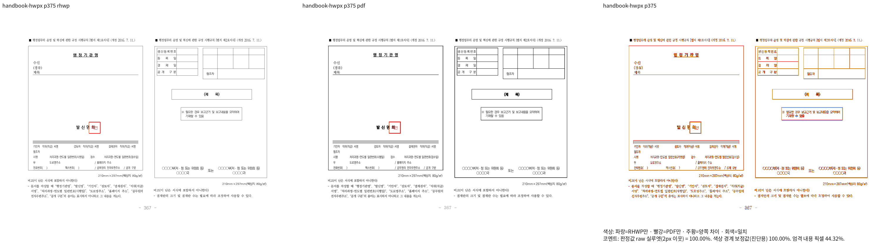 |

## 수식·미세 간격 확대 판독

4개 입력의 Native/fresh WASM 원본 PNG를 같은 좌표·같은 배율에서 독립 Print와 대조했습니다. `x=6m`의 x는 기울임, 단위 m은 정체이며, 분수 양쪽·정체 단위 앞뒤 본문·보기 번호 간격을 확인했습니다. ± 한 기호, 대문자 Σ/Π·소문자 π·첨자의 소속과 분수 범위가 맞습니다. 작은 글자와 괘선의 명암 차이는 남지만 다른 기호·잘린 글자·문단 이동으로 취급하지 않습니다.

| 입력·판독 범위 | Native 3배 | fresh WASM 3배 |
| --- | --- | --- |
| eq-rm-space · 정체 단위와 분수·본문 간격 | 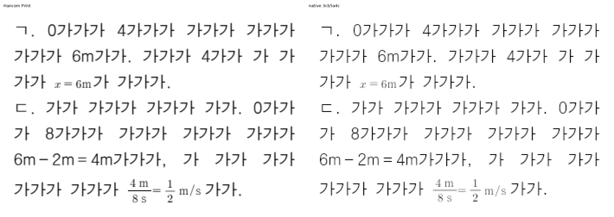 | 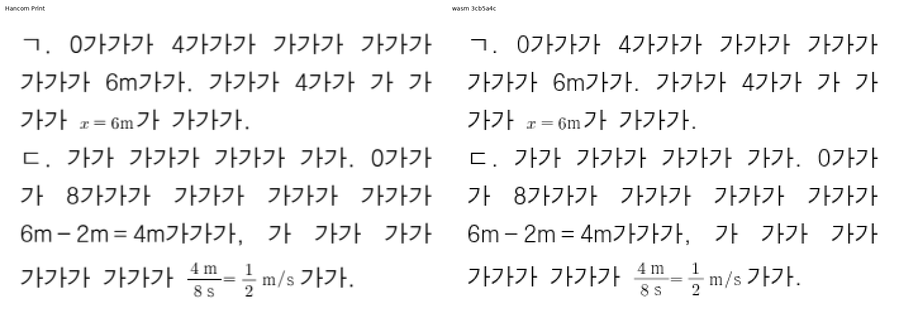 |
| eq-plusminus · 한 기호 ±와 앞뒤 수식·본문 | 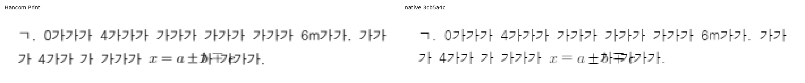 | 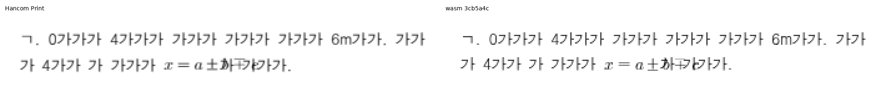 |
| eq-uppercase-greek · 대문자 그리스 문자·첨자·분수 | 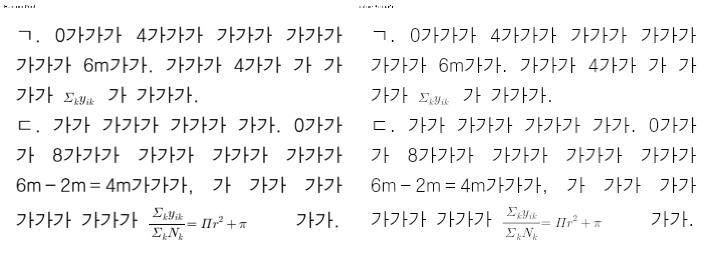 | 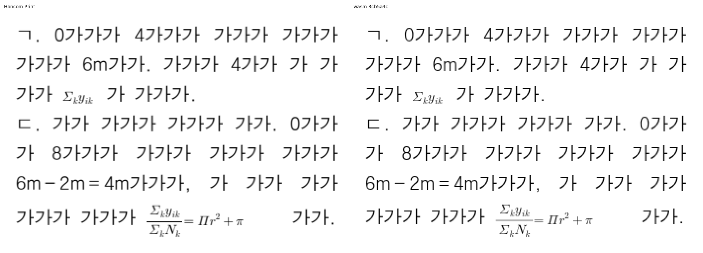 |
| original-eq-rm-quarterspace · 원 실물의 rm/공백과 분수·본문·보기 번호 | 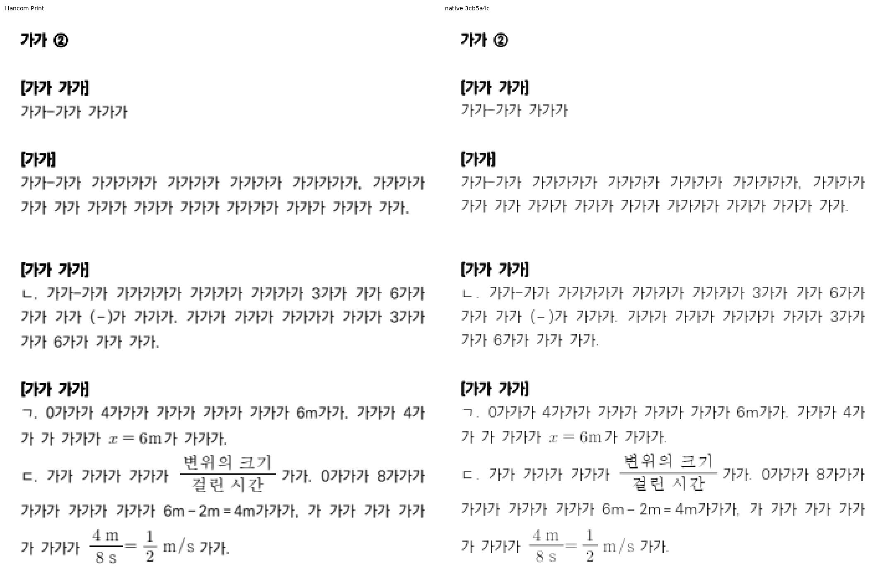 | 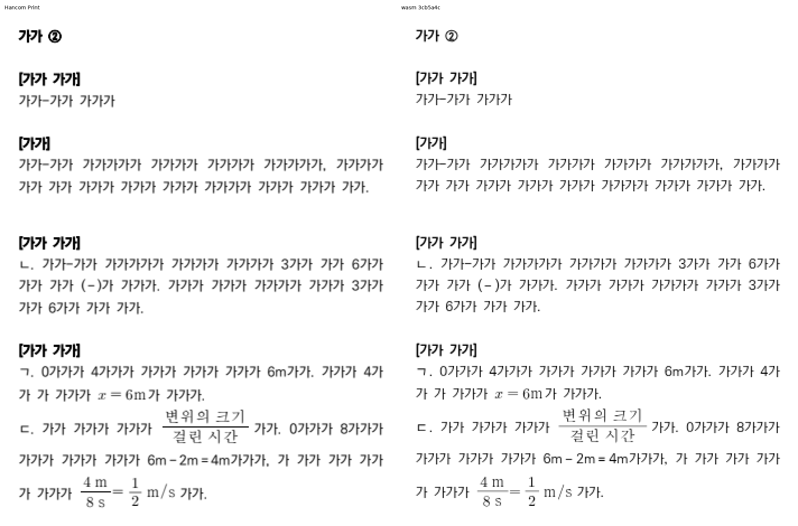 |

이 판독은 해당 source의 실제 출력에 대한 기록입니다. 전체 Rust·lint·Native Skia·최신 GitHub CI와 merge는 각각의 실제 종료 결과를 별도로 확인합니다.

## #7967 문단 테두리와 기존 완료 페이지 검사

[exam_eng·exam_kor의 전쪽 결과와 10개 실제 review·같은 좌표 확대](paragraph-border-7967.md)를 추가했습니다. 영어 8쪽과 국어 4·20쪽의 테두리 끝·뒤 내용, 기존 영어 5쪽/국어 14쪽 px 검사의 독립 원점을 모두 현재 Native/fresh WASM에서 대조했습니다. 해당 두 기존 px 검사를 새로 생성한 검사로 집계하지 않습니다.

## 최종 head의 재출력

최종 runtime `3cb5a4c290`에서 72개 입력·양쪽 1,529쪽을 다시 출력했습니다. 직전 완결 runtime과 Native/fresh WASM 각각 1,529쪽의 RGB가 같음을 확인했고, 동일한 독립 Print와 새 PNG로 제출용 review·overlay·확대 자료를 다시 생성했습니다. 이전 공통 컷 보정 전후 8쪽의 비교는 같은 개선의 이력으로 유지하며 새 head의 직접 판독과 구분합니다.
