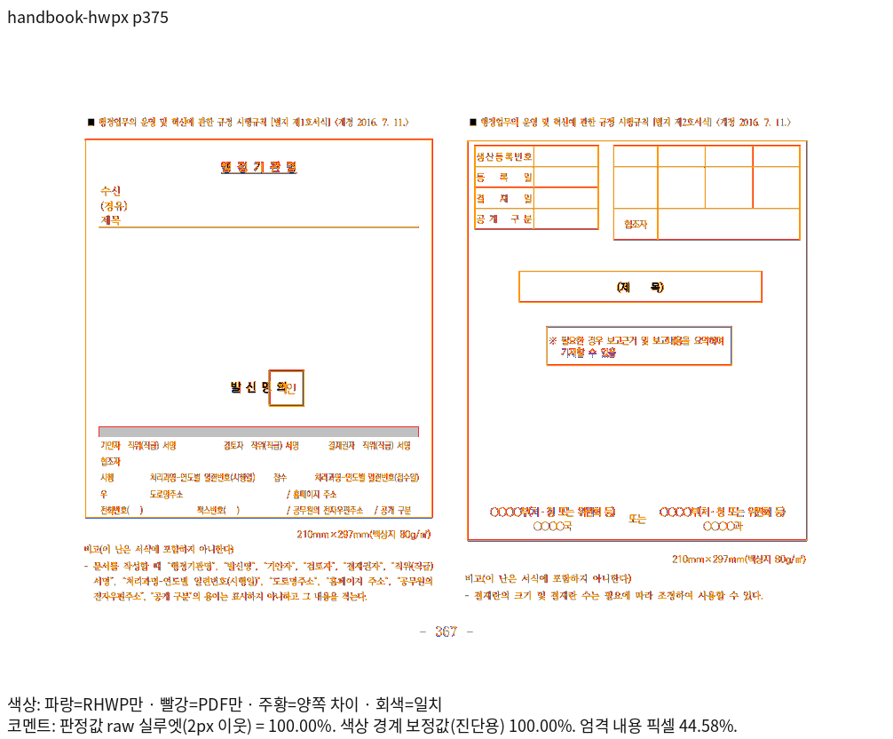
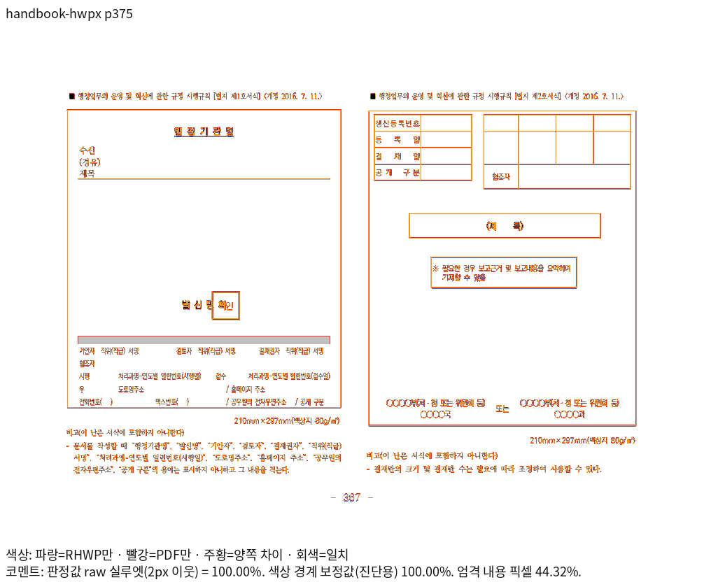

# 편람 HWPX 375쪽 완료 서식의 소유·여백·내용 보존

- 실제 runtime source: `3cb5a4c290663343123074be1e2fc0dda18d3db4`. 해당 소스에서 Native와 최적화한 fresh WASM을 산출하고 전체 페이지 TSV와 대표 PNG를 다시 생성했습니다.
- 입력: [원본](<../../../../../samples/2025 행정업무운영 편람(최종).hwpx>), SHA-256 `c6dd7e847a99f219681afc5a29c80a9665c04df9cda4d820a3350d739664fdf6`.
- 독립 기준: [한컴 2024 Print PDF](<../../../../../pdf/2025 행정업무운영 편람(최종)-hwpx-kopub-2024.pdf>), SHA-256 `299cb2d994bba8b63f78b681bd74580286e298f25689b4ff4f40c66c54bfa85e`.
- print 프로필, compat 2024, 96dpi, 색상 경계 보정 전 2px `silhouette_raw_match_percent`입니다.
- 글꼴은 설치된 `/usr/local/share/fonts/hancom-office-2020`과 `/usr/local/share/fonts/hwp-convert-mcp-kopub`을 직접 사용했습니다. 글꼴 파일을 자산에 복사하지 않았습니다.
- Native 빌드: 고정 `target/pr-review`, release-test/native-skia, jobs 8. WASM은 같은 고정 target의 locked wrapper, release 최적화·wasm-opt 포함, jobs 8·codegen-units 16입니다.

| 출력 | 독립 PDF와 같은 전체 쪽수 | 전쪽 최저 raw | 좌표 보호 쪽 raw | 원본 |
| --- | ---: | --- | --- | --- |
| native | 383 | 92.49658% · 94쪽 | 375쪽 100.00000% | [전쪽 TSV](../tsv/current/native/handbook-hwpx.tsv) |
| wasm | 383 | 92.51660% · 94쪽 | 375쪽 100.00000% | [전쪽 TSV](../tsv/current/wasm/handbook-hwpx.tsv) |

원본 HWPX 전체 383쪽을 같은 원본의 정상 KoPub Print와 대조했습니다. 과거 무 KoPub 환경의 384쪽 PDF를 이번 기준과 혼동하지 않습니다. 375쪽은 Native/fresh WASM 양쪽 raw 100%이며, HWP와 HWPX의 독립 Print 375쪽 RGB도 같습니다.

두 형식은 같은 서식 검사 로직을 실행합니다. 왼쪽·오른쪽 서식의 원본 셀 내용·순서·누락·중복, 단 소유·서로 겹치지 않음, 표 앞 공백과 가운데 정렬, 원본 바깥여백을 한 번만 소비하는 관계를 유지합니다. 독립 Print의 외곽 원점을 ±2px로 보호하고, 원본 여백을 0으로 바꾼 대조군에서는 크기를 유지하며 원점만 해당 여백만큼 이동하는 실제 동작도 검사합니다. 이 페이지는 100% 우선 선정 조건을 충족합니다.

## 대표 출력

### 375쪽

| 출력 | review | overlay |
| --- | --- | --- |
| native |  |  |
| wasm |  |  |

이 자료는 해당 문서의 시각 선행 조건과 핵심 검사 증거입니다. 다른 입력·전체 Rust 회귀·GitHub CI·merge 완료를 대신하지 않습니다. 각 TSV는 생성 원본을 바이트 그대로 보존했습니다.
