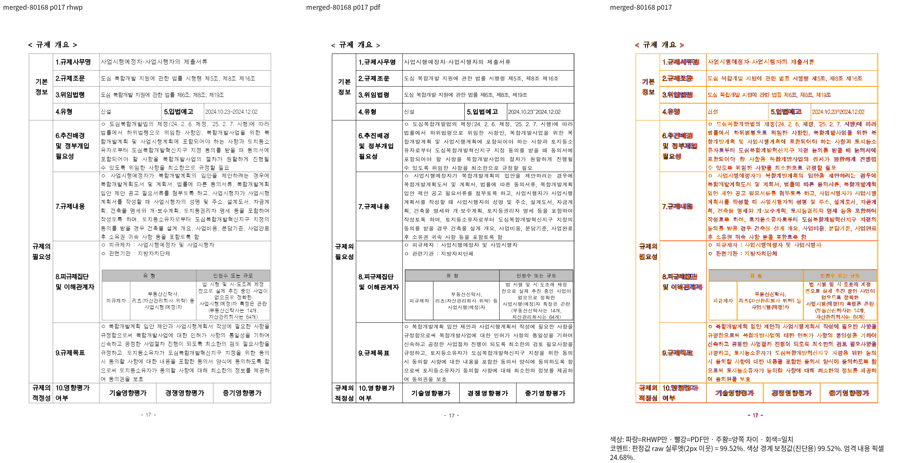
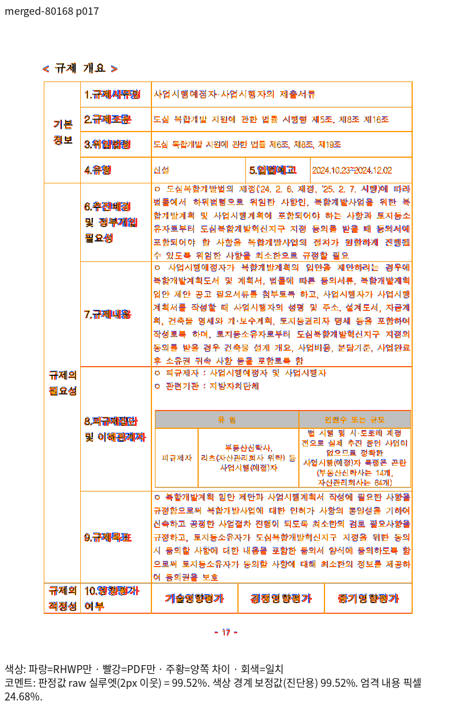
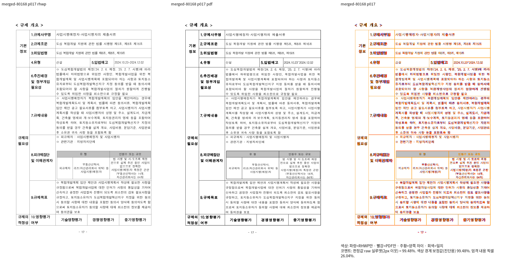
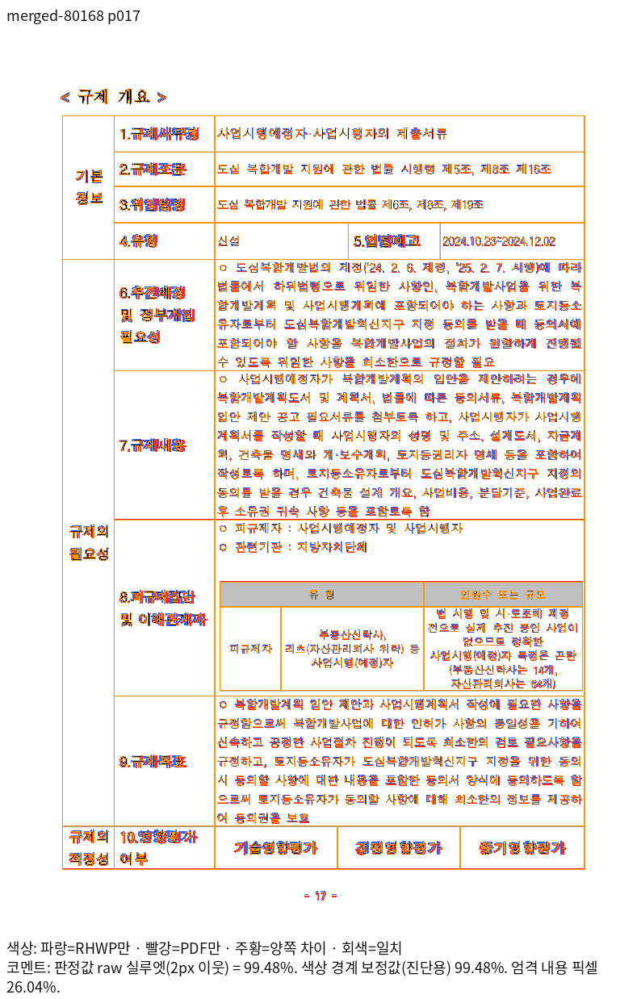
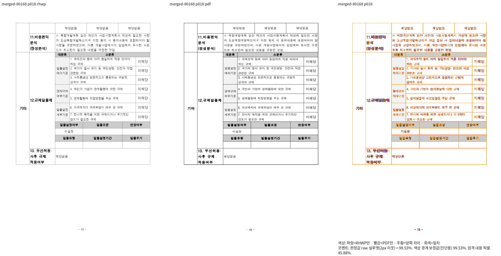
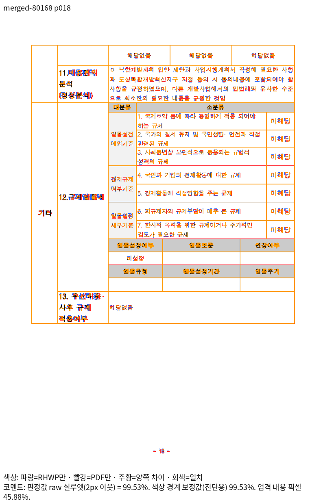
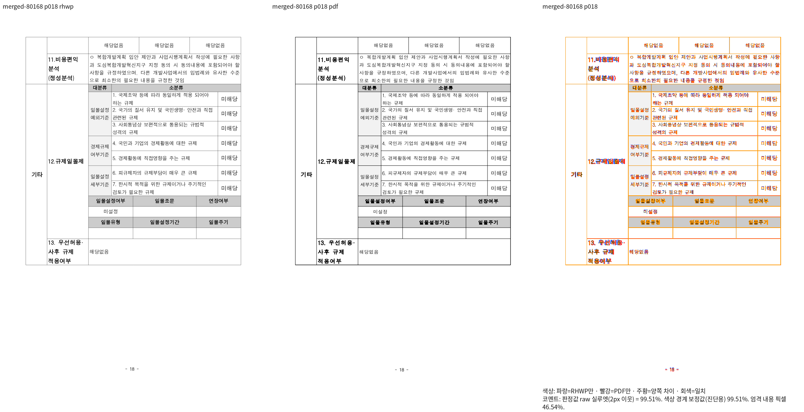
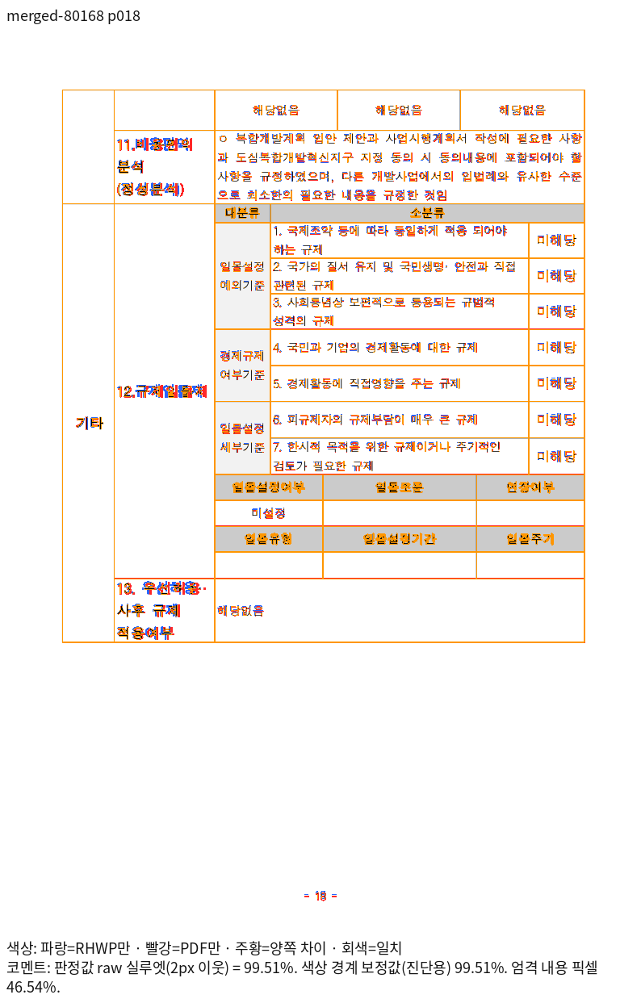

# 80168 17쪽 표제의 문단 소유와 내용 보존

- 실제 runtime source: `3cb5a4c290663343123074be1e2fc0dda18d3db4`. 해당 소스에서 Native와 최적화한 fresh WASM을 산출하고 전체 페이지 TSV와 대표 PNG를 다시 생성했습니다.
- 입력: [원본](<../../../../../samples/80168_regulatory_analysis.hwp>), SHA-256 `c8ad10fe9f07be5119cd804278017aefa46e555bbee4f05f0f5132fe4f591a22`.
- 독립 기준: [한컴 2024 Print PDF](<../../../../../pdf/80168_regulatory_analysis-hwp-2024.pdf>), SHA-256 `b233df7098547df43455f49c13ba5b63f1f06113c853a4773f86a94d6b34a982`.
- print 프로필, compat 2024, 96dpi, 색상 경계 보정 전 2px `silhouette_raw_match_percent`입니다.
- 글꼴은 설치된 `/usr/local/share/fonts/hancom-office-2020`과 `/usr/local/share/fonts/hwp-convert-mcp-kopub`을 직접 사용했습니다. 글꼴 파일을 자산에 복사하지 않았습니다.
- Native 빌드: 고정 `target/pr-review`, release-test/native-skia, jobs 8. WASM은 같은 고정 target의 locked wrapper, release 최적화·wasm-opt 포함, jobs 8·codegen-units 16입니다.

| 출력 | 독립 PDF와 같은 전체 쪽수 | 전쪽 최저 raw | 좌표 보호 쪽 raw | 원본 |
| --- | ---: | --- | --- | --- |
| native | 157 | 93.90078% · 49쪽 | 17쪽 99.52324% | [전쪽 TSV](../tsv/current/native/merged-80168.tsv) |
| wasm | 157 | 91.66667% · 153쪽 | 17쪽 99.47967% | [전쪽 TSV](../tsv/current/wasm/merged-80168.tsv) |

원본 표 문단 139의 셀 (8, 1)은 두 행에 걸치며, `10.영향평가`와 `여부` 두 문단을 담습니다. 두 문단에 실제 저장 LineSeg가 없는데도 행 수와 문단 수가 같다는 형상만으로 한 문단씩 나누던 추정을 제거했습니다. 실제 수용 상자 안에 두 문단이 모두 들어갑니다. 17쪽의 소유·내용 순서·포함과 18쪽의 중복 없음을 독립 Print와 직접 대조했습니다. 독립 PDF의 `여부` 원점 (111.36, 777.72)pt를 96dpi의 (148.48, 1036.96)px로 환산해 ±2px로 보호합니다.

같은 보강 검사 초안을 원 Native `b7443d4328`에서 실행하면 표제 누락으로 FAIL하며, 수정한 runtime에서는 정상 대조군과 함께 PASS했습니다. 실제 물리 높이로 분할해야 하는 76076의 18·19쪽은 수정 전후 Native RGB가 동일하며, 새 Native/fresh WASM의 직접 비교도 확인합니다. 이 자료는 두 문단을 항상 같은 쪽에 강제로 넣는 규칙이 아닙니다.

최저인 WASM 153쪽은 독립 PDF와 출력 모두 본문 없이 쪽 번호만 있는 쪽임을 직접 확인했습니다. 이 쪽은 98% 미만이므로 절대 좌표 회귀를 추가하지 않습니다. 폰트 래스터의 미세 차이를 내용 누락과 구분합니다.

## 대표 출력

### 17쪽

| 출력 | review | overlay |
| --- | --- | --- |
| native |  |  |
| wasm |  |  |

### 18쪽

| 출력 | review | overlay |
| --- | --- | --- |
| native |  |  |
| wasm |  |  |

이 자료는 해당 문서의 시각 선행 조건과 핵심 검사 증거입니다. 다른 입력·전체 Rust 회귀·GitHub CI·merge 완료를 대신하지 않습니다. 각 TSV는 생성 원본을 바이트 그대로 보존했습니다.
