# #7967 문단 테두리의 전쪽 검증과 직접 판독

원 PR별 검증 범위를 다시 대조하면서 기존 70개 제출 원장에 없던 `exam_eng.hwp`와
`exam_kor.hwp`를 확인했습니다. 실제 runtime `3cb5a4c290663343123074be1e2fc0dda18d3db4`의
동결된 Native Skia와 최적화 fresh WASM Canvas2D, 같은 96dpi·print·compat 2022·설치 글꼴로
추가했습니다. 새 빌드나 기준 PDF 재변환으로 이전 증거를 대신하지 않았습니다.
기준 Native는 `a6e9d18fc1061318055b4eb348daec201427ea03`, 기준 WASM은 컴파일 입력 동치와
실제 기능 보존을 확인한 `f45878c7caafb43ca1fd017ddd93484a0acc6ad2`입니다.

[입력·한컴 Print PDF 다운로드와 SHA](inputs_and_print_pdfs.md),
[원본 TSV·해시·producer](../integrity.tsv), [실제 PNG 해시](../image_integrity.tsv)를 연결합니다.
아래 값은 색상 경계 보정 전 2px `silhouette_raw_match_percent`입니다.

| 입력 | backend | 전체 쪽수 | 기준 최저 raw | 후보 최저 raw | 가장 낮은 페이지별 변화 %p |
| --- | --- | ---: | ---: | ---: | ---: |
| exam_eng | Native | 8/8 | 97.16293% | 97.16295% | 0.00000 |
| exam_eng | fresh WASM | 8/8 | 96.96448% | 96.96447% | -0.00002 |
| exam_kor | Native | 20/20 | 92.51027% | 96.63620% | -0.00039 |
| exam_kor | fresh WASM | 20/20 | 92.43917% | 96.67089% | -0.00029 |

독립 Print와 전체 쪽수가 모두 일치하고 90% 미만·누락·측정 불가·0.1%p 이상 하락은 없습니다.
원 70개에 28쪽을 더한 최종 범위는 72개 입력·backend별 1,529쪽입니다.

## 직접 판독

원본 PNG의 같은 좌표를 3배 nearest로 표시했습니다. 세 패널은 독립 Print·Native·fresh WASM이며
원본 픽셀이나 위치를 보정하지 않았습니다. 문단 테두리의 끝, 마지막 글줄과 바깥쪽 후속 내용,
단 소유를 대조했습니다. 괘선·글자의 명암과 안티앨리어싱 차이는 남으며 픽셀 동일성을 주장하지 않습니다.

### 영어 8쪽: 단 마지막 문단 테두리

| backend | review | overlay |
| --- | --- | --- |
| Native | 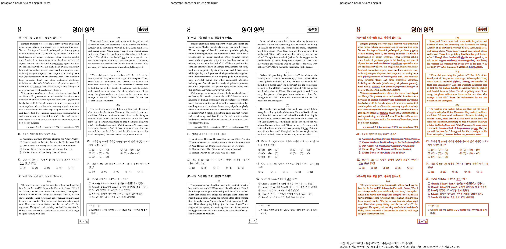 | 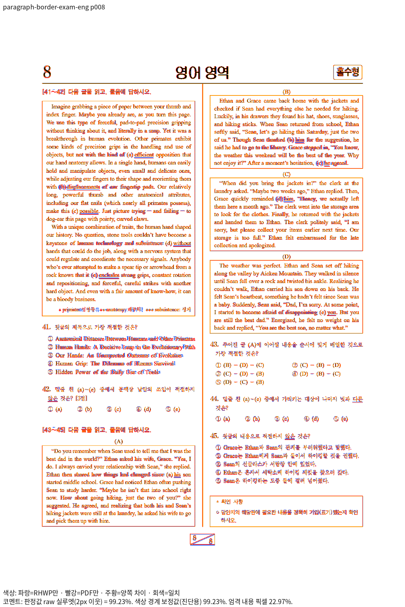 |
| fresh WASM | 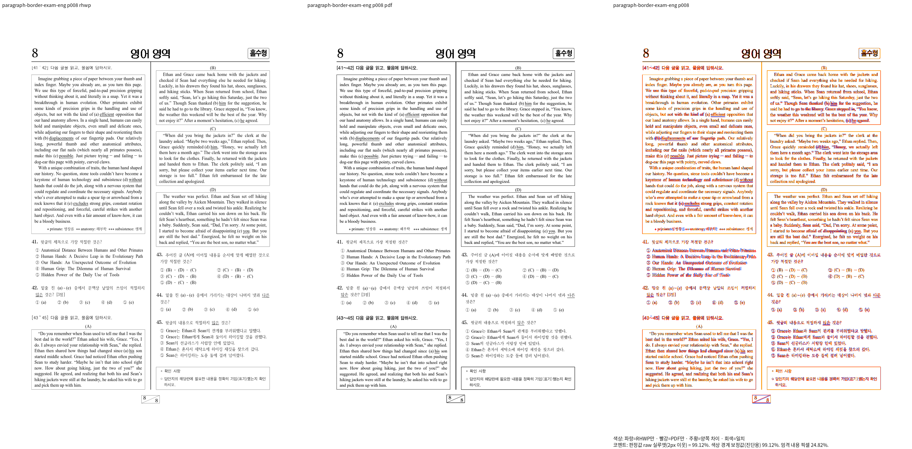 | 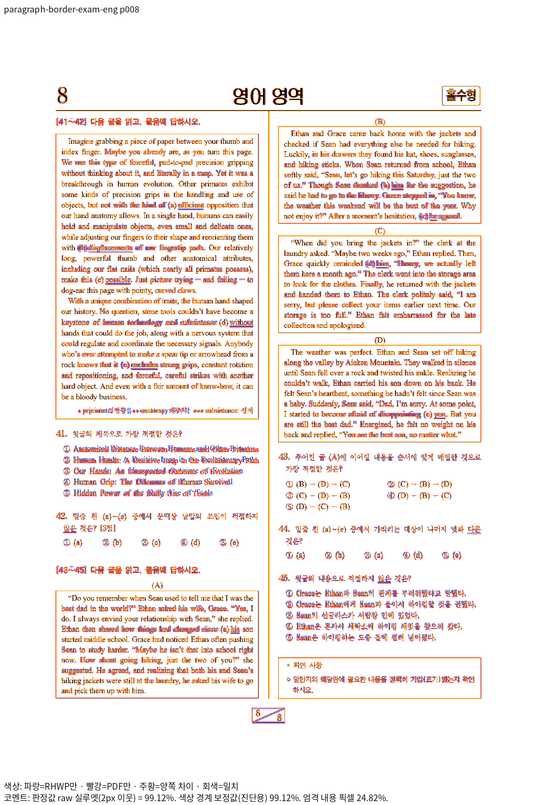 |

표본의 `pi=298` 상자 끝과 `pi=300/302/304`의 단 중간 상자·후속 문항을 확인했습니다.
기존 정식 `issue_7888_para_border_group_bottom_no_default_inset` 검사는 같은 문단 모양의
「상자 아래 변 − 마지막 글줄 아래」 관계를 보호합니다. 절대 좌표를 새로 고정하지 않았습니다.
8쪽 raw는 Native 99.23348%, fresh WASM 99.11859%입니다.

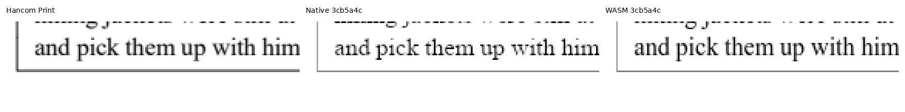

### 국어 4·20쪽: 본문 외곽과 마지막 문항

4쪽의 긴 지문 테두리 끝, 20쪽의 복합 그림·채팅 상자·확인 사항과 바깥 문단을 확인했습니다.
본문이 빠져 테두리만 맞은 것으로 판정하지 않았습니다. raw는 4쪽 99.97033/99.97085%,
20쪽 99.87004/99.90007%(Native/fresh WASM)입니다.

| 쪽 | Native review | fresh WASM review |
| --- | --- | --- |
| 4 | 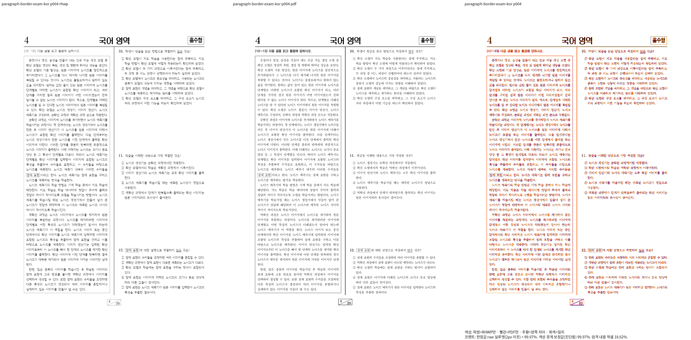 | 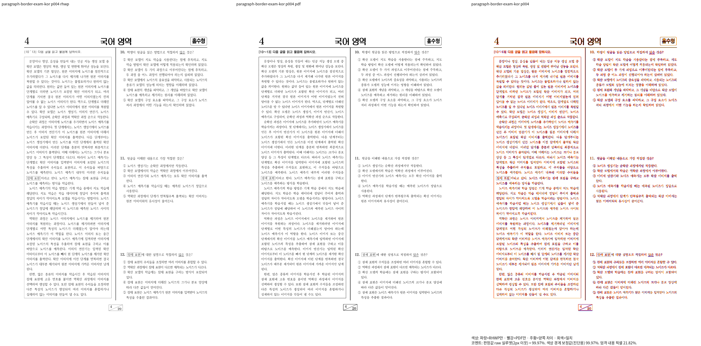 |
| 20 | 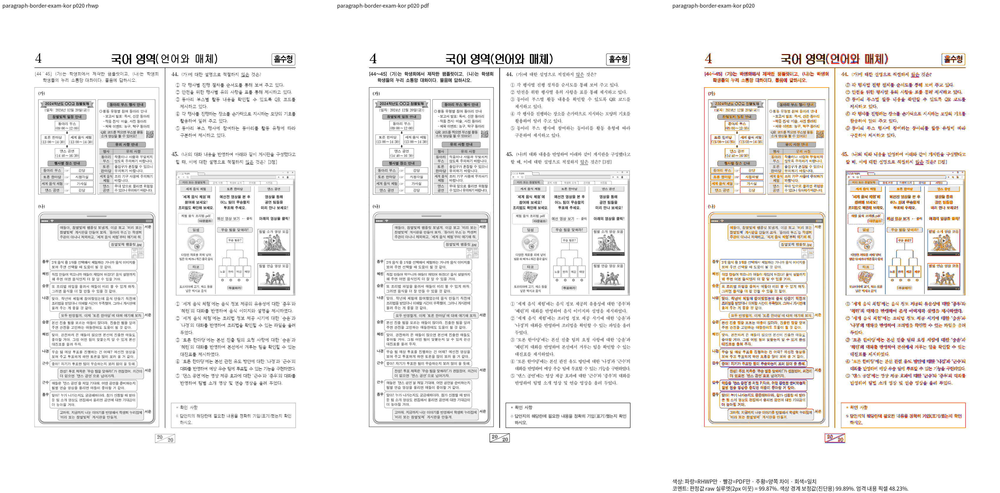 | 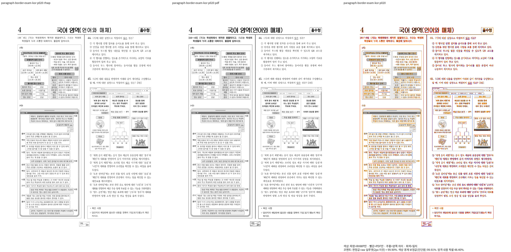 |

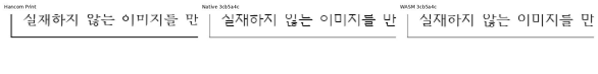
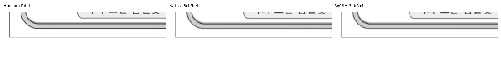

## 이미 있는 완료 페이지 px 검사 유지

새 좌표 검사를 중복 추가하지 않고 현재 정식 suite의 다음 검사와 직접 대조했습니다.

| 기존 정식 검사 | 보호 대상 | 현재 Native/fresh WASM raw |
| --- | --- | --- |
| `verified_english_neutral_space_ownership::english_completed_page_five_keeps_print_word_origins_and_owned_content` | 영어 5쪽 문29의 다/어/것 원점·기준선 ±2px, 문단 소유·순서·누락·중복 | 99.58462/99.56831% |
| `verified_hancom_paragraph_frames::verified_exam_completed_page14_print_header_and_frame_positions` | 국어 14쪽 홀수형 상자와 두 단 외곽 ±2px, 기존 소유·포함·기준선 관계 | 99.79549/99.78359% |

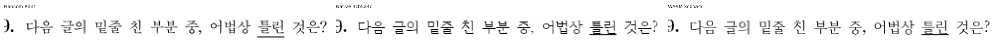
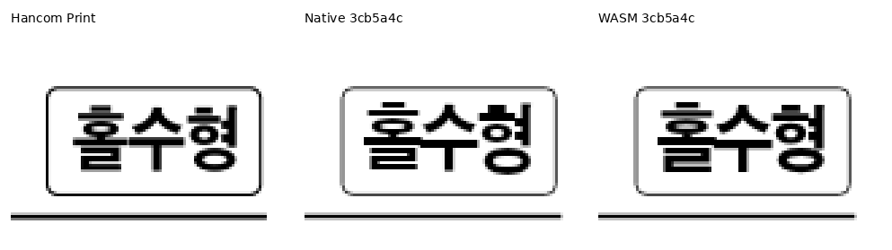

두 검사는 기존 base에 있던 검사입니다. 이번에 새로 생성한 테스트 수로 집계하지 않으며
현재 후보의 전체 회귀 실행 결과를 별도로 확인합니다. 이 두 문서의 통과를 원 PR이 별도로
추적한 온새미로 #7761·#7888의 전체 해결로 확대하지 않습니다.
