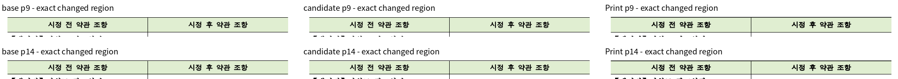
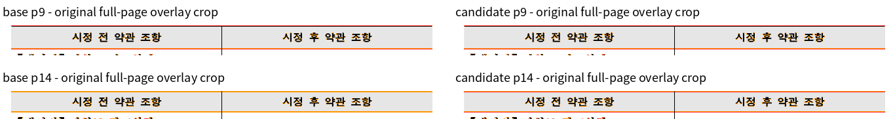

# 새 base와 후보 사이의 실제 차이 영역 판독

같은 원본 `samples/issue6929/148776468_search_ad_terms_press_release.hwp`와 독립 Print의 9·14쪽을 비교했다.
측정 source·제품 해시·전체 페이지 TSV는 [Native](native-base-preservation.md)와 [fresh WASM](wasm-base-preservation.md)에 기록했다.
각 경로 41쪽 중 39쪽은 base/candidate PNG가 바이트 단위로 같고, 아래 두 쪽만 경계 픽셀의 밝기 차이가 있다.
두 경로 모두 모든 페이지의 raw 하락은 0쪽이다.

- 9쪽: 두 경로 각각 37픽셀 차이, 채널 최대 차이 21. Native raw는 base/candidate 모두 100%다.
- 14쪽: 두 경로 각각 1,314픽셀 차이, 채널 최대 차이 33. Native raw는 양쪽 모두 99.95138%다.
- 두 쪽의 `시정 전 약관 조항 / 시정 후 약관 조항` 글자·셀 경계 위치와 내용 보존을 같은 배율에서 확인했다.
  내부 채움색 표본은 base/candidate/Print 모두 RGB(224,238,209)다. RGB 전체 일치를 주장하지 않는다.

아래 그림은 기존 전쪽 출력의 **같은 차이 영역을 자른 진단 그림**이다. 독립된 전쪽 점수나 다른 PR의 주장 증적으로 사용하지 않는다.
위쪽 행은 9쪽, 아래쪽 행은 14쪽이다. review는 base/candidate/Print를 나란히 배치했고 overlay는 같은 영역의 겹침을 보여 준다.

