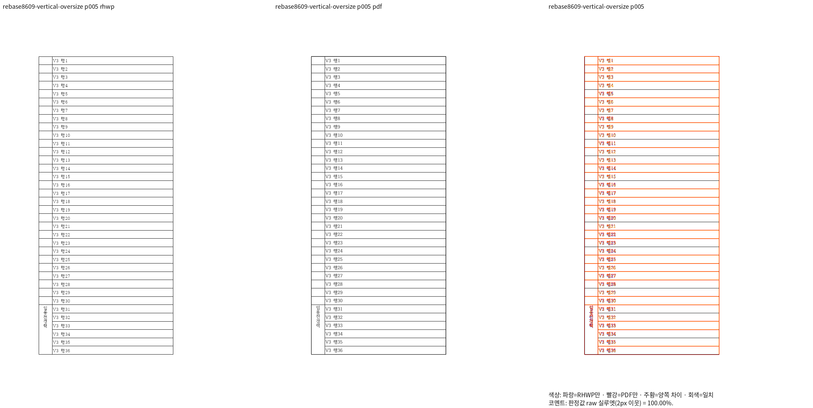
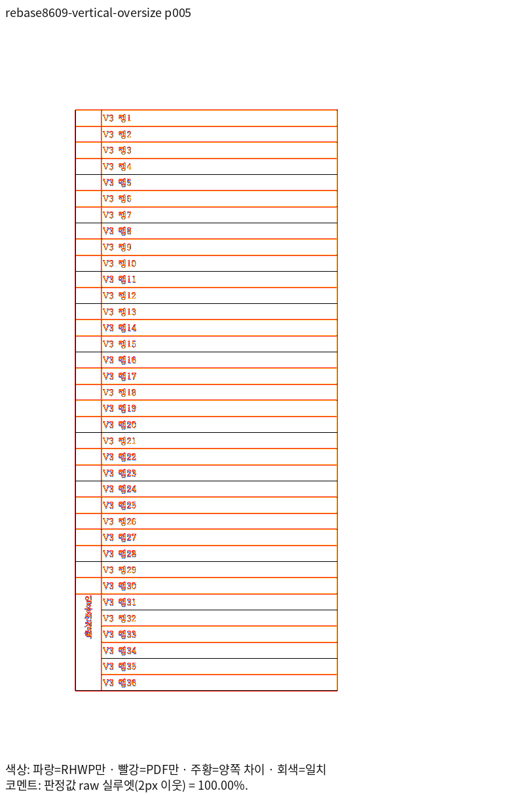
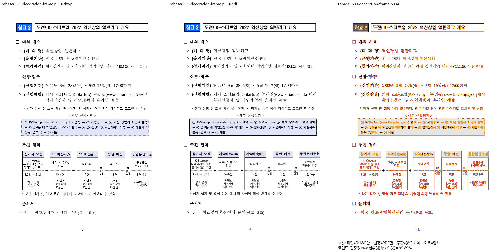
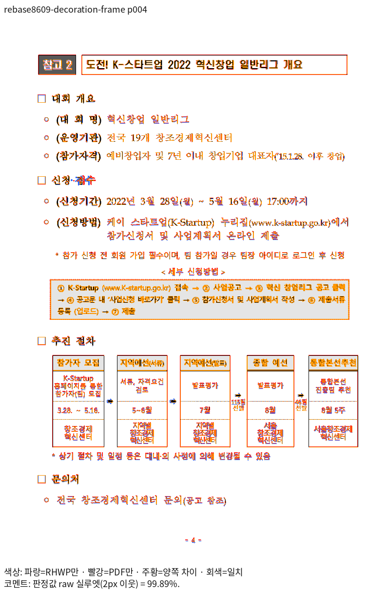
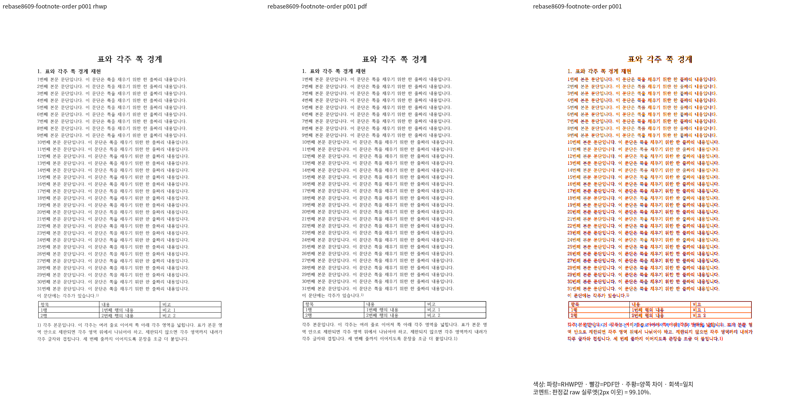
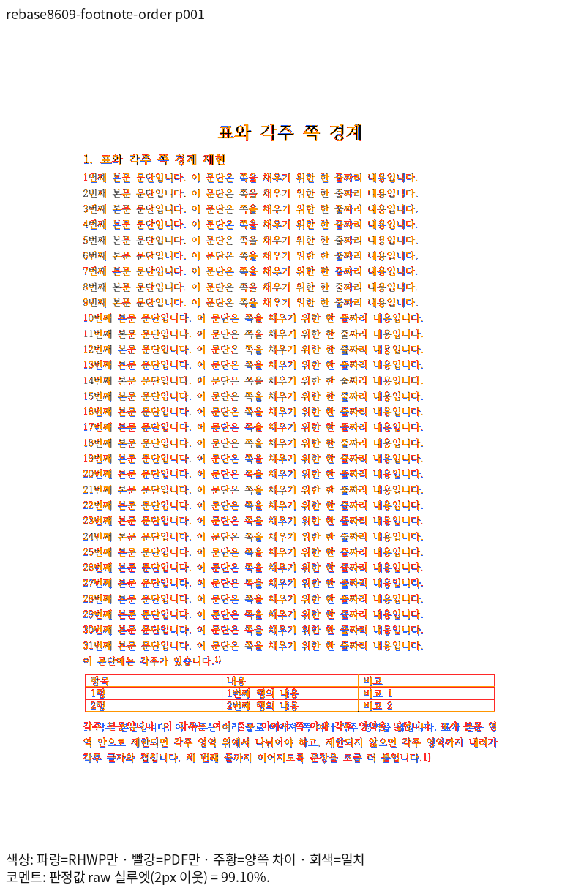

# 최신 리베이스 Native의 주장 쪽 직접 판독

제품 source `ba2ebfd34a4ebf402bce8e002254b672a09ef764`, Native SHA-256 `296a0d3f68dcb29f5bd91f3f5411bb78e42c53d04a51f526a3473281ba090cc6`.
같은 입력·기존 독립 Print를 96 DPI·Print profile로 비교했다. 원본이나 PDF를 재출력하지 않았다.
각 항목의 review와 별도 overlay를 2026-11-05 KST에 실제로 열었다. 점수 통과와 관측을 구분한다.
전쪽 TSV는 [10입력·43쪽 대조](native-own-validation.md)에 있으며 중복 파일을 추가하지 않는다.

fit 입력의 5쪽은 [별도 실제 판독](native-vertical-fit/README.md)에 연결한다.

## PR #8475 · vertical-oversize · 5쪽

| Native review | 같은 쪽의 별도 overlay |
| --- | --- |
|  |  |

초과 높이 입력에서도 임용전경력 다섯 글자가 병합 칸 안의 한 세로줄에 남는다. V3 행 1~36과 표 종료·다음 쪽 소속을 보존했다. 2px raw 100%와 선 획의 완전한 일치는 구분한다.

| 제출 그림 | SHA-256 |
| --- | --- |
| `review` | `4519e3ee940d0170fd074753ad2edc56e97b7da739e13c3361975709fd2bc1fc` |
| `overlay` | `100aca7432052eaeb6588393363e2401d1f7c700db74682e8ff4373a80888762` |

## PR #8512 · decoration-frame · 4쪽

| Native review | 같은 쪽의 별도 overlay |
| --- | --- |
|  |  |

참고 2 제목 틀 뒤 대회 개요·신청 접수·세부 신청방법·추진 절차·문의처의 순서를 확인했다. 빈 표 host 뒤 본문이 위로 당겨지거나 겹치지 않는다. 신청방법 상자의 점선과 독립 PDF의 실선 표현 차이는 남는다. 전체 Native PNG SHA가 4b 이전 후보와 같아 리베이스 신규 후퇴가 아님을 확인했다.

기준 PNG SHA-256 `55dd878bbe54dd76318fcab074f06b70c3f64c795c24a37ad8a05ec266a726d6`, 현재 PNG SHA-256 `55dd878bbe54dd76318fcab074f06b70c3f64c795c24a37ad8a05ec266a726d6`.

| 제출 그림 | SHA-256 |
| --- | --- |
| `review` | `ea54985c89b7f71b6917e95a19b926a363b7e22b607d84ba2417271c4545b405` |
| `overlay` | `ed449e5408808babe244ae9f92d0e00924aa65adab512825a5c843527a7f337f` |

## PR #8535 · footnote-order · 1쪽

| Native review | 같은 쪽의 별도 overlay |
| --- | --- |
|  |  |

1~31 본문과 각주 참조 뒤 표가 놓이고 표 종료가 각주 영역 위에 남는다. 입력 XML의 각주 autoNum은 본문 뒤에 있어 PDF는 번호를 마지막에 출력하지만 Native는 앞에 표시한다. 이 차이를 표 제한 개선과 구분한다. 현재 Native PNG는 c183 후보와 바이트가 같으며 원 PR ee3fd560의 제품 수정은 scaffold 표 속성 6줄이다. 각주 번호 전체 일치를 해결했다고 주장하지 않는다.

기준 PNG SHA-256 `7117be06fc0b80f1501a0469677827fda2716d3651e290d827804f805f89b365`, 현재 PNG SHA-256 `7117be06fc0b80f1501a0469677827fda2716d3651e290d827804f805f89b365`.

| 제출 그림 | SHA-256 |
| --- | --- |
| `review` | `08d6b29a70539c5130553638d5c4131220bd94b051cb5dbb21f36a5e9bec45d9` |
| `overlay` | `87e94dff9536d2dcde95a2c2ab11cf7578e12c059ea0ffec263eab124b356942` |

이 증거는 Native만 완료했다. fresh WASM의 같은 입력·쪽 확인과 최종 공통 검증은 별도로 완료해야 한다.
