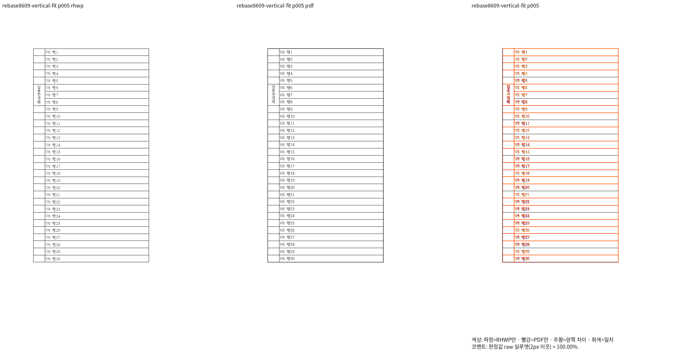
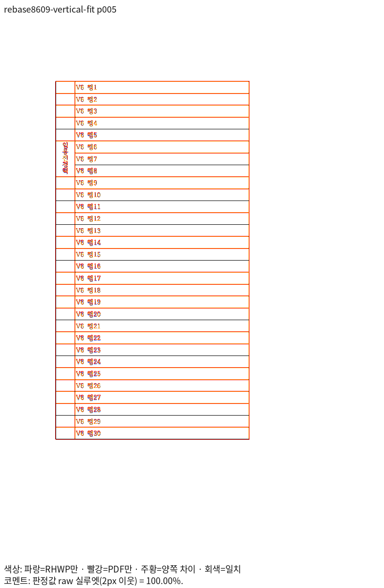

# 최신 리베이스 Native — 세로쓰기 마지막 글자 보존

제품 source `ba2ebfd34a4ebf402bce8e002254b672a09ef764`, 기준 base `f529dc92d4d172bf32390d7749743a45d9e41bfc`.
Native 실행 파일 SHA-256: `296a0d3f68dcb29f5bd91f3f5411bb78e42c53d04a51f526a3473281ba090cc6`.
실제 source는 검증 시작 때 고정한 4,694개 파일의 해시로 확인한다. 후속 문서 커밋과 구분한다.

| 입력 | 독립 기준 | 전체 쪽수·전쪽 최저 raw | 전쪽 TSV |
| --- | --- | --- | --- |
| [vertical_fit.hwpx](<../../../../../../samples/issue8470/vertical_fit.hwpx>) | [vertical_fit-2020.pdf](<../../../../../../pdf/issue8470/vertical_fit-2020.pdf>) | 5쪽·100.00000% | [Native TSV](../candidate/native/pr8475-vertical_fit-8a319181.tsv) |

원본 내용을 바꾸거나 한컴 2020 Print PDF를 재출력하지 않았다. 96 DPI·Print profile·
색상 경계 보정 전 2px raw다. 시각 측정은 시스템 글꼴을 사용했다. 최소 글꼴 Rust와 구분한다.

| 같은 입력의 5쪽 review | 같은 5쪽의 별도 overlay |
| --- | --- |
|  |  |

2026-11-05 KST에 위 두 이미지를 실제로 열어 직접 대조했다. 왼쪽 병합 칸의
`임용전경력` 다섯 글자가 한 세로줄로 모두 표시되고 칸 안에 포함된다.
V6 행 1~30의 순서·인접 셀·표 종료와 같은 5쪽 소속을 보존했다.
2px raw 100%는 선의 두께·색까지 완전한 픽셀 일치를 뜻하지 않는다. 표 선의
미세한 획 표현과 직접 판독 결과를 점수 통과와 구분한다.

fresh WASM의 최신 리베이스 출력과 최종 공통 검증은 아직 진행 중이다. 이 Native
기록만으로 전체 승인·통합 완료를 선언하지 않는다.

| 산출물 | SHA-256 |
| --- | --- |
| `../candidate/native/pr8475-vertical_fit-8a319181.tsv` | `651306476c87a371f9fe4a04366e2fc908ec9241fb4ab9918c6652f0cee0ac50` |
| `p005-review.png` | `67c2486b1c390e431a13ae586615a2fbfd197ebfadad554121181f5dd66c2ac0` |
| `p005-overlay.png` | `c1774cf136f0f03ae9326432db157e0332646abc22a48847d8eb200ade792714` |

원본 SHA-256: `6423c7d010e7333a0749119c2d06833f64fd88f5aa6814f2665c47430fd88c7a`.
독립 Print PDF SHA-256: `f714bb7909f44ec3eedfa9c3d7a0055180ed775f252ccf9b5a056efb093e446a`.

실제 대표 쪽 명령(저장소 루트):

```bash
/home/tsjang/rhwp/venv/bin/python scripts/visual_sweep.py --hwp samples/issue8470/vertical_fit.hwpx --pdf pdf/issue8470/vertical_fit-2020.pdf --key rebase8609-vertical-fit --rhwp-bin /home/tsjang/rhwp/output/pr-review/planet6897-20261103/rhwp-rebase8609-dda217dba0 --compat 2022 --dpi 96 --page-workers 1 --out /home/tsjang/rhwp/output/pr-review/planet6897-20261103/rebase8609-review/native --page 5
```

전쪽 TSV는 같은 제품의 `--silhouette-only --resume` 명령으로 먼저 생성했다.
실행 원장·원시 로그는 로컬 `output/pr-review/planet6897-20261103/`에 유지한다.
