# 최신 실제 Studio의 세로쓰기 소비 경로 검증

제품 source `ba2ebfd34a4ebf402bce8e002254b672a09ef764`. 최신 고정 WASM을 Vite alias로 연결했으며 제품 소스·기존 pkg/public 번들은 바꾸지 않았다.
같은 두 원본의 5쪽을 실제 Studio에서 화면 캡처했다. 각 표의 review와 별도 overlay를 2026-11-05 KST에 실제로 열었다.

- 브라우저: Chrome/156.0.8078.47. viewport 1280×900, 쪽 캡처 794×1123, 96 CSS DPI·DPR 1.
- Canvas2D와 CanvasKit compat/default software에서 screen·print 총 12개 캡처, 실제 backend 불일치·fallback·replay hard failure 0건, exit 0.
- 원래 baseline의 엄격한 RGB parity는 8개 대조 모두 기준을 넘었다. 이 진단을 통과로 바꾸지 않았다. 아래 독립 Print의 2px raw·직접 판독과 RGB 동일 여부를 구분한다.
- 시각 측정에 사용한 설치 글꼴 카탈로그의 실제 바이트를 공개 host font API로 공급했다. 1,906개 원 face 중 중복 PostScript 이름은 Fontconfig 선택으로 해소해 1,793개 face를 제공했다.
- 빈 문자열 별칭만 제거했으며 글꼴 파일·표시 임계값·assertion·제품 코드는 바꾸지 않았다. 설치 글꼴 프로그램은 제출하지 않는다.
- 실제 읽은 프로그램: `8664669bd2d6-HANBatang.ttf`·`seguiemj.ttf`·`NotoColorEmoji.ttf`. 공급 파일의 SHA는 원 카탈로그와 대조했다.
- 초기 글꼴 공급 누락·빈 별칭·중복 설치본의 실패 실행은 로컬 output에 별도로 보존했다. 실패한 Canvas2D fallback 화면을 CanvasKit 증거로 쓰지 않는다.

JS SHA-256 `bb9be9d806756697eddee5d185e80e9256bd0d97947d78a94777222100f12393`.
WASM SHA-256 `3a9125c0a3fa65e1ebbe45abfd0e2070248fbb96d1f5e083d6e3108baa62ed61`.
카탈로그 SHA-256 `a63fb6bc24eb457c3bf27579e0ce234601d191186289fd457634824eb93b2217`.

최신 패키지의 실제 초기화 요청과 원본 프로그램 해시를 기록했다. 원본·독립 PDF·전체 Native/WASM TSV는 [최신 영향 범위](vertical-cell-claims.md)에 연결한다.

## vertical-fit-p005 · 독립 Print 5쪽 ↔ 실제 Studio 5쪽

| Native Skia print | Studio Canvas2D print | Studio CanvasKit default software print |
| --- | --- | --- |
| 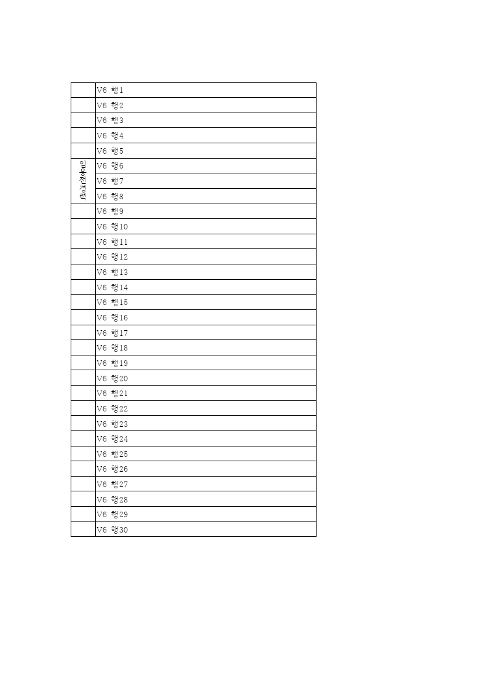 | 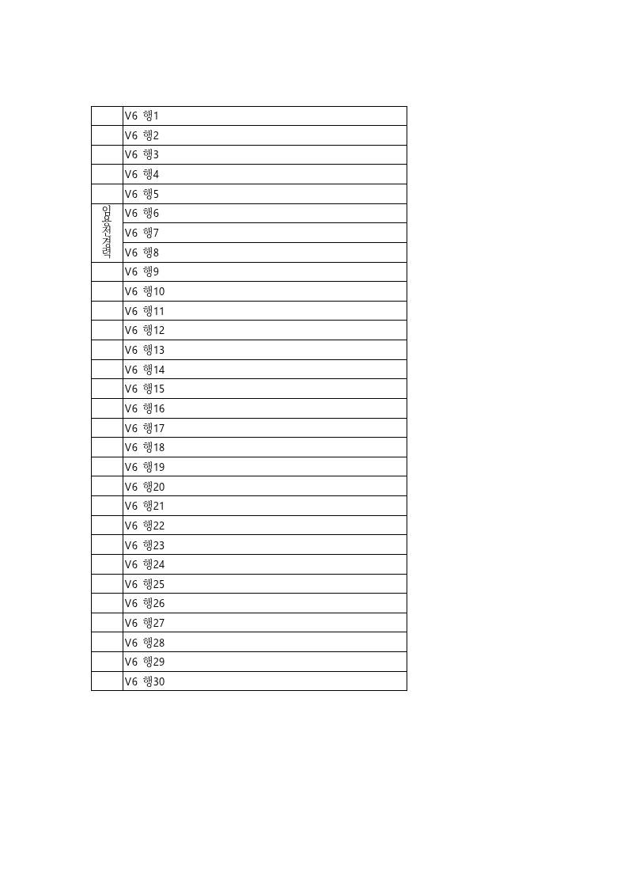 |  |

| 실제 Studio 출력 | 정밀 2px raw | review | 별도 overlay |
| --- | --- | --- | --- |
| canvas2d · print | 100.0% | 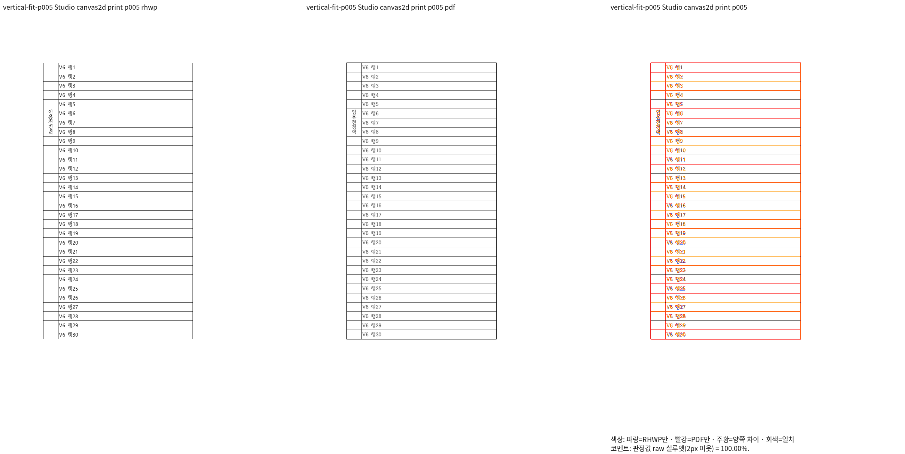 | 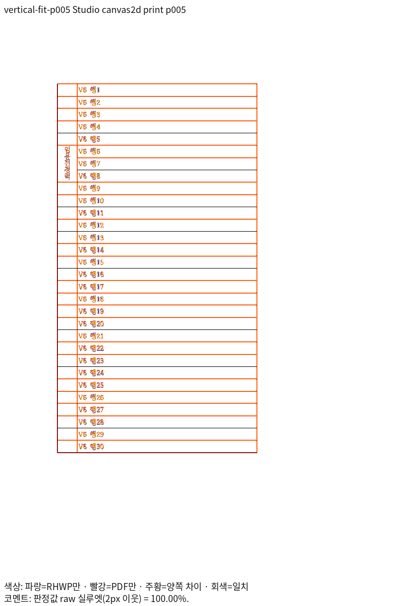 |
| canvaskit-default · print | 100.0% | 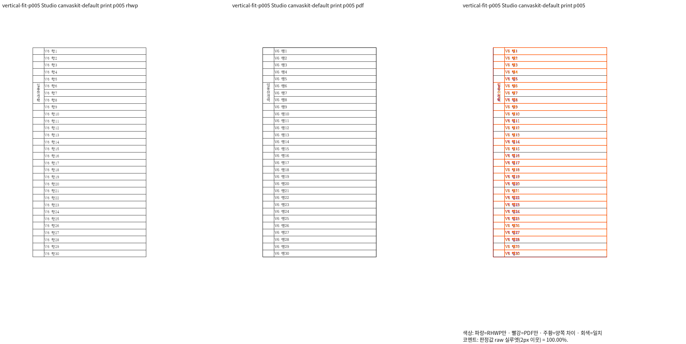 | 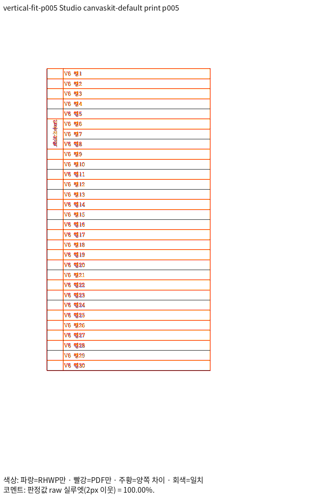 |

V6 행 1~30과 표 종료·인접 칸을 대조했다. 임용전경력 다섯 글자가 칸 안의 한 세로줄에 보존된다. 글꼴 획 윤곽·선 강도 차이는 남으며 raw 100.00% 표시를 RGB 완전 일치로 해석하지 않는다.

## vertical-oversize-p005 · 독립 Print 5쪽 ↔ 실제 Studio 5쪽

| Native Skia print | Studio Canvas2D print | Studio CanvasKit default software print |
| --- | --- | --- |
| 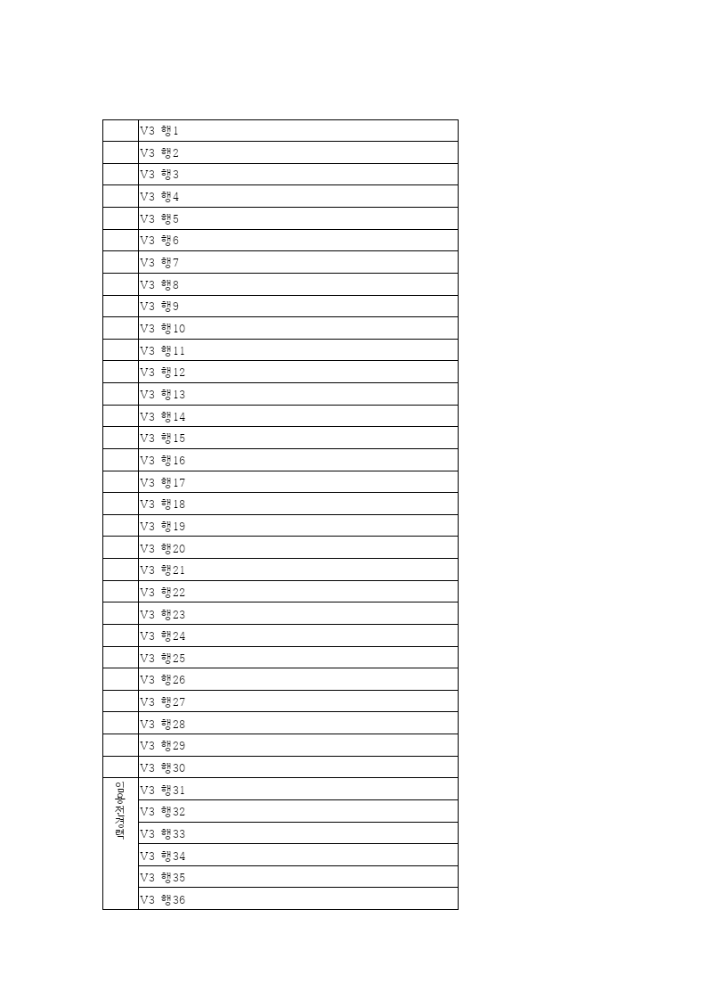 | 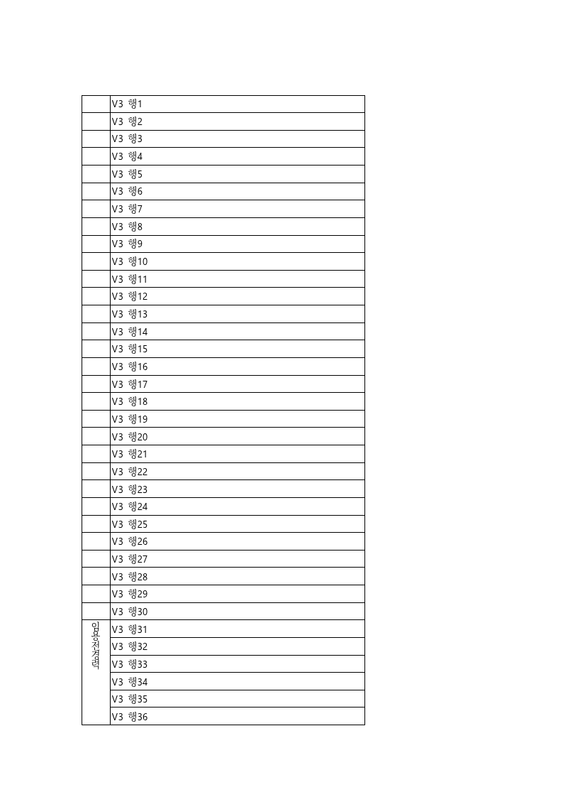 | 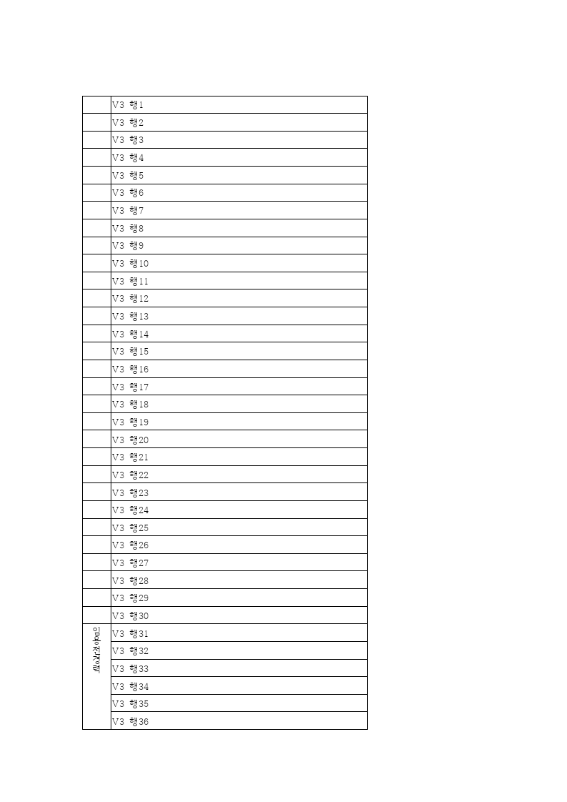 |

| 실제 Studio 출력 | 정밀 2px raw | review | 별도 overlay |
| --- | --- | --- | --- |
| canvas2d · print | 99.99761% | 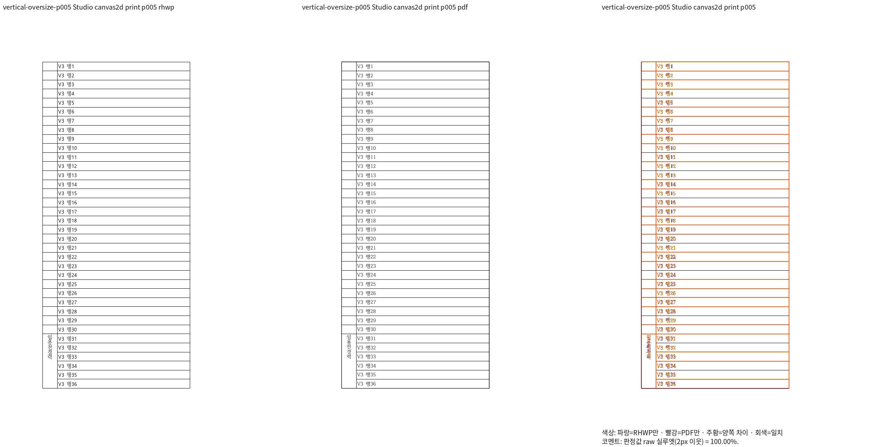 | 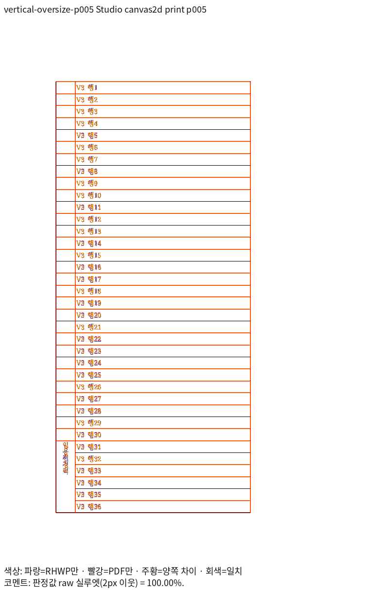 |
| canvaskit-default · print | 100.0% | 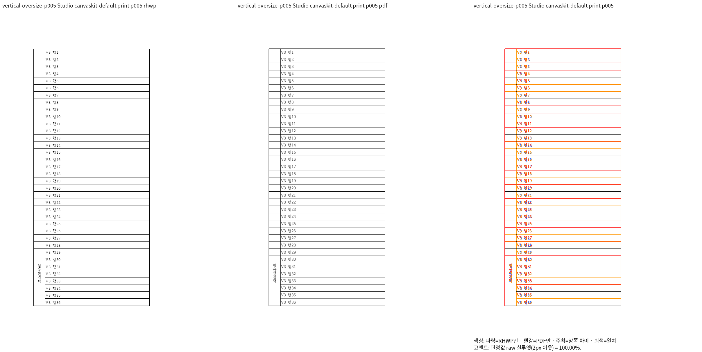 | 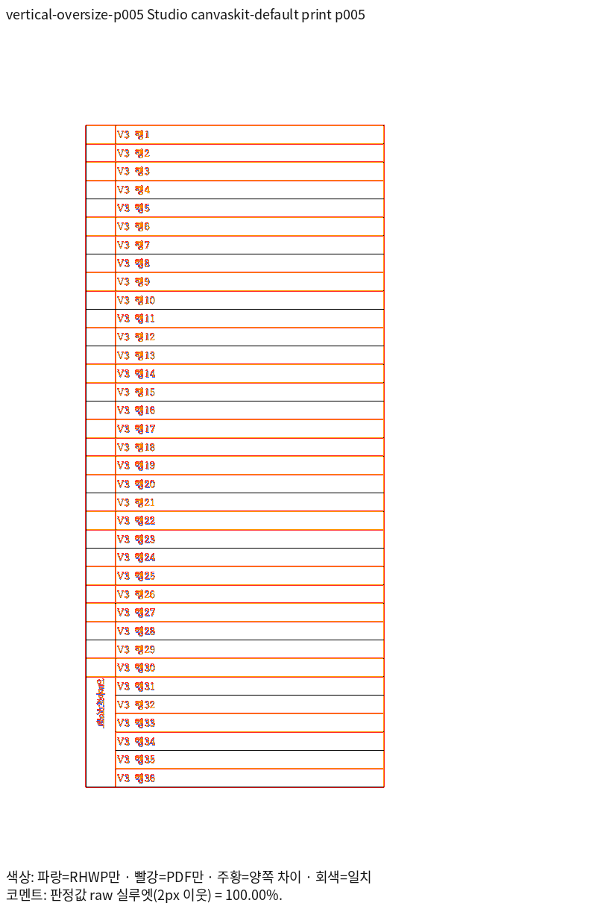 |

V3 행 1~36과 표 종료·인접 칸을 대조했다. 임용전경력 다섯 글자가 칸 안의 한 세로줄에 보존된다. 글꼴 획 윤곽·선 강도 차이는 남으며 raw 100.00% 표시를 RGB 완전 일치로 해석하지 않는다.

## 실행 재현과 범위

저장소의 `rhwp-studio/e2e/renderer-baseline.mjs`를 사용했다. 로컬 복사본은 import 경로와 초기화 직후 `window.rhwpStudio.fonts.setProvider(...)` 호출만 환경에 맞게 연결했으며 원 assertion·캡처 함수는 그대로 유지했다.
호스트는 `getSnapshot`으로 실제 설치 face 메타데이터를, `readFace`로 같은 revision의 프로그램 바이트를 공급한다. `fc-match`로 중복 설치본을 선택한 근거를 함께 보존했다.

실제 명령: `node /home/tsjang/rhwp/output/pr-review/planet6897-20261103/renderer-baseline-with-host-fonts.mjs --mode=headless --manifest=/home/tsjang/rhwp/output/pr-review/planet6897-20261103/studio-consumers-rebase8609/manifest.json --output=/home/tsjang/rhwp/output/pr-review/planet6897-20261103/studio-consumers-rebase8609 --profiles=screen,print --scope=representative --canvaskit-surface=software`.
실행 로그 SHA-256 `cf6c5e38d5561ed524c6181323eccb8290a42bf9d360f3db3fc05bdf3fcd63b4`.

로컬 실행기·중간 JSON·실패 로그는 output에만 둔다. 이 두 쪽의 실제 paint 확인을 Studio 전체 기능이나 전쪽 CanvasKit 일치로 확대하지 않는다.
