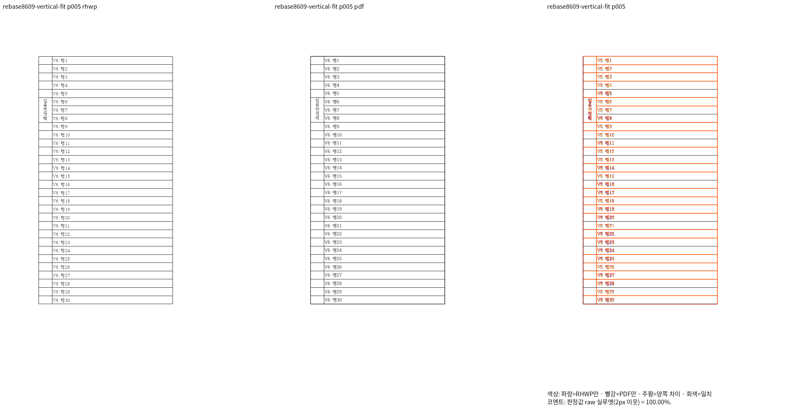
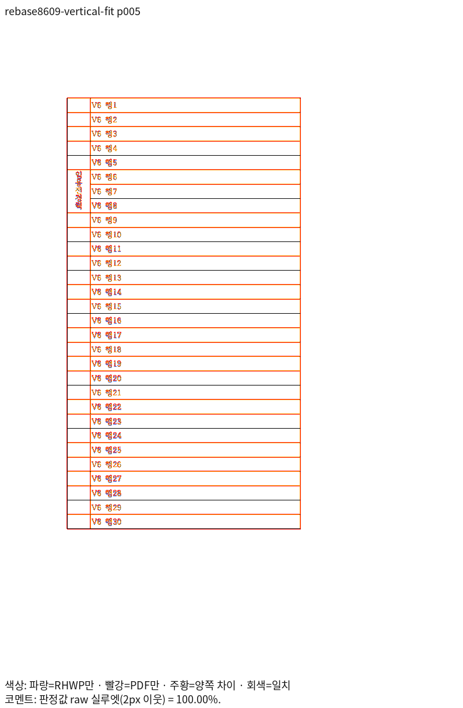
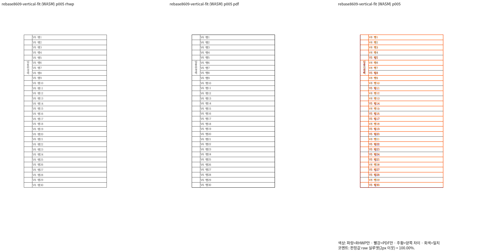
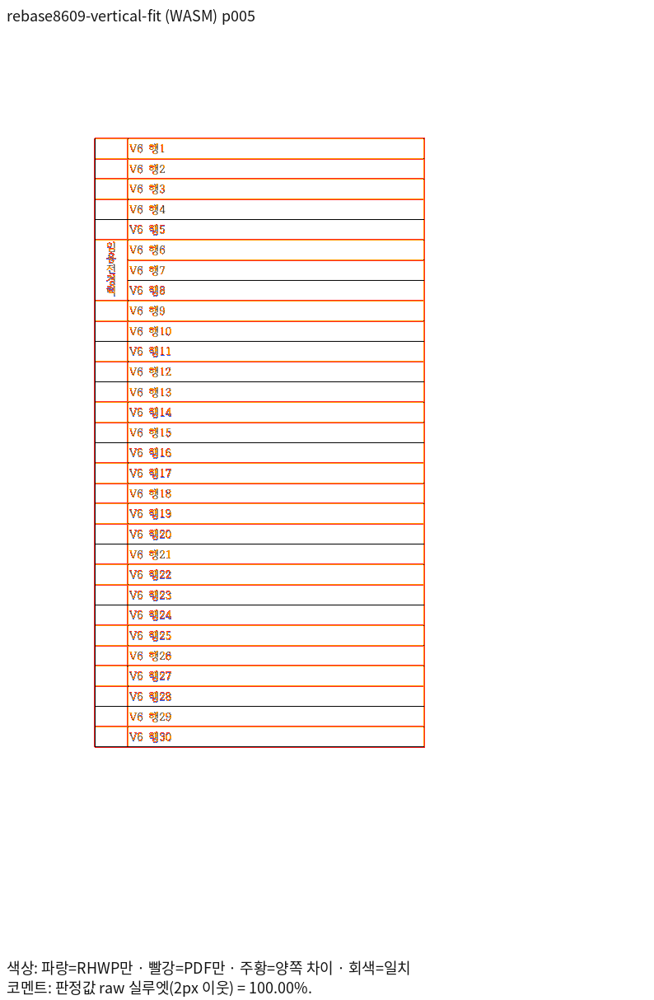
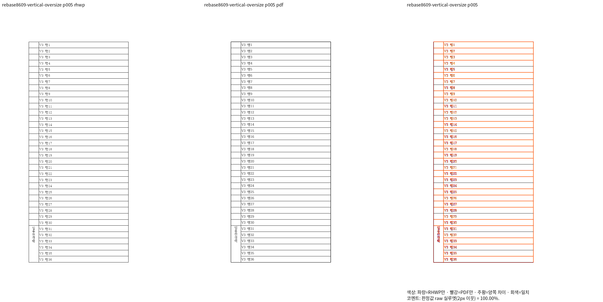
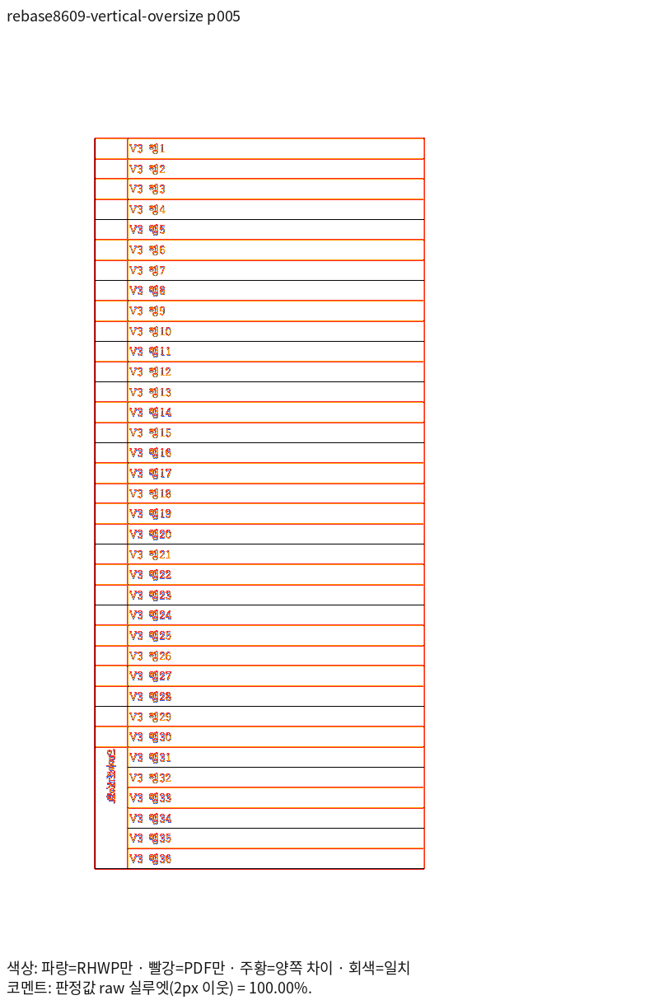
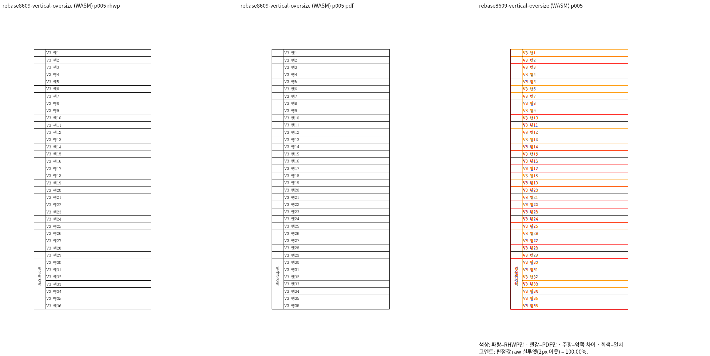
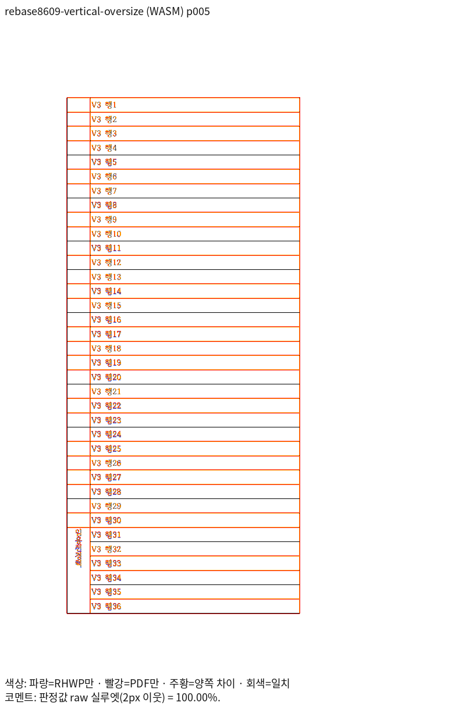

# PR #8475 최신 Native·fresh WASM 주장 쪽

제품 source `ba2ebfd34a4ebf402bce8e002254b672a09ef764`에서 같은 원본·기존 한컴 2020 Print를 비교했다.
두 문제 입력은 Native/fresh WASM 각각 전체 5쪽이 100.00%다. 표의 5쪽 마지막 글자 보존을
두 경로의 실제 review·별도 overlay에서 직접 확인했다. 2px raw 통과와 모든 획의 완전 일치를 구분한다.

[Native 10입력·43쪽](native-own-validation.md)과 [fresh WASM 10입력·43쪽](wasm-own-validation.md)은
모두 90% 이상이며 직전 후보 대비 정밀 raw 0.1%p 초과 하락 0쪽이다. 새 base 자체 대조·전체 Rust도 완료했다. [최종 code head CI](../code-head-ci-completion.md)까지 확인했다.

## vertical_fit.hwpx · 독립 PDF 5쪽 ↔ rhwp 5쪽

[원본](<../../../../../samples/issue8470/vertical_fit.hwpx>) · [독립 Print](<../../../../../pdf/issue8470/vertical_fit-2020.pdf>)

| 출력 | 전5쪽 TSV·최저 raw | 같은 5쪽 review | 같은 5쪽 overlay |
| --- | --- | --- | --- |
| Native | [TSV](candidate/native/pr8475-vertical_fit-8a319181.tsv) · 100.00% |  |  |
| fresh WASM | [TSV](candidate/wasm/pr8475-vertical_fit-8a319181.tsv) · 100.00% |  |  |

직접 판독: `임용전경력` 다섯 글자가 한 세로줄의 병합 칸 안에 남는다. V6 행 1~30, 인접 셀·표 종료·쪽 소속을 보존했다.

## vertical_oversize.hwpx · 독립 PDF 5쪽 ↔ rhwp 5쪽

[원본](<../../../../../samples/issue8470/vertical_oversize.hwpx>) · [독립 Print](<../../../../../pdf/issue8470/vertical_oversize-2020.pdf>)

| 출력 | 전5쪽 TSV·최저 raw | 같은 5쪽 review | 같은 5쪽 overlay |
| --- | --- | --- | --- |
| Native | [TSV](candidate/native/pr8475-vertical_oversize-30055ea5.tsv) · 100.00% |  |  |
| fresh WASM | [TSV](candidate/wasm/pr8475-vertical_oversize-30055ea5.tsv) · 100.00% |  |  |

직접 판독: `임용전경력` 다섯 글자가 한 세로줄의 병합 칸 안에 남는다. V3 행 1~36, 인접 셀·표 종료·쪽 소속을 보존했다.

수정 전 같은 검사 함수 2 FAIL·수정 후 2 PASS와 기존 대조 5 PASS는 [선행 실제 검출 기록](../pr_8475/vertical-axis-focused-37e5bba300.md)에 연결한다.
이 그림은 PR #8475의 해당 입력·쪽 증거다. 다른 원 PR이나 독립 Print가 다른 문서의 증거로 사용하지 않는다.
